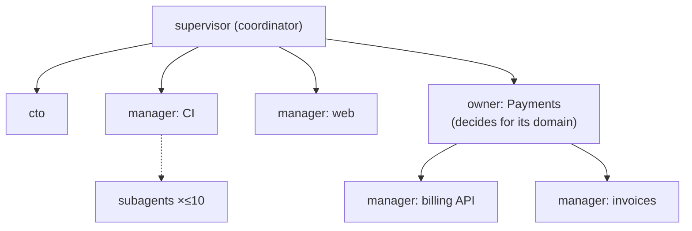

# Flatter agent trees, a coordinator/CTO split, parallel dispatch and spawn proposals

Tracking: RIG-6011 (parent RIG-6005). Rulings designed against (Matt, 2026-10-19 and
2026-10-20): coordination option B (separate coordinator and CTO agents), a flatter tree, about
ten subagents per Manager, and spawn proposals with evidence. This record builds on the role
taxonomy record (`compass-manager-role-taxonomy`, RIG-3066) and amends parts of it by citation.
Design only; no code ships with this record.

## Open Questions

Each question has options and a recommendation. Q1 and Q2 are load-bearing: T2 and T3 build the
CTO role from them. Q3 to Q5 change values the tasks set, so they are load-bearing too.

### Q1. After direct event delivery lands, do the coordinator and CTO stay separate?

Compass will deliver CI, Linear comment and PR-merge events to the owning agent. Routing work then
moves out of the coordinator's turns (see [Event delivery](#event-delivery-shrinks-the-coordinator)).

- **(a) Keep them separate.** The coordinator shrinks to routing, spawn bookkeeping and incident
  intake, and some of that may later move into server code. The CTO stays off the event path, so its
  context holds direction, priorities, design intake and the final review pass.
- **(b) Merge them once events are direct.** One root agent does both. This saves one standing
  session, but operational traffic comes back into the context that holds long-term direction.
- **(c) Make the CTO the root and the coordinator its child.** The judgment voice sits at the top of
  the tree. Every escalation then passes through the CTO's context, which is the traffic option B
  is meant to keep away from it.

**Recommendation: (a).** The split is cheap: one extra standing session, and the CTO is mostly idle.
The cost of merging is the problem option B solves. Revisit only if the coordinator's remaining
work is fully in server code and has no agent left.

### Q2. Where does the CTO sit, and what is its role label?

- **(a) A fourth role, `cto`, as a child of the root `supervisor`.** It has its own prompt, receives
  no routed issues or alerts, and has the final review pass and design intake (RIG-6010).
- **(b) A peer root.** A second root with no parent. Today's code allows it (`CreateAgent` with an
  empty parent creates a root), but `docs/concepts/agent-roles.md` says "There is always exactly one
  at the root", and the tree view would show two trees.
- **(c) An `owner` named "CTO".** No new role, but an `owner` prompt tells it to decompose and
  delegate a domain, which is the opposite of the CTO's job.

**Recommendation: (a).** A role selects a block-0 prompt, so a role with a different posture needs a
new label (`agent-roles.md`: "The prompt *is* the role's capability and posture"). Placing it as a
child keeps the one-root rule. Its parent edge means the coordinator can reach it by DM; the CTO
does not report work up to it.

### Q3. How is a spawn proposal approved?

The prompts today say: "propose it on your home channel, wait for a yes, then spawn"
(`config/skills/management-trees/SKILL.md`). Nothing in the server checks this.

- **(a) Keep it a prompt rule, and add the evidence format.** The proposer posts a proposal with
  fixed fields on its home channel; the operator answers there.
- **(b) The proposer's parent approves.** The parent Manager or CTO approves within an operator-set
  budget, and only proposals over that budget go to the operator.
- **(c) A server approval gate.** A new `ProposeSpawn` RPC records a pending proposal, and
  `agents_spawn_peer` fails unless an approved proposal matches.

**Recommendation: (a) now, with (c) as a later task.** The rulings ask for surfacing with evidence,
then spawn after approval; (a) delivers that with prompt and skill edits alone. (c) is the right
end state for an unattended tree, but it needs an approval surface in the UI, which RIG-6010's review
gate will also need. Sharing that surface is cheaper than building it twice. (b) widens who can grow
the tree before any cap exists (spawn quotas are deferred to RIG-1574).

### Q4. What parallelism target goes in the prompts?

- **(a) Up to 10 concurrent subagents per Manager, round-robin back over them.** This matches the
  ruling. The fleet settings pin `task.maxConcurrency: 10`.
- **(b) No number; tell the Manager to parallelise every independent slice.** The SDK default stays
  at 32.
- **(c) A number per role.** For example 10 for `manager`, 3 for `owner` and 1 for `supervisor`.

**Recommendation: (a), with the cap at 10 for every role.** The ruling names ten. A pinned setting
makes it a fact about the runtime, not a hope about the prompt, and it bounds per-container load. The
coordinator split already keeps upper tiers from doing implementation, so a per-role number adds
little.

### Q5. How flat is the default tree?

- **(a) Root `supervisor`, the `cto`, then lane `manager`s directly under the root. An `owner` only
  where a domain makes its own decisions.** Prompts and the skill teach this as the default shape.
- **(b) Keep today's default `supervisor → owner → manager` example, and add guidance against idle
  owners.**
- **(c) Remove the `owner` role.**

**Recommendation: (a).** It matches the ruling. Owners stay valid: the server already accepts any
role at any depth, and some domains do decide for themselves. Removing the role (c) would break the
existing role set (DL-new-A in the taxonomy record) for no gain.

## Problem / Intent

The running wave shows four problems, and Compass copies the wave's shape. First, coordinators
work through one task at a time, so a Manager with ten independent slices takes ten turns of
wall-clock time. Second, a lane that needs a new owner gets one only when someone notices. Third,
mid-tier owners sit idle between the root and the lanes. Fourth, one supervisor holds both routing
and long-term direction, and the routing traffic crowds out the direction.

This record designs the target tree shape, the coordinator/CTO split, parallel dispatch, and spawn
proposals. It also answers the RIG-6011 question of whether a worker's completion reaches its
Manager as an event or by polling.

## Approach

### Completion reaches the Manager as an event, not a poll

A worker is an in-process `task` subagent ("There is deliberately **no `worker` role**",
`docs/concepts/agent-roles.md`). Its completion stays inside the Manager's own session:

- **Async mode is on by default.** The SDK default for `async.enabled` is `true`
  (`config/settings-schema.ts` in `@oh-my-pi/pi-coding-agent` 18.0.11), and Compass's shipped
  `settings` overlay is empty (`config/profiles/default/profile.yml`: "settings: … {}").
- **A finished job is pushed into the session.** `AgentSession.#deliverAsyncJobResult` enqueues the
  result on the yield queue as an `async-result` entry. The registration comment says: "completions
  for jobs this agent owns are injected into THIS session's run as async-result follow-ups".
- **An idle Manager wakes.** `YieldQueue` schedules an idle flush when the session is not streaming
  (`#scheduleIdleFlush`), and the flush injects the result as a new turn.

So the Manager loop the prompt describes already works without polling
(`config/prompts/manager/SYSTEM.md`: "dispatch subagents -> end turn -> resume"). A prompt change is
enough for parallel dispatch; no transport change is needed.

A **standing child Manager** is different. `agents_spawn_peer` returns once the server has
provisioned and started the child (`lifecycleService.SpawnAsAccount` in `go/server/lifecycle.go`).
Its later work reaches the parent only as an explicit DM report. Lifecycle changes
(`AGENT_SESSION_STATE_STOPPED`, `AGENT_SESSION_STATE_ERRORED`) go to the event stream and presence
(`Hub.deliverSession` in `go/internal/runnerhub/hub.go`), not to the parent. A child that crashes
therefore goes silent until the parent pulls `compass_roster` or `compass_tree`. T5 closes that gap
with a system-sender notice to the parent.

### Parallel dispatch

The `manager` prompt already calls the Manager "a COORDINATOR, not a typist", and
`management-trees` already says "Keep parallel subagents on non-overlapping file zones". Neither
says how many workers to run, so the agent runs one at a time. The change:

- The three role prompts and `management-trees` gain one rule: dispatch every independent slice at
  once, up to 10 concurrent subagents (Q4). Above 10, queue the rest and start one as each finishes.
- Every parallel worker gets its own jj workspace. The Compass `jj` skill already teaches this
  ("Workspaces — one per parallel subagent", `config/skills/jj/SKILL.md`).
- The fleet settings document `settings/config.yml` pins `task.maxConcurrency: 10`. The bundle door
  admits that member (`settingsMember` in `go/cmd/compass/bundle.go`), and the agent loads it as a
  read-only overlay (`readMountedSettingsPath` in `packages/compass-agent/src/config-reader.ts`).
- The `supervisor` and `cto` dispatch mostly to the tree, not to subagents, so the cap rarely binds
  for them.

### The tree shape

- **`supervisor`** stays the one root. It routes, handles incidents and spawn bookkeeping, and is the
  operator's first contact.
- **`cto`** (new, Q2) is the root's child. It has no lane and receives no routed work. It holds
  direction and priorities, takes design intake, and does the final review pass (RIG-6010).
- **`manager`**s hang directly under the root by default.
- **`owner`**s are used only where a domain makes its own decisions, such as its own design
  records, priorities or operator. An owner that only forwards work adds a hop with no judgment, and
  the guidance says not to create one.

The server needs no change for this shape. Any role may parent any role
(`lifecycleService.SpawnAsAccount` checks only `store.IsManagerRole`), and owners already nest
freely.

### Event delivery shrinks the coordinator

Matt expects direct event delivery to remove most routing turns: CI, Linear comment and PR-merge
events go to the agent that owns the PR or issue. When it lands, the coordinator's remaining work is
intake of unowned issues, incidents, spawn bookkeeping and operator first contact. This record does
not design event delivery; it fixes the role boundary so that delivery can land without moving the
CTO. Q1 decides what happens to the coordinator afterwards.

### Spawn proposals

Every tier proposes a spawn when a lane needs a new owner or manager. The proposal states the
evidence. Under Q3 (a), it is a home-channel post with these fields, and the skill gives a template:

| Field | Content |
| --- | --- |
| Proposed node | role, name by function, persona summary, parent |
| Evidence | open issues in the area and their age, queue depth, the longest wait, and how many unrelated issues the proposer currently holds |
| Cost | one standing session and container |
| Alternative | rebalance inside the subtree, or leave the work where it is |

The trigger to propose is any of: issues in an area wait longer than a day, the proposer holds work
across two or more unrelated areas, or a domain has started making its own decisions. These
thresholds are prompt guidance; Q3 (c) would move them into a server check.

### Alternatives considered

- **A single root that does both routing and direction (option A).** Matt ruled option B.
- **Raising parallelism with more standing Managers instead of subagents.** Each standing node
  costs a handle and a container. DL-134 rejects per-implementer containers.
- **A transport change for worker completion.** It is not needed, because completion is already
  pushed (above).

## Global Constraints

- The role set grows from three to four (`supervisor`, `owner`, `manager`, `cto`) only if Matt picks
  Q2 (a). `store.IsManagerRole` stays the single server check.
- Role prompts live at `config/prompts/<role>/SYSTEM.md`; a new role needs a prompt before the server
  accepts it, or the agent boots on the default prompt.
- Workers stay in-process `task` subagents (DL-134). This record adds no worker tree nodes.
- No new usage-billed resource. One extra standing session for the `cto`; no new metrics.
- Prompt text follows the existing prompts' style: imperative and short.

## Plan

### T1 — Parallel dispatch in prompts and settings `[config]`

- Add the dispatch rule (Q4) to `config/prompts/{supervisor,owner,manager}/SYSTEM.md` and the
  "Scope the subagent" section of `config/skills/management-trees/SKILL.md`.
- Add `config/settings/config.yml` with `task.maxConcurrency: 10`.
- **Interfaces:** consumes the bundle `settingsMember`; produces no API.
- **Test:** a config-materialize test asserts the setting reaches the overlay
  (`cli.config-passthrough.test.ts` already covers `settings/config.yml`).

### T2 — The `cto` role `[compass-server + config]`

- Add `cto` to `managerRoles` in `go/internal/store/types.go`; update the `CreateAgentRequest.role`
  and `SpawnPeerRequest.role` proto comments to list four roles.
- Add `config/prompts/cto/SYSTEM.md`: no lane, no routed work, owns direction, priorities, design
  intake and the final review pass; reports to the operator on its home channel.
- **Interfaces:** `store.IsManagerRole("cto") == true`; the spawn and create paths accept it.
- **Test:** the existing role-validation tests gain a `cto` case; an unknown role still fails.

### T3 — Tree-shape guidance and the concepts doc `[docs + config]`

- Rewrite the default example in `management-trees` to the Q5 shape, and add "don't create an
  owner that only forwards".
- Update `docs/concepts/agent-roles.md` with the four roles and the coordinator/CTO split.
- **Interfaces:** none.

### T4 — Spawn-proposal template `[config]`

- Add the proposal fields and triggers to `management-trees` and the three prompts' approval lines.
- **Interfaces:** none (Q3 (a)).

### T5 — Child lifecycle notice to the parent `[compass-server]`

- When a standing child's session reaches `AGENT_SESSION_STATE_ERRORED` or
  `AGENT_SESSION_STATE_STOPPED` without a despawn, post a system-sender (DL-191) message on the
  parent/child DM. The parent then wakes on a normal delivery.
- **Interfaces:** consumes `Hub.deliverSession` lifecycle transitions; produces one message per
  transition on the existing DM channel.
- **Test:** a runnerhub test drives `ERRORED` for a parented child and asserts one message on that
  DM; a despawned child produces none.

## Tasks

- [ ] T1 — Parallel dispatch rule plus `task.maxConcurrency: 10`
- [ ] T2 — `cto` role and prompt (after Q1, Q2)
- [ ] T3 — Tree-shape guidance and concepts doc (after Q5)
- [ ] T4 — Spawn-proposal template (after Q3)
- [ ] T5 — Child lifecycle notice on the parent DM

## Ledger delta

- **DL-643:** a worker's completion reaches its Manager as an async-result push; parallel dispatch
  needs prompt and settings changes only.
- **DL-644:** Managers dispatch independent slices in parallel, up to 10 concurrent subagents.
- **DL-645:** coordination splits into a `supervisor` coordinator and a separate `cto`.
- **DL-646:** a standing child's unexpected stop or error posts a system-sender notice on its
  parent DM.
