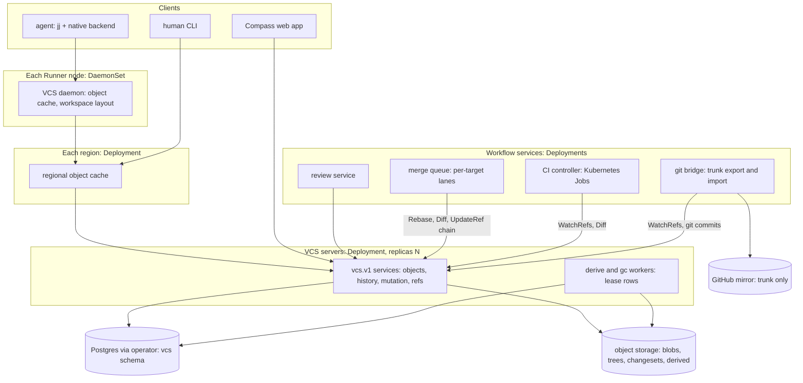

# The native VCS: overview

Tracker: RIG-5665

> Freezes on merge; later changes supersede by citation, never rewrite
> (convention: the `docs/designs/agent/compass-agent-config-delivery/design.md`
> header). Unless a path says otherwise, every path is in
> [RigelBuild/compass](https://github.com/RigelBuild/compass).

Ledger-impact: DL-580 files D1. This set replaces the deleted
`internal-vcs.md` record; DL-578, DL-579 and DL-581 now point at
[store](store.md#decisions). The RIG-5558 decisions (DL-535..DL-538,
DL-561) and DL-090 and DL-326 stay whole: they govern the git backend.

**Named decisions this record introduces:** D1 in [Decisions](#decisions).

## Open Questions

Cross-record questions. Each record keeps its own.

### OQ-1 (R2-1) — Is the native VCS split out of Compass?

Load-bearing for placement, not for design. Pending with Matt in RIG-5821. Not decided
here. The set is built so a split is cheap: its own proto package
(`vcs.v1`), its own Postgres schema and tenant GUC, its own object keys,
and Compass as a client through `api.Principal`
([store](store.md#tenancy-and-the-split-product)). If Matt splits it, this
directory moves to its own surface.

### OQ-2 (R2-2) — What is it called?

Pending with Matt in RIG-5821. Not
decided here. Every record says "the native VCS" and invents no name. No
binary, package or flag carries a product name until Matt rules
([store](store.md) OQ-5).

### OQ-3 — Which client do agents run? (load-bearing for `client.md`)

- (a) jj with a custom backend that speaks `vcs.v1`. jj's backend is
  pluggable (its `cli/examples` include `custom-backend` and
  `custom-working-copy`), and agents already know jj.
- (b) A new client and daemon of our own.

**Recommendation: (a)**, decided in `client.md`. The store's
changeset carries jj's 16-byte change id so either client fits.

### OQ-4 — Where do conflicts live?

Shared by store, review and
merge-queue. **Recommendation:** the store never keeps a conflicted
changeset; conflicts are typed results ([store](store.md) OQ-7).

### OQ-5 — Which tenant model in a single-tenant deployment?

**Recommendation:**
one tenant row, created at boot, as Compass does today. The tenant column
and RLS stay on, so a deployment can add tenants with no migration.

## Rulings

Matt, 2026-10-18 (docs#48 threads). These are fixed.

> 1. A full Scion implementation: many Servers and many Runners. The single
>    Server is only for dogfooding. Mirror Scion as closely as possible.
> 2. The git mirror carries trunk only. Changes under review are never
>    mirrored. No "PR" and no branches unless a reason exists. Scion is the
>    reference; Twigg, Piper, Critique and jj inspire the UI and workflow.
> 3. Review is Critique/Twigg/jj: changes stack freely into DAGs, and CI
>    uses the graph.
> 4. No GitHub egress for agents on a fully native repo. GitHub mirroring is
>    for migrating repos and for public visibility. The Compass repo stays
>    fully mirrored.
> 5. Two backends. RIG-5558 (`agent-vcs-tools.md`) ships whole for repos on
>    git and GitHub. The native VCS is a second backend, picked per repo
>    behind the agent `vcs_*` tools.
> 6. No length cap; split into files as needed.
> 7. CI/CD is designed alongside, on Kubernetes.
> 8. The product may split out with its own name (RIG-5821 R2-1, R2-2).
> 9. A merge queue (2026-10-18): batching, bisection, stacks as units,
>    per-affected-target lanes instead of a global lock, server-side
>    auto-rebase, and a cheap-model fixer for trivial conflicts; a
>    non-trivial conflict ejects the change.

## Problem / Intent

Compass agents keep history in git and land work through GitHub. That ties
every agent to a forge, a clone and a push credential, and it scales the
way git does. Matt ruled for a Scion-style VCS that Compass runs itself.
This record is the map of that set: goals, terms, components, how it sits
beside the git backend, and the order of work.

### Goals

- A server that owns history: it stores changesets, builds trees, commits,
  rebases, merges and answers history queries
  ([Scion](https://www.anthropic.com/engineering/redesigning-source-control):
  "the server answers questions about file history and blame, creates
  commits, performs merges and rebases").
- Many stateless servers and tiered caches over immutable objects.
- Review over a DAG of changes with versions, not branches.
- CI that reads the graph and the diff API, and a merge queue without a
  global lock.
- Trunk exported to GitHub as derived git commits, and git history
  imported.
- Tenancy, per-directory ACLs and enforced caps from the first release.

### Non-goals

- Replacing the git backend. RIG-5558 ships unchanged (ruling 5).
- Git wire compatibility. No clone, fetch or push of a native repo over
  the git protocol; the GitHub mirror is the git view.
- Mirroring changes under review (ruling 2).
- Naming the product or deciding the split (OQ-1, OQ-2).
- Managed-service operations. The boundary test is the
  [OSS-core boundary record](../meta/oss-core-managed-boundary/design.md#boundary-test).

## Approach

### Glossary

| Term | Meaning | Follows |
| -- | -- | -- |
| changeset | An immutable entry in history: ordered parents, a change id, and changed paths against the first parent with content ids. | Scion's changeset; Mononoke Bonsai |
| blob | File content, named by SHA-256 of its bytes. | REAPI digest |
| tree | A derived, content-addressed directory node; never uploaded. | Mononoke manifests; git tree |
| ref | A name and a target changeset, moved only by compare-and-swap. Few exist. | Scion ("a compare-and-swap on a single Spanner row") |
| trunk | The repo's main ref. It moves forward only, and each changeset on it has a dense `trunk_seq`. | Scion main; Piper head |
| change | A unit of work across rewrites, named by a 16-byte change id. Not an object. | jj ("only the change ID does") |
| version | One uploaded state of a change; a new version on each rewrite. | Twigg ("Increased by 1 on rebases, amends, msg changes and submits") |
| stack | The DAG of changes a change depends on, reviewed and landed as a graph. | Critique, Twigg, jj |
| workspace | One working copy over a repo, sparse and optionally virtual, owned by a client. | jj workspace; CitC |
| derived data | A value computed from a changeset and its parents' values, cached forever. | Scion ("defined recursively"); Mononoke `DerivableType` |

### Component map



- **Server tier.** Stateless `vcs.v1` servers, `compass-server --vcs-only`
  as a Deployment with `replicas: N`, behind one Service. Postgres and
  object storage are operator-provided, as the
  [Kubernetes record](../server-on-kubernetes.md#design) requires today.
- **Cache tier.** A regional cache Deployment answers reads by id from
  memory and disk, and asks the servers on a miss. Scion: "When a cache is
  missing an object, it asks the authoritative scion-servers".
- **Daemon tier.** One daemon per Runner node (DaemonSet) keeps a bounded
  object cache and lays out workspaces for the sessions on that node.
- **Client tier.** Agents run jj with a native backend inside the session;
  the web app and humans call the API directly.
- **Workflow tier.** Review, merge queue, CI and git bridge are clients of
  `vcs.v1` with service subjects. None holds history of its own.

### Two backends behind the `vcs_*` tools

The agent `vcs_*` tools (RIG-5558, `createVcsTools` in the agent's
`vcs.ts`) stay the one tool surface. Each repo has a backend:

- **git** (default): the RIG-5558 path, unchanged. Local jj over git, the
  Server's mirror, GitHub PRs, `forge_*` tools.
- **native**: jj with the native backend. `vcs_submit` uploads a new
  version of each change; review, CI and the merge queue run in Compass;
  trunk reaches GitHub only through the git bridge.

The backend is a property of the repo, read by the Server when it grants
a repo to an agent (`AgentRepositoryService`). One session can hold repos
on both backends; each tool call routes by the repo it names. An agent on
a native repo has no `github.com` egress (ruling 4). A repo moves to native
once: import, a freeze of the git backend for that repo, then the switch
(`git-bridge.md`). The tool names and arguments are kept, so
the prompt and skill change only where the review words differ.

### Record index and work order

| Record | Owns | Depends on |
| -- | -- | -- |
| [store](store.md) | Changeset format, blobs, Postgres metadata and ref CAS, derived data, server-side commit, rebase and merge, the `vcs.v1` API, tenancy, ACLs, scaling, gc, caps | — |
| `client.md` | Object protocol, daemon and regional cache, sparse and virtual checkout, jj native backend, `vcs_*` tools on native | store |
| `review.md` | Change, version, stack DAG, threads, approvals, attention, landing, web UI | store |
| `ci-cd.md` | Triggers from ref and version events, presubmit, postsubmit milestones, culprit finding, affected targets, engine, deploy | store, review |
| `merge-queue.md` | Batching, bisection, stacks as units, per-target lanes, auto-rebase, conflict fixer and ejection | store, review, ci-cd |
| `git-bridge.md` | Trunk export to GitHub, git history import, per-repo cutover | store |

Work order: store S1–S8 first, because every record reads its entities.
Client and git-bridge start next, in parallel; git-bridge registers the
git-commit `Deriver` (store S9). Review follows client. Ci-cd follows
review. The merge queue comes last, since it composes review state, CI
results and the store's `Rebase` and chained `UpdateRef`.

### Decisions

- **D1 — DL-580.** Two backends sit behind one agent `vcs_*` tool surface,
  chosen per repo: the RIG-5558 git backend ships unchanged for repos on
  GitHub, and the native VCS serves native repos, where agents have no
  GitHub egress and only trunk is mirrored to GitHub as derived git
  commits.

## Plan

### Global Constraints

- **Public repo.** No operator names, private product detail, or links to
  private records. Tracker ids stay plain text.
- **No product name** until RIG-5821 R2-2 rules. Write "the native VCS".
- **Split-ready.** `go/internal/vcs` imports nothing from Compass
  packages; Compass reaches it through `vcs.v1` and `api.Principal`.
- **RIG-5558 is frozen.** No change to its proto fields, its mirror, its
  migrations or its decisions.
- **Caps.** Every usage-billed component states its cap per layer, a
  budget alert that pages Matt, and spend-cap rows, in the record that
  enables it.

### O1 — Sibling records

Write client, review, ci-cd, merge-queue and git-bridge against
[store](store.md#api-the-vcsv1-connect-package). Each cites store entities
and RPCs by name and adds none to `vcs.v1` without a store supersession.

Interfaces: `vcs.v1` services `RepoService`, `ObjectService`,
`HistoryService`, `MutationService`, `RefService`, as frozen in store.

### O2 — Backend selection

A per-repo backend field on the Compass side, read by the agent tools.
Designed in client and git-bridge; this record fixes only the rule (D1).

Interfaces:

```proto
// compass.v1 (designed in client.md)
enum RepoBackend { REPO_BACKEND_UNSPECIFIED = 0; REPO_BACKEND_GIT = 1; REPO_BACKEND_NATIVE = 2; }
```

## Tasks

- [ ] O1 — client, review, ci-cd, merge-queue and git-bridge records
- [ ] O2 — per-repo backend selection behind the `vcs_*` tools
- [ ] Store S1–S11 ([store](store.md#tasks))
