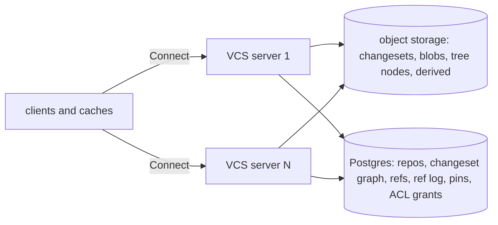

# The native VCS: store and server

Tracker: RIG-5665

> Freezes on merge; later changes supersede by citation, never rewrite
> (convention: the `docs/designs/agent/compass-agent-config-delivery/design.md`
> header). Unless a path says otherwise, every path is in
> [RigelBuild/compass](https://github.com/RigelBuild/compass).

Ledger-impact: DL-578, DL-579 and DL-581 file D1–D3. They replace the
decisions of the deleted `internal-vcs.md` record, which made a git mirror
the store. DL-535, DL-090, DL-326 and DL-561 stay whole: they govern the git
backend, and this record designs the native backend only
([overview](README.md), ruling 5).

**Named decisions this record introduces:** D1–D3 in [Decisions](#decisions).

Length: Matt lifted the length cap for this set (ruling 6 in the
[overview](README.md#rulings)). The prose sits mostly in Approach, which
freezes the formats every sibling record builds on.

This record owns the entities and RPCs the sibling records share:
`client.md`, `review.md`, `ci-cd.md`, `git-bridge.md` and `merge-queue.md`
in this directory (written after this record). The
[overview](README.md) holds the glossary and the component map.

## Open Questions

The record is written against each recommendation. OQ-3 depends on OQ-1.
OQ-7 is shared with review and merge-queue.

### OQ-1 — Which content hash? (load-bearing)

- (a) **SHA-256.** Every tier has it in its standard library: Go
  `crypto/sha256`, Bun, and browser WebCrypto. Go runs it on native
  instructions ([Go 1.21 notes](https://go.dev/doc/go1.21): "SHA-224 and
  SHA-256 operations now use native instructions when available when
  GOARCH=amd64, providing a performance improvement on the order of 3-4x").
  Remote build caches key blobs the same way
  ([REAPI](https://github.com/bazelbuild/remote-apis/blob/main/build/bazel/remote/execution/v2/remote_execution.proto):
  `SHA256 = 1;`), so CI can share blobs with a build cache unchanged.
- (b) **BLAKE2b-256**, as Mononoke uses for Bonsai ids. Go has it only in
  `golang.org/x/crypto`. WebCrypto has no BLAKE family, so a browser needs
  a library.
- (c) **BLAKE3.** Fastest in software. No dependency in the Go module today,
  and no standard-library support in any tier.

**Recommendation: (a) SHA-256.** Hash speed is not the bottleneck; object
storage and the network are. The win is one id that the build cache, the
browser and every client compute with no new dependency. Git ids (SHA-1)
stay derived data in `git-bridge.md`.

### OQ-2 — Which metadata database? (load-bearing)

- (a) **Postgres ≥16**, provided by the operator, as Compass needs today
  ([k8s D3](../server-on-kubernetes.md#resolved-decisions)). On Kubernetes
  the reference operator is CloudNativePG (Apache-2.0). RLS, `xid8`, and
  LISTEN/NOTIFY are already in use or available. One primary bounds write
  throughput.
- (b) **CockroachDB.** It scales writes across nodes. From v24.3 it ships
  under the CockroachDB Software License, and the free tier is
  ["throttled after 7 days without sending telemetry"](https://www.cockroachlabs.com/docs/stable/licensing-faqs).
  That fits badly with an AGPL-3.0 product that operators self-host.
- (c) **FoundationDB** (Apache-2.0). Strict serializable and fast, but
  ["Transaction size cannot exceed 10,000,000 bytes of affected data"](https://apple.github.io/foundationdb/known-limitations.html)
  and transactions end after five seconds. It is one more stateful system
  to run, and no Compass code speaks it.

**Recommendation: (a) Postgres.** The hot writes are small: one row per
changeset, one row per ref move. Content never enters the database. The
metadata layer sits behind the `meta` package interfaces (S3), so a later
move to (b) or (c) replaces one package, not the API.

### OQ-3 — Which canonical encoding is hashed? (load-bearing; depends on OQ-1)

Protobuf bytes cannot be hashed
([protobuf.dev](https://protobuf.dev/programming-guides/serialization-not-canonical/):
"Protobuf serialization is not (and cannot be) canonical").

- (a) **Deterministic CBOR** ([RFC 8949 §4.2.1](https://www.rfc-editor.org/rfc/rfc8949#section-4.2.1),
  "Core Deterministic Encoding Requirements") with integer keys. Go has
  `fxamacker/cbor` (MIT, `CoreDetEncOptions()`); TS has `cborg`. New
  optional keys keep old ids stable.
- (b) A hand-written length-prefixed binary format. No dependency, but each
  client language reimplements it and its evolution rules.

**Recommendation: (a)**, with strict decoding: a decoder re-encodes and
rejects any input whose bytes differ. Test vectors in the repo (S1) bind
every implementation.

### OQ-4 — May a reader fetch a blob by id alone? (security)

A blob id names content, not a path. A reader without access to a
restricted directory could ask for a guessed id and learn that the content
exists.

- (a) Id reads (`GetBlobs`, `ReadBlob`) need read on the whole repo.
  Readers with partial access use path reads (`GetTrees`, `GetFiles`),
  which check the ACL for each path.
- (b) All reads go by path. Caches lose cheap id lookups.
- (c) Key blobs per ACL scope. Restricted content stops deduplicating, and
  moving a file across scopes copies it.

**Recommendation: (a).** Most repos have no read-narrowing ACL, so most
readers keep id reads. A partial reader never gets an id oracle.

### OQ-5 — One binary or two?

- (a) `compass-server` gains `--vcs-only`, which mounts only the native VCS
  services and skips the Runner and session wiring. One image serves both
  roles.
- (b) A new binary. It needs a name, and the product name is pending
  (R2-2 in the [overview](README.md#open-questions)).

**Recommendation: (a).** It reuses the Server image and publish lane, and
invents no name. A split moves `go/internal/vcs` and adds a binary then.

### OQ-6 — Retention defaults

Trunk history is kept forever. The question is how long an unpinned
changeset lives (an abandoned upload, a dropped rebase candidate).

- (a) 7 days after creation.
- (b) 30 days.

**Recommendation: (a) 7 days**, set per deployment. Review versions and
workspaces hold pins, so a live change never depends on this window.

### OQ-7 — Does the store keep conflicted changesets? (shared with review and merge-queue)

- (a) No. The store refuses a conflicted tree. `Rebase` and `Merge` return
  a typed conflict and write nothing. The client (jj) keeps conflicts
  locally, and the merge queue hands the conflict to its fixer or ejects.
- (b) Yes, as jj does: a tree is a `Merge<TreeId>`, and conflicts can be
  committed and shared.

**Recommendation: (a).** Trunk and the git mirror can never hold a
conflict, and every reader sees plain trees. (b) can be added later as a
new changeset field without changing old ids.

## Problem / Intent

Compass agents today keep history in git and land work on GitHub. Matt ruled
for a full Scion-style VCS with many Servers (ruling 1). This record designs
its store and server: the changeset format, the blob and metadata stores,
the ref compare-and-swap, derived data, server-side commit, rebase and
merge, and the Connect API that every client and sibling record calls.

The model is Scion
([Redesigning source control](https://www.anthropic.com/engineering/redesigning-source-control)):
"Client-server asymmetry. In git, every client is capable of being a
full-fledged server. In Scion, the server answers questions about file
history and blame, creates commits, performs merges and rebases".

## Approach

### Ground truth

- **Server and auth.** `compass-server` serves Connect v2
  (`connectrpc.com/connect/v2`). Callers authenticate through
  `BearerInterceptor` and `ServiceBearerInterceptor`
  (`go/internal/auth/interceptor.go`, `go/internal/auth/service_door.go`).
  Both resolve a `store.Subject{Kind, ID, Tenant}`
  (`go/internal/store/types.go`).
- **Tenancy.** Every tenant table carries `tenant_id` with
  `FORCE ROW LEVEL SECURITY` and a `tenant_isolation` policy on the GUC
  `compass.tenant_id`. `go/internal/store/tenant_tx.go` sets it with
  `SET LOCAL` under the `compass_app` role; `WithSystemRole` switches to
  `compass_system` (BYPASSRLS).
- **Object storage.** `NewS3ObjectStore(cfg S3Config)`
  (`go/internal/store/objectstore.go`) wraps minio-go and runs against
  Garage, R2, MinIO and AWS S3. The e2e suite has a Garage fixture
  (`go/e2e/garage_fixture.go`).
- **Codegen.** `buf.gen.yaml` has `clean: true` and fences internal protos
  with `exclude_paths`. Each output tree has one template, because a clean
  run wipes the tree.
- **Deployment.** The Kubernetes record runs one Server with
  `replicas: 1` and `Recreate`
  ([server-on-kubernetes](../server-on-kubernetes.md#design)). Postgres ≥16
  is provided by the operator (k8s D3).

### Shape: immutable content, transactional coordination

The store has two halves, as Scion has. Immutable objects (changesets,
file content, tree nodes, derived values) are named by their hash and live
in object storage. Any tier can cache them forever: "Every request is for a
specific object that never changes, so any cache can answer it". Mutable
state (refs, pins, the ref log, ACL grants, quotas) lives in Postgres and
changes only inside a transaction.

Creating a changeset never takes a lock and never touches a ref. Moving a
ref is a compare-and-swap on one row. Scion: "no packfiles to accept, no
locking or cross-server coordination, and no refs to move around… moving
one is a compare-and-swap on a single Spanner row that happens separately
from creating changesets." The object store is never the ref authority.



### Ids and encoding (OQ-1, OQ-3)

- An **id** is 32 bytes: SHA-256 of the object's canonical bytes. The wire
  carries `bytes` of length 32. Text forms are lowercase hex.
- A **blob id** is SHA-256 of the raw file bytes, with no header. A build
  cache digest of the same file is the same hash.
- Changesets and tree nodes are encoded as deterministic CBOR (RFC 8949
  §4.2.1) with small integer map keys. The decoder re-encodes and rejects
  any input that is not byte-identical. That makes "same content, same id"
  hold across Go and TS.
- A **domain tag** prefixes the hashed bytes of each structured kind:
  `"cs1\0"` for a changeset, `"tree1\0"` for a tree node. A blob that holds
  a valid changeset encoding can never collide with a changeset id.
- Every id on the wire travels with its size where one exists
  (`size_bytes`), as REAPI digests do.

### Changeset

The changeset is the unit of history, as in Scion ("the unit of work is a
“changeset,” an entry in a write-ahead log") and Mononoke Bonsai
([bonsai.thrift](https://github.com/facebook/sapling/blob/79071c2a3ea20c36ed71332608535e5801101bba/eden/mononoke/mononoke_types/serialization/bonsai.thrift):
"Bonsai Changeset is the fundamental commit object of Mononoke's internal
representation"). It stores the changed paths and their content ids. It
never stores a tree.

```text
Changeset (CBOR map, keys in this order; hashed as "cs1\0" ‖ bytes)
  1  parents      [id]            ordered; parents[0] is the diff base; [] is a root
  2  change_id    bytes(16)       stable across rewrites (jj CHANGE_ID_LENGTH = 16)
  3  author       Signature
  4  committer    Signature
  5  message      text            UTF-8
  6  changes      map<path, FileChange | null>   sorted by path bytes; null = delete
  7  extra        map<text, bytes>  optional; absent when empty
Signature  { 1 name: text, 2 email: text, 3 time_unix_ms: int, 4 tz_offset_min: int }
FileChange { 1 kind: 0 file | 1 executable | 2 symlink, 2 content: id, 3 size: uint,
             4 copy_from: { 1 path: text, 2 parent: uint } (optional) }
```

Rules, all checked at intake:

- **Tree rule.** `tree(cs) = apply(tree(parents[0]), changes)`. A root
  changeset applies to the empty tree. A merge lists every path whose
  merged result differs from `parents[0]`. So a tree is always derivable
  from one parent and the changes, with no merge logic.
- **Parent order is hashed.** Bonsai: "Parents are stored and hashed
  ordered. This matches Git". Two orders are two changesets.
- **Paths.** UTF-8, `/`-separated, no empty, `.` or `..` component, no NUL,
  at most 4,096 bytes. Bonsai's prefix rule holds: "There is no distinction
  between added and modified files", and "A deleted path may be a prefix of
  changed paths and means a file was replaced by a directory. Otherwise,
  path conflicts are not allowed".
- **Content exists.** Each `content` id names a blob already stored in the
  repo, with the stated `size`.
- **No conflicts** are stored (OQ-7). A changeset's tree is plain.
- **`extra`** carries keys the git bridge needs to round-trip an imported
  commit (for example a GPG signature). Keys are namespaced (`git.gpgsig`).
  The store does not interpret them.

A changeset has no tree id, no version, and no review state. The root
tree id is derived (below) and kept on the changeset's row. Review
versions group changesets by `change_id` (`review.md`).

### Blobs

A blob is file content. Object keys are per repo:
`<tenant>/<repo>/b/<hex>`. Per-repo keys give up dedup across repos. They
buy a simple repo delete (one prefix) and no cross-repo existence oracle.

- A blob of at most 4 MiB is one object.
- A larger blob is stored as 4 MiB chunks, each a blob in its own right,
  plus a chunk list at `<tenant>/<repo>/b/<hex>.chunks`. The client
  uploads missing chunks, then calls `PutChunkedBlob`. The server streams
  the chunks, hashes them in order, and stores the list only if the whole
  hash matches. An interrupted upload resumes by asking `FindMissingBlobs`
  for the chunks.
- An object body starts with one format byte: `0` raw, `1` zstd
  (`klauspost/compress`, already a dependency). The server compresses only
  when that saves at least 10%. Ids are always of the raw bytes.
- A `vcs.blobs` row records each stored blob (repo, id, size, chunk count,
  created time). `FindMissingBlobs` answers from Postgres, not from object
  HEADs. The row is written only after the object PUT succeeds.
- `max_file_bytes` is a per-repo setting, default 100 MiB. A repo with a
  git mirror cannot raise it, because "GitHub blocks files larger than
  100 MiB"
  ([GitHub docs](https://docs.github.com/en/repositories/working-with-files/managing-large-files/about-large-files-on-github)).

### Trees

A tree node is derived, never uploaded. It is a sorted list of entries:

```text
TreeNode (CBOR array of entries, sorted by name bytes; hashed as "tree1\0" ‖ bytes)
Entry { 1 name: text, 2 kind: 0 file | 1 executable | 2 symlink | 3 tree,
        3 id: id, 4 size: uint }   size of a tree = sum of its file sizes
```

Nodes are content-addressed objects at `<tenant>/<repo>/t/<hex>`. A
changeset rewrites only the nodes on the paths it changes, so one commit
writes O(changed paths × depth) nodes. The entry `size` lets a virtual
file system list a directory without fetching blobs.

### Metadata database (OQ-2)

Postgres holds the changeset graph and all mutable state, in its own
schema `vcs`, with its own migration set and its own tenant GUC. Content
never enters it. Each tenant table carries `tenant_id` and the Compass RLS
pattern (`ENABLE` and `FORCE ROW LEVEL SECURITY`, policy
`tenant_isolation`), keyed on `vcs.tenant_id` instead of
`compass.tenant_id`.

```sql
-- go/internal/vcs/meta/migrations/0001_vcs.sql (sketch; every table gets RLS)
CREATE SCHEMA vcs;
CREATE TABLE vcs.tenants (id TEXT PRIMARY KEY, quota_bytes BIGINT NOT NULL DEFAULT 0);
CREATE TABLE vcs.repos (
  tenant_id TEXT NOT NULL DEFAULT current_setting('vcs.tenant_id', TRUE)
    REFERENCES vcs.tenants (id) ON DELETE RESTRICT,
  id BIGINT GENERATED ALWAYS AS IDENTITY,
  name TEXT NOT NULL,                       -- "owner/name", as AgentRepositoryService
  trunk_ref TEXT NOT NULL DEFAULT 'trunk',
  max_file_bytes BIGINT NOT NULL DEFAULT 104857600,
  quota_bytes BIGINT NOT NULL,
  retention_days INT NOT NULL DEFAULT 7,
  stored_bytes BIGINT NOT NULL DEFAULT 0,
  log_seq BIGINT NOT NULL DEFAULT 0,        -- last ref-log entry
  trunk_seq BIGINT NOT NULL DEFAULT 0,      -- last trunk position
  deleted_unix_ms BIGINT,
  created_unix_ms BIGINT NOT NULL,
  PRIMARY KEY (tenant_id, id), UNIQUE (tenant_id, name));
CREATE TABLE vcs.changesets (
  tenant_id TEXT NOT NULL DEFAULT current_setting('vcs.tenant_id', TRUE),
  repo_id BIGINT NOT NULL,
  id BYTEA NOT NULL CHECK (length(id) = 32),
  change_id BYTEA NOT NULL,
  p1 BYTEA,                                 -- parents[0]; NULL for a root
  parent_count SMALLINT NOT NULL,
  generation BIGINT NOT NULL,               -- 1 + max over all parents
  p1_depth BIGINT NOT NULL,                 -- length of the first-parent chain
  skip BYTEA,                               -- first-parent ancestor at GetSkipHeight(p1_depth)
  root_tree BYTEA NOT NULL,
  acl_root BYTEA,                           -- ACL manifest; NULL = no ACL files
  trunk_seq BIGINT,                         -- position on trunk; NULL off trunk
  encoded_bytes INT NOT NULL,
  created_unix_ms BIGINT NOT NULL,
  PRIMARY KEY (tenant_id, repo_id, id));
CREATE TABLE vcs.changeset_parents (tenant_id TEXT, repo_id BIGINT, child BYTEA,
  ord SMALLINT, parent BYTEA, PRIMARY KEY (tenant_id, repo_id, child, ord));
CREATE INDEX changeset_children ON vcs.changeset_parents (tenant_id, repo_id, parent);
CREATE TABLE vcs.blobs (tenant_id TEXT, repo_id BIGINT, id BYTEA, size_bytes BIGINT,
  chunks INT NOT NULL DEFAULT 0, stored_bytes BIGINT, last_seen_unix_ms BIGINT,
  PRIMARY KEY (tenant_id, repo_id, id));
CREATE TABLE vcs.refs (tenant_id TEXT, repo_id BIGINT, name TEXT, target BYTEA NOT NULL,
  version BIGINT NOT NULL, updated_unix_ms BIGINT, PRIMARY KEY (tenant_id, repo_id, name));
CREATE TABLE vcs.ref_log (tenant_id TEXT, repo_id BIGINT, log_seq BIGINT, name TEXT,
  old_target BYTEA, new_target BYTEA, chain BYTEA[], subject TEXT, reason TEXT,
  at_unix_ms BIGINT, PRIMARY KEY (tenant_id, repo_id, log_seq));
CREATE TABLE vcs.pins (tenant_id TEXT, repo_id BIGINT, holder TEXT, changeset BYTEA,
  expires_unix_ms BIGINT, PRIMARY KEY (tenant_id, repo_id, holder, changeset));
CREATE TABLE vcs.grants (tenant_id TEXT, repo_id BIGINT, subject TEXT, role SMALLINT,
  PRIMARY KEY (tenant_id, repo_id, subject));
CREATE TABLE vcs.derived (tenant_id TEXT, repo_id BIGINT, kind SMALLINT, changeset BYTEA,
  value BYTEA, PRIMARY KEY (tenant_id, repo_id, kind, changeset));
CREATE TABLE vcs.derive_cursors (tenant_id TEXT, repo_id BIGINT, kind SMALLINT,
  log_seq BIGINT, lease_token TEXT, lease_until_unix_ms BIGINT,
  PRIMARY KEY (tenant_id, repo_id, kind));
CREATE TABLE vcs.path_touches (tenant_id TEXT, repo_id BIGINT, path TEXT, trunk_seq BIGINT,
  PRIMARY KEY (tenant_id, repo_id, path, trunk_seq));
CREATE TABLE vcs.git_commits (tenant_id TEXT, repo_id BIGINT, changeset BYTEA,
  git_commit BYTEA CHECK (length(git_commit) = 20),
  PRIMARY KEY (tenant_id, repo_id, changeset), UNIQUE (tenant_id, repo_id, git_commit));
```

The sketch elides `NOT NULL`, the `tenant_id` default and the foreign keys
on the later tables; the migration has them all. Repos have a numeric id,
so a rename moves no object. Object keys use the numeric id.

### Refs and the ref log

A ref is a name and a target changeset. Scion keeps refs few ("global
state that every server has to agree on is a looming scaling problem"), and
so does this store. A repo has its trunk ref and optional `release/*`
refs. Review heads, workspaces and merge-queue candidates are not refs;
they hold **pins** instead, so gc keeps their changesets.

- **Names** match `^[a-z0-9][a-z0-9._/-]{0,199}$`.
- **Protected refs** are the trunk ref and `release/*`. They move only
  forward along the first-parent chain, and only for a subject with the
  `land` role (the merge queue, admins).
- **The CAS.** `UpdateRef` names the expected target. One statement
  decides it:

```sql
UPDATE vcs.refs SET target = $new, version = version + 1, updated_unix_ms = $now
 WHERE tenant_id = $t AND repo_id = $r AND name = $name AND target = $expected
 RETURNING version;
```

  Under READ COMMITTED a second writer blocks on the row, then "The search
  condition of the command (the WHERE clause) is re-evaluated to see if the
  updated version of the row still matches"
  ([Postgres docs](https://www.postgresql.org/docs/current/transaction-iso.html)).
  So exactly one of two racing writers wins. The loser gets zero rows and a
  typed `current` result, not an error.
- **Batch advance.** `UpdateRef` may carry a `chain`: an ordered list of
  changesets where `chain[0].parents[0]` is the expected target, each next
  entry's `parents[0]` is the one before it, and the last is the new
  target. The server checks the chain from immutable rows before the
  transaction, then moves the ref once. The merge queue lands a whole batch
  with one CAS. Without a chain, the server walks the first-parent chain
  from the new target back to the expected one (at most 10,000 steps, else
  `INVALID_ARGUMENT` asking for a chain).
- **In the same transaction** the server bumps `vcs.repos.log_seq`, writes
  one `vcs.ref_log` row, and, for the trunk ref, gives each chain entry the
  next `trunk_seq`. The repo row lock orders ref-log entries, so the log is
  gapless. The transaction ends with `pg_notify('vcs_ref', …)`, which
  Postgres delivers only on commit ("not delivered until and unless the
  transaction is committed",
  [NOTIFY](https://www.postgresql.org/docs/current/sql-notify.html)).
- **`trunk_seq`** is a dense position on trunk: 1 for the first trunk
  changeset, then +1 for each. CI milestones, bisection and the git bridge
  use it as "the n-th trunk changeset".
- **`WatchRefs`** streams ref-log entries after a given `log_seq`. NOTIFY
  is only a wake-up; the stream reads rows, so a reconnecting consumer
  resumes from its last seq and misses nothing.

### Derived data

Derived data follows Scion: "Each type of derived data is defined
recursively, so its value for a changeset is computed from its values for
that changeset’s parents." Mononoke has the same model
([`derivable_type.rs`](https://github.com/facebook/sapling/blob/main/eden/mononoke/mononoke_types/src/derivable_type.rs),
"Enum which consolidates all available derived data types"). A derived
value is a pure function of immutable inputs, so two servers that derive
the same value write the same bytes. No lease guards a derivation; an
in-process singleflight stops duplicate work in one replica, and
`INSERT … ON CONFLICT DO NOTHING` absorbs a cross-replica race.

Each kind has a mode:

- **Eager** kinds are derived at intake, before the changeset row commits.
  A changeset without them is never visible.
- **On-trunk** kinds are derived when trunk advances. A worker per
  (repo, kind) reads the ref log from `vcs.derive_cursors.log_seq`, under
  a lease row like `LeaseForgeMirror`
  (`go/internal/store/forge_mirrors.go`). Any replica can hold the lease.
- **Lazy** kinds are derived on first read and memoized.

| Kind | Mode | Value | Used by |
| -- | -- | -- | -- |
| Root tree | Eager | tree node objects; root id in `vcs.changesets.root_tree` | every read, `Diff`, client checkout |
| Commit graph | Eager | `generation`, `p1_depth`, `skip` columns | `MergeBase`, `Log`, ancestry checks |
| ACL manifest | Eager | ACL node objects; root id in `acl_root` | every ACL check |
| Path index | On-trunk | `vcs.path_touches` rows | `PathHistory` on trunk |
| Git commit | On-trunk, mirrored repos only | `vcs.git_commits` rows | `git-bridge.md` export |
| Content meta | Lazy, per blob | `{is_binary, is_utf8, lines, git_sha1}` object | `Diff`, `Blame`, git bridge |
| Blame | Lazy, per (changeset, path) | range list object | `Blame` |

- **Trees.** `tree(cs)` applies `cs.changes` to `tree(parents[0])` and
  writes only the nodes on changed paths.
- **Commit graph.** `generation` prunes ancestry walks. `skip` is the
  Bitcoin skip pointer on the first-parent chain
  ([`chain.cpp`](https://raw.githubusercontent.com/bitcoin/bitcoin/master/src/chain.cpp)
  `GetSkipHeight`: `return (height & 1) ? InvertLowestOne(InvertLowestOne(height - 1)) + 1 : InvertLowestOne(height);`),
  so "ancestor at depth d" takes O(log n) steps. Mononoke keeps the same
  skip-tree parent.
- **ACL manifest.** Mononoke's `AclManifests` is the model
  ([`acl_manifest/derive.rs`](https://raw.githubusercontent.com/facebook/sapling/main/eden/mononoke/derived_data/acl_manifest/derive.rs):
  "Only `.slacl` file changes (explicit + implicit deletes) are fed to
  `derive_manifest`; unchanged subtrees are reused automatically"). A
  changeset that touches no ACL file copies its parent's `acl_root`.
- **Path index.** For each trunk changeset, one row per changed path and
  per ancestor directory of it. `PathHistory` on a trunk changeset is one
  index range scan. Off trunk, it walks the first-parent chain until it
  reaches a trunk changeset, then uses the index.
- **Git commit.** The store owns the slot and the table. The
  `git-bridge.md` record owns the derivation (git trees and commits from
  changesets, with `extra` keys for round-trip fields).
- **Blame.** Lazy, as Mononoke's blame: `blame(cs, path)` is
  `blame(parents[0], path)` moved through the line diff, with new lines
  assigned to `cs`. The value is stored at a key derived from
  `(changeset, path)`, so no row is needed.
- **Adding a kind** later is one `Deriver`. A backfill runs it over trunk
  from the oldest unrecorded `trunk_seq`.

### Intake

`CreateChangesets` takes canonical encodings, parents before children.
For each, in order:

1. Decode, re-encode, and compare bytes. Check path and size rules.
2. Check that every parent is stored or earlier in the batch. Otherwise
   `FAILED_PRECONDITION`, with the missing ids in the error detail.
3. Check that every blob is stored, with `SELECT … FOR SHARE` on its row,
   and touch `last_seen_unix_ms`. Otherwise `FAILED_PRECONDITION` with the
   missing digests.
4. Check write ACLs for every changed path (below).
5. Derive the eager kinds and PUT their objects, then PUT the changeset
   object.
6. In one transaction, insert the changeset row and its parent rows with
   `ON CONFLICT DO NOTHING`.

Intake is idempotent: the same bytes give the same id and no new row.
Intake takes no lock beyond its own row inserts and the blob share locks.
A crash after step 5 leaves objects with no row; gc removes them.

### Server-side commit, rebase and merge

Scion's server "creates commits, performs merges and rebases". So does
this one. These calls let a thin client (an agent, the web app, the merge
queue) change history with no local repo.

- **`Commit`** takes parents, file changes whose content is already
  stored, a message and an optional change id. The server builds the
  changeset, then runs intake.
- **`Rebase`** takes a set of changesets (any shape, up to 1,000) and an
  `onto`. Every parent outside the set is replaced by `onto`. Each
  changeset is rewritten in topological order: the new changes are a
  three-way merge of each path, with the old `parents[0]` tree as the base,
  the new `parents[0]` tree as the destination, and the old changeset's
  tree as the source. Change id, author and message are kept. The
  committer is the caller, at server time. With `drop_empty`, a rewritten
  changeset with no changes is dropped and its children take its parent.
  This drops a change that trunk already holds.
- **`Merge`** takes two or more parents and merges each path against the
  merge base. With more than one best merge base, every path that differs
  between the bases is a `MULTIPLE_BASES` conflict. The store does not
  merge criss-cross histories implicitly.
- **Conflicts are results, not errors.** A conflict is
  `Conflict{changeset, paths[]}`. Each `PathConflict` has a kind, the
  file versions as jj orders them, and hunks. jj's `Merge<T>`
  ([`lib/src/merge.rs`](https://github.com/jj-vcs/jj/blob/9ff73e7f/lib/src/merge.rs))
  "Alternates between positive and negative terms, starting with
  positive". So `adds` has n entries and `removes` has n−1. For a rebase,
  `adds = [destination, source]` and `removes = [base]`. Each hunk carries
  the destination line range and the text of each term. A binary file has
  no hunks.
- **Nothing conflicted is stored** (OQ-7). On a conflict, `Rebase`
  returns the rewrites that came before it. Those are stored, unpinned
  changesets; the caller pins the ones it keeps. `Merge` writes nothing.
- **The text merge** is in-house (`go/internal/vcs/textdiff`): a histogram
  line diff and a three-way line merge. The Go module has no diff
  dependency today, and the conflict shape above is the store's own. A file
  is binary when its first 8 KiB holds a NUL byte, as git decides.

### Per-directory ACLs

ACLs live in the tree, as Mononoke's `.slacl` files do. A file named
`.vcsacl` in a directory sets the ACL for that directory and everything
under it, down to the next `.vcsacl`. It is JSON:

```json
{ "read": ["role:read"], "write": ["account:acct_1", "role:admin"] }
```

- A missing `read` or `write` key inherits that list from the enclosing
  scope. The repo grants (`vcs.grants`) are the outermost scope.
- An entry is `account:<id>`, `service:<name>`, or `role:<role>`, which
  matches any subject holding that repo role or a higher one. `admin`
  always passes.
- **Write.** Every changed path needs write in its scope under
  `parents[0]`'s ACL manifest and under the trunk head's. Changing,
  adding or deleting `<dir>/.vcsacl` needs write in the scope that encloses
  `<dir>`, never the file's own scope. A `land` subject passes write checks
  for `Rebase` and `Merge`, because those reapply changes already checked
  at intake.
- **Read.** A path read (`ReadTree`, `ReadFile`, `Diff`, `Blame`,
  `PathHistory`) needs read in the path's scope under the changeset's ACL
  manifest and under the trunk head's. A denied read answers `NOT_FOUND`,
  never `PERMISSION_DENIED`, so it does not confirm the path exists.
  `Diff` and `ReadTree` leave out denied entries.
- **Id reads** need read on the whole repo: no `.vcsacl` narrows read for
  the caller (OQ-4). A malformed `.vcsacl` fails intake with
  `INVALID_ARGUMENT` naming the path.
- Protected paths, such as a mirrored repo's `.github/workflows/`, use
  this same mechanism: a `.vcsacl` there grants write to named humans only.

### Tenancy and the split product

Tenancy is OSS-core capability, framed as the
[boundary record](../meta/oss-core-managed-boundary/design.md#boundary-test)
asks: the public single-tenant product compiles and runs it. Compass's
product rule is
[self-host and managed](https://github.com/RigelBuild/compass/blob/main/docs/concepts/self-host-and-managed.md).
This record restates neither.

- Every `vcs` row carries `tenant_id`, under RLS on `vcs.tenant_id`.
  `meta.(*Meta).InTenant` sets it with `SET LOCAL`, as
  `go/internal/store/tenant_tx.go` does. GC and derive workers use a
  BYPASSRLS role, as `WithSystemRole` does.
- Every object key starts with the tenant id: `<tenant>/<repo id>/…`.
- The tenant comes from the authenticated subject, never from a request
  field. The API reads one `api.Principal` from the context. In Compass,
  an adapter fills it from `BearerInterceptor` (an account, with its
  tenant) or `ServiceBearerInterceptor` (a `store.Subject` of kind
  `SubjectService`).
- `vcs.tenants` is the native VCS's own table. Compass calls
  `meta.(*Meta).EnsureTenant` when it creates a tenant. If the native VCS
  splits out (R2-1), it keeps its schema, GUC and object keys; only the
  `api.Principal` adapter changes.

### Horizontal scaling

Ruling 1 asks for many Servers. The native VCS server keeps no state of its
own. Every write goes to Postgres or object storage, so any replica answers
any call.

- **Role.** `compass-server --vcs-only` (OQ-5) mounts only the native VCS
  services. It holds no Runner sessions, so it runs as a Deployment with
  `replicas: N` and `RollingUpdate`. The combined Compass Server keeps the
  Kubernetes record's `replicas: 1` until that record changes.
- **Object cache.** Each replica keeps an in-process LRU of immutable
  objects keyed by `(tenant, repo, id)`, bounded by `--vcs-cache-bytes`
  (default 1 GiB). An entry is never invalidated, because its key names its
  content.
- **HTTP caching.** Every read by id is marked
  `option idempotency_level = NO_SIDE_EFFECTS;`, so Connect serves it over
  GET ([Connect docs](https://connectrpc.com/docs/go/get-requests-and-caching/):
  "Handlers will automatically support GET requests using this option").
  Those responses carry
  `Cache-Control: private, max-age=31536000, immutable`. The regional
  cache and the per-node daemon are designed in `client.md`; they
  authenticate each caller for the repo before they answer from cache.
- **Read replicas.** `--vcs-read-dsn` sends immutable-row reads
  (changesets, parents, blobs, derived) to a Postgres replica. A miss falls
  back to the primary, because the replica can lag. Refs, pins and the ref
  log are read from the primary only.
- **Workers.** Derive and gc workers hold lease rows with a TTL and a
  token, as `LeaseForgeMirror` does. Any replica can take any lease.
- **Write ceiling.** Trunk advances serialize on one ref row per repo.
  Landing a batch with one `UpdateRef` keeps that row cold
  (`merge-queue.md`).

### GC and retention

- **Roots** are every ref target, every unexpired pin, and every changeset
  younger than the repo's `retention_days` (OQ-6). Trunk history is always
  reachable from the trunk ref, so it is kept forever.
- **Changesets.** A daily gc worker per repo marks every changeset reachable
  from a root through parent rows. It deletes the unmarked changeset rows,
  their derived rows, and then their objects. Rows go first, so a reader
  never finds a row whose object is gone.
- **Blobs.** A blob row is deleted when no live changeset names it and its
  `last_seen_unix_ms` is older than the retention window. The `DELETE`
  re-checks `last_seen_unix_ms` in its `WHERE`. An intake that touched the
  row (step 3) holds a share lock, so the delete waits and then skips the
  row. The object is deleted after the row's transaction commits.
- **Tree nodes and derived objects** are swept weekly: list the repo's
  `t/` and `d/` prefixes, keep every node reachable from a live root tree
  or newer than the retention window, delete the rest.
- **Repo delete** sets `deleted_unix_ms`. After 30 days a worker deletes
  the repo's rows and its object prefix. `CreateRepo` refuses the name
  until then.
- **Ref log** rows are kept forever. They are small, and they are the
  audit trail of every trunk move.

### Caps and spend

Object storage and the database are usage-billed when an operator runs them
on a cloud vendor. The native VCS enforces its own caps, and the enabling
deployment adds the vendor layer.

| Layer | Cap | Enforced by |
| -- | -- | -- |
| Repo | `vcs.repos.quota_bytes` (required at `CreateRepo`) | intake refuses with `RESOURCE_EXHAUSTED` before any PUT |
| Tenant | `vcs.tenants.quota_bytes` (0 = no tenant cap) | the same check, summed over the tenant's repos |
| File | `vcs.repos.max_file_bytes` | `PutBlobs` and `PutChunkedBlob` |
| Request | 16 MiB per call (`connect.WithReadMaxBytes`) | Connect handler options |
| Bucket | Garage `garage bucket set-quotas --max-size <size> --max-objects <n> <bucket>`, or the vendor's bucket quota | object store refuses uploads past the quota |
| Database | the operator's volume size (for CloudNativePG, `storage.size`) | Postgres stops writing at a full volume; ref and changeset writes fail closed |

`stored_bytes` counts blob bytes as stored (after compression), changeset
encodings, tree nodes and derived objects. A deployment that enables the
native VCS on a usage-billed vendor also adds a budget alert that pages
Matt through the billing paging route, and a spend-cap row per layer with
evidence that it enforces. Until then the native VCS stays off in that
deployment.

### API: the `vcs.v1` Connect package

The API is its own proto package, `vcs.v1`, in `proto/vcs/v1/vcs.proto`. It
imports nothing from `compass.v1`, so a split product (R2-1) takes the file
as it is. It is a public API: agents, the web app, the merge queue, CI and
any operator tooling call it. It joins the public lane in `buf.gen.yaml`
with `M` mappings to `github.com/RigelBuild/compass/go/gen/vcs/v1;vcsv1`,
so its Go and TS code generate with the rest and no second `clean: true`
tree is needed.

Every request names a repo as `"owner/name"`. Ids are 32-byte `bytes`.
An empty `bytes` field means "not set". Errors use Connect codes:
`NOT_FOUND` (also for a read the ACL denies), `PERMISSION_DENIED` (writes
only), `FAILED_PRECONDITION` with a `MissingObjects` detail,
`RESOURCE_EXHAUSTED` (quota), `INVALID_ARGUMENT` (encoding, paths, limits).
A lost CAS and a conflict are not errors; they are typed results.

```proto
// proto/vcs/v1/vcs.proto
syntax = "proto3";
package vcs.v1;

message Digest { bytes id = 1; uint64 size_bytes = 2; }
message Signature { string name = 1; string email = 2; int64 time_unix_ms = 3; int32 tz_offset_min = 4; }
enum EntryKind { ENTRY_KIND_UNSPECIFIED = 0; ENTRY_KIND_FILE = 1; ENTRY_KIND_EXECUTABLE = 2; ENTRY_KIND_SYMLINK = 3; ENTRY_KIND_TREE = 4; }
message Entry { string name = 1; EntryKind kind = 2; bytes id = 3; uint64 size_bytes = 4; }
message CopyFrom { string path = 1; uint32 parent = 2; }
message FileChange { EntryKind kind = 1; Digest content = 2; CopyFrom copy_from = 3; }
message PathChange { string path = 1; oneof change { FileChange file = 2; bool delete = 3; } }
message Changeset {
  repeated bytes parents = 1;
  bytes change_id = 2;
  Signature author = 3;
  Signature committer = 4;
  string message = 5;
  repeated PathChange changes = 6;  // sorted by path, as encoded
  map<string, bytes> extra = 7;
}
// FAILED_PRECONDITION detail: what the server lacks.
message MissingObjects { repeated Digest blobs = 1; repeated bytes changesets = 2; }

service RepoService {
  rpc CreateRepo(CreateRepoRequest) returns (CreateRepoResponse);
  rpc GetRepo(GetRepoRequest) returns (GetRepoResponse);
  rpc ListRepos(ListReposRequest) returns (ListReposResponse);
  rpc DeleteRepo(DeleteRepoRequest) returns (DeleteRepoResponse);
  rpc SetGrant(SetGrantRequest) returns (SetGrantResponse);
}
enum RepoRole { REPO_ROLE_UNSPECIFIED = 0; REPO_ROLE_READ = 1; REPO_ROLE_WRITE = 2; REPO_ROLE_LAND = 3; REPO_ROLE_ADMIN = 4; }
message Repo { string name = 1; string trunk_ref = 2; uint64 quota_bytes = 3; uint64 stored_bytes = 4; uint64 max_file_bytes = 5; uint32 retention_days = 6; }
message CreateRepoRequest { string repo = 1; uint64 quota_bytes = 2; uint64 max_file_bytes = 3; uint32 retention_days = 4; }
message CreateRepoResponse { Repo repo = 1; }
message GetRepoRequest { string repo = 1; }
message GetRepoResponse { Repo repo = 1; RepoRole caller_role = 2; }
message ListReposRequest { string prefix = 1; uint32 page_size = 2; string page_token = 3; }
message ListReposResponse { repeated Repo repos = 1; string next_page_token = 2; }
message DeleteRepoRequest { string repo = 1; }
message DeleteRepoResponse {}
// subject is "account:<id>" or "service:<name>"; UNSPECIFIED removes the grant.
message SetGrantRequest { string repo = 1; string subject = 2; RepoRole role = 3; }
message SetGrantResponse {}

service ObjectService {
  rpc FindMissingBlobs(FindMissingBlobsRequest) returns (FindMissingBlobsResponse);
  rpc PutBlobs(PutBlobsRequest) returns (PutBlobsResponse);
  rpc PutChunkedBlob(PutChunkedBlobRequest) returns (PutChunkedBlobResponse);
  rpc GetBlobs(GetBlobsRequest) returns (GetBlobsResponse) { option idempotency_level = NO_SIDE_EFFECTS; }
  rpc GetChangesets(GetChangesetsRequest) returns (GetChangesetsResponse) { option idempotency_level = NO_SIDE_EFFECTS; }
  rpc GetTrees(GetTreesRequest) returns (GetTreesResponse) { option idempotency_level = NO_SIDE_EFFECTS; }
  rpc ReadTree(ReadTreeRequest) returns (ReadTreeResponse);
  rpc ReadFile(ReadFileRequest) returns (stream ReadFileResponse);
}
message FindMissingBlobsRequest { string repo = 1; repeated Digest digests = 2; }
message FindMissingBlobsResponse { repeated Digest missing = 1; }
// Each content at most 4 MiB; the server computes the ids.
message PutBlobsRequest { string repo = 1; repeated bytes contents = 2; }
message PutBlobsResponse { repeated Digest digests = 1; }
message PutChunkedBlobRequest { string repo = 1; Digest digest = 2; repeated Digest chunks = 3; }
message PutChunkedBlobResponse {}
message Blob { bytes id = 1; bytes content = 2; repeated Digest chunks = 3; }  // chunks set: content empty
message GetBlobsRequest { string repo = 1; repeated bytes ids = 2; }
message GetBlobsResponse { repeated Blob blobs = 1; }
message ChangesetObject { bytes id = 1; bytes encoded = 2; Changeset changeset = 3; bytes root_tree = 4; uint64 generation = 5; }
message GetChangesetsRequest { string repo = 1; repeated bytes ids = 2; bool omit_decoded = 3; }
message GetChangesetsResponse { repeated ChangesetObject changesets = 1; }
message TreeObject { bytes id = 1; bytes encoded = 2; repeated Entry entries = 3; }
message GetTreesRequest { string repo = 1; repeated bytes ids = 2; }
message GetTreesResponse { repeated TreeObject trees = 1; }
// Path read, ACL-checked per entry; depth 0 = one level.
message ReadTreeRequest { string repo = 1; bytes changeset = 2; string path = 3; uint32 depth = 4; }
message ReadTreeResponse { repeated PathEntry entries = 1; }
message PathEntry { string path = 1; Entry entry = 2; }
message ReadFileRequest { string repo = 1; bytes changeset = 2; string path = 3; }
message ReadFileResponse { oneof frame { Entry header = 1; bytes chunk = 2; } }

service HistoryService {
  rpc Log(LogRequest) returns (LogResponse);
  rpc MergeBase(MergeBaseRequest) returns (MergeBaseResponse) { option idempotency_level = NO_SIDE_EFFECTS; }
  rpc IsAncestor(IsAncestorRequest) returns (IsAncestorResponse) { option idempotency_level = NO_SIDE_EFFECTS; }
  rpc Diff(DiffRequest) returns (DiffResponse) { option idempotency_level = NO_SIDE_EFFECTS; }
  rpc PathHistory(PathHistoryRequest) returns (PathHistoryResponse);
  rpc Blame(BlameRequest) returns (BlameResponse) { option idempotency_level = NO_SIDE_EFFECTS; }
}
// Ancestors of heads, newest generation first, excluding ancestors of stop.
message LogRequest { string repo = 1; repeated bytes heads = 2; repeated bytes stop = 3; repeated string paths = 4; bool first_parent = 5; uint32 page_size = 6; string page_token = 7; }
message LogEntry { bytes id = 1; Changeset changeset = 2; uint64 trunk_seq = 3; }
message LogResponse { repeated LogEntry entries = 1; string next_page_token = 2; }
// All best common ancestors; empty when the heads share no history.
message MergeBaseRequest { string repo = 1; repeated bytes heads = 2; }
message MergeBaseResponse { repeated bytes bases = 1; }
message IsAncestorRequest { string repo = 1; bytes ancestor = 2; bytes descendant = 3; }
message IsAncestorResponse { bool ancestor = 1; }
// from empty = to's parents[0]; paths are prefixes; empty = all.
message DiffRequest { string repo = 1; bytes from = 2; bytes to = 3; repeated string paths = 4; bool hunks = 5; uint32 context_lines = 6; uint32 page_size = 7; string page_token = 8; }
enum ChangeKind { CHANGE_KIND_UNSPECIFIED = 0; CHANGE_KIND_ADDED = 1; CHANGE_KIND_MODIFIED = 2; CHANGE_KIND_DELETED = 3; CHANGE_KIND_COPIED = 4; }
message DiffHunk { uint32 old_start = 1; uint32 old_lines = 2; uint32 new_start = 3; uint32 new_lines = 4; bytes text = 5; }
message FileDiff { string path = 1; ChangeKind kind = 2; Entry old = 3; Entry new = 4; string copied_from = 5; bool binary = 6; repeated DiffHunk hunks = 7; }
message DiffResponse { repeated FileDiff files = 1; string next_page_token = 2; }
message PathHistoryRequest { string repo = 1; bytes from = 2; string path = 3; uint32 page_size = 4; string page_token = 5; }
message PathHistoryResponse { repeated bytes changesets = 1; string next_page_token = 2; }
message BlameRequest { string repo = 1; bytes changeset = 2; string path = 3; }
message BlameRange { uint32 start_line = 1; uint32 line_count = 2; bytes changeset = 3; string original_path = 4; uint32 original_start_line = 5; }
message BlameResponse { repeated BlameRange ranges = 1; }

service MutationService {
  rpc CreateChangesets(CreateChangesetsRequest) returns (CreateChangesetsResponse);
  rpc Commit(CommitRequest) returns (CommitResponse);
  rpc Rebase(RebaseRequest) returns (RebaseResponse);
  rpc Merge(MergeRequest) returns (MergeResponse);
}
// Canonical encodings, parents before children.
message CreateChangesetsRequest { string repo = 1; repeated bytes encoded = 2; }
message CreateChangesetsResponse { repeated bytes ids = 1; }
// committer = caller at server time; change_id empty = new random id.
message CommitRequest { string repo = 1; repeated bytes parents = 2; repeated PathChange changes = 3; string message = 4; Signature author = 5; bytes change_id = 6; }
message CommitResponse { bytes changeset = 1; bytes root_tree = 2; }
message RebaseRequest { string repo = 1; repeated bytes changesets = 2; bytes onto = 3; bool drop_empty = 4; }
message Rewrite { bytes old = 1; bytes new = 2; bool dropped = 3; }
// conflict set: rewrites hold only the changesets rewritten before it.
message RebaseResponse { repeated Rewrite rewrites = 1; Conflict conflict = 2; }
message MergeRequest { string repo = 1; repeated bytes parents = 2; string message = 3; bytes change_id = 4; }
message MergeResponse { oneof outcome { bytes changeset = 1; Conflict conflict = 2; } }
enum ConflictKind {
  CONFLICT_KIND_UNSPECIFIED = 0; CONFLICT_KIND_CONTENT = 1; CONFLICT_KIND_MODIFY_DELETE = 2;
  CONFLICT_KIND_ADD_ADD = 3; CONFLICT_KIND_FILE_DIRECTORY = 4; CONFLICT_KIND_MODE = 5;
  CONFLICT_KIND_BINARY = 6; CONFLICT_KIND_MULTIPLE_BASES = 7;
}
// One side of a conflict; entry unset = the path is absent on that side.
message ConflictTerm { bytes changeset = 1; Entry entry = 2; }
// jj Merge<T> order: adds has n terms, removes n-1.
message ConflictHunk { uint32 dest_start_line = 1; uint32 dest_line_count = 2; repeated bytes adds = 3; repeated bytes removes = 4; }
message PathConflict { string path = 1; ConflictKind kind = 2; repeated ConflictTerm adds = 3; repeated ConflictTerm removes = 4; repeated ConflictHunk hunks = 5; }
message Conflict { bytes changeset = 1; repeated PathConflict paths = 2; }

service RefService {
  rpc GetRef(GetRefRequest) returns (GetRefResponse);
  rpc ListRefs(ListRefsRequest) returns (ListRefsResponse);
  rpc UpdateRef(UpdateRefRequest) returns (UpdateRefResponse);
  rpc DeleteRef(DeleteRefRequest) returns (DeleteRefResponse);
  rpc WatchRefs(WatchRefsRequest) returns (stream WatchRefsResponse);
  rpc Pin(PinRequest) returns (PinResponse);
  rpc Unpin(UnpinRequest) returns (UnpinResponse);
}
message Ref { string name = 1; bytes target = 2; uint64 version = 3; int64 updated_unix_ms = 4; }
message GetRefRequest { string repo = 1; string name = 2; }
message GetRefResponse { Ref ref = 1; }
message ListRefsRequest { string repo = 1; string prefix = 2; }
message ListRefsResponse { repeated Ref refs = 1; }
// expected empty = create; chain[0].parents[0] == expected, last == target.
message UpdateRefRequest { string repo = 1; string name = 2; bytes expected = 3; bytes target = 4; repeated bytes chain = 5; string reason = 6; }
message UpdateRefResponse { bool updated = 1; Ref current = 2; uint64 log_seq = 3; repeated uint64 trunk_seqs = 4; }
message DeleteRefRequest { string repo = 1; string name = 2; bytes expected = 3; }
message DeleteRefResponse { bool deleted = 1; Ref current = 2; }
message WatchRefsRequest { string repo = 1; uint64 after_log_seq = 2; repeated string names = 3; }
message WatchRefsResponse { uint64 log_seq = 1; string name = 2; bytes old_target = 3; bytes new_target = 4; repeated bytes chain = 5; repeated uint64 trunk_seqs = 6; string subject = 7; string reason = 8; int64 at_unix_ms = 9; }
// holder is "<owner record>:<key>", for example "review:<change id hex>".
message PinRequest { string repo = 1; string holder = 2; repeated bytes changesets = 3; uint32 ttl_seconds = 4; }
message PinResponse {}
// changesets empty = every pin of the holder.
message UnpinRequest { string repo = 1; string holder = 2; repeated bytes changesets = 3; }
message UnpinResponse {}
```

Limits on every call: at most 1,000 ids or changesets per request, 16 MiB
per request and response body, and `page_size` at most 1,000 (default
100). `UpdateRef` on a protected ref needs `REPO_ROLE_LAND`. `Pin` and
`Unpin` need `REPO_ROLE_WRITE`.

### What the merge queue gets

`merge-queue.md` builds on these calls and on nothing else in
the store:

- **Auto-rebase** is `Rebase` with `drop_empty`. A conflict comes back as
  `Conflict{changeset, paths[]}`, with hunks, so the conflict fixer gets
  the exact terms and the queue can eject without parsing text.
- **Affected paths** come from `Diff` with `paths` and no `hunks`, and
  from `MergeBase` and `IsAncestor` to place a stack against trunk.
  Per-target lanes map those paths to targets (`ci-cd.md`).
- **Landing a batch** is one `UpdateRef` with `chain`. A lost CAS returns
  the current target; the lane rebases onto it and retries. No global lock
  is held while CI runs.
- **Candidates** survive gc through `Pin` with a holder such as
  `merge-queue:<lane>`, and are dropped with `Unpin`.
- **Trunk events** stream from `WatchRefs`, which resumes from a
  `log_seq` after a restart.

### Alternatives considered

- **A git repo per repo as the store** (the deleted `internal-vcs.md`).
  Rejected by ruling 1: git packs, refs and locks are what Scion removed.
  Git stays a derived export (`git-bridge.md`).
- **Object-store conditional writes as the ref authority.** Rejected: a
  ref move must also order the ref log and assign `trunk_seq` in the same
  transaction.
- **Store trees in each changeset, as git does.** Rejected: a commit would
  write a whole tree path per change on the client. A changed-paths
  changeset is what lets the server build trees once and cache them.
- **Store conflicts (jj `Merge<TreeId>`).** Deferred (OQ-7).

### Decisions

- **D1 — DL-578.** The native VCS store holds Bonsai-like changesets
  (ordered parents, a change id, and changed paths against the first
  parent with their content ids) and file blobs, content-addressed by
  SHA-256 over deterministic CBOR, in object storage; Postgres (schema
  `vcs`) holds the changeset graph, refs, the ref log and pins, and a ref
  moves only by a single-row compare-and-swap.
- **D2 — DL-579.** The server creates commits, rebases and merges;
  conflicts are typed results (paths, jj-ordered terms, hunks) and are
  never stored; `UpdateRef` advances a ref by an ordered chain of
  changesets in one CAS; derived data (trees, commit graph, ACL manifest
  eager; path index and git commits on trunk; blame lazy) is a pure
  function of a changeset and its parents.
- **D3 — DL-581.** The native VCS has its own Connect package `vcs.v1`,
  its own Postgres schema and tenant GUC, and per-tenant object keys; it
  reads the caller from an `api.Principal` that Compass fills; per-directory
  ACLs are in-tree `.vcsacl` files, and a denied read answers `NOT_FOUND`.

## Plan

### Global Constraints

- **Public repo.** No operator names, hosts or private product detail. Cite
  Compass code by symbol and path.
- **Go.** `go 1.26.0`, module `github.com/RigelBuild/compass/go`.
  `connectrpc.com/connect/v2` only. Lint bans `errors.As` (use
  `errors.AsType[T]`), `time.Sleep`, `fmt.Print*`,
  `context.Background`/`TODO` outside `main` and tests.
- **New dependency:** `github.com/fxamacker/cbor/v2` (MIT) only. No diff,
  hash or database library beyond what `go.mod` has.
- **Layout.** Code under `go/internal/vcs/` (`object`, `meta`, `blob`,
  `derive`, `acl`, `textdiff`, `api`). `go/internal/vcs` imports nothing
  from `go/internal/store`, `go/server` or `go/gen/compass`. One
  `depguard` rule (`vcs-split`) enforces this.
- **Migrations.** The `vcs` schema has its own migration directory,
  `go/internal/vcs/meta/migrations/`, numbered from `0001`, and its own
  advisory lock key. It never touches the Compass migration set.
- **Postgres ≥16**, as k8s D3. **Object storage** through
  `S3ObjectStore`.
- **Tests.** Every task is red/green. Postgres tests use
  `StartSuitePostgres` (`go/internal/pgshare`); object-store tests use the
  Garage fixture or an in-memory `Objects`.
- **Proto.** `buf lint` STANDARD with no new `ignore_only` entry.

### Order

```text
S1 ids+encoding ─┬─ S2 meta ──┬─ S4 derive+acl ─ S6 intake+Commit ─┬─ S7 rebase/merge/diff ─┐
                 └─ S3 blobs ─┘                                    ├─ S8 refs+pins+watch ───┼─ S10 gc ─ S11 wiring+caps
S5 proto (after S1) ──────────────────────────────────────────────┘ S9 trunk derive ───────┘
```

### S1 — Ids and canonical encoding

Encode and strictly decode changesets and tree nodes; path rules; test
vectors shared with every client. Tests: round-trip, a reordered map, a
non-shortest integer, an unsorted path and a bad path each fail decode;
the vectors file matches.

Interfaces:

```go
// go/internal/vcs/object
type ID [32]byte
type Digest struct{ ID ID; Size uint64 }
type Kind uint8 // KindFile, KindExecutable, KindSymlink, KindTree
type Signature struct{ Name, Email string; TimeUnixMs int64; TZOffsetMin int32 }
type CopyFrom struct{ Path string; Parent uint32 }
type FileChange struct{ Kind Kind; Content ID; Size uint64; CopyFrom *CopyFrom }
type Changeset struct {
	Parents   []ID
	ChangeID  [16]byte
	Author    Signature
	Committer Signature
	Message   string
	Changes   map[string]*FileChange // nil value = delete
	Extra     map[string][]byte
}
type TreeEntry struct{ Name string; Kind Kind; ID ID; Size uint64 }
func ParseID(s string) (ID, error)
func (id ID) String() string
func BlobID(content []byte) ID
func EncodeChangeset(cs *Changeset) ([]byte, ID, error)
func DecodeChangeset(b []byte) (*Changeset, ID, error)
func EncodeTree(entries []TreeEntry) ([]byte, ID, error)
func DecodeTree(b []byte) ([]TreeEntry, ID, error)
func CheckPath(p string) error
// testdata: go/internal/vcs/object/testdata/vectors.json
```

### S2 — Metadata schema and the ref CAS

The `vcs` schema with RLS on every table, sqlc queries in
`go/internal/vcs/meta/queries/`, tenant transactions, and `UpdateRef` with
its chain check and ref-log write. Tests: cross-tenant reads return no
rows; two racing `UpdateRef` calls give one winner and one `Current`; the
ref log is gapless under concurrency; `trunk_seq` is dense.

Interfaces:

```go
// go/internal/vcs/meta
type RepoID int64
type Meta struct{ /* pgxpool primary and optional read pool */ }
func Open(ctx context.Context, dsn, readDSN string) (*Meta, error)
func (m *Meta) Migrate(ctx context.Context) error
func (m *Meta) EnsureTenant(ctx context.Context, tenant string) error
func (m *Meta) InTenant(ctx context.Context, tenant string, fn func(q *db.Queries) error) error
func (m *Meta) AsSystem(ctx context.Context, fn func(q *db.Queries) error) error
type RefUpdate struct {
	Repo     RepoID
	Name     string
	Expected object.ID // zero = create
	Target   object.ID
	Chain    []object.ID // checked by the caller from immutable rows
	Subject  string
	Reason   string
	Trunk    bool
}
type RefResult struct {
	Updated   bool
	Version   int64
	Current   object.ID
	LogSeq    int64
	TrunkSeqs []int64
}
func (m *Meta) UpdateRef(ctx context.Context, tenant string, u RefUpdate) (RefResult, error)
func (m *Meta) Lease(ctx context.Context, tenant string, repo RepoID, kind int16, token string, ttl time.Duration) (cursor int64, ok bool, err error)
```

### S3 — Blob store

Put, chunked put, get, find-missing, compression byte, per-repo keys and
quota accounting. `S3ObjectStore` gains `DeleteObject` and `ListPrefix`.
Tests: same bytes give the same id and one row; a chunk list with a wrong
total hash is refused; a quota overrun refuses before any PUT;
`FindMissing` answers from rows.

Interfaces:

```go
// go/internal/store/objectstore.go (added)
func (s *S3ObjectStore) DeleteObject(ctx context.Context, key string) error
func (s *S3ObjectStore) ListPrefix(ctx context.Context, prefix string, fn func(key string) error) error

// go/internal/vcs/blob
type Objects interface {
	PutSegment(ctx context.Context, key string, body []byte) error
	GetSegment(ctx context.Context, key string) ([]byte, error)
	DeleteObject(ctx context.Context, key string) error
	ListPrefix(ctx context.Context, prefix string, fn func(key string) error) error
}
type Store struct{ /* Objects, *meta.Meta */ }
func New(objects Objects, m *meta.Meta) *Store
func Key(tenant string, repo meta.RepoID, class byte, id object.ID) string // class 'b', 't', 'c', 'd'
func (s *Store) FindMissing(ctx context.Context, tenant string, repo meta.RepoID, digests []object.Digest) ([]object.Digest, error)
func (s *Store) Put(ctx context.Context, tenant string, repo meta.RepoID, contents [][]byte) ([]object.Digest, error)
func (s *Store) PutChunked(ctx context.Context, tenant string, repo meta.RepoID, whole object.Digest, chunks []object.Digest) error
func (s *Store) Get(ctx context.Context, tenant string, repo meta.RepoID, id object.ID) (content []byte, chunks []object.Digest, err error)
```

### S4 — Derived framework, trees, commit graph and ACLs

Eager derivation (root tree, commit graph columns, ACL manifest), the
skip pointer, `.vcsacl` parsing and the ACL checker. Tests: a tree from
changes equals a tree built from scratch; `SkipHeight` matches Bitcoin's
values for 0..1,024; an ancestor at depth d takes at most 2·log2(n) steps;
an ACL file change needs write in the enclosing scope; a denied read is
`NotFound`.

Interfaces:

```go
// go/internal/vcs/derive
type Kind int16 // KindPathIndex, KindGitCommit, KindContentMeta, KindBlame
type EagerResult struct {
	RootTree   object.ID
	ACLRoot    *object.ID
	Generation int64
	P1Depth    int64
	Skip       *object.ID
	Objects    map[string][]byte // object key → body, PUT before the row
}
func SkipHeight(height int64) int64
func Eager(ctx context.Context, env *Env, cs *object.Changeset, id object.ID) (EagerResult, error)
func Ancestor(ctx context.Context, env *Env, from object.ID, depth int64) (object.ID, error)
type Deriver interface {
	Kind() Kind
	Derive(ctx context.Context, env *Env, id object.ID) ([]byte, error)
}

// go/internal/vcs/acl
type Rule struct{ Read, Write []string }
func ParseRule(b []byte) (Rule, error)
type Checker struct{ /* *derive.Env, grants */ }
func (c *Checker) CanRead(ctx context.Context, p api.Principal, cs object.ID, path string) (bool, error)
func (c *Checker) CanWrite(ctx context.Context, p api.Principal, cs object.ID, path string) (bool, error)
func (c *Checker) NarrowsRead(ctx context.Context, p api.Principal, cs object.ID) (bool, error)
```

### S5 — Proto and generated code

`proto/vcs/v1/vcs.proto` as in [API](#api-the-vcsv1-connect-package);
`buf.gen.yaml` gains the `Mvcs/v1/vcs.proto=github.com/RigelBuild/compass/go/gen/vcs/v1;vcsv1`
mapping on both Go plugins. Tests: `buf lint`, the drift check, and a
round-trip of each message.

Interfaces: the proto above; generated packages
`github.com/RigelBuild/compass/go/gen/vcs/v1` (`vcsv1`) and
`.../vcs/v1/vcsv1connect`; TS under `packages/compass-client/src/gen/vcs/v1/`.

### S6 — Intake, Commit and the read services

`CreateChangesets` and `Commit` (intake steps 1–6), `RepoService`,
`ObjectService`, `Log`, `MergeBase`, `IsAncestor`. Tests: intake is
idempotent; a missing blob returns `MissingObjects`; a write outside the
caller's ACL scope is `PERMISSION_DENIED`; a GET to `GetChangesets` works.

Interfaces (every unary handler has this shape):

```go
// go/internal/vcs/api
type PrincipalKind uint8 // PrincipalAccount, PrincipalService
type Principal struct{ Kind PrincipalKind; ID, Tenant string }
func WithPrincipal(ctx context.Context, p Principal) context.Context
func PrincipalFrom(ctx context.Context) (Principal, bool)
type Deps struct{ Meta *meta.Meta; Blobs *blob.Store; Env *derive.Env; ACL *acl.Checker }
func Mount(mux *http.ServeMux, deps Deps, opts ...connect.HandlerOption)

func (s *mutationService) CreateChangesets(ctx context.Context, req *vcsv1.CreateChangesetsRequest) (*vcsv1.CreateChangesetsResponse, error)
func (s *mutationService) Commit(ctx context.Context, req *vcsv1.CommitRequest) (*vcsv1.CommitResponse, error)
func (s *objectService) GetChangesets(ctx context.Context, req *vcsv1.GetChangesetsRequest) (*vcsv1.GetChangesetsResponse, error)
func (s *objectService) ReadFile(ctx context.Context, req *vcsv1.ReadFileRequest, stream vcsv1connect.ObjectServiceReadFileServerStream) error
func (s *historyService) MergeBase(ctx context.Context, req *vcsv1.MergeBaseRequest) (*vcsv1.MergeBaseResponse, error)
```

### S7 — Text merge, Rebase, Merge and Diff

The histogram diff and three-way merge, `Rebase`, `Merge` and `Diff`.
Tests: a clean rebase keeps change ids; an overlapping edit returns a
`CONTENT` conflict with `adds = [dest, src]`, `removes = [base]` and the
right line range; `drop_empty` drops a change trunk holds; criss-cross
merge bases give `MULTIPLE_BASES`; `Diff` with `paths` returns only those
prefixes.

Interfaces:

```go
// go/internal/vcs/textdiff
type LineRange struct{ Start, Count int } // Start is 1-based
type Edit struct{ Old, New LineRange }
type ConflictHunk struct{ Dest LineRange; Adds, Removes [][]byte }
func IsBinary(b []byte) bool
func Diff(old, new []byte) []Edit
func Merge3(base, dest, src []byte) (merged []byte, conflicts []ConflictHunk)

func (s *mutationService) Rebase(ctx context.Context, req *vcsv1.RebaseRequest) (*vcsv1.RebaseResponse, error)
func (s *mutationService) Merge(ctx context.Context, req *vcsv1.MergeRequest) (*vcsv1.MergeResponse, error)
func (s *historyService) Diff(ctx context.Context, req *vcsv1.DiffRequest) (*vcsv1.DiffResponse, error)
```

### S8 — Ref service, pins and the ref stream

`GetRef`, `ListRefs`, `UpdateRef` (chain check, protected refs),
`DeleteRef`, `WatchRefs` (NOTIFY wake-up, rows as truth), `Pin`, `Unpin`.
Tests: a chain whose links do not connect is `INVALID_ARGUMENT`; a
non-`land` caller cannot move trunk; a lost CAS returns `updated=false`
and the current ref; a stream resumed at `after_log_seq` misses nothing.

Interfaces:

```go
func (s *refService) UpdateRef(ctx context.Context, req *vcsv1.UpdateRefRequest) (*vcsv1.UpdateRefResponse, error)
func (s *refService) WatchRefs(ctx context.Context, req *vcsv1.WatchRefsRequest, stream vcsv1connect.RefServiceWatchRefsServerStream) error
func (s *refService) Pin(ctx context.Context, req *vcsv1.PinRequest) (*vcsv1.PinResponse, error)
func (m *Meta) WaitRefLog(ctx context.Context, tenant string, repo RepoID, after int64) (int64, error)
```

### S9 — On-trunk and lazy derivation

Derive workers for the path index and the git-commit slot (the git-bridge
`Deriver` plugs in), lazy content meta and blame, `PathHistory` and
`Blame`. Tests: a worker resumes from its cursor after a lease loss;
`PathHistory` on trunk is one range scan; blame of a moved line names the
original changeset.

Interfaces:

```go
// go/internal/vcs/derive
func RunTrunkWorker(ctx context.Context, env *Env, d Deriver) error
func Register(d Deriver) // git-bridge registers KindGitCommit
func (s *historyService) PathHistory(ctx context.Context, req *vcsv1.PathHistoryRequest) (*vcsv1.PathHistoryResponse, error)
func (s *historyService) Blame(ctx context.Context, req *vcsv1.BlameRequest) (*vcsv1.BlameResponse, error)
```

### S10 — GC and retention

Changeset mark-sweep, the blob delete race guard, the weekly node sweep and
repo delete. Tests: a pinned changeset survives; an expired pin does not; a
blob touched by an intake in flight survives the sweep; repo delete frees
the name after 30 days.

Interfaces:

```go
// go/internal/vcs/gc
type Config struct{ Every, NodeSweepEvery, RepoDeleteAfter time.Duration }
func Run(ctx context.Context, m *meta.Meta, b *blob.Store, cfg Config) error
func CollectRepo(ctx context.Context, m *meta.Meta, b *blob.Store, tenant string, repo meta.RepoID, now time.Time) (Stats, error)
type Stats struct{ Changesets, Blobs, Nodes int64; Bytes int64 }
```

### S11 — Server wiring, scaling and caps

`compass-server` gains `--vcs-dsn`, `--vcs-read-dsn`, `--vcs-bucket`,
`--vcs-cache-bytes` and `--vcs-only`. A Compass interceptor fills
`api.Principal` from `auth.CallerFrom` with the request tenant, or from
`auth.ServiceSubjectFrom`. The Server manifests renderer gains a
`vcs` block (replicas, DSNs, bucket). Tests: a `--vcs-only` replica mounts
only `vcs.v1`; two replicas serve one repo with one consistent trunk;
quota refusal end to end against Garage with a bucket quota set.

Interfaces:

```go
// go/server/vcs_principal.go
func vcsPrincipalInterceptor() connect.ServerInterceptor
// go/cmd/compass-server
type vcsFlags struct{ DSN, ReadDSN, Bucket string; CacheBytes int64; Only bool }
func registerVCSFlags(fs *flag.FlagSet) *vcsFlags
```

## Tasks

- [ ] S1 — ids and canonical encoding (`go/internal/vcs/object`, test vectors)
- [ ] S2 — `vcs` schema, RLS, `Meta`, ref CAS and ref log
- [ ] S3 — blob store, chunking, quotas, `DeleteObject`/`ListPrefix`
- [ ] S4 — eager derivation: trees, commit graph and skip list, ACL manifest and checker
- [ ] S5 — `proto/vcs/v1/vcs.proto` and generated code
- [ ] S6 — intake, `Commit`, repo, object and read history services
- [ ] S7 — text merge, `Rebase`, `Merge`, `Diff`
- [ ] S8 — ref service, chain CAS, pins, `WatchRefs`
- [ ] S9 — on-trunk and lazy derivation, `PathHistory`, `Blame`
- [ ] S10 — gc and retention
- [ ] S11 — server wiring, `--vcs-only`, renderer block, caps rows and budget alert
