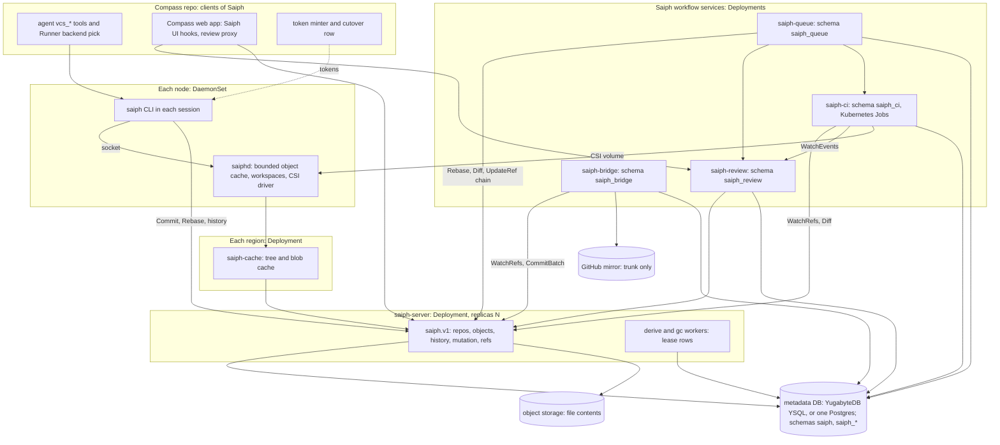

# Saiph

Design records for Saiph, the version control system Rigel sells. Its code
will live in `RigelBuild/saiph`, which does not exist yet. Records go in
this directory. Decisions go in `decisions/<area>/DL-NNN.md`; the areas
are `overview`, `store`, `client`, `review`, `ci-cd`, `merge-queue` and
`git-bridge`, one per record.

This page is the overview of the set.

Tracker: RIG-5665

> Freezes on merge; later changes supersede by citation, never rewrite
> (convention: the `docs/designs/agent/compass-agent-config-delivery/design.md`
> header in the Compass designs). Unless a path says otherwise, every code
> path is in the `RigelBuild/saiph` repo. A Compass path says "in
> Compass".

Ledger-impact: DL-580 files D1. The set replaces the deleted Compass
record `internal-vcs.md`; DL-578, DL-579 and DL-581 point at
[store](store.md#decisions). The sibling records file DL-590..DL-626. The
RIG-5558 decisions (DL-535..DL-538, DL-561) and DL-090 and DL-326 stay
whole: they govern the git backend.

**Named decisions this record introduces:** D1 in [Decisions](#decisions).

## Open Questions

Every record's questions, in one index. Matt reads this first. Each
record is written against its recommendation. "LB" marks a load-bearing
question: a different answer reshapes the record.

| Id | Question | Recommendation | LB |
| -- | -- | -- | -- |
| overview OQ-1 | Which license does the saiph repo take? | AGPL-3.0-only, as Compass | n |
| overview OQ-2 | Do review, queue, CI and git bridge ship in the saiph repo? | Yes, as Saiph services | y |
| overview OQ-3 | Where do conflicts live? | Never stored; typed results; open conflicts stay in the working copy | n |
| overview OQ-4 | Tenant model in a single-tenant install? | One tenant row at boot; RLS stays on | n |
| [store](store.md#open-questions) OQ-1 | Which metadata database? | YugabyteDB YSQL (core only); one Postgres ≥16 allowed on one node | y |
| store OQ-2 | Which bytes are hashed? | Deterministic CBOR (RFC 8949 §4.2.1) | y |
| store OQ-3 | May a reader fetch an object by id alone? | Only with read on the whole repo | n |
| store OQ-4 | Retention of unpinned changesets? | 7 days | n |
| store OQ-5 | Does the store keep conflicted changesets? | No | n |
| store OQ-6 | How does `saiph-server` know the caller? | JWTs from configured issuers; Compass is one | y |
| [client](client.md#open-questions) OQ-1 | Checkout mode for agent sessions? | Virtual on Podman, materialized on microVM | y |
| client OQ-2 | `saiphd` upgrade without breaking mounts? | FUSE takeover; restart as fallback | n |
| client OQ-3 | Does `saiphd` start from a snapshot? | No; node disk plus a warm fetch | n |
| client OQ-4 | Mixed git and Saiph session keeps GitHub egress? | Yes, while any repo is on git | n |
| client OQ-5 | Does the agent hold a Saiph token? | No; the Runner relays to `saiphd` | n |
| client OQ-6 | How is a Saiph-only repo granted to an agent? | Accept it by its cutover state | n |
| client OQ-7 | Virtual checkouts on macOS? | No; materialized only | n |
| client OQ-8 | How does a human get a token from Compass? | OAuth 2.0 device grant | n |
| [review](review.md#open-questions) OQ-1 | Who may upload a version of another owner's change? | Any account with write | n |
| review OQ-2 | How are change classes detected? | Lexically, from `Diff` hunks | n |
| review OQ-3 | May a read-narrowed reader use review? | No | n |
| review OQ-4 | How long do closed changes' versions stay readable? | Re-pin for 90 days | n |
| review OQ-5 | What does a repo without `.saiphreview` require? | One human LGTM, owners and CI | n |
| review OQ-6 | How does an agent learn it is its turn? | A home-channel message from Compass | n |
| [ci-cd](ci-cd.md#open-questions) OQ-1 | One CI config file or one per directory? | One `.saiph/ci.yaml` | n |
| ci-cd OQ-2 | How does moon see a Saiph checkout? | A Saiph provider for moon's pluggable VCS | y |
| ci-cd OQ-3 | May the deploy controller move `release/*` refs? | Yes, by a ref-prefix grant | n |
| ci-cd OQ-4 | Does CI revert a confirmed culprit? | No; it comments | n |
| ci-cd OQ-5 | Compass jobs Kubernetes cannot run? | Keep them on GitHub Actions against the mirror | n |
| ci-cd OQ-6 | Is a flaky target quarantined? | Yes | y |
| [merge-queue](merge-queue.md#open-questions) OQ-1 | Pre-merge or post-merge gating? | Per-repo mode, default `pre` | y |
| merge-queue OQ-2 | Does a conflict-fix version need a new approval? | The review policy decides | y |
| merge-queue OQ-3 | Which model does the fixer call, and how? | One OpenAI-compatible chat call | n |
| merge-queue OQ-4 | What is trivial by default? | Conservative: small text content conflicts | n |
| merge-queue OQ-5 | Where does queue policy live? | `.saiphqueue` at the trunk head | n |
| merge-queue OQ-6 | What does the queue do with `INFRA`? | Hold the batch | n |
| merge-queue OQ-7 | Land-by-merge mode? | Yes, per owner | n |
| [git-bridge](git-bridge.md#open-questions) OQ-1 | GitHub PRs after cutover? | Import allowlisted PRs; land by merge | y |
| git-bridge OQ-2 | PRs from authors not on the allowlist? | Comment and close | n |
| git-bridge OQ-3 | History Saiph cannot hold? | Refuse; the repo stays on git | y |
| git-bridge OQ-4 | Open GitHub PRs at the switch? | Import them | n |

Dependencies: git-bridge OQ-2 and OQ-4 depend on git-bridge OQ-1;
client OQ-6 depends on git-bridge's cutover state; merge-queue OQ-6 and
ci-cd OQ-6 are siblings. The overview's own questions follow.

### OQ-1 — Which license does the saiph repo take?

Compass is AGPL-3.0-only. Saiph is sold, self-hosted, and used through
Compass.

- (a) AGPL-3.0-only, as Compass. Customers who self-host get the source;
  a vendor that runs a modified copy as a service must share it.
- (b) A source-available license. It restricts competitors more, but
  customers lose the freedoms Compass gives them.

**Recommendation: (a).** One license across Rigel's products. Either way,
no code from `facebook/sapling` enters the repo: it is GPL-2.0-only, and
GPL-2.0-only code cannot be copied into AGPL-3.0 code (ruling 12).

### OQ-2 — Do review, the merge queue, CI and the git bridge ship in the saiph repo?

Matt placed the schema, proto, binaries and deploy manifests in the saiph
repo, and kept the agent `vcs_*` tools, the Runner backend pick and the
web UI hooks in Compass. The workflow services are not named.

- (a) In the saiph repo, as Saiph services. Scion says such a system
  "requires its own code review, code search, and CI", so a customer who
  self-hosts Saiph without Compass still needs them.
- (b) In Compass. Saiph without Compass would then have no review or
  merge queue.

**Recommendation: (a).** Compass keeps only its UI hooks and agent tools.
Each sibling record designs its service on this assumption.

### OQ-3 — Where do conflicts live?

Shared by store, review and merge-queue. **Recommendation:** the store
never keeps a conflicted changeset; conflicts are typed results, and the
`saiph` client keeps open conflicts in the working copy, as Sapling does
([store](store.md#oq-5--does-the-store-keep-conflicted-changesets-shared-with-review-and-merge-queue)).

### OQ-4 — Which tenant model in a single-tenant install?

**Recommendation:** one tenant row, created at boot. The tenant column and
RLS stay on, so an install can add tenants with no migration
([store](store.md#tenancy)).

## Resolved decisions

- **Split and name (RIG-5821 R2-1, R2-2).** Matt ruled on 2026-10-19:
  Saiph is its own product in its own repo, `RigelBuild/saiph`. Rigel
  sells it; customers self-host it or use it through Compass, and the
  Compass repo is its first user. The proto package is `saiph.v1`, the CLI
  is `saiph`, the node daemon is `saiphd`, and the server is
  `saiph-server`.
- **Client.** Matt ruled on 2026-10-18: Saiph has its own client, not jj.
  It is inspired by jj and Sapling and built Scion's way: a node daemon, a
  bounded object cache, sparse and virtual checkouts, and server-side
  mutations ([client](client.md)).
- **Scion to the letter.** Matt ruled on 2026-10-18: the core (server and
  client) follows the Scion post. Where the post is silent, the
  `facebook/sapling` repo (Mononoke, EdenFS, the Sapling client) is the
  reference. Store departures are listed in
  [Deviations from Scion](store.md#deviations-from-scion).

## Rulings

Matt, 2026-10-18 and 2026-10-19 (docs#48 threads, RIG-5821). These are
fixed.

> 1. A full Scion implementation: many Servers and many Runners. The single
>    Server is only for dogfooding. Mirror Scion as closely as possible.
> 2. The git mirror carries trunk only. Changes under review are never
>    mirrored. No "PR" and no branches unless a reason exists. Scion is the
>    reference; Twigg, Piper, Critique and jj inspire the UI and workflow.
> 3. Review is Critique/Twigg/jj: changes stack freely into DAGs, and CI
>    uses the graph.
> 4. No GitHub egress for agents on a fully native repo. GitHub mirroring is
>    for migrating repos and for public visibility. The Compass repo stays
>    fully mirrored.
> 5. Two backends. RIG-5558 (`agent-vcs-tools.md`) ships whole for repos on
>    git and GitHub. Saiph is a second backend, picked per repo behind the
>    agent `vcs_*` tools.
> 6. No length cap; split into files as needed.
> 7. CI/CD is designed alongside, on Kubernetes.
> 8. The product may split out with its own name (RIG-5821 R2-1, R2-2).
> 9. A merge queue (2026-10-18): batching, bisection, stacks as units,
>    per-affected-target lanes instead of a global lock, server-side
>    auto-rebase, and a cheap-model fixer for trivial conflicts; a
>    non-trivial conflict ejects the change.
> 10. The core VCS, server and client, follows Scion to the letter. Where
>     the Scion post is silent, the eden/sapling repo (Mononoke, EdenFS,
>     the Sapling client) is the reference.
> 11. Our own client, not jj: inspired by jj and Sapling, built Scion's
>     way (node daemon, bounded cache, sparse and virtual checkouts,
>     server-side mutations). A 16-byte change id stays, as our own
>     concept.
> 12. Sapling is GPL-2.0-only and Compass is AGPL-3.0-only: borrow designs
>     and ideas only, never code. Running an unmodified EdenFS as a
>     separate program is not in scope.
> 13. The product is named Saiph (2026-10-19). It is sold: customers
>     self-host it or use it through Compass, and the Compass repo is its
>     first user. Proto `saiph.v1`; CLI `saiph`; daemon `saiphd`.
> 14. Saiph lives in its own repo, `RigelBuild/saiph` (2026-10-19). Its
>     schema, proto, binaries and deploy manifests belong there. Compass is
>     a client: the agent `vcs_*` tools, the Runner backend pick and the
>     web UI hooks stay in Compass.

## Problem / Intent

Compass agents keep history in git and land work through GitHub. That ties
every agent to a forge, a clone and a push credential, and it scales the
way git does. Saiph is a Scion-style version control system that Rigel
sells and Compass uses first. This record maps the set: goals, terms,
components, how Saiph sits beside the git backend, and the order of work.

### Goals

- A server that owns history: it stores changesets, builds trees, commits,
  rebases, merges and answers history queries
  ([Scion](https://www.anthropic.com/engineering/redesigning-source-control):
  "the server answers questions about file history and blame, creates
  commits, performs merges and rebases").
- Many stateless servers and strict cache tiers over immutable objects.
- Our own client that fetches only what it reads: sparse and virtual
  checkouts through a node daemon.
- Review over a DAG of changes with versions, not branches.
- CI that reads the graph and the diff API, and a merge queue without a
  global lock.
- Trunk exported to GitHub as derived git commits, and git history
  imported.
- Tenancy, per-directory ACLs and enforced caps from the first release,
  because Saiph is sold.

### Non-goals

- Replacing the git backend. RIG-5558 ships unchanged (ruling 5).
- Git wire compatibility. No clone, fetch or push of a Saiph repo over the
  git protocol; the GitHub mirror is the git view.
- Mirroring changes under review (ruling 2).
- jj as the client (ruling 11), and running EdenFS (ruling 12).
- Managed-service operations. In Compass's terms, the boundary test is the
  [OSS-core boundary record](../compass/meta/oss-core-managed-boundary/design.md#boundary-test).

## Approach

### Glossary

| Term | Meaning | Follows |
| -- | -- | -- |
| changeset | An immutable entry in history, created only by the server: ordered parents, a change id, and the files changed against the first parent with content ids. | Scion ("an entry in a write-ahead log"); Mononoke Bonsai |
| blob | File content, named by BLAKE2b-256 of its bytes keyed `saiph.content`, stored compressed in object storage. | Scion ("compressed file contents in blob storage"); Mononoke `ContentId` |
| tree | A derived, content-addressed directory node whose entries carry sizes; never uploaded. | Scion (trees fetched recursively); Mononoke fsnodes |
| ref | A name and a target changeset, moved only by compare-and-swap. Few exist. | Scion ("a compare-and-swap on a single Spanner row") |
| trunk | The repo's main ref. It moves forward only, and each changeset on it has a dense `trunk_seq`. | Scion's main ref; Piper head |
| change | A unit of work across rewrites, named by a 16-byte change id that Saiph assigns. Not an object. | Saiph's own concept, inspired by jj ("a commit as it evolves over time") |
| version | One state of a change; a new version on each rewrite. | Twigg ("Increased by 1 on rebases, amends, msg changes and submits") |
| stack | The DAG of changes a change depends on, reviewed and landed as a graph. | Critique, Twigg, jj |
| workspace | One working copy on a node, laid out by `saiphd`, sparse and optionally virtual. | Scion ("sparse checkouts" and "virtualized checkouts"); EdenFS |
| derived data | A value computed from a changeset and its parents' values, written back to the database. | Scion ("defined recursively"); Mononoke `DerivableType` |
| pin | A holder's claim that keeps a changeset alive through gc, in place of a ref. | Saiph's own; Scion discourages refs |

### Component map



- **Server tier.** `saiph-server` runs as a Deployment with `replicas: N`
  behind one Service. The metadata database (YugabyteDB core, or one
  Postgres) and object storage are operator-provided. Manifests live in
  the saiph repo (`deploy/`).
- **Cache tier.** `saiph-cache`, one Deployment per region, answers reads
  by id and asks the servers on a miss. Scion: "When a cache is missing an
  object, it asks the authoritative scion-servers".
- **Daemon tier.** `saiphd` runs once per node (DaemonSet). It keeps a
  bounded object cache for every job on the node, lays out workspaces,
  and serves CI pods through its CSI driver. Scion: "the client talks over
  a socket to a daemon, scion-daemon, that stores objects for the whole
  node".
- **Client tier.** The `saiph` CLI runs in the session and talks to
  `saiphd` for objects and to `saiph-server` for mutations and history.
  The daemon, cache and server answer the same object RPCs, so the client
  does not know the topology.
- **Workflow tier.** `saiph-review`, `saiph-queue`, `saiph-ci` (with its
  `saiph-ci-step` Job wrapper) and `saiph-bridge` are Saiph services
  (OQ-2). Each keeps its rows in its own schema (`saiph_review`,
  `saiph_queue`, `saiph_ci`, `saiph_bridge`) in the store's database,
  under the store's tenant GUC, and calls `saiph.v1` with its own service
  token. None holds history of its own.
- **Compass.** The agent `vcs_*` tools, the Runner backend pick, the web
  UI hooks, the review proxy, the token minter and the `repo_cutovers`
  row. Compass mints the tokens its agents and users present
  ([store](store.md) OQ-6, [client](client.md)).

### Two backends behind the `vcs_*` tools

The agent `vcs_*` tools (RIG-5558, `createVcsTools` in the agent's
`vcs.ts` in Compass) stay the one tool surface. Each repo has a backend:

- **git** (default): the RIG-5558 path, unchanged. Local jj over git, the
  Compass Server's mirror, GitHub PRs, `forge_*` tools.
- **saiph**: the tools drive the `saiph` CLI. `vcs_submit` creates a new
  version of each change on the server; review, CI and the merge queue
  run in Saiph; trunk reaches GitHub only through the git bridge.

The backend is a property of the repo, which Compass reads when it grants
a repo to an agent (`AgentRepositoryService` in Compass). The Runner picks
the backend when it prepares the session: for a Saiph repo it mounts the
node's `saiphd` socket and a Saiph token, not a git credential. One
session can hold repos on both backends; each tool call routes by the repo
it names. An agent on a Saiph repo has no `github.com` egress (ruling 4).
A repo moves to Saiph once: import, a freeze of the git backend for that
repo, then the switch ([git-bridge](git-bridge.md)). The tool names and arguments are
kept, so the prompt and skill change only where the review words differ.

### Record index and work order

| Record | Owns | Depends on |
| -- | -- | -- |
| [store](store.md) | Changeset format, blobs, metadata database and ref CAS, derived data, server-side commit, rebase and merge, the `saiph.v1` API, auth seam, tenancy, ACLs, scaling, gc, caps, deviations from Scion | — |
| [client](client.md) | The `saiph` CLI, `saiphd`, `saiph-cache`, the object protocol, sparse and virtual checkout, token claims and Compass issuance, the `vcs_*` tools and Runner pick on Saiph | store |
| [review](review.md) | Change, version, stack DAG, threads, approvals, attention, landing, web UI | store |
| [ci-cd](ci-cd.md) | Triggers from ref and version events, presubmit, postsubmit milestones, culprit finding, affected targets, engine, deploy | store, review |
| [merge-queue](merge-queue.md) | Batching, bisection, stacks as units, per-target lanes, auto-rebase, conflict fixer and ejection | store, review, ci-cd |
| [git-bridge](git-bridge.md) | Trunk export to GitHub, git history import, per-repo cutover | store |

Work order, by binary:

1. `saiph-server`: store S1–S8. Every record reads its entities.
2. `saiph`, `saiphd` and `saiph-cache` ([client](client.md) C1–C8), and
   `saiph-bridge` ([git-bridge](git-bridge.md) B1–B7), in parallel. The
   bridge registers the git-commit and git-tree derivers (store S9).
3. `saiph-review` ([review](review.md)), after client.
4. `saiph-ci` and `saiph-ci-step` ([ci-cd](ci-cd.md)), after review.
5. `saiph-queue` ([merge-queue](merge-queue.md)) last: it composes review
   state, CI results, and the store's `Rebase` with resolutions and
   chained `UpdateRef`.
6. Compass tasks run beside their binary: token issuance and the agent
   backend ([client](client.md) C9–C10), the review proxy and UI
   ([review](review.md) R12), and the cutover row
   ([git-bridge](git-bridge.md) B8).

### Decisions

- **D1 — DL-580.** Two backends sit behind one agent `vcs_*` tool surface,
  chosen per repo: the RIG-5558 git backend ships unchanged for repos on
  GitHub, and Saiph serves Saiph repos through the `saiph` CLI, where
  agents have no GitHub egress and only trunk is mirrored to GitHub as
  derived git commits; the tools, the Runner backend pick and the web UI
  hooks stay in Compass, and Saiph stays in its own repo.

## Plan

### Global Constraints

- **Public repo.** No operator names, private product detail, or links to
  private records. Tracker ids stay plain text.
- **Names.** Saiph; proto package `saiph.v1`; CLI `saiph`; node daemon
  `saiphd`; regional cache `saiph-cache`; server `saiph-server`; services
  `saiph-review`, `saiph-queue`, `saiph-ci` and `saiph-bridge`; schemas
  `saiph`, `saiph_review`, `saiph_queue`, `saiph_ci` and `saiph_bridge`.
  No other use of the name is mentioned.
- **Repo boundary.** Saiph code lives in `RigelBuild/saiph` and imports
  nothing from Compass. Compass reaches Saiph only through `saiph.v1` and
  the `saiph` CLI, with tokens it issues.
- **Scion first.** Core choices follow the Scion post; gaps follow
  `facebook/sapling`; each departure is listed in the record that makes
  it.
- **Sapling and EdenFS: designs and ideas only, never code.** No file,
  function, test or data table from `facebook/sapling` is copied,
  translated or pasted. Running an unmodified EdenFS is not in scope.
- **RIG-5558 is frozen.** No change to its proto fields, its mirror, its
  migrations or its decisions.
- **Caps.** Every usage-billed component states its cap per layer, a
  budget alert that pages Matt, and spend-cap rows, in the record that
  enables it.

### O1 — Sibling records

Done: [client](client.md), [review](review.md), [ci-cd](ci-cd.md),
[merge-queue](merge-queue.md) and [git-bridge](git-bridge.md), written
against [store](store.md#api-the-saiphv1-connect-package). Their store
additions are folded into store. A later addition to `saiph.v1`
supersedes store.

Interfaces: `saiph.v1` services `RepoService`, `ObjectService`,
`HistoryService`, `MutationService`, `RefService`, and `auth.Principal`,
as frozen in store.

### O2 — Backend selection in Compass

A per-repo backend field on the Compass side, read by the agent tools and
the Runner. Designed in client and git-bridge; this record fixes only the
rule (D1).

Interfaces:

```proto
// compass.v1, in Compass (derived, never stored; see client.md and git-bridge.md)
enum RepoBackend { REPO_BACKEND_UNSPECIFIED = 0; REPO_BACKEND_GIT = 1; REPO_BACKEND_SAIPH = 2; }
```

## Tasks

- [x] O1 — client, review, ci-cd, merge-queue and git-bridge records
- [ ] O2 — per-repo backend selection behind the `vcs_*` tools and in the Runner
- [ ] Store S1–S11 ([store](store.md#tasks))
- [ ] Client C1–C11, review R1–R12, ci-cd CI1–CI11, merge-queue Q1–Q11, git-bridge B1–B9 (each record's Tasks)
