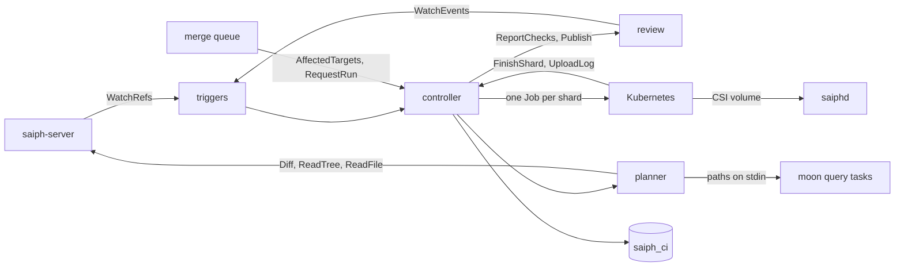

# Saiph: CI/CD on Kubernetes

Tracker: RIG-5665

> Freezes on merge; later changes supersede by citation, never rewrite
> (convention: the `docs/designs/agent/compass-agent-config-delivery/design.md`
> header). Unless a path says otherwise, every code path is in the
> `RigelBuild/saiph` repo, which does not exist yet. A Compass path says
> "in Compass".

Ledger-impact: D1–D10 are filed as DL-602..DL-611, and no filed decision
is superseded. Decisions about Compass's GitHub Actions CI stay whole:
they govern repos on the git backend
([overview](README.md#rulings), ruling 5).

**Named decisions this record introduces:** D1–D10 in [Decisions](#decisions).

Length: Matt lifted the length cap for this set (ruling 6 in the
[overview](README.md#rulings)). The prose sits mostly in Approach.

This record designs Saiph's CI and deploy service, `saiph-ci`. It builds
on the entities and RPCs of [store](store.md) and on the review contract
in [review](review.md), and it gives [merge-queue](merge-queue.md) the calls the queue runs on.
The [overview](README.md) holds the glossary and the component map.

## Open Questions

None depends on another unless it says so.

### OQ-1 — One CI config file, or one per directory?

Twigg lets a repo "commit a `CI.json` and/or `CD.json` file anywhere in
your repository". Each file owns its folder, and a change below that
folder triggers its jobs ([Twigg CI/CD](https://twigg.vc/docs/v/2/ci-cd/)).

- (a) Per-directory `CI.json` and `CD.json` files, as Twigg.
- (b) One root file, `.saiph/ci.yaml`. Directory scope comes from the
  build graph: a moon project is a directory with its own `moon.yml`. A
  repo with no build graph lists directory jobs in the same file.

**Recommendation: (b).** Saiph reads targets from the build graph, so the
file holds only policy: classes, timeouts, resources, milestones
and deploy stages. One file is one place to review, and one `.saiphacl` on
`.saiph/` protects it ([store](store.md#per-directory-acls)). Per-directory
files let anyone with write in a directory change the CI policy of that
directory. Either way, CI reads the config at the run's base, never from
the change under test (D4).

### OQ-2 — How does moon see a Saiph checkout? (load-bearing for the cache)

moon reads repo state only through git. Its check is
`self.worktree.git_dir.exists() && find_command_on_path("git").is_some()`
(`is_enabled` in
[`crates/vcs/src/git/git_client.rs`](https://github.com/moonrepo/moon/blob/v2.6.2/crates/vcs/src/git/git_client.rs)),
and the task runner turns its cache off without it: "If the VCS root does
not exist (like in a Docker container), we should avoid failing and simply
disable caching" (`is_cache_enabled` in
[`crates/task-runner/src/task_runner.rs`](https://github.com/moonrepo/moon/blob/v2.6.2/crates/task-runner/src/task_runner.rs)).
A Saiph job has no `.git` and no `git`. So moon runs, but it neither reads
nor writes its local or remote cache, and it rebuilds its project graph on
every run ("No VCS to hash with, so abort caching", `new_with_cache` in
`crates/workspace/src/workspace_builder.rs` in moon). Affected detection
is not hit: moon takes changed files from stdin before it asks git
([Targets and affected detection](#targets-and-affected-detection)).

- (a) Write a Saiph provider for moon's proposed pluggable VCS and
  contribute it upstream
  ([moon#2620](https://github.com/moonrepo/moon/issues/2620), open,
  "[feature] Pluggable VCS support"). Until it ships, Saiph jobs run moon
  without its cache.
- (b) Put a `git` shim and an empty `.git` in the job image. The shim
  answers the subcommands moon runs (`rev-parse`, `branch --show-current`,
  `ls-files`, `remote get-url`, `--version`).
- (c) Fork moon.

**Recommendation: (a).** (b) puts a git-shaped lie in every job. The moon
issue itself warns that treating another VCS as git "can produce an empty
branch, a stale revision, or changed files calculated from a different
repository state". (c) is a permanent maintenance cost. The cost of (a) is
small for the first user: Compass's `.moon/workspace.yml` (in Compass) has
no `remote:` block, so its CI shares no remote cache today. Bazel repos
use the cache from the start, because Bazel needs no VCS to hash.

### OQ-3 — May the deploy controller move `release/*` refs? (security; store addition)

Store lets only a `land` subject move a protected ref, and a repo role
covers every ref. `REPO_ROLE_LAND` for CD would let CD move trunk too.

- (a) Add a ref prefix to grants (`SetGrantRequest.ref_prefix`, see
  [Store additions](#store-additions)). CD holds `land` on `release/` only.
- (b) CD never moves refs. A person with `land` cuts releases and lands
  picks with the `saiph` CLI, and CD only runs stages.

**Recommendation: (a).** Rapid automates the cut and the approved picks;
(b) keeps a manual step in every release. (a) is one field and one check
in the store.

### OQ-4 — Does CI revert a confirmed culprit?

- (a) No. CI comments on the culprit change and adds its owner to the
  attention set. The breakage keeps the target red at trunk until a later
  trunk changeset passes it (D6).
- (b) Yes. CI opens a revert change and sends it through the merge queue
  when the culprit's posterior is at least 0.95.

**Recommendation: (a)** for the first release. Revert policy is product
behavior that needs breakage data from the first user. (b) can be added
later on the same `Breakage` rows.

### OQ-5 — Compass jobs that Kubernetes cannot run

Compass's CI selects a macOS suite (`darwin_affected` in `outputLines`,
`tools/ci-matrix/index.ts` in Compass). It needs a macOS host.

- (a) Keep it as a GitHub Actions job on the trunk-only mirror. It runs
  after landing and reports on GitHub only.
- (b) Add a pull-based `saiph-ci-agent` for hosts outside Kubernetes. It
  takes shards from the controller as job pods do.

**Recommendation: (a)** at Compass's cutover. Presubmit coverage for that
suite is lost, and the cutover issue names it. Build (b) when a customer
needs it. Depends on the cutover plan in [git-bridge](git-bridge.md).

### OQ-6 — Is a flaky target quarantined? (load-bearing for the merge queue)

A result never changes, and CI never retries (D5). When two results for
one target disagree on the same inputs, CI opens a flake breakage
([Flakes and quarantine](#flakes-and-quarantine)). The question is what
the flaky target does to gating while that breakage is open.

- (a) Quarantine. The target still runs and reports, but it is not
  required: `TargetResult.quarantined` is true, review gets
  `required=false`, and the merge queue drops it from a batch's required
  set until the breakage closes.
- (b) No quarantine. The target stays required. Every lane that touches
  it ejects until the owner fixes the test.

**Recommendation: (a).** A flaky test is a bug, and the breakage routes it
to its owner. (b) stops every unrelated change that touches the target.
(a) does not hide the bug: the breakage stays open and listed until a fix
lands. Recorded as D7.

## Problem / Intent

Saiph replaces the forge, so it must also replace the forge's CI. Matt
ruled that CI/CD is designed alongside Saiph, on Kubernetes (ruling 7),
that review stacks are DAGs which CI uses (ruling 3), and that the merge
queue runs per-target lanes (ruling 9). This record designs that service:
triggers from the store's ref log and from review's version events,
presubmit on versions, postsubmit on trunk in milestones with culprit
finding, affected targets from the store's `Diff`, the engine, job source
with no git, result storage, the CI side of the merge queue, deploy
stages on release refs, a remote build cache, and compute caps.

Scion takes the position this record builds on: "we've invested in
post-merge and pre-deploy automated testing", and "a CI job that needs
the diff between a commit and its merge base … can ask the server for it"
([Redesigning source control](https://www.anthropic.com/engineering/redesigning-source-control)).
The post does not say how its CI runs. Google's published TAP, culprit
finding and Rapid fill that gap, as Mononoke fills the store's.

## Approach

### Shape

`saiph-ci` is one Go service, `cmd/saiph-ci`, with four parts: the
trigger consumers, the planner, the controller and the deploy
controller. It reads the store and review only through `saiph.v1`. It
keeps its own rows in the schema `saiph_ci`, under the store's tenant GUC
`saiph.tenant_id` and the same row-level security. It runs work as
Kubernetes Jobs whose source comes from `saiphd` through CSI. The store
answers every history question; this service owns only orchestration.



### Triggers

- **Trunk and release refs.** One `WatchRefs` stream per repo, resumed at
  the stored `after_log_seq`. Store task S8 tests that "a stream resumed
  at `after_log_seq` misses nothing" ([store](store.md#tasks)). The
  consumer keeps entries for the trunk ref and `release/*`. Each entry
  carries the landed `chain` and its `trunk_seqs`.
- **Versions.** One `ReviewService.WatchEvents` stream per repo, resumed
  at the stored `after_seq`, for `VERSION_UPLOADED`, `ABANDONED` and
  `LANDED`. On `OUT_OF_RANGE` the consumer rescans with `ListChanges` and
  resumes at its `event_seq`.
- **Exactly once.** The consumer writes the new cursor and the runs it
  creates in one `saiph_ci` transaction. A restart replays nothing twice
  and skips nothing. One replica holds each repo's stream under a lease,
  in the store's `Lease` pattern.
- **Reconnects.** Resuming a stream at its cursor after a server restart
  is the stream protocol, not a retry. Each reconnect is counted, and the
  trigger-lag alert fires when a cursor falls five minutes behind.

### Targets and affected detection

A target is a build-graph task id; for moon it is `project:task`. The
config puts each target in a class. `gate` targets run on presubmit and
in the merge queue; `post` targets run only on trunk. This is the split
Google measured: presubmit runs small and medium tests, and postsubmit
runs the large and enormous ones
([Who Broke the Build?](https://research.google.com/pubs/archive/45794.pdf)).

`AffectedTargets(base, head)` has five steps:

1. **Paths.** `Diff(from=base, to=head)` with no hunks, paged. It compares
   two root trees and needs no ancestry, so a speculative merge-queue base
   works. `Diff` leaves out paths the caller cannot read, so CI's service
   subject needs read on the whole repo.
2. **Graph inputs.** The config lists the globs the build graph reads:
   `.moon/**`, every `moon.yml`, toolchain manifests and lockfiles, and
   `.saiph/ci.yaml`. `graph_changed` is true when a diff path matches
   one. `graph_id` is the SHA-256 of the sorted (path, blob id) list of
   graph-input files at head. The planner keeps that manifest per
   changeset in `saiph_ci.graph_manifests`. It derives it from the base's
   manifest plus the diff, or from one `ReadTree` walk the first time.
3. **Skeleton.** The planner writes the graph-input files of a `graph_id`
   into a local directory with `ReadFile`, once, and keeps the directory
   in an LRU bounded by `--skeleton-bytes`. moon builds its project and
   task graph from these files alone, and matching changed paths against
   input globs needs no other file. A toolchain plugin that reads a file
   outside the list fails the plan loudly; the fix is a glob in the
   config.
4. **moon.** The planner runs
   `moon query tasks --affected --downstream deep` in the skeleton, with
   the diff paths on stdin, one per line. moon reads changed files from
   stdin when stdin is not a terminal
   (`crates/app/src/queries/changed_files.rs` in moon), so it never asks
   git. Compass selects its CI targets the same way today
   (`taskTargetsForPaths` in `tools/ci-matrix/index.ts`, in Compass).
5. **Barrier.** `all=true` when moon cannot build the graph, when the
   diff has more than `max_affected_paths` paths (default 20,000), or
   when it touches workspace or toolchain config (`.moon/workspace.yml`,
   `.moon/toolchain*.yml`, `.prototools`). `all` overrides `graph_id` and
   `graph_changed`.

`AffectedTargets(X, X)` is an empty diff and returns at once. A run
filters the result by the classes its kind runs. A target that affected
detection drops is left out of the required set; it is never reported as
skipped. A repo with no build graph lists targets with path globs in the
config, and the planner matches them directly. Both are one `Adapter`
interface. A later Bazel adapter uses the same skeleton, with `BUILD`,
`*.bzl` and `MODULE.bazel` as graph inputs.

The planner also gives each target an **input key**: the SHA-256 of
`graph_id`, the target, the job image digest, the store tree id of each
directory its inputs cover (the blob id for a single file), and the input
keys of the tasks it depends on. A tree id changes when any file below it
changes, so equal keys mean equal inputs. A coarse key can miss a flake;
it cannot invent one. The key never skips a run.

The config is read at the run's base, never from the change under test
(D4), so a change cannot weaken the policy that checks it. When the diff
touches `.saiph/ci.yaml`, the planner adds the built-in gate target
`saiph:ci-config`, which validates the head's file.

```yaml
# .saiph/ci.yaml (read at the run's base)
graph_inputs: [".moon/**", "**/moon.yml", "**/package.json", "bun.lock", "go.mod", "go.sum"]
classes:                  # first match wins; an unmatched target is gate
  - { targets: "e2e:*", class: post }
timeouts: { default: 30m, "e2e:*": 2h }
resources: { default: { cpu: "2", memory: 4Gi }, "*:build": { cpu: "8", memory: 16Gi } }
checkout: virtual         # or materialized
milestone: { minutes: 45, changesets: 50 }
owners: { "web:*": "account:acct_web" }
deploy:
  cut: { cron: "0 9 * * MON" }
  stages:
    - { name: staging, target: "deploy:staging", service_account: deploy-staging }
    - { name: prod, target: "deploy:prod", service_account: deploy-prod, approval: true }
```

### Presubmit on versions

On `VERSION_UPLOADED`, CI requests a `RUN_KIND_PRESUBMIT` run of the
version's changeset against the event's `base`, the trunk merge base that
review computes. Review stacks are DAGs (ruling 3). A version's changeset
holds every change it depends on, so its tree is the stack up to that
change, and its affected set from the trunk base covers its parents'
changes too. A green child means the stack below it passes on that tree.

CI reports through `ReportChecks`: one `CheckRun` per target, named
`ci/<project:task>`, `required` unless the target is quarantined, with
`details_url` pointing at the log. It sends `complete=true` once the plan
is known, because no check is added after that. PASSED maps to `SUCCESS`;
FAILED and INFRA map to `FAILURE`; a cancelled target maps to
`CANCELLED`. A red target that is `broken_at_base` says so in its
summary: the author did not break it, and the change lands after trunk is
fixed and the change is rebased.

A new version cancels the targets of older versions that have not
started. `ABANDONED` cancels the change's open runs. A version whose
changeset already has results reuses them.

Presubmit runs code that nobody has reviewed yet: agents' changes and,
later, imported pull requests ([git-bridge](git-bridge.md) OQ-2). Its Jobs run under
the Restricted Pod Security profile with `hostUsers: false`. They mount
no Secret, hold only a read token for the repo and read access to the
cache, and a NetworkPolicy lets them reach only `saiph-ci`, the cache and
`saiphd`.

### Postsubmit milestones

TAP does not test every commit. It tests "a number of consecutive code
commits together", and a milestone is "typically cut every 45 minutes"
([TAP](https://research.google.com/pubs/archive/45861.pdf)). Saiph does
the same on trunk. A milestone is cut at the trunk head when
`milestone.minutes` (default 45) have passed or `milestone.changesets`
(default 50) have landed since the last one. It is a
`RUN_KIND_POSTSUBMIT` run of every affected `gate` and `post` target, with
the previous milestone as base.

A target that is red at a milestone opens a breakage when its last trunk
result was green. The breakage holds the range from the last green
`trunk_seq` to the first red one, and culprit finding runs over it. A
target that stays red adds no breakage. A breakage closes when the target
passes on a later trunk changeset (D6). Until then, every run whose base
is at or after the first red `trunk_seq` marks that target
`broken_at_base`.

### Culprit finding

The candidates are the trunk changesets in the range whose own diff
affects the target, by `AffectedTargets(parent, candidate)`. No other
changeset can change its result. The search is Google's flake-aware
culprit finding, which "is based on Bayesian inference and noisy binary
search, utilizing prior information"
([paper](https://research.google/pubs/flake-aware-culprit-finding/)). The
prior is uniform over the candidates, and the noise is the target's flake
rate from `GetTargetStats`. Each step probes the candidate that splits
the posterior mass most evenly. A probe is a `RUN_KIND_CULPRIT` run of
every target broken in that range.

No changeset runs a target twice. A probe at a changeset that already has
a result, such as a merge-queue batch head, uses that result for free.
The search stops when one candidate's posterior reaches 0.95, when every
candidate has a result, or after `max_culprit_probes` probes (default
16). A confirmed culprit gets one change-level comment through
`ReviewService.Publish`, with `RESOLUTION_UNRESOLVED` and its owner in
`attention_add`. CI does not revert in the first release (OQ-4). An
unconfirmed search lists its best candidates and their posteriors on the
breakage.

### Flakes and quarantine

Each (repo, changeset, target) has one result, and it never changes. CI
never retries a target, and a Job never retries its pod. A flaky test is
a bug, so CI records the evidence and routes it to an owner.

- **Detection.** When a new result disagrees with a stored result that
  has the same input key, CI opens a `BREAKAGE_KIND_FLAKE` breakage for
  the target, or adds to the open one. Neither result changes. A
  merge-queue batch that fails a target, followed by a successor batch
  that passes it with the same key, is this case.
- **Quarantine** (OQ-6). While the flake breakage is open, each new
  result of that target has `quarantined=true`. The target still runs and
  reports, so its results keep feeding the statistics. Review gets
  `required=false`, and the merge queue drops it from a batch's required
  set.
- **Close.** The breakage closes when the target's input key changes on
  trunk and its next 20 results all pass, or when a `land` subject closes
  it with `CloseBreakage` after a fix lands.
- **Routing.** The config's `owners` map names the account that owns a
  target. `ListBreakages` lists each open flake with that owner.

`GetTargetStats.flaky` counts results that are part of a disagreement.

**INFRA** is a pod that ends without its step wrapper's report: an
eviction, a lost node, a failed image pull. Each unfinished target of the
shard gets INFRA on the run. INFRA is red and fires the CI infra alert,
which CI's lane owns. It is stored on the run, not as the changeset's
result, so a person may request a new run after the cause is fixed.
Nothing re-requests it automatically. A target that hits its own timeout
or memory limit is FAILED, because those limits are part of the target's
contract.

### Engine: a first-party controller and Jobs

The controller splits a run into shards and runs each shard as one
`batch/v1` Job. A shard holds about `shard_seconds` (default 600) of
targets by their p50 duration. Pending shards wait in `saiph_ci`, ordered
by priority and then age. The controller creates a Job only while the
repo is under `max_running_shards`. Pods use a PriorityClass with
`preemptionPolicy: Never`, because a preempted pod would be an INFRA
result. [Alternatives considered](#alternatives-considered) compares the
engines this replaces.

```yaml
apiVersion: batch/v1
kind: Job
metadata: { name: "ci-<run id>-<shard>", namespace: "saiph-ci-<tenant>" }
spec:
  backoffLimit: 0                 # never retry a pod (D5)
  activeDeadlineSeconds: 1800     # the sum of the shard's target timeouts
  ttlSecondsAfterFinished: 3600
  template:
    spec:
      restartPolicy: Never
      hostUsers: false
      priorityClassName: saiph-ci-presubmit
      serviceAccountName: saiph-ci-pre
      tolerations:
        - { key: saiph.rigel.build/ci, operator: Equal, value: "true", effect: NoSchedule }
      securityContext: { runAsNonRoot: true, seccompProfile: { type: RuntimeDefault } }
      containers:
        - name: step
          image: "<the repo's CI image, by digest>"
          command: [saiph-ci-step, --run, "<run id>", --shard, "<n>"]
          workingDir: /src
          resources: { requests: { cpu: "2", memory: 4Gi }, limits: { cpu: "2", memory: 4Gi } }
          volumeMounts: [{ name: src, mountPath: /src }]
      volumes:
        - name: src
          csi:
            driver: saiph.rigel.build
            readOnly: false
            volumeAttributes: { repo: owner/name, changeset: "<64 hex>", sparse: "", mode: virtual }
```

The step wrapper, `saiph-ci-step`, runs `moon run` with the shard's
targets, as Compass's GitHub Actions jobs do today. It reads moon's run
report in `.moon/cache/`, sends one outcome per target with
`StepService.FinishShard`, and streams the log with `UploadLog`. Logs are
stored zstd-compressed under
`<tenant>/<repo id>/ci/<run id>/<shard>.log.zst`. A shard can report only
its own targets: `FinishShard` checks a random per-shard token that the
controller puts in the Job's environment and stores hashed.

### Job source: a CSI volume from `saiphd`

Jobs have no git. Their source is a CSI inline ephemeral volume served by
`saiphd`, as agreed in [client](client.md#ci-source-the-csi-driver). Pod
Security forbids hostPath at Baseline and allows `csi` at Restricted. The
volume is a copy-on-write overlay over the changeset, deleted when the
pod ends. The mode defaults to `virtual` with an empty sparse set, so the
FUSE root fetches only what the job reads. A repo whose tools walk the
whole tree sets `checkout: materialized`. The `CSIDriver` object's
`tokenRequests` gives the driver a token with audience
`saiph.rigel.build`. The pod's service account maps to
`service:k8s/<namespace>/<serviceaccount>`, which CI grants
`REPO_ROLE_READ` when a repo enables CI. A job that needs history uses
the `saiph` CLI in API mode.

### Results

```sql
-- internal/ci/migrations/0001_saiph_ci.sql; every table has ENABLE and
-- FORCE ROW LEVEL SECURITY and a tenant_isolation policy on saiph.tenant_id.
CREATE SCHEMA saiph_ci;
CREATE TABLE saiph_ci.runs (
  tenant_id TEXT NOT NULL DEFAULT current_setting('saiph.tenant_id', TRUE),
  repo_id BIGINT NOT NULL,
  run_id TEXT NOT NULL,
  kind SMALLINT NOT NULL,
  changeset BYTEA NOT NULL CHECK (length(changeset) = 32),
  base BYTEA,
  change_id BYTEA,                          -- presubmit: the review change
  version INT,
  idempotency_key TEXT NOT NULL,
  priority SMALLINT NOT NULL,
  state SMALLINT NOT NULL,
  created_unix_ms BIGINT NOT NULL,
  PRIMARY KEY (tenant_id, run_id),
  UNIQUE (tenant_id, repo_id, idempotency_key)
);
CREATE TABLE saiph_ci.run_targets (         -- per-run status; INFRA and CANCELLED live only here
  tenant_id TEXT NOT NULL DEFAULT current_setting('saiph.tenant_id', TRUE),
  run_id TEXT NOT NULL,
  target TEXT NOT NULL,
  shard INT,
  status SMALLINT NOT NULL,
  PRIMARY KEY (tenant_id, run_id, target)
);
CREATE TABLE saiph_ci.results (             -- one immutable outcome per changeset and target
  tenant_id TEXT NOT NULL DEFAULT current_setting('saiph.tenant_id', TRUE),
  repo_id BIGINT NOT NULL,
  changeset BYTEA NOT NULL CHECK (length(changeset) = 32),
  target TEXT NOT NULL,
  passed BOOLEAN NOT NULL,
  input_key BYTEA NOT NULL CHECK (length(input_key) = 32),
  run_id TEXT NOT NULL,
  duration_ms BIGINT NOT NULL,
  trunk_seq BIGINT,                         -- set for trunk changesets
  quarantined BOOLEAN NOT NULL,
  finished_unix_ms BIGINT NOT NULL,
  PRIMARY KEY (tenant_id, repo_id, changeset, target)
);
CREATE INDEX results_by_input ON saiph_ci.results (tenant_id, repo_id, target, input_key);
CREATE TABLE saiph_ci.breakages (
  tenant_id TEXT NOT NULL DEFAULT current_setting('saiph.tenant_id', TRUE),
  repo_id BIGINT NOT NULL,
  id TEXT NOT NULL,
  target TEXT NOT NULL,
  kind SMALLINT NOT NULL,                   -- 1 break, 2 flake
  last_green_trunk_seq BIGINT,
  first_red_trunk_seq BIGINT,
  culprit BYTEA,
  posterior DOUBLE PRECISION,
  owner TEXT,
  opened_unix_ms BIGINT NOT NULL,
  closed_unix_ms BIGINT,
  closed_by TEXT,
  PRIMARY KEY (tenant_id, repo_id, id)
);
CREATE TABLE saiph_ci.cursors (             -- one per repo and stream ("refs", "review")
  tenant_id TEXT NOT NULL DEFAULT current_setting('saiph.tenant_id', TRUE),
  repo_id BIGINT NOT NULL,
  stream TEXT NOT NULL,
  seq BIGINT NOT NULL,
  lease_token TEXT,
  lease_until_unix_ms BIGINT,
  PRIMARY KEY (tenant_id, repo_id, stream)
);
-- Also: graph_manifests (changeset, graph_id, zstd CBOR manifest),
-- repo_settings (caps), releases and release_items.
```

Results are keyed by changeset, because a changeset id names the exact
tree and history. Review maps a version to its changeset, and `runs`
records `change_id` and `version`, so the UI lists results per version.
Trunk results also carry `trunk_seq`. A result is inserted with
`ON CONFLICT DO NOTHING`, so the first outcome stands. CI holds no pins.
A run reads changesets that a ref, a review version pin or the queue's
`merge-queue:<lane>` pin keeps, or that are younger than the repo's
`retention_days`.

### API: `proto/saiph/v1/ci.proto`

CI calls the store and review as `service:saiph-ci`. When a repo enables
CI, that subject gets `REPO_ROLE_WRITE` on the repo, for `ReportChecks`,
`Publish` and whole-repo reads. Deploy uses the same subject, with a
second grant of `REPO_ROLE_LAND` on the ref prefix `release/` (OQ-3).

CI forwards the caller's token to the store's `GetRepo` and reads
`caller_role`. Reads need READ. `RequestRun` needs WRITE, and
`RUN_KIND_MERGE_QUEUE` and `RUN_KIND_CULPRIT` need LAND. `CloseBreakage`
and `Approve` need LAND, and `Approve` refuses a service subject.
`StepService` takes no issuer token; its `shard_token` authenticates it.

```proto
syntax = "proto3";
package saiph.v1;

service TargetService {
  rpc AffectedTargets(AffectedTargetsRequest) returns (AffectedTargetsResponse) { option idempotency_level = NO_SIDE_EFFECTS; }
  rpc GetResults(GetResultsRequest) returns (GetResultsResponse) { option idempotency_level = NO_SIDE_EFFECTS; }
  rpc ListBreakages(ListBreakagesRequest) returns (ListBreakagesResponse) { option idempotency_level = NO_SIDE_EFFECTS; }
  rpc CloseBreakage(CloseBreakageRequest) returns (CloseBreakageResponse);
  rpc GetTargetStats(GetTargetStatsRequest) returns (GetTargetStatsResponse) { option idempotency_level = NO_SIDE_EFFECTS; }
}
message AffectedTargetsRequest { string repo = 1; bytes base = 2; bytes head = 3; }
// all = the barrier; it overrides graph_id and graph_changed. A false graph_changed always means unchanged.
message AffectedTargetsResponse { repeated string targets = 1; bool all = 2; bytes graph_id = 3; bool graph_changed = 4; }
message GetResultsRequest { string repo = 1; bytes changeset = 2; repeated string targets = 3; }
message GetResultsResponse { repeated TargetResult results = 1; }
enum BreakageKind { BREAKAGE_KIND_UNSPECIFIED = 0; BREAKAGE_KIND_BREAK = 1; BREAKAGE_KIND_FLAKE = 2; }
message Breakage {
  string id = 1; string target = 2; BreakageKind kind = 3;
  uint64 last_green_trunk_seq = 4; uint64 first_red_trunk_seq = 5;
  bytes culprit = 6; double posterior = 7; string owner = 8;
  bool open = 9; int64 opened_unix_ms = 10; int64 closed_unix_ms = 11;
}
message ListBreakagesRequest { string repo = 1; bool include_closed = 2; uint32 page_size = 3; string page_token = 4; }
message ListBreakagesResponse { repeated Breakage breakages = 1; string next_page_token = 2; }
message CloseBreakageRequest { string repo = 1; string id = 2; string reason = 3; }
message CloseBreakageResponse { Breakage breakage = 1; }
// Empty targets = all; window_days defaults to 7, at most 30. Flake rate = flaky / runs.
message GetTargetStatsRequest { string repo = 1; repeated string targets = 2; uint32 window_days = 3; }
message TargetStats { string target = 1; uint64 runs = 2; uint64 passed = 3; uint64 failed = 4; uint64 flaky = 5; uint64 infra = 6; int64 p50_duration_ms = 7; }
message GetTargetStatsResponse { repeated TargetStats stats = 1; }

service RunService {
  rpc RequestRun(RequestRunRequest) returns (RequestRunResponse);
  rpc GetRun(GetRunRequest) returns (GetRunResponse) { option idempotency_level = NO_SIDE_EFFECTS; }
  rpc WatchRun(WatchRunRequest) returns (stream WatchRunResponse);
  rpc CancelRun(CancelRunRequest) returns (CancelRunResponse);
}
enum RunKind { RUN_KIND_UNSPECIFIED = 0; RUN_KIND_PRESUBMIT = 1; RUN_KIND_POSTSUBMIT = 2; RUN_KIND_MERGE_QUEUE = 3; RUN_KIND_CULPRIT = 4; RUN_KIND_DEPLOY = 5; }
enum RunState { RUN_STATE_UNSPECIFIED = 0; RUN_STATE_QUEUED = 1; RUN_STATE_RUNNING = 2; RUN_STATE_DONE = 3; RUN_STATE_CANCELLED = 4; }
// No FLAKY status: a flake is a breakage (D7).
enum TargetStatus {
  TARGET_STATUS_UNSPECIFIED = 0; TARGET_STATUS_PENDING = 1; TARGET_STATUS_RUNNING = 2;
  TARGET_STATUS_PASSED = 3; TARGET_STATUS_FAILED = 4; TARGET_STATUS_INFRA = 5; TARGET_STATUS_CANCELLED = 6;
}
message TargetResult {
  string target = 1; TargetStatus status = 2;
  reserved 3; // attempts: CI never retries
  bool reused = 4; bool broken_at_base = 5; string details_url = 6;
  bool quarantined = 7; bytes input_key = 8; int64 duration_ms = 9;
}
// Empty targets = affected(base, changeset) for the kind's classes. priority 0 = the kind's default.
message RequestRunRequest {
  string repo = 1; bytes changeset = 2; bytes base = 3; RunKind kind = 4;
  repeated string targets = 5; string idempotency_key = 6; uint32 priority = 7;
  bytes change_id = 8; uint32 version = 9;
}
message RequestRunResponse { string run_id = 1; bool reused = 2; }
message Run {
  string run_id = 1; string repo = 2; RunKind kind = 3; RunState state = 4;
  bytes changeset = 5; bytes base = 6; bool all = 7; repeated TargetResult results = 8;
  int64 created_unix_ms = 9;
}
message GetRunRequest { string run_id = 1; }
message GetRunResponse { Run run = 1; }
message WatchRunRequest { string run_id = 1; }
// One event per target state change; the last event carries done.
message RunEvent { oneof event { TargetResult result = 1; Run done = 2; } }
message WatchRunResponse { RunEvent event = 1; }
message CancelRunRequest { string run_id = 1; string reason = 2; }
message CancelRunResponse { Run run = 1; }

// Called only by saiph-ci-step inside a Job.
service StepService {
  rpc FinishShard(FinishShardRequest) returns (FinishShardResponse);
  rpc UploadLog(stream UploadLogRequest) returns (UploadLogResponse);
}
message StepOutcome { string target = 1; bool passed = 2; int64 duration_ms = 3; string summary = 4; }
message FinishShardRequest { string run_id = 1; uint32 shard = 2; string shard_token = 3; repeated StepOutcome outcomes = 4; }
message FinishShardResponse {}
message UploadLogRequest { string run_id = 1; uint32 shard = 2; string shard_token = 3; bytes chunk = 4; }
message UploadLogResponse { uint64 bytes = 1; }

service DeployService {
  rpc CutRelease(CutReleaseRequest) returns (CutReleaseResponse);
  rpc ProposePick(ProposePickRequest) returns (ProposePickResponse);
  rpc Approve(ApproveRequest) returns (ApproveResponse);
  rpc GetRelease(GetReleaseRequest) returns (GetReleaseResponse) { option idempotency_level = NO_SIDE_EFFECTS; }
}
enum StageState { STAGE_STATE_UNSPECIFIED = 0; STAGE_STATE_WAITING = 1; STAGE_STATE_RUNNING = 2; STAGE_STATE_DONE = 3; STAGE_STATE_FAILED = 4; }
message Stage { string name = 1; StageState state = 2; string run_id = 3; repeated string approved_by = 4; }
// Item 0 is the cut; later items are picks.
message ReleaseItem { string id = 1; bytes trunk_changeset = 2; bytes release_changeset = 3; string run_id = 4; repeated string approved_by = 5; bool landed = 6; }
message Release { string name = 1; bytes head = 2; repeated ReleaseItem items = 3; repeated Stage stages = 4; }
// Empty trunk_changeset = the newest milestone where every target passed.
message CutReleaseRequest { string repo = 1; string name = 2; bytes trunk_changeset = 3; }
message CutReleaseResponse { Release release = 1; }
message ProposePickRequest { string repo = 1; string release = 2; bytes trunk_changeset = 3; }
message ProposePickResponse { ReleaseItem item = 1; }
// Exactly one of item_id and stage.
message ApproveRequest { string repo = 1; string release = 2; string item_id = 3; string stage = 4; }
message ApproveResponse { Release release = 1; }
message GetReleaseRequest { string repo = 1; string name = 2; }
message GetReleaseResponse { Release release = 1; }
```

`RequestRun` with the same `idempotency_key` returns the same run. A new
key gets a new run, but a target that already has a result at that
changeset returns it with `reused=true`. `priority` is 0–100, and higher
runs sooner. 0 means the kind's default: presubmit 30, postsubmit 20,
culprit 40, merge queue 50. The queue uses 60 for bisection probes and
land retests.

### What the merge queue gets

- `AffectedTargets` as a snapshot diff, cheap on equal inputs, with `all`
  as the barrier and a `graph_changed` that is never falsely false.
- `RequestRun` with `RUN_KIND_MERGE_QUEUE`, which runs `gate` targets
  only.
- Results that never change. FAILED, INFRA and `broken_at_base` are red;
  a `quarantined` target is not required.
- Successor evidence instead of reruns: a later batch's result on the
  same input key is the second result that shows a flake.
- `GetTargetStats` and `ListBreakages`. CI holds no pins.

### Deploy: releases, stages and approvals

Google's Rapid branches a release "from the mainline at a specific
revision" and cherry-picks fixes into it
([Release engineering](https://sre.google/sre-book/release-engineering/)).
In Saiph a release is the protected ref `release/<name>`. It moves forward
only, by `land` only, in a single-row CAS.

- **Cut.** On the config's `deploy.cut` schedule or a `CutRelease` call,
  CD takes the newest milestone where every `gate` and `post` target
  passed and creates `release/<name>` there with `UpdateRef`. CD holds
  `land` on `release/` only (OQ-3).
- **Picks.** `ProposePick` names a trunk changeset. CD rebases it onto
  the release head with the store's `Rebase`, runs its affected targets
  as a `RUN_KIND_DEPLOY` run, and waits for approval. A conflict refuses
  the pick and names the paths. An approved, green pick moves the release
  ref with one `UpdateRef`.
- **Stages.** Each stage runs its deploy target as a Job in the stage's
  own namespace, under a service account the operator grants. Deploy
  credentials live only there, never in a presubmit namespace. A stage
  with `approval: true` waits for `Approve` from a human `land` account.
  A failed stage stops the release; it never rolls back on its own.
- **Audit.** Every cut and pick is a ref-log row with its subject and
  reason.

### Remote build cache

The cache speaks REAPI with the `SHA256` digest function. It is Buildbarn
`bb-storage` (Apache-2.0), one Deployment per region from the saiph
repo's `deploy/`.

- **Auth.** bb-storage verifies the pods' projected service-account JWTs
  against a JWKS file, which its `sync_jwks_to_configmap` keeps current.
  An `instance_name_prefix` authorizer scopes each repo to the instance
  `<tenant>/<repo>`. `get_authorizer` admits every CI service account of
  the tenant. `put_authorizer` admits only `saiph-ci-post`, the
  postsubmit and deploy account, so a presubmit can read the cache but
  never poison it.
- **Digests.** A source file's REAPI digest is the SHA-256 alias in the
  store's content meta. `saiphd` sets the xattr `user.saiph.sha256` from
  `ObjectService.GetContentMeta` ([Store additions](#store-additions)),
  and Bazel reads it with `--unix_digest_hash_attribute_name`, so Bazel
  hashes no source file in a virtual checkout. Store tree ids are not
  REAPI `Directory` digests, so trees are not shared.
- **moon.** moon speaks the same protocol (`remote.host`,
  `cache.instanceName`), but its cache stays off until OQ-2 is solved.
  moon retries a transient cache error up to three times and only warns
  on a failed write. Against Saiph's own cache that hides a defect, so
  the cache error rate has its own alert, and task CI10 turns the retry
  off or files the upstream change.

### Caps and spend

| Layer | Cap | Enforced by |
| -- | -- | -- |
| Tenant namespace | ResourceQuota on `requests.cpu`, `requests.memory`, `limits.cpu`, `limits.memory`, `pods` and `count/jobs.batch` in `saiph-ci-<tenant>` | the API server refuses a Job or pod over quota; the shard stays queued and the quota alert fires |
| Container | LimitRange default and maximum | the API server |
| Repo | `max_running_shards` (default 20) | the controller creates no Job past it |
| Run | `max_shards_per_run` (default 200) | the planner refuses the run with `RESOURCE_EXHAUSTED` |
| Job | `activeDeadlineSeconds`, the sum of its targets' timeouts, at most 4 h | the Job controller ends the pod; its targets are FAILED |
| Finished Job | `ttlSecondsAfterFinished: 3600` | the TTL controller |
| Culprit search | `max_culprit_probes` (default 16) per breakage | the controller stops and leaves the search unconfirmed |
| Node pool | the cluster autoscaler's maximum for the pool tainted `saiph.rigel.build/ci` | the autoscaler adds no node past it |
| Cache | bb-storage block storage on a fixed-size volume | bb-storage evicts the oldest blocks |
| Logs | the bucket quota and a 30-day lifecycle rule on the `ci/` prefix | the object store |

`saiph_ci_pod_seconds_total{tenant,repo,kind}` measures compute. A
deployment that enables CI on a usage-billed vendor also adds a budget
alert that pages Matt through the billing paging route, and a spend-cap
row per layer with evidence that it enforces. Until then CI stays off in
that deployment.

### Store additions

Folded into [store](store.md#api-the-saiphv1-connect-package):
`SetGrantRequest.ref_prefix` and the grants key change
([Refs and the ref log](store.md#refs-and-the-ref-log), task S2), and
`ObjectService.GetContentMeta` (task S9).

### Alternatives considered

- **Tekton Pipelines and Triggers.** Kubernetes-native, but triggers are
  an `EventListener` with `TriggerBinding`s for webhooks, and each
  `PipelineRun` keeps its own state beside CI's results. Every
  self-hosted install would carry its CRDs and controllers. Rejected.
- **Argo Workflows and Argo Events.** Argo Events delivers events
  asynchronously and unordered, and CI needs ordered, resumable ref and
  version streams. Rejected.
- **Buildkite agent-stack-k8s.** Its control plane is Buildkite's hosted
  service, so a self-hosted Saiph would depend on a vendor and egress.
  Rejected.
- **Woodpecker.** The org knows it: an existing Woodpecker server runs
  another monorepo's `moon ci`. Its Kubernetes backend runs pods with a
  temporary PVC per pipeline and clones with git. Its forges are git
  forges, and "Addon forges are still experimental". Results would be
  keyed by pipeline number, not changeset. Rejected for Saiph; that
  server is not affected.
- **Rerun a red target to test for a flake.** Trunk's merge queue advises
  "Retry limit should be 1-3 max". Rejected: a rerun hides a flaky test,
  and successor evidence with quarantine shows it instead.
- **Results keyed by run.** Rejected: a second run could replace a red
  result.
- **bazel-remote.** It has no JWT auth (htpasswd or mTLS only), so it
  cannot scope puts per repo by service account. Rejected.
- **A git clone or a git shim in the job.** Rejected: OQ-2 (b).
- **Per-directory config files.** OQ-1 (a).

### Decisions

- **D1 — DL-602.** `saiph-ci` is a first-party Go service that runs each shard of
  targets as one Kubernetes Job with `backoffLimit: 0`. It adopts no CI
  engine.
- **D2 — DL-603.** CI triggers from the store's `WatchRefs` and review's
  `WatchEvents`, each resumed at a cursor stored in the same transaction
  as the runs it creates.
- **D3 — DL-604.** A target is a build-graph task id. Affected targets come from
  the store's snapshot `Diff`, fed to moon on stdin in a skeleton of
  graph-input files, with `all` as the barrier.
- **D4 — DL-605.** CI policy is one `.saiph/ci.yaml`, read at the run's base and
  never from the change under test.
- **D5 — DL-606.** Each (repo, changeset, target) has one immutable result. CI
  never retries a target, and a Job never retries a pod. INFRA is red,
  alerts, and is stored on the run only.
- **D6 — DL-607.** Postsubmit runs in TAP-style milestones. A red target opens a
  breakage that keeps it red at trunk until a later trunk changeset passes
  it. Culprit finding is flake-aware Bayesian search that runs each
  (target, changeset) at most once, and it comments, never reverts.
- **D7 — DL-608.** A flake is two results that disagree on one input key. It opens
  a flake breakage, and the target is quarantined, not required, until
  the breakage closes.
- **D8 — DL-609.** Jobs get their source from a `saiphd` CSI inline ephemeral
  volume and have no git.
- **D9 — DL-610.** CD follows Rapid: a release is a protected `release/*` ref cut
  from a green milestone, a pick is a rebased trunk changeset, and stages
  run deploy targets behind human `land` approvals.
- **D10 — DL-611.** The remote cache is REAPI with SHA-256 on bb-storage, scoped
  per repo by instance prefix and written only by postsubmit. CI compute
  is capped by a namespace ResourceQuota, a per-repo shard limit and a
  budget alert that pages Matt.

## Plan

### Global Constraints

- **Inherit [store](store.md#global-constraints):** public repo, Go 1.26,
  `connectrpc.com/connect/v2`, Compass's lint rules, red/green tests,
  `buf lint` STANDARD, SQL that YugabyteDB YSQL and Postgres 16 both run.
- **Layout.** `internal/ci/` holds `trigger`, `plan`, `adapter/moon`,
  `control`, `step`, `results`, `culprit`, `deploy` and `api`.
  `cmd/saiph-ci` is the service and `cmd/saiph-ci-step` the step wrapper.
  Migrations live in `internal/ci/migrations/`, numbered from `0001`.
- **Kubernetes ≥ 1.33**, for `hostUsers: false`. `k8s.io/client-go` only;
  no CRDs.
- **No retries.** Nothing reruns a target, a pod or a shard. Resuming a
  stream at its cursor is allowed. A call to the store or review that
  fails ends the step loudly, and the work stays queued.
- **moon v2.6.2 or later** as the first adapter, called as a binary.
- **Tests.** Controller tests use a fake clientset. One end-to-end test
  per task runs a kind cluster with the CSI driver from client task C8.

### Order

```text
CI1 proto ─┬─ CI2 schema ─┬─ CI3 triggers ─┬─ CI6 presubmit ─┐
           │              ├─ CI4 planner ──┼─ CI7 postsubmit ┼─ CI11 deploy+caps
           │              └─ CI5 controller┘                 │
CI9 store adds ─ CI8 CD ─────────────────────────────────────┤
CI10 cache ──────────────────────────────────────────────────┘
```

### CI1 — Proto and generated code

`proto/saiph/v1/ci.proto` as in [API](#api-protosaiphv1ciproto). Tests:
`buf lint` passes; `buf breaking` against the frozen file passes.

Interfaces:

```go
// gen/saiph/v1/saiphv1connect
type TargetServiceHandler interface{ /* AffectedTargets, GetResults, ListBreakages, CloseBreakage, GetTargetStats */ }
type RunServiceHandler interface{ /* RequestRun, GetRun, WatchRun, CancelRun */ }
type StepServiceHandler interface{ /* FinishShard, UploadLog */ }
type DeployServiceHandler interface{ /* CutRelease, ProposePick, Approve, GetRelease */ }
```

### CI2 — The `saiph_ci` schema and the results store

The tables in [Results](#results) with RLS, and the result insert. Tests:
a second insert for one changeset and target leaves the first;
another tenant's rows are invisible; `ResultsByInputKey` returns both
sides of a disagreement.

Interfaces:

```go
// internal/ci/results
type Result struct{ Changeset object.ID; Target string; Passed bool; InputKey [32]byte; RunID string; DurationMs int64; TrunkSeq *int64; Quarantined bool }
func (s *Store) Insert(ctx context.Context, tenant string, repo meta.RepoID, r Result) (inserted bool, err error)
func (s *Store) Get(ctx context.Context, tenant string, repo meta.RepoID, cs object.ID, targets []string) ([]Result, error)
func (s *Store) ResultsByInputKey(ctx context.Context, tenant string, repo meta.RepoID, target string, key [32]byte) ([]Result, error)
```

### CI3 — Triggers

The `WatchRefs` and `WatchEvents` consumers, the cursor lease and the
`ListChanges` rescan. Tests: a consumer killed between two events
creates each run once; `OUT_OF_RANGE` rescans and resumes at
`event_seq`; a second replica waits for the lease.

Interfaces:

```go
// internal/ci/trigger
type Sink interface{ OnRef(ctx context.Context, e *saiphv1.WatchRefsResponse, tx pgx.Tx) error; OnReview(ctx context.Context, e *saiphv1.ReviewEvent, tx pgx.Tx) error }
func RunRefs(ctx context.Context, env *Env, repo string, sink Sink) error
func RunReview(ctx context.Context, env *Env, repo string, sink Sink) error
```

### CI4 — Planner and the moon adapter

`AffectedTargets`, the graph manifest, the skeleton cache, the moon
adapter, classes and the input key. Tests: a diff under one project
returns its tasks and their dependents; a `moon.yml` change sets
`graph_changed`; a `.moon/workspace.yml` change sets `all`; equal base
and head returns no targets without running moon; a speculative base
with no common ancestor works; an edit outside a target's inputs keeps
its input key.

Interfaces:

```go
// internal/ci/plan
type Affected struct{ Targets []string; All bool; GraphID [32]byte; GraphChanged bool }
type Adapter interface {
	GraphInputs(cfg *Config) []string
	Affected(ctx context.Context, skeleton string, paths []string) ([]string, error)
	InputDirs(ctx context.Context, skeleton, target string) ([]string, error)
}
func (p *Planner) AffectedTargets(ctx context.Context, repo string, base, head object.ID) (Affected, error)
func (p *Planner) InputKey(ctx context.Context, repo string, cs object.ID, target string) ([32]byte, error)
func LoadConfig(ctx context.Context, c saiphv1connect.ObjectServiceClient, repo string, base object.ID) (*Config, error)
```

### CI5 — Controller, Jobs and the step wrapper

`RequestRun`, `GetRun`, `WatchRun`, `CancelRun`, sharding, the pending
queue, Job creation, `StepService`, logs and INFRA. Tests: the same
idempotency key returns the same run; a target with a result returns
`reused=true`; the repo never exceeds `max_running_shards`; an evicted
pod yields INFRA, fires the alert and creates no new Job; a Job has
`backoffLimit: 0`; a wrong shard token is `UNAUTHENTICATED`.

Interfaces:

```go
// internal/ci/control
type Shard struct{ RunID string; N uint32; Targets []string; Priority uint32 }
func (c *Controller) RequestRun(ctx context.Context, req *saiphv1.RequestRunRequest) (*saiphv1.RequestRunResponse, error)
func (c *Controller) JobFor(s Shard, cfg *plan.Config, src CSISource) *batchv1.Job
type CSISource struct{ Repo string; Changeset object.ID; Sparse []string; Mode string }
// cmd/saiph-ci-step
func runShard(ctx context.Context, step saiphv1connect.StepServiceClient, runID string, shard uint32, targets []string) error
```

### CI6 — Presubmit

Runs on `VERSION_UPLOADED`, `ReportChecks`, cancellation on a new version
or `ABANDONED`, the Restricted profile and the NetworkPolicy. Tests: a
stack child's run covers its parents' changes; a failed target reports
`FAILURE` and `required=true`; a quarantined one `required=false`; a
presubmit pod cannot reach the internet or put to the cache.

Interfaces:

```go
// internal/ci/control
func (c *Controller) OnVersion(ctx context.Context, e *saiphv1.ReviewEvent, tx pgx.Tx) error
func checkRuns(results []*saiphv1.TargetResult) []*saiphv1.CheckRun
```

### CI7 — Postsubmit, breakages, culprits and flakes

Milestones, breakages, `broken_at_base`, culprit search, flake
detection, quarantine, `ListBreakages`, `CloseBreakage` and
`GetTargetStats`. Tests: a red milestone opens one breakage; with a
uniform prior and no flakes the search finds the culprit in
⌈log₂ n⌉ probes; with a 10% flake rate it reaches 0.95 on a seeded
simulation; no (target, changeset) runs twice; a confirmed culprit gets
one comment and an attention entry; a disagreement on one input key
quarantines the target.

Interfaces:

```go
// internal/ci/culprit
type Candidate struct{ Changeset object.ID; TrunkSeq int64 }
type Search struct{ Candidates []Candidate; FlakeRate float64; Observed map[object.ID]bool }
func (s *Search) Posterior() []float64
func (s *Search) Next() (Candidate, bool)
func (s *Search) Confirmed(threshold float64) (Candidate, bool)
```

### CI8 — Deploy

`DeployService`, release cuts and picks, stage Jobs and approvals.
Depends on CI9. Tests: CD's grant cannot move trunk; a conflicting pick
is refused with paths; a stage with `approval: true` waits for a human
`land` account and refuses a service subject; a failed stage stops the
release.

Interfaces:

```go
// internal/ci/deploy
func (d *Deployer) Cut(ctx context.Context, repo, name string, at object.ID) (*saiphv1.Release, error)
func (d *Deployer) Pick(ctx context.Context, repo, release string, trunkCS object.ID) (*saiphv1.ReleaseItem, error)
func (d *Deployer) Approve(ctx context.Context, p auth.Principal, req *saiphv1.ApproveRequest) (*saiphv1.Release, error)
```

### CI9 — Store additions in `saiph-server`

Folded into store tasks S2 and S9
([store](store.md#s2--metadata-schema-and-the-ref-cas)), which carry the
tests and interfaces.

### CI10 — Remote build cache

bb-storage manifests, the JWKS sync, the instance-prefix and put
authorizers, and moon's cache retry turned off or an upstream change
filed. Tests: a presubmit token reads and cannot put; a repo cannot read
another repo's instance; a Bazel build on a virtual checkout hashes no
source file.

Interfaces:

```go
// deploy/cache: bb-storage config (Jsonnet), JWKS ConfigMap, Deployment, Service
```

### CI11 — Deployment, caps and alerts

`deploy/ci/` manifests: the `saiph-ci` Deployment, the namespaces per
tenant with ResourceQuota, LimitRange and NetworkPolicy, the
PriorityClasses, the service accounts and grants. The infra, trigger-lag,
quota and cache-error alerts. The caps rows and the budget alert. Tests:
a Job over quota stays queued and fires the quota alert; each alert fires
on a forced fault and stays quiet on a healthy run.

Interfaces:

```go
// cmd/saiph-ci
type ciFlags struct{ DSN, SaiphURL, Issuers, Namespace string; SkeletonBytes int64; MaxRunningShards int }
func registerFlags(fs *flag.FlagSet) *ciFlags
```

## Tasks

- [ ] CI1 — `proto/saiph/v1/ci.proto` and generated code
- [ ] CI2 — `saiph_ci` schema, RLS and results store
- [ ] CI3 — triggers: `WatchRefs`, `WatchEvents`, cursors and lease
- [ ] CI4 — planner, moon adapter, graph manifest, skeleton, input key
- [ ] CI5 — controller, Jobs, `saiph-ci-step`, logs, INFRA
- [ ] CI6 — presubmit, `ReportChecks`, sandbox
- [ ] CI7 — postsubmit milestones, breakages, culprit search, flakes and quarantine
- [ ] CI8 — deploy: releases, picks, stages, approvals
- [ ] CI9 — store additions (done in store S2 and S9)
- [ ] CI10 — remote build cache on bb-storage
- [ ] CI11 — deploy manifests, caps, alerts and budget alert
