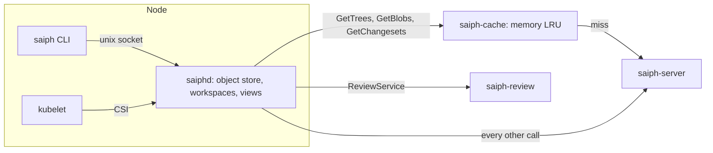

# Saiph: client, daemon, and cache tiers

Tracker: RIG-5665

> Freezes on merge; later changes supersede by citation, never rewrite
> (convention: the `docs/designs/agent/compass-agent-config-delivery/design.md`
> header). Unless a path says otherwise, every code path is in the
> `RigelBuild/saiph` repo, which does not exist yet. A Compass path says
> "in Compass".

Ledger-impact: D1–D7 are filed as DL-590..DL-596. The store additions
this record asked for are folded into [store](store.md#api-the-saiphv1-connect-package)
(tasks S6 and S11).

**Named decisions this record introduces:** D1–D7 in [Decisions](#decisions).

This record designs Saiph's client side: the `saiph` CLI, the node daemon
`saiphd`, the regional cache `saiph-cache`, the object protocol between
them, sparse and virtual checkouts, the CSI driver that gives CI its
source, the token model that tells `saiph-server` who calls it, and the
agent `vcs_*` tools on the Saiph backend. It builds on the entities and
RPCs of [store](store.md) and the rulings in the
[overview](README.md#rulings). Its additions to `saiph.v1`, listed in
[Store additions](#store-additions), are folded into store.

## Open Questions

Matt ruled that Saiph has its own client, built Scion's way (ruling 11),
and that the core follows Scion to the letter, with `facebook/sapling`
(EdenFS, the Sapling client) as the reference where the post is silent
(ruling 10). Settled by those rulings, so not open: jj as the client or
backend (rejected, see [Alternatives considered](#alternatives-considered)),
and running EdenFS (ruling 12). The record is written against each
recommendation below. None depends on another, except OQ-6, which depends
on [git-bridge](git-bridge.md).

### OQ-1 — Which checkout mode do agent sessions get? (load-bearing)

A virtual checkout is a FUSE filesystem served by `saiphd`. Compass's
microVM tier shares exactly one read-write host directory into the guest
through virtiofsd (`workspaceShare` in
`go/internal/runtime/microvm_lifecycle.go` in Compass: "the backend
expresses exactly one read-write workspace share"). Nobody has tested
virtiofsd over a FUSE mount on the host.

- (a) Virtual on the Podman tier. Materialized on the microVM tier until
  task C6 shows virtiofsd serves the FUSE root correctly; then virtual
  there too.
- (b) Materialized everywhere. Simple, but a large repo costs a full
  sparse fetch and disk per session, which is what Scion avoids: "when a
  job does need files on disk, the client only pays for what it actually
  reads".
- (c) Virtual everywhere now. Risks a broken microVM tier.

**Recommendation: (a).** The mode is a per-session field
(`CreateSessionRequest.mode`), so the switch is a Runner flag, not a
migration.

### OQ-2 — How does `saiphd` upgrade without breaking virtual mounts?

A FUSE mount dies with the process that serves it.

- (a) Takeover, as EdenFS does: "a new EdenFS daemon to seamlessly take
  over mount points from an existing running daemon without unmounting
  the filesystems"
  ([Takeover.md](https://github.com/facebook/sapling/blob/main/eden/fs/docs/Takeover.md)).
  The DaemonSet uses `maxSurge: 1`, so the new pod starts beside the old
  one and receives the FUSE file descriptors and the session table over a
  unix socket.
- (b) Restart: on upgrade the Runner restarts every session that has a
  virtual root. Materialized roots survive any restart.

**Recommendation: (a), with (b) as the fallback.** go-fuse opens a
mount from an inherited descriptor (the `/dev/fd/N` mount point in
`fuse/mount_linux.go` of `hanwen/go-fuse`), but a resumed server must not
repeat the FUSE `INIT` handshake. Task C6 proves that first; if go-fuse
cannot skip it, C6 carries a patch (go-fuse is BSD-licensed), and until
it lands the upgrade uses (b).

### OQ-3 — Does `saiphd` start from a snapshot?

Scion: "Each daemon starts from a periodically refreshed snapshot". The
post does not say what a snapshot holds or how it reaches a node.

- (a) No snapshot file. The daemon's object store is on node disk and
  survives restarts. A new node prefetches the trunk head of the repos
  and sparse prefixes in its `--prefetch` list from `saiph-cache`.
- (b) A snapshot job packs trunk's objects into one file in object
  storage, and each new daemon downloads it. That adds a second
  distribution path, object-storage credentials on every node, and a
  job to run.

**Recommendation: (a).** It gives a warm start with the RPCs the tiers
already serve. [Deviations from Scion](#deviations-from-scion) lists it.

### OQ-4 — Does a session with git and Saiph repos keep GitHub egress?

Ruling 4: "No GitHub egress for agents on a fully native repo." Egress is
per session (one network namespace), not per repo.

- (a) A session keeps the forge hosts when any granted repo is on the git
  backend, and loses them when every granted repo is on Saiph.
- (b) Compass refuses to grant an agent repos on both backends.

**Recommendation: (a).** The GitHub credential still covers only the git
repos, so a mixed session gains nothing it lacks today. (b) blocks the
migration, which moves one repo at a time ([git-bridge](git-bridge.md)).

### OQ-5 — Does the agent hold a Saiph token? (security)

- (a) No. The Runner relays the agent's Saiph calls to `saiphd`, and the
  daemon attaches the session's token upstream, as the Runner relays
  forge calls today (`Gateway.Forge` in
  `go/internal/runner/gateway/forge.go` in Compass: "forwards one
  agent-initiated forge call to the Server's RelayForgeCall under the
  session bound to this container").
- (b) The token is a 0600 file in the agent's `$HOME`, as the GitHub
  credential is (`gitCredentialSecretName` in
  `go/server/git_credential.go` in Compass).

**Recommendation: (a).** The agent gains no credential, which is the
posture of `agent-vcs-tools.md` ("The agent gains no credential"). It
also needs no network egress for Saiph at all, so the microVM tier needs
no new device.

### OQ-6 — How is a repo that exists only in Saiph granted to an agent? (depends on git-bridge)

`AgentRepositoryService.AddAgentRepository` in Compass refuses a repo
with no GitHub App installation ("FAILED_PRECONDITION when no GitHub App
is configured … the App has no installation for the org").

- (a) It accepts the repo when `repoCutoverState` (in
  `go/server/vcs_backend.go` in Compass, designed in [git-bridge](git-bridge.md))
  says it is not on the git backend, skips the GitHub checks, and stores
  the grant row as today. The git credential broker skips every repo
  whose state is not `GIT`, as the cutover already requires.
- (b) A new forge provider value `saiph` for such rows.

**Recommendation: (a).** One grant table, and the backend comes from one
function, as agreed with [git-bridge](git-bridge.md).

### OQ-7 — Does macOS get virtual checkouts?

EdenFS serves macOS over NFSv3 ("On macOS, EdenFS uses NFSv3",
[Overview.md](https://github.com/facebook/sapling/blob/main/eden/fs/docs/Overview.md)).

- (a) macOS gets materialized checkouts only in this record.
- (b) An NFSv3 server inside `saiphd`.

**Recommendation: (a).** Only humans run macOS, and a sparse
materialized checkout serves them. (b) is a new record when a large repo
needs it.

### OQ-8 — How does a human get a Saiph token from Compass?

- (a) `saiph auth login <compass url>` runs the OAuth 2.0 device grant
  (RFC 8628) against Compass. Compass returns a one-hour token and a
  refresh token, which the CLI keeps in a 0600 file.
- (b) Compass's settings page mints a 30-day token that the human pastes
  in. A JWT cannot be revoked before it expires, so a leaked token lives
  for 30 days.

**Recommendation: (a).** Tokens stay short-lived. A refresh token is an
opaque row in Compass that Compass can revoke. A standalone install uses
Saiph's own revocable `saiph.tokens` rows instead ([store](store.md) OQ-6).

## Problem / Intent

Scion's server does the work and its client stays small: "The client
maintains a bounded local object cache, lays out the working copy files
on disk, monitors for filesystem changes, and gives users an ergonomic
way to work with the server"
([Scion](https://www.anthropic.com/engineering/redesigning-source-control)).
This record designs that client for Saiph, with the tiers Scion puts
between the client and the server, and plugs it into the places that use
it: Compass agent sessions, CI pods on Kubernetes, and a human at a
terminal. The git backend (RIG-5558) stays as it is (ruling 5).

## Approach

### Ground truth

- **Saiph's repo** is `RigelBuild/saiph`. It does not exist yet, so every
  Saiph path here is a plan. `cmd/saiph`, `cmd/saiphd` and
  `cmd/saiph-cache` belong to this record ([store](store.md#global-constraints)
  layout).
- **The store contract.** Every server call here is a `saiph.v1` RPC from
  [store](store.md#api-the-saiphv1-connect-package): `GetTrees`,
  `GetBlobs`, `GetChangesets`, `FindMissingBlobs`, `PutBlobs`,
  `PutChunkedBlob`, `ReadTree`, `ReadFile`, `Commit`, `Rebase`, `Merge`,
  `Log`, `MergeBase`, `Diff`, `Blame`, `GetRef`, `Pin`, `Unpin`,
  `GetRepo`, `SetGrant`. Id reads need read on the whole repo; path reads
  check each path ([store](store.md) OQ-3).
- **The review contract** ([review](review.md)): package `saiph.v1`, file
  `proto/saiph/v1/review.proto`, service `ReviewService`, served by its
  own binary `saiph-review`, with
  `UploadVersions`, `AbandonChange`, `GetChange` and `GetStack`. The
  caller must be the agent's account (`account:<id>`), never a service.
- **The cutover contract** ([git-bridge](git-bridge.md)): Compass reads a repo's state
  with `repoCutoverState` in `go/server/vcs_backend.go` in Compass, which
  returns `GIT`, `IMPORTING`, `NATIVE_MIRRORED` or `NATIVE_ONLY`.
- **The CI contract** ([ci-cd](ci-cd.md)): CI pods get source through the CSI
  driver below, with the attributes agreed there. CI nodes carry the
  taint `saiph.rigel.build/ci=true:NoSchedule`.
- **Compass today.** An agent reaches its Runner over one unix socket per
  container, and the Runner relays forge calls to the Server under the
  session binding (`Gateway.Forge` in
  `go/internal/runner/gateway/forge.go` in Compass). In a microVM, guestd
  forwards `/run/compass/agent.sock` to the Runner over vsock
  (`go/internal/guestd/supervisor.go` in Compass). The microVM tier boots
  "exactly one read-write workspace share" at `/workspace`
  (`workspaceShare` in `go/internal/runtime/microvm_lifecycle.go` in
  Compass). `runtime.SourceVolume` is "a checkout dir backed by a writable
  session-volume mount" (`go/internal/runtime/workspace.go` in Compass).
  The Runner's egress policy is one static allowlist
  (`SpecDefaults.Egress` in `go/internal/runner/spec.go` in Compass, from
  `--egress-allow`). The GitHub credential reaches the agent as the file
  secret `GITHUB_APP_TOKEN` (`brokeredSecretResolver.ResolveFor` in
  `go/server/git_credential.go` in Compass).
- **Compass already verifies JWTs** from Kubernetes issuers with
  `go-jose/go-jose/v4`: `RunnerVerifier.Verify` in
  `go/internal/auth/workload_identity.go` in Compass refreshes a JWKS
  every hour (`jwksRefreshEvery`), re-fetches on an unknown key id at
  most every five minutes (`kidRefetchCooldown`), keeps the last good keys
  for a day (`staleKeysAfter`), and requires `exp` and `iat` because
  "go-jose skips an absent time claim". Saiph's verifier follows the same
  rules, written fresh in the saiph repo.

### Four tiers

Scion: "In the fleet, the client talks over a socket to a daemon,
scion-daemon, that stores objects for the whole node … talks only to the
tree and blob cache servers in its region, called scion-cache … When a
cache is missing an object, it asks the authoritative scion-servers".
Saiph has the same four tiers.



- **`saiph`** is the CLI. It holds no repo data. It asks `saiphd` for
  objects and workspace state, and sends mutations through the daemon to
  the server.
- **`saiphd`** runs once per node. It keeps the bounded object store for
  every job on the node, lays out workspaces, watches them for changes,
  and holds each workspace's view and op log. It forwards every call it
  does not answer to its upstreams with the caller's own bearer token.
- **`saiph-cache`** runs once per region. It answers id reads from memory
  and asks the servers on a miss.
- **`saiph-server`** is the store's server ([store](store.md)).

Tiering is strict, as Scion's is: "we strictly enforce the tiering to
isolate failure domains". A daemon sends id reads only to `--cache`. A
cache sends them only to `--server`. When the cache is down, the daemon
fails the read; it never falls back to the server. Calls that are not id
reads (`Commit`, `Log`, `Diff`, path reads, refs, pins, review) go from
the daemon to their service directly, because they are the client's work
with the server, not the fetch protocol.

### Deviations from Scion

| Scion | Saiph | Why |
| -- | -- | -- |
| "Each daemon starts from a periodically refreshed snapshot" | No snapshot file. The daemon's store survives restarts on node disk, and a new node prefetches its `--prefetch` list from the cache (OQ-3) | The post does not say what a snapshot is. A second distribution path needs object-storage credentials on every node. |
| One client process on each machine | On a laptop, `saiph` starts a per-user `saiphd` whose `--cache` is the server URL | Scion's tiers are "in the fleet". A laptop has no regional cache. |

### Gaps filled from EdenFS and Sapling

The post leaves these open. Each row names the reference and marks where
Saiph departs. Paths are in `facebook/sapling`. Designs only, never code
(ruling 12).

| Gap | Reference | Saiph |
| -- | -- | -- |
| Virtual checkout | EdenFS: FUSE on Linux, "lazily fetching file data" (`eden/fs/docs/Overview.md`) | Follows: FUSE through `hanwen/go-fuse/v2` |
| Local edits in a virtual checkout | EdenFS materializes a changed inode and its ancestors into the overlay ("Materialized files are stored in the overlay", `eden/fs/docs/Glossary.md`) | Follows |
| Change tracking | EdenFS Journal, used "to implement APIs like `getFilesChangedSince()`" (`Glossary.md`); Sapling uses Watchman so status runs "in O(files-you-have-changed) time" (`website/docs/scale/axes.md`) | Follows: the FUSE journal in virtual mode, inotify in materialized mode |
| Kernel caching | EdenFS "returns an infinite expiry" and invalidates explicitly, because it "tracks all writes" (`eden/fs/docs/Caching.md`) | Follows |
| In-memory blob cache | EdenFS keeps "a capped-size, minimum-entry, in-memory LRU cache for recently-accessed blobs" (`Caching.md`) | Follows |
| Disk store eviction | EdenFS: "Local store eviction is an unsolved problem" (`Caching.md`) | **Departs:** a byte cap with LRU eviction, because Scion's cache is "bounded" |
| Daemon restart | EdenFS takeover hands mounts to a new daemon "without unmounting the filesystems" (`eden/fs/docs/Takeover.md`) | Follows (OQ-2) |
| Undo | Sapling MetaLog "makes atomic updates possible, and allows viewing past states for debugging and undoing" (`website/docs/dev/internals/metalog.md`) | Follows the idea: a per-view op log on the node |
| Graph view | Sapling Smartlog shows "just the ones relevant to you" (`website/docs/overview/smartlog.md`) | Follows |
| Change identity | Sapling mutation records | **Departs:** the store's change id ([store](store.md#changeset)) |
| Open conflicts | Sapling refuses to commit unresolved conflicts ([store](store.md) OQ-5) | Follows |

### The object protocol: want-only fetch

Scion: "Scion's negotiation doesn't tell the server what the client
already has; instead, it operates exclusively on trees and blobs the
client wants. Starting from a root tree, the client checks its local
store for missing trees and requests them recursively, then repeats the
process for blobs." Saiph's fetch is exactly that, over the store's id
reads:

1. Read the changeset (`GetChangesets`) for its `root_tree`.
2. Walk trees from the root. At each level, collect the child tree ids
   that the sparse set includes and the local store lacks. Ask for them
   with `GetTrees`, at most 1,000 ids per call, and repeat level by level.
3. Collect the blob ids under the sparse set that the store lacks. Ask
   for them with `GetBlobs`. Each tree entry carries a size, so the
   fetcher packs each call under the 16 MiB response limit. A blob larger
   than 4 MiB comes back as a chunk list; the fetcher then asks for the
   chunks.

There is no have-list and no pack. "Every request is for a specific
object that never changes, so any cache can answer it", and a fetch that
stops resumes from what the store already holds. A virtual checkout stops
after step 1: it fetches a tree when a directory is first looked up and a
blob when a file is first read. Scion: "Sparse and even virtualized
checkouts don't need special support, because the client simply doesn't
ask for trees it doesn't want."

- **Same RPCs at every tier.** `saiphd` and `saiph-cache` implement the
  read half of `saiphv1connect.ObjectServiceHandler` (`GetTrees`,
  `GetBlobs`, `GetChangesets`) with the store's messages. Scion: they
  "all respond to identical RPCs for this protocol, so the client doesn't
  need to know the cache topology".
- **Wire form is the disk form.** Scion's caches "stream objects directly
  from memory, in the disk format that the daemon will consume". A tier
  asks with `GetBlobsRequest.stored_form` and gets `Blob.stored`: the
  store's object body (a format byte, then zstd). Tree and changeset
  objects travel as their `encoded` CBOR bytes, with `omit_decoded` set.
  Both fields are [Store additions](#store-additions).
- **Every object is verified** before a tier keeps it. A tree or changeset
  decodes with `object.DecodeTree` or `object.DecodeChangeset` (store S1)
  and must hash to the asked id. A blob must hash to its id after
  decompression (`object.BlobID`). A tier never serves bytes it has not
  verified, so a faulty tier cannot corrupt a checkout.
- **Access before cache.** Store's caches "authenticate each caller for
  the repo before they answer from cache". A tier calls `GetRepo` upstream
  with the caller's bearer and keeps the verdict for 60 seconds, keyed by
  the SHA-256 of the bearer and the repo, and never past the token's
  `exp`. An id read is served only when the verdict says `id_reads` (the
  caller reads the whole repo). A caller with partial read gets
  `PERMISSION_DENIED` on id reads and uses path reads (`ReadTree`,
  `ReadFile`), which every tier passes through uncached.
- **Cache keys** are `(tenant, repo, id)`, as in `saiph-server`. The tenant
  comes from the verdict (`GetRepoResponse.tenant`), never from the
  request.

### `saiph-cache`

- A Deployment per region, from the saiph repo's `deploy/`, with
  `replicas: N` and a Service with `trafficDistribution: PreferSameZone`.
  Each added region adds one Deployment ([store](store.md#deviations-from-scion)).
- An in-memory LRU of stored bodies, bounded by `--memory-bytes` (default
  8 GiB). No disk: Scion's tiers do "not require long-lived state".
- A miss asks the server once per key, however many callers wait
  (`golang.org/x/sync/singleflight`).
- Replicas do not share entries; each holds what its callers asked for.
  Scion does not say how its caches shard, so Saiph starts with the
  simplest form and measures the hit rate.
- It serves only `GetTrees`, `GetBlobs` and `GetChangesets` from cache, and
  passes `GetRepo`, `ReadTree` and `ReadFile` through. Every other method
  answers `UNIMPLEMENTED`.

### `saiphd`: the node daemon

Scion's client "maintains a bounded local object cache, lays out the
working copy files on disk, monitors for filesystem changes". On a node
those jobs are in `saiphd`, shared by every job on the node.

- **Where it runs.** On a Kubernetes node it is a DaemonSet (privileged,
  for `/dev/fuse` and mount propagation). On a Compass Runner host it is a
  host service beside `compass-runner`, on the socket the Compass
  deployment names: `/run/compass/vcs/daemon.sock` (agreed with
  [ci-cd](ci-cd.md); only the Runner reaches it). On a laptop, `saiph` starts a
  per-user `saiphd` on `$XDG_RUNTIME_DIR/saiph/daemon.sock`.
- **Object store.** Stored-form objects under `--store-dir`, one file per
  object at `<tenant>/<owner>/<name>/<kind>/<hex[:2]>/<hex>`, bounded by
  `--store-bytes` (default 50 GiB) with LRU eviction. A read touches the
  file's mtime at most once an hour; startup rebuilds the LRU from mtimes.
  An evicted object is fetched again on its next read.
- **Access.** The store is shared across sessions and tenants, so a hit is
  served to a session only after the access verdict for that session's
  token and the repo says `id_reads` (the same cache as the tiers). A
  session with partial read gets path reads, uncached.
- **Sessions.** A session binds a token and a checkout mode to a set of
  workspaces. The Runner creates one per agent session, the CSI driver
  one per volume, and the laptop daemon has one named `local`.
  `SetSessionToken` replaces the token before it expires. Deleting a
  session unmounts and deletes its workspaces.
- **Proxy.** `saiphd` serves `saiph.v1`, including `ReviewService`, on its
  socket and forwards every call it does not answer (writes, history,
  refs, review) to `--server` or, for `ReviewService`, `--review` (the
  `saiph-review` endpoint) with the session's token. Id reads go to
  `--cache` only.
- **Daemon API.** The CLI and the Runner talk to `saiphd` over
  `saiphd.v1` (task C5). It is local, not part of `saiph.v1`.

### Checkouts: sparse, virtual and materialized

A workspace is a directory, a repo, a sparse set of path prefixes (empty =
whole tree), a mode and a view. `.saiph/workspace` at its root names the
workspace id and repo; the CLI finds it by walking up from the working
directory.

- **Materialized.** `saiphd` fetches the sparse set (the want-only walk)
  and writes the files. Changing the sparse set fetches or deletes only
  the difference. This mode works everywhere, including macOS (OQ-7) and
  the microVM share (OQ-1).
- **Virtual.** `saiphd` mounts a FUSE filesystem with
  `hanwen/go-fuse/v2`, `allow_other`, at the workspace directory. A
  lookup fetches a tree; an open or read fetches the blob. Kernel entry
  and attribute timeouts are infinite, and `saiphd` invalidates entries
  itself on checkout, because it sees every write (as EdenFS does). The
  sparse set still applies: a path outside it does not exist.
- **Local edits.** A write to an unmodified file copies it into the
  session's overlay directory, with its parent directories, as EdenFS
  materializes inodes. The overlay is bounded by `--overlay-bytes` per
  session (default 20 GiB); past it, writes fail with `ENOSPC`.
- **Read-only.** A CSI volume with `readOnly: true` refuses every write
  in both modes.
- **Podman tier.** The Runner bind-mounts the workspace directory into
  the container with `rslave` propagation, so a virtual mount made by
  `saiphd` shows through.
- **MicroVM tier.** The workspace is the `/workspace` share's host
  directory. Materialized works now; virtual waits on task C6 (OQ-1).

### Filesystem monitor

Sapling uses a filesystem monitor so status runs "in O(files-you-have-changed)
time". Saiph's monitor lives in `saiphd`, never in the CLI.

- **Virtual mode:** the FUSE server sees every write. It appends the path
  to an in-memory journal with a sequence number, as EdenFS's Journal
  does. Status reads the journal since the last snapshot and the overlay.
- **Materialized mode:** an inotify watch per directory (through
  `fsnotify`). An overflow (`IN_Q_OVERFLOW`) marks the workspace for one
  full rescan, which compares size and mtime against the last snapshot and
  hashes only the candidates. On the microVM tier, virtiofsd writes to the
  host directory with ordinary syscalls, so a host watch sees guest writes
  ([INFERENCE]; task C6 tests it).
- **Ignores.** `.gitignore` files are honored, so mirrored repos behave as
  they do in git.

### Working copy, commit and conflicts

The working copy is the files on top of one changeset, `wc_parent`, as in
Sapling. Nothing is committed until the user commits.

- **Commit.** `saiph commit` takes the changed paths from the monitor,
  hashes each file (`object.BlobID`), asks `FindMissingBlobs`, uploads the
  missing ones with `PutBlobs` (or chunks and `PutChunkedBlob` over 4 MiB),
  and calls `Commit` with `parents = [wc_parent]`. The server builds the
  tree ([store](store.md#server-side-commit-rebase-and-merge)). New blobs
  also go into the node store. The new changeset becomes `wc_parent`.
- **Amend** commits with the old changeset's parents and `change_id`, then
  calls `Rebase` for the view's descendants of the old changeset onto the
  new one, as jj rebases descendants automatically.
- **Conflicts** stay in the working copy (store OQ-5 (a)). When `Rebase`
  or `Merge` returns a `Conflict` for the changeset being checked out,
  `saiphd` writes conflict markers from its `ConflictHunk`s and records the
  conflicted paths. `saiph commit` refuses while any path is unresolved,
  as Sapling does; `saiph resolve <path>` marks one resolved. A rebase of
  a stack stops at the first conflict; `rewrites` names what moved.

### Change ids, views, the op log and undo

These come from jj and Sapling, built inside Saiph's own client.

- **Change ids.** The store gives each changeset a 16-byte change id that
  survives amend and rebase ([store](store.md#changeset)). The CLI prints
  it as jj does: "hexadecimal numbers that use 'digits' z-k instead of
  0-9a-f" (jj glossary). Changeset ids print as lowercase hex. The two
  alphabets cannot be confused, and either works as a revision. The CLI
  prints the shortest prefix unique within the view.
- **View.** Each workspace has a view: `wc_parent`, the visible heads,
  local bookmarks (a name to a change id) and the trunk head last seen.
  Bookmarks never reach the server; Saiph's only refs are trunk and
  `release/*` ([store](store.md#refs-and-the-ref-log)). Review keys a
  stack by change id, not by name.
- **Op log.** Every command that changes a view writes an operation: id,
  parent op, time, the command line and the new view, as jj's
  `Operation{view_id, parents, metadata}` and Sapling's MetaLog do. The
  log is one append-only file per workspace in `saiphd`, fsynced per op.
  `PutView` is a compare-and-swap on the head op, so two commands racing
  on one workspace cannot both win.
- **Undo.** `saiph undo` writes a new op whose view is the view before the
  last op; `saiph op restore <op>` writes the view of any op. Undo is
  itself an op, so it can be undone. Undo changes the view only; it never
  deletes a changeset, and the store keeps unpinned changesets for the
  repo's retention window.
- **Keeping heads alive.** `saiphd` pins each view's heads with
  `Pin(holder = "workspace:<id>", ttl_seconds = 2592000)`, refreshed daily,
  and unpins heads that leave every op in the last 30 days.
- **Smartlog.** `saiph log` with no arguments shows the view's heads,
  their ancestors down to their merge base with trunk, and trunk's head,
  as Sapling's smartlog shows "just the ones relevant to you". It reads
  `HistoryService.Log(heads = view heads + trunk, stop = merge bases)` and
  marks each change with its review state from `ReviewService.GetStack`.

### Commands, and how Matt uses them

```text
saiph auth login https://compass.example.com     # OQ-8 (a)
saiph clone owner/name ~/src/name --sparse go/ --sparse docs/
cd ~/src/name
saiph log                       # smartlog
saiph new trunk                 # start on trunk's head
saiph commit -m "fix: ..."      # upload + Commit
saiph amend                     # keep the change id, restack descendants
saiph sync                      # fetch trunk, Rebase the view's stacks onto it
saiph submit --ready            # ReviewService.UploadVersions
saiph undo                      # back one op
saiph op log
saiph sparse add web/
```

The full set: `clone`, `status`, `diff`, `log`, `show`, `new`, `commit`,
`amend`, `rebase -s <rev> -d <rev>`, `sync`, `resolve`, `bookmark
set|delete`, `submit`, `abandon`, `undo`, `op log`, `op restore`,
`sparse add|remove|list`, `auth login|token`, `cat`, `ls`. Every command
takes `--json`.

### Jobs that skip the checkout

Scion: "many write workloads can also skip the checkout and function
entirely via API". Every query the CLI makes is a `saiph.v1` call, so a
job can make it without a workspace.

- `saiph cat`, `ls`, `log`, `diff` and `show` take `--repo owner/name` and
  a revision, and call `ReadFile`, `ReadTree`, `Log` and `Diff` directly.
- `saiph commit --repo owner/name --parent <rev> --write <path>=@<file>
  --delete <path>` uploads and calls `Commit` with no checkout.
- The merge queue and review call `saiph.v1` directly
  ([merge-queue](merge-queue.md), [review](review.md)).

### Tokens and Compass's issuance

Store OQ-6 (a): `saiph-server` verifies JWTs from configured issuers.
This section fixes the claims and how Compass mints them.

- **Claims.** `iss` (equals `Issuer.URL`), `aud` (equals
  `Issuer.Audience`, default `saiph`), `sub` (`account:<id>` or
  `service:<name>`, which sets `Principal.Kind` and `Principal.ID`),
  `tenant` (`Principal.Tenant`), `scope` (space-separated, as RFC 8693
  §4.2 defines it), `exp` and `iat`, plus `agent` (true on agent-session
  tokens; [review](review.md) adds it as `Claims.Agent` and `Principal.Agent`).
  `exp` and `iat` are required, as Compass requires them
  (`RunnerVerifier.Verify`: "go-jose skips an absent time claim"). The
  lifetime `exp - iat` is at most one hour. Algorithms are ES256 and
  RS256.
- **Scopes.** `read`, `write`, `land`, `provision` and `import` (store
  S11). A scope caps what the token can do; the repo grant (`SetGrant`)
  still decides per repo. `EnsureTenant` needs `provision`; `CommitBatch`
  and an import `Commit` need `import`.
- **Keys.** An issuer with no static `Keys` is discovered from its URL:
  `<URL>/.well-known/openid-configuration`, then its `jwks_uri`. The keys
  refresh hourly, on an unknown `kid` at most every five minutes, and the
  last good set is kept for 24 hours, as Compass's runner verifier does.
- **Kubernetes issuers.** An issuer with `Kubernetes: true` maps
  `sub = system:serviceaccount:<ns>:<sa>` to
  `Principal{Kind: service, ID: "k8s/<ns>/<sa>", Tenant: Issuer.Tenant,
  Scopes: ["read"]}`, the subject agreed with [ci-cd](ci-cd.md). The cluster's
  service-account issuer must be https and serve discovery; Kubernetes
  documents that it is "OIDC compatible, but not strictly OIDC
  compliant", which is enough for `jwks_uri`.
- **`Issuer.Tenant`** is required for a Kubernetes issuer (its tokens
  carry no `tenant`) and, when set on any issuer, must equal the `tenant`
  claim if one is present.
- **Compass mints** with an ES256 key it loads from a file. Its issuer URL
  is `https://<compass host>/saiph`; it serves
  `/saiph/.well-known/openid-configuration` and `/saiph/jwks.json`. It
  mints for three callers:
  - an agent session: `sub = account:<agent account id>`, `agent: true`,
    scopes `read write`, 15 minutes, through the Runner (below);
  - a human: through the device grant (OQ-8);
  - Compass itself: `sub = service:compass`, scopes `provision`, for
    `EnsureTenant` and `SetGrant`.
- **Grants.** When `AddAgentRepository` adds a repo that is not on git
  (OQ-6), Compass calls `SetGrant(repo, "account:<agent id>",
  REPO_ROLE_WRITE)`; removing the grant sets `REPO_ROLE_UNSPECIFIED`.
  `saiph-review` verifies with the same `internal/auth` Verifier, so an
  agent's review calls carry its account, as [review](review.md) requires. Review
  reads `agent` into `Principal.Agent` ([review](review.md) Store additions).

### Agent tools on the Saiph backend

The `vcs_*` tools keep their names and arguments. Each call picks its
backend from the workspace it runs in: a `.saiph/` directory selects
Saiph, a `.jj/` directory selects the RIG-5558 git backend, whose
behavior does not change (ruling 5).

| Tool | Git backend (RIG-5558, unchanged) | Saiph backend |
| -- | -- | -- |
| `vcs_status` | jj in the clone | `saiphd.v1` `Status` |
| `vcs_commit` | jj commit, bookmark moved | `Snapshot`, then the bookmark set in the view |
| `vcs_workspace` `add`, `forget`, `update-stale` | jj workspace | `CreateWorkspace`, `DeleteWorkspace`, `Checkout` of the view's `wc_parent` |
| `vcs_sync` | fetch and rebase | `GetRef(trunk)`, `Rebase` of the bookmark's stack onto it |
| `vcs_submit` | forge `submit_stack` | `ReviewService.UploadVersions(heads, VERSION_REASON_UPLOAD, request_land = ready)` |
| `vcs_retire` | forge `retire_head` | `AbandonChange` |
| `vcs_pr_status` | forge `stack_status` | `GetChange`, `GetStack` |

`vcs_submit`'s `issues` go into the message as trailer lines, one
`Issue: <id>` line per issue with the id verbatim (for example
`Issue: RIG-5821`), because `UploadVersions` has no issue field.

- **The relay.** The agent holds no token (OQ-5). The Runner's gateway
  already serves the container's `agent.sock`; it mounts the Connect
  paths of `saiph.v1` (including `ReviewService`) and `saiphd.v1` on the
  same socket and forwards them to `saiphd` with the session id set,
  refusing a call that
  names another session. In a microVM, guestd already forwards
  `agent.sock` over vsock, so nothing new crosses the VM boundary. The
  agent's `saiph` CLI uses `SAIPH_SOCKET=/run/compass/agent.sock`.
- **The token.** At session start, and five minutes before each token
  expires, the Runner calls the new `RunnerService.MintSaiphToken` and
  passes the result to `saiphd` with `CreateSession` or
  `SetSessionToken`. The Server mints only for a session with at least
  one granted repo not on git.
- **The Runner's backend pick.** The Server derives each granted repo's
  backend from `repoCutoverState`: `GIT` and `IMPORTING` are
  `REPO_BACKEND_GIT`; `NATIVE_MIRRORED` and `NATIVE_ONLY` are
  `REPO_BACKEND_SAIPH`; a repo with no cutover row is `REPO_BACKEND_GIT`.
  This keeps README O2's `RepoBackend` enum as a derived API value, never
  a stored column (agreed with [git-bridge](git-bridge.md)). The session start the
  Runner receives lists the repos with their backends. The Runner uses it
  to create the `saiphd` session, to decide the egress below, and the
  git credential broker skips non-git repos.

### Egress

Ruling 4: no GitHub egress for agents on a native repo.

- A session whose granted repos are all `REPO_BACKEND_SAIPH` loses the
  forge hosts: the Runner removes the hosts in its new `--forge-hosts`
  flag (default `github.com,api.github.com`) from that session's egress
  policy. It gets no `GITHUB_APP_TOKEN` either. A mixed session keeps
  them (OQ-4).
- A session needs no egress for Saiph at all: every Saiph call goes over
  the socket to `saiphd`, and `saiphd` reaches its tiers from the host.
- A tier that cannot enforce egress (`egressUnenforcer` in
  `go/internal/runner/spec.go` in Compass) keeps today's behavior: the
  policy is not enforced there, so the rule holds only on enforcing tiers.

### CI source: the CSI driver

Agreed with [ci-cd](ci-cd.md). A CI pod gets its source as a CSI inline
ephemeral volume, because Pod Security baseline forbids hostPath
("HostPath volumes must be forbidden") and allows `csi`.

```yaml
volumes:
  - name: src
    csi:
      driver: saiph.rigel.build
      readOnly: false          # a writable copy-on-write workspace
      volumeAttributes:
        repo: owner/name
        changeset: "<64 hex>"
        sparse: "go/\ndocs/"   # newline-separated prefixes; empty = whole tree
        mode: virtual          # or materialized
```

- `saiphd` serves the CSI Node service on
  `/var/lib/kubelet/plugins/saiph.rigel.build/csi.sock`, beside a
  `node-driver-registrar` sidecar. The `CSIDriver` sets
  `attachRequired: false`, `podInfoOnMount: true`,
  `volumeLifecycleModes: [Ephemeral]`, `requiresRepublish: true` and
  `tokenRequests: [{audience: saiph.rigel.build,
  expirationSeconds: 3600}]`. The DaemonSet tolerates
  `saiph.rigel.build/ci=true:NoSchedule`.
- Writes go to the session overlay and are deleted at unpublish. A volume
  with `readOnly: true` refuses them.
- `NodePublishVolume` reads the pod's token from
  `csi.storage.k8s.io/serviceAccount.tokens`, creates a session with it
  and a workspace at the target path, and returns when the root is ready
  (virtual) or the sparse set is written (materialized). Republish only
  replaces the token, since it "should only change the contents rather
  than the mount". `NodeUnpublishVolume` deletes the session and its
  workspace.
- The server maps the token to `service:k8s/<namespace>/<serviceaccount>`
  (above). CI grants that subject `REPO_ROLE_READ` on the repo.
- **Bazel digests.** `saiphd` sets the xattr `user.saiph.sha256` on each
  file from the SHA-256 alias in the store's content meta, so Bazel skips
  hashing (`--unix_digest_hash_attribute_name`). The read is
  `ObjectService.GetContentMeta`, which [ci-cd](ci-cd.md) adds to the store.

### Caps and spend

| Layer | Cap | Enforced by |
| -- | -- | -- |
| Node store | `saiphd --store-bytes` (default 50 GiB) | LRU eviction before each write |
| Session overlay | `saiphd --overlay-bytes` (default 20 GiB) | writes fail with `ENOSPC` |
| Session fetch | `saiphd --session-fetch-bytes-per-hour` (default 20 GiB) | `RESOURCE_EXHAUSTED` to the session |
| Node upstream | `saiphd --upstream-bytes-per-sec` (default 100 MiB/s) | token bucket; callers wait |
| Cache memory | `saiph-cache --memory-bytes` (default 8 GiB), container limit 1.25× that | LRU eviction; the kernel OOM-kills past the limit |
| Cache upstream | `saiph-cache --upstream-bytes-per-sec` (default 200 MiB/s) | token bucket |
| Cache replicas | fixed `replicas`, no autoscaler | the Deployment |
| Request | 16 MiB per call | Connect read limits, as [store](store.md#caps-and-spend) |

Cross-region traffic is the billed egress: a daemon talks only to its
region's cache, and only a cache miss crosses to the servers. A deployment
that runs `saiph-cache` or `saiphd` on a usage-billed vendor also adds the
vendor's egress cap where one exists, a budget alert that pages Matt
through the billing paging route, and a spend-cap row per layer with
evidence that it enforces. Until then the tier stays off in that
deployment, as the store's caps say.

### Alternatives considered

- **jj as the backend or the client** (an earlier draft's question).
  Rejected,
  and ruling 11 settles it. jj is local-first: its `Backend` trait writes
  trees locally (`write_tree`, `write_file` in `lib/src/backend.rs` of
  `jj-vcs/jj`), while a Saiph tree "is derived, never uploaded"
  ([store](store.md#trees)). Its op log is a repo-wide store of views and
  op heads (`OpStore`, `op_heads_store.rs`), which assumes one client sees
  every ref; Saiph's views are per workspace and its refs are on the
  server. It commits conflicts, which store OQ-5 (a) rejects. And it
  carries its git backend and colocation. Saiph takes the ideas (change
  ids, op log, undo, auto-rebase) and builds them in its own client.
- **The Sapling client against a Saiph EdenAPI.** Rejected by ruling 12
  and the license constraint.
- **Git clients through the git bridge.** The overview's non-goal: no git
  wire compatibility.
- **A Compass proxy for every call.** Store OQ-6 (b): it breaks the tiers.
- **A hostPath socket in CI pods.** Pod Security baseline forbids it.
- **The agent holds its token.** OQ-5 (b).

### Store additions

Folded into [store](store.md#api-the-saiphv1-connect-package):
`stored_form`, `Blob.stored`, `GetTreesRequest.omit_decoded`,
`GetRepoResponse.id_reads` and `tenant` (store S6), and the
`internal/auth` issuer, claims, scopes, `MaxTokenLifetime`,
`discoverKeys` and `principal` (store S11).

### Decisions

- **D1 — DL-590.** Saiph's client follows Scion's tiers: the `saiph` CLI, one
  `saiphd` per node, and a regional `saiph-cache`. They answer the same
  id-read RPCs as `saiph-server`, tiering is strict, objects travel in
  their stored form, and every tier verifies each object's id before it
  keeps it.
- **D2 — DL-591.** Fetch is want-only: trees recursively, then blobs, with no have
  list. Checkouts are sparse, and either virtual (FUSE through go-fuse,
  with an overlay) or materialized. The filesystem monitor is the FUSE
  journal or inotify, in `saiphd`. EdenFS is a design reference only.
- **D3 — DL-592.** The working copy sits on one changeset and is committed through
  server-side `Commit`. The CLI shows change ids in jj's reverse hex, keeps
  a per-workspace op log with undo, keeps bookmarks local, and shows a
  smartlog. jj as backend or client is rejected.
- **D4 — DL-593.** Tokens are JWTs with `iss`, `sub`, `aud`, `tenant`, `scope`,
  `exp` and `iat`, at most one hour long. Keys are discovered from the
  issuer URL, and Kubernetes service-account tokens map to
  `service:k8s/<ns>/<sa>` in `Issuer.Tenant`. Compass mints ES256 tokens
  for agents, humans (device grant) and itself.
- **D5 — DL-594.** Agents hold no Saiph token. The `vcs_*` tools on a Saiph
  workspace go through the Runner's relay to `saiphd`, which adds the
  session's token. Each repo's backend is derived from `repoCutoverState`
  and never stored. The git backend is unchanged.
- **D6 — DL-595.** A session whose repos are all on Saiph has no GitHub egress and
  no GitHub credential.
- **D7 — DL-596.** CI gets source through the CSI driver `saiph.rigel.build`
  as an inline ephemeral volume, with the pod's own token. Every tier
  ships with a cap per layer, a paging budget alert and spend-cap rows.

## Plan

### Global Constraints

- **Inherit [store](store.md#global-constraints):** public repo, Go 1.26,
  `connectrpc.com/connect/v2`, Compass's lint rules, red/green tests,
  `buf lint` STANDARD, Scion first, and Sapling and EdenFS as designs only,
  never code.
- **Layout.** `cmd/saiph`, `cmd/saiphd`, `cmd/saiph-cache`;
  `internal/store`, `internal/fetch`, `internal/tier`, `internal/daemon`,
  `internal/wc`, `internal/oplog`, `internal/vfs`, `internal/csi`,
  `internal/cli`; `proto/saiphd/v1/daemon.proto`.
- **Dependencies:** `github.com/hanwen/go-fuse/v2` (BSD-3-Clause),
  `github.com/fsnotify/fsnotify` (BSD-3-Clause),
  `github.com/go-jose/go-jose/v4` (Apache-2.0),
  `github.com/go-git/go-git/v5/plumbing/format/gitignore` (Apache-2.0),
  `golang.org/x/sync/singleflight`, and for CSI only
  `github.com/container-storage-interface/spec` with
  `google.golang.org/grpc`, because kubelet speaks gRPC.
- **Compass tasks** (C9, C10) follow Compass's conventions and leave
  RIG-5558's proto fields, mirror, migrations and decisions untouched.
- **No Saiph code imports Compass.** Compass reaches Saiph through
  `saiph.v1`, `saiphd.v1` and the CLI.

### Order

```text
C1 store+fetch ─┬─ C2 tiers+cache ─┬─ C5 saiphd ─┬─ C6 virtual ─┐
C3 store adds ──┘                  │             ├─ C7 CLI ─────┼─ C11 deploy+caps
C4 auth ───────────────────────────┘             ├─ C8 CSI ─────┤
                                   C9 Compass tokens ─ C10 agent backend ─┘
```

### C1 — Node object store and the want-only fetcher

A bounded stored-form store on disk and the tree-then-blob fetcher.
Tests: eviction keeps the store under its cap; a fetch of a sparse set asks
only for missing ids under the set; an interrupted fetch resumes without
asking again for stored objects; an object whose bytes do not hash to its
id is refused and not stored; a call never exceeds 1,000 ids or 16 MiB.

Interfaces:

```go
// internal/store
type ObjKind uint8
const (ObjBlob ObjKind = iota + 1; ObjTree; ObjChangeset; ObjChunk)
type Key struct{ Tenant, Repo string; Kind ObjKind; ID object.ID }
func Open(dir string, capBytes int64) (*Store, error)
func (s *Store) Get(k Key) (stored []byte, ok bool, err error)
func (s *Store) Put(k Key, stored []byte) error // caller has verified
func (s *Store) Size() int64
// internal/fetch
type Access struct{ Bearer, Tenant, Repo string }
type Upstream interface {
	Read(ctx context.Context, a Access, kind store.ObjKind, ids []object.ID) (map[object.ID][]byte, error)
}
func New(s *store.Store, up Upstream) *Fetcher
func (f *Fetcher) Changeset(ctx context.Context, a Access, id object.ID) (object.Changeset, object.ID, error) // root tree
func (f *Fetcher) Tree(ctx context.Context, a Access, id object.ID) ([]object.TreeEntry, error)
func (f *Fetcher) Blob(ctx context.Context, a Access, id object.ID) ([]byte, error)
func (f *Fetcher) Prefetch(ctx context.Context, a Access, root object.ID, sparse []string) error
```

### C2 — Tier handler, access verdicts and `saiph-cache`

The read half of `ObjectService` shared by `saiphd` and `saiph-cache`,
the access-verdict cache, and the cache binary. Tests: a caller without
`id_reads` gets `PERMISSION_DENIED` on id reads even for a cached object;
a verdict never outlives the token's `exp`; ten concurrent misses for one
id make one upstream call; a cache with no reachable server fails the read
rather than skipping a tier; methods other than the three id reads and
the pass-through reads answer `UNIMPLEMENTED`.

Interfaces:

```go
// internal/tier
type Verdict struct{ Tenant string; IDReads bool; Expires time.Time }
func NewAccessCache(up saiphv1connect.RepoServiceClient, ttl time.Duration) *AccessCache
func (c *AccessCache) Check(ctx context.Context, bearer, repo string) (Verdict, error)
func NewHandler(src fetch.Upstream, local *store.Store, access *AccessCache, pass saiphv1connect.ObjectServiceClient) *Handler
// cmd/saiph-cache
type cacheFlags struct{ Listen, Server string; MemoryBytes, UpstreamBytesPerSec int64 }
```

### C3 — Store additions in `saiph-server`

Folded into store task S6
([store](store.md#s6--intake-commit-and-the-read-services)), which
carries the tests and interfaces.

### C4 — Issuer additions in `internal/auth`

Folded into store task S11
([store](store.md#s11--server-binary-auth-deployment-and-caps)), which
carries the tests and interfaces.

### C5 — `saiphd`: sessions, workspaces, monitor, commit and op log

The daemon binary, `saiphd.v1`, materialized checkouts, the inotify
monitor, `Snapshot` (upload and `Commit`), the op log and pins. Tests:
status after editing two files in a 100,000-file checkout reads two
paths; an inotify overflow triggers one rescan; amend keeps the change id
and restacks descendants; two racing `PutView` calls on one op head leave
one winner; undo restores the prior view; a session cannot name another
session's workspace.

Interfaces:

```proto
// proto/saiphd/v1/daemon.proto
syntax = "proto3";
package saiphd.v1;
import "saiph/v1/saiph.proto";

enum CheckoutMode { CHECKOUT_MODE_UNSPECIFIED = 0; CHECKOUT_MODE_MATERIALIZED = 1; CHECKOUT_MODE_VIRTUAL = 2; }
enum FileState { FILE_STATE_UNSPECIFIED = 0; FILE_STATE_ADDED = 1; FILE_STATE_MODIFIED = 2; FILE_STATE_DELETED = 3; FILE_STATE_CONFLICTED = 4; }
message Bookmark { string name = 1; bytes change_id = 2; }
message View { bytes wc_parent = 1; repeated bytes heads = 2; repeated Bookmark bookmarks = 3; bytes trunk = 4; }
message Op { bytes id = 1; bytes parent = 2; int64 time_unix_ms = 3; string command = 4; View view = 5; }
message FileStatus { string path = 1; FileState state = 2; }

service DaemonService {
  rpc CreateSession(CreateSessionRequest) returns (CreateSessionResponse);
  rpc SetSessionToken(SetSessionTokenRequest) returns (SetSessionTokenResponse);
  rpc DeleteSession(DeleteSessionRequest) returns (DeleteSessionResponse);
  rpc CreateWorkspace(CreateWorkspaceRequest) returns (CreateWorkspaceResponse);
  rpc DeleteWorkspace(DeleteWorkspaceRequest) returns (DeleteWorkspaceResponse);
  rpc Status(StatusRequest) returns (StatusResponse);
  rpc Snapshot(SnapshotRequest) returns (SnapshotResponse);
  rpc Checkout(CheckoutRequest) returns (CheckoutResponse);
  rpc GetView(GetViewRequest) returns (GetViewResponse);
  rpc PutView(PutViewRequest) returns (PutViewResponse);
  rpc ListOps(ListOpsRequest) returns (ListOpsResponse);
}
message CreateSessionRequest { string session_id = 1; string token = 2; CheckoutMode mode = 3; string root_dir = 4; }
message CreateSessionResponse {}
message SetSessionTokenRequest { string session_id = 1; string token = 2; }
message SetSessionTokenResponse {}
message DeleteSessionRequest { string session_id = 1; }
message DeleteSessionResponse {}
// changeset empty = trunk head; path is under the session's root_dir.
message CreateWorkspaceRequest { string session_id = 1; string repo = 2; string path = 3; bytes changeset = 4; repeated string sparse = 5; bool read_only = 6; }
message CreateWorkspaceResponse { string workspace = 1; View view = 2; }
message DeleteWorkspaceRequest { string session_id = 1; string workspace = 2; }
message DeleteWorkspaceResponse {}
message StatusRequest { string session_id = 1; string workspace = 2; }
message StatusResponse { bytes wc_parent = 1; repeated FileStatus files = 2; }
// amend: keep wc_parent's change id and parents, then Rebase its descendants in the view.
message SnapshotRequest { string session_id = 1; string workspace = 2; string message = 3; bool amend = 4; repeated string paths = 5; }
message SnapshotResponse { bytes changeset = 1; bytes op = 2; repeated saiph.v1.Rewrite rewrites = 3; }
message CheckoutRequest { string session_id = 1; string workspace = 2; bytes changeset = 3; repeated string sparse = 4; }
message CheckoutResponse { bytes op = 1; }
message GetViewRequest { string session_id = 1; string workspace = 2; }
message GetViewResponse { bytes op = 1; View view = 2; }
// FAILED_PRECONDITION when the head op is not expected_op.
message PutViewRequest { string session_id = 1; string workspace = 2; bytes expected_op = 3; View view = 4; string command = 5; }
message PutViewResponse { bytes op = 1; }
message ListOpsRequest { string session_id = 1; string workspace = 2; uint32 limit = 3; }
message ListOpsResponse { repeated Op ops = 1; }
```

```go
// internal/daemon
type Config struct {
	StoreDir, Socket, CSISocket, Cache, Server, Review string
	StoreBytes, OverlayBytes, SessionFetchBytesPerHour, UpstreamBytesPerSec int64
	Prefetch []Prefetch // OQ-3 (a)
}
type Prefetch struct{ Repo string; Sparse []string }
func New(cfg Config) (*Daemon, error)
func (d *Daemon) Serve(ctx context.Context) error
// internal/wc
type Monitor interface {
	Changed(since uint64) (paths []string, seq uint64, rescan bool, err error)
	Close() error
}
func NewInotify(root string, ignore gitignore.Matcher) (Monitor, error)
// internal/oplog
func Open(path string) (*Log, error)
func (l *Log) Head() (*daemonv1.Op, error)
func (l *Log) Put(expected []byte, v *daemonv1.View, command string) (*daemonv1.Op, error)
func (l *Log) List(limit int) ([]*daemonv1.Op, error)
```

### C6 — Virtual checkouts, takeover and the microVM proof

The FUSE root, the overlay, the journal, kernel-cache invalidation, and
takeover (OQ-2). It also proves virtiofsd serving a FUSE-backed directory
into a microVM guest, and host inotify seeing guest writes (OQ-1). Tests:
reading one file in an unfetched tree fetches one path of trees and one
blob; a write materializes the file into the overlay; the overlay cap
returns `ENOSPC`; a takeover keeps an open file readable across a daemon
upgrade; a guest read of a virtual root through virtiofsd returns the
committed bytes.

Interfaces:

```go
// internal/vfs
type Root struct{ /* go-fuse server, workspace, overlay */ }
func Mount(dir string, f *fetch.Fetcher, a fetch.Access, root object.ID, sparse []string, overlayDir string, overlayBytes int64, readOnly bool) (*Root, error)
func (r *Root) Journal() wc.Monitor
func (r *Root) Checkout(root object.ID, sparse []string) error // invalidates kernel entries
// internal/daemon/takeover
func Handoff(ctx context.Context, sock string, roots []*vfs.Root) error // sends FUSE fds and session table
func Resume(ctx context.Context, sock string) ([]*vfs.Root, error)    // skips FUSE INIT
```

### C7 — The `saiph` CLI

Commands, revision parsing, reverse-hex change ids, smartlog, undo and
`op` commands, API-only `--repo` mode, `auth login`, and starting the
per-user `saiphd` on a laptop. Tests: a change id and a changeset id with
the same leading bytes parse to different revisions; the shortest unique
prefix is unique in the view; `undo` after `amend` restores the old head;
`commit --repo` with no workspace creates a changeset; smartlog shows only
view heads, their ancestors to trunk, and trunk.

Interfaces:

```go
// internal/cli
type Rev struct{ Changeset object.ID; ChangeID [16]byte }
func FormatChangeID(id [16]byte) string // 32 letters, z-k for 0-f
func ParseRev(s string, v *daemonv1.View, lookup func(ctx context.Context, prefix string) ([]Rev, error)) (Rev, error)
func ShortestUnique(ids [][16]byte, id [16]byte) int
func Main(ctx context.Context, args []string, stdout, stderr io.Writer) int
```

### C8 — The CSI driver

The CSI Node service inside `saiphd`, the `CSIDriver` object and the
DaemonSet changes. Tests: publish with each mode yields the requested
tree at the target path; writes land in the overlay and vanish at
unpublish; `readOnly` refuses writes; republish replaces the
token without remounting; unpublish deletes the workspace; a pod whose
service account has no grant gets a publish error and no files.

Interfaces:

```go
// internal/csi
const DriverName = "saiph.rigel.build"
const TokenAttr = "csi.storage.k8s.io/serviceAccount.tokens"
type NodeServer struct{ csi.UnimplementedNodeServer /* *daemon.Daemon */ }
func (n *NodeServer) NodePublishVolume(ctx context.Context, r *csi.NodePublishVolumeRequest) (*csi.NodePublishVolumeResponse, error)
func (n *NodeServer) NodeUnpublishVolume(ctx context.Context, r *csi.NodeUnpublishVolumeRequest) (*csi.NodeUnpublishVolumeResponse, error)
func (n *NodeServer) NodeGetInfo(ctx context.Context, r *csi.NodeGetInfoRequest) (*csi.NodeGetInfoResponse, error)
```

### C9 — Compass token issuance (in Compass)

The ES256 minter, the discovery endpoints, `MintSaiphToken`, the device
grant (OQ-8), `EnsureTenant` per Compass tenant, and `SetGrant` from
`AddAgentRepository` (OQ-6). Tests: a minted token verifies with C4's
verifier through discovery; a session with only git repos gets
`FAILED_PRECONDITION`; the token's `sub` is the session's agent account
and its `agent` claim is true;
removing a repo grant calls `SetGrant` with `REPO_ROLE_UNSPECIFIED`.

Interfaces:

```go
// go/internal/saiphtoken (in Compass)
func NewMinter(keyFile, issuerURL, audience string, now func() time.Time) (*Minter, error)
// agent sets the agent claim (review.md Store additions); true for agent-session tokens.
func (m *Minter) Mint(tenant, subject string, scopes []string, agent bool, ttl time.Duration) (token string, expires time.Time, err error)
func (m *Minter) DiscoveryHandler() http.Handler // /saiph/.well-known/openid-configuration, /saiph/jwks.json
```

```proto
// proto/compass/v1/runner.proto (in Compass) — added to RunnerService
rpc MintSaiphToken(MintSaiphTokenRequest) returns (MintSaiphTokenResponse);
message MintSaiphTokenRequest { string session_id = 1; }
message MintSaiphTokenResponse { string token = 1; int64 expires_unix_ms = 2; }
```

### C10 — The Saiph backend for agents (in Compass)

The derived `RepoBackend`, the repo list in the Runner's session start,
the relay on `agent.sock`, the token refresh, the per-session egress
subtraction, and the Saiph branch of the `vcs_*` tools. Tests: a `.jj/`
workspace runs today's git path unchanged; a `.saiph/` workspace maps each
tool as the table says; an all-Saiph session's policy has no forge hosts
and no `GITHUB_APP_TOKEN`; a mixed session keeps both; a relayed call
naming another session is refused.

Interfaces:

```go
// go/server/vcs_backend.go (in Compass)
func repoBackend(state cutoverState, found bool) compassv1.RepoBackend
// go/internal/runner/saiphrelay (in Compass)
func Mount(mux *http.ServeMux, sessionID string, daemonSock string) // saiph.v1 (incl. ReviewService) and saiphd.v1 paths
```

```proto
// proto/compass/v1/compass.proto (in Compass): README O2's enum, a derived value
enum RepoBackend { REPO_BACKEND_UNSPECIFIED = 0; REPO_BACKEND_GIT = 1; REPO_BACKEND_SAIPH = 2; }
message SessionRepo { string repo = 1; RepoBackend backend = 2; }
```

```ts
// packages/compass-agent/src/vcs-saiph.ts (in Compass)
export type VcsBackend = "git" | "saiph";
export function selectBackend(cwd: string): Promise<VcsBackend>;
export function createSaiphVcsBackend(socketPath: string): VcsBackendImpl;
```

### C11 — Deployment, caps and alerts

`deploy/` manifests for the `saiphd` DaemonSet (privileged, `maxSurge: 1`,
the CSI registrar), the `saiph-cache` Deployment and Service
(`trafficDistribution: PreferSameZone`), the caps table's flags, metrics
(`saiphd_store_bytes`, `saiph_cache_memory_bytes`,
`saiph_cache_upstream_bytes_total`), and the budget alert and spend-cap
rows for a usage-billed deployment. Tests: a store at its cap evicts and
stays under it; the upstream rate limit holds under load; the alert fires
on a synthetic breach and stays quiet on a healthy deployment.

Interfaces: the flags in C2 and C5 and the manifests above.

## Tasks

- [ ] C1 — node object store and want-only fetcher
- [ ] C2 — tier handler, access verdicts, `saiph-cache`
- [ ] C3 — store additions (done in store S6)
- [ ] C4 — issuer claims, discovery and Kubernetes mapping (done in store S11)
- [ ] C5 — `saiphd`: sessions, materialized checkouts, monitor, commit, op log
- [ ] C6 — virtual checkouts, takeover, microVM proof
- [ ] C7 — `saiph` CLI: commands, change ids, smartlog, undo, API mode
- [ ] C8 — CSI driver
- [ ] C9 — Compass token issuance (in Compass)
- [ ] C10 — Saiph backend for agent tools, relay and egress (in Compass)
- [ ] C11 — deployment, caps, budget alert and spend-cap rows
