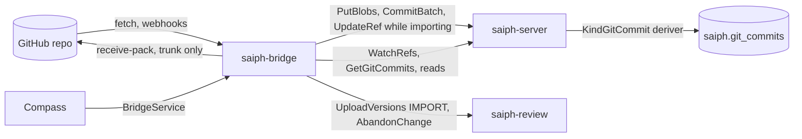
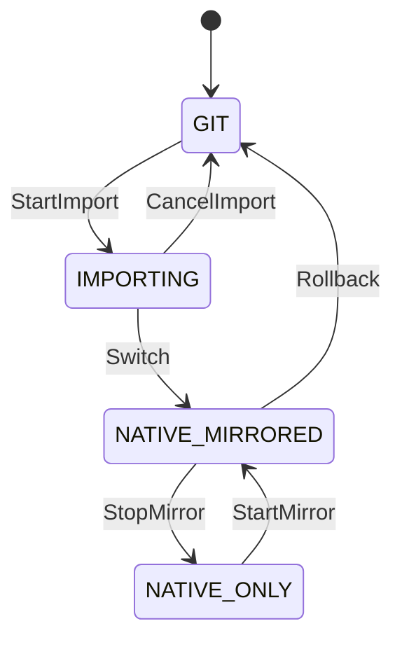

# Saiph: git bridge

Tracker: RIG-5665

> Freezes on merge; later changes supersede by citation, never rewrite
> (convention: the `docs/designs/agent/compass-agent-config-delivery/design.md`
> header). Unless a path says otherwise, every code path is in the
> `RigelBuild/saiph` repo, which does not exist yet. A Compass path says
> "in Compass".

Ledger-impact: D1–D6 are filed as DL-621..DL-626. The RIG-5558 decisions
(DL-535..DL-538, DL-561) and DL-052 stay whole: they govern the git
backend, which this record does not change.

**Named decisions this record introduces:** D1–D6 in [Decisions](#decisions).

Length: Matt lifted the length cap for this set (ruling 6 in the
[overview](README.md#rulings)). The prose sits mostly in Approach, which
fixes the export mapping, the push rules, the import mapping and the
cutover steps.

This record designs Saiph's git interop: trunk export to GitHub, history
import from GitHub, and the per-repo move from the RIG-5558 git backend to
Saiph. It builds on the entities and RPCs of [store](store.md) and the
rulings in the [overview](README.md#rulings).

## Open Questions

The record is written against each recommendation below. OQ-2 and OQ-4
depend on OQ-1; the others stand alone.

### OQ-1 — What happens to GitHub PRs after cutover? (load-bearing)

After cutover, GitHub's default branch takes writes only from the bridge
([Cutover](#per-repo-cutover)). Bots still open PRs on the mirror. The
Compass repo has two that matter. release-please opens a Release PR on
each push to main (`release-pr` in `.github/workflows/release.yml` in
Compass), and it tags a release only when that PR is merged
([release-please README](https://github.com/googleapis/release-please#whats-a-release-pr):
"When the Release PR is merged, release-please takes the following
steps", then "Tags the commit with the version number"). Renovate PRs come
back when closed:
["This PR will be recreated if closed unmerged"](https://github.com/renovatebot/renovate/blob/main/docs/usage/key-concepts/pull-requests.md#immortal-prs).

- (a) **Refuse all.** The bridge comments on every PR with the Saiph path
  and closes it. Release automation and dependency updates must be
  rebuilt on Saiph before the repo moves. Renovate has no Saiph platform,
  so updates stop.
- (b) **Import allowlisted PRs, land by rebase.** The bridge imports a PR
  from an allowlisted author as a review change. The merge queue lands it
  as usual, with new ids, and the bridge closes the PR with the landed
  commit. Renovate works. release-please does not: its PR closes unmerged,
  so it never tags.
- (c) **Import allowlisted PRs, land by merge.** As (b), but the queue
  lands the change as a two-parent merge whose second parent is the PR
  head, exported with its original id. GitHub then marks the PR merged:
  "A pull request can be marked as merged if its head branch commits
  become reachable from the base branch outside that pull request"
  ([GitHub docs](https://docs.github.com/en/pull-requests/reference/pull-request-merges#indirect-merges)).
  release-please accepts merges ("Both squash-merge and merge commits work
  with Release PRs"). It needs a land-by-merge mode in the merge queue
  ([Contracts with sibling records](#contracts-with-sibling-records)).

**Recommendation: (c).** Both bots keep working with no change to their
setup, and GitHub main still has one writer. Every imported PR goes
through Saiph review, CI and the queue like any change. (b) is the
fallback if the merge queue does not take the land-by-merge mode.

One risk is open. release-please finds a release by the merged PR's
merge commit (`mergeCommitOid: pullRequest.mergeCommit?.oid` in
`src/github.ts`, and `src/manifest.ts` skips a commit with a "missing
merged pull request"). GitHub's docs do not say whether an indirect merge
sets `mergeCommit`. Task B6 tests it on a scratch repo before the Compass
repo leaves `GIT`. If it is not set, release-please never tags, (c) gives
it nothing over (b), and this question reopens.

### OQ-2 — What happens to PRs from authors not on the allowlist? (depends on OQ-1)

The Compass mirror is public, so strangers can open PRs.

- (a) The bridge comments once with the contribution path and closes the
  PR.
- (b) The bridge imports it as a review change with no owner, and a human
  adopts it. CI then runs a stranger's code, which [ci-cd](ci-cd.md) must sandbox
  first.
- (c) The bridge ignores it. The PR stays open and can never merge.

**Recommendation: (a) now, (b) when [ci-cd](ci-cd.md) runs untrusted
presubmits.** A PR that can never merge should not look open.

### OQ-3 — What does import do with history Saiph cannot hold? (load-bearing)

Three git shapes have no Saiph form. A gitlink (mode `160000`, a
submodule) has no entry kind ([store](store.md#changeset): file,
executable, symlink). A path that is not UTF-8 fails the store's path
rule. A non-canonical tree, such as a zero-padded mode, derives a
different tree id, so its commit cannot round-trip (D1).

- (a) **Refuse.** Import stops at the first such commit and reports every
  one it finds, with commit and path. That repo stays on the git backend.
- (b) **Represent.** Add a gitlink kind (Mononoke has one: `GitSubmodule`
  in `eden/mononoke/mononoke_types/src/file_change.rs`), raw path bytes,
  and raw tree bytes as store additions.
- (c) **Rewrite.** Import a cleaned history and force-push it to GitHub at
  cutover. Every SHA, tag, fork and signature breaks.

**Recommendation: (a).** The Compass checkout has no `.gitmodules` file.
(b) can come later as new `FileChange` kinds, which do not change old
ids. (c) breaks D1.

### OQ-4 — What happens to open GitHub PRs at the switch? (depends on OQ-1)

At the switch, agents and humans may have open PRs on the git backend.

- (a) **Import.** The bridge imports each open PR whose head is in the same
  repo through the OQ-1 PR path, and closes it with a link to the new
  change. Compass names the owner from its PR ownership rows
  (`forge_authored_artifacts`, the RIG-5558 table).
- (b) **Close and resubmit**, as RIG-5558 did for jj-vine PRs
  (`agent-vcs-tools.md` OQ-5). Each owner re-creates the work on Saiph.

**Recommendation: (a).** It reuses the inbound path, and no work is lost.
PRs from forks get (b).

## Problem / Intent

Repos that move to Saiph already live on GitHub, with years of history and
people who read them there. Matt ruled that GitHub keeps a trunk-only
mirror for migration and public visibility, and that the Compass repo stays
mirrored (rulings 2 and 4). This record designs that bridge: deterministic
git commits from changesets, a push of trunk to GitHub, a full import of
git history into changesets, and a reversible, per-repo cutover from the
RIG-5558 git backend, which ships unchanged (ruling 5).

## Approach

### Ground truth

- `RigelBuild/saiph` does not exist yet, so every Saiph path is a plan. A
  Compass path says "in Compass".
- The RIG-5558 git backend ships unchanged and is frozen (ruling 5). The
  bridge is new code in the saiph repo. It does not call, wrap or edit
  the `Mirror` interface (`go/internal/forge/mirror.go` in Compass) or
  any table it uses.
- Saiph imports nothing from Compass. The bridge mints its own GitHub
  tokens; Compass reaches the bridge only through `saiph.v1`.

### Shape



The bridge has three parts:

- **The git-commit deriver** (`internal/gitexport`) runs inside
  `saiph-server`. It fills the store's `KindGitCommit` slot
  (`derive.Register`, store S9). It is pure, so every replica derives the
  same bytes.
- **`saiph-bridge`** (`cmd/saiph-bridge`) is its own binary, like
  `saiph-review`, `saiph-queue` and `saiph-ci`. Its rows live in schema
  `saiph_bridge`, with migrations in `internal/bridge/migrations/`
  numbered from `0001`. Each repo has one worker, held by a lease row
  that any replica can take, as the store's derive workers do. The worker
  imports, catches up, exports and handles inbound PRs for that repo.
- **Compass's cutover row** (in Compass) says which backend agents use.

Import builds changesets through the store's one intake path
([Intake](store.md#intake): "Import ([git-bridge](git-bridge.md)) runs inside
`saiph-server`"). The bridge reads git objects and sends structured
inputs with `CommitBatch`. The server checks, encodes and hashes them.
No client-encoded changeset crosses the wire.

### Identity and tokens

- **Saiph side.** The bridge is `service:saiph-bridge`. It signs its own
  five-minute tokens per tenant, as review does: its issuer is in
  `saiph-server`'s `--issuers` file and may mint only that subject.
  Scopes are `read write land import` (`import` is a store addition).
  Compass grants roles per repo with `SetGrant`: `REPO_ROLE_LAND` while
  the repo is `IMPORTING`, then `REPO_ROLE_WRITE` from the switch on.
- **GitHub side.** The bridge is its own GitHub App, not Compass's agent
  App and not the CI App. Its permissions are Contents write, Workflows
  write, Pull requests write and Metadata read. A separate App lets a
  ruleset name exactly one bypass actor (D2). Registering an App is a
  manual step with no IaC path (the comment beside the second
  `create-github-app-token` step in `.github/workflows/release.yml` in
  Compass says the same), so B9 files a human-action issue for it.
- **Minting.** `internal/githubapp` signs an RS256 App JWT and calls
  `POST /app/installations/{id}/access_tokens` with the repo and the
  permissions above. It is new code; it does not import
  `ScopedAppMinter` (`go/internal/forge/githubapp.go` in Compass).
  Tokens are cached until five minutes before they expire.
- **Git transport.** The token is the HTTP password with user
  `x-access-token`, as GitHub documents: "use the installation access
  token as the HTTP password"
  ([GitHub docs](https://docs.github.com/en/apps/creating-github-apps/authenticating-with-a-github-app/authenticating-as-a-github-app-installation)).

### Export mapping

Export is a pure function of a changeset and its parents' git ids (D1).
The store owns the slot; this record owns the function
([Derived data](store.md#derived-data): "git trees and commits from
changesets, with `extra` keys for round-trip fields").

| Git field | From |
| -- | -- |
| blob id | content meta `git_sha1` (lazy, `saiph.derived`) |
| tree entry mode | `ENTRY_KIND_FILE` `100644`, `EXECUTABLE` `100755`, `SYMLINK` `120000`, `TREE` `40000` |
| tree | entries in git order (a directory name sorts as if it ended in `/`); one git tree per Saiph tree node, memoized as lazy kind `KindGitTree` |
| `parent` lines | `parents` in order, each mapped through `saiph.git_commits` |
| `author`, `committer` | `name <email> seconds tz`; seconds are `time_unix_ms / 1000` rounded down; `tz` is `tz_offset_min` as `±hhmm`; `extra["git.author"]` or `extra["git.committer"]` replaces the line when present |
| extra headers | `extra["git.headers"]` verbatim when present; otherwise one `change-id` header |
| message | `message` bytes |

- **Recursion.** A commit needs its parents' git ids, so deriving a merge
  derives its side parents first. A side parent gets a
  `saiph.git_commits` row even though it has no `trunk_seq`.
- **`change-id`.** A changeset born in Saiph exports one header,
  `change-id <id>`, in jj's form: jj writes `change_id.reverse_hex()` under
  `CHANGE_ID_COMMIT_HEADER: &str = "change-id"`
  ([`lib/src/git_backend.rs`](https://github.com/jj-vcs/jj/blob/9ff73e7f/lib/src/git_backend.rs)).
  A jj user who fetches the mirror sees Saiph's change ids.
- **Round-trip keys.** Import sets `git.headers` on every imported
  changeset, empty when the commit had no extra headers. It holds every
  header after `committer` (`gpgsig`, `gpgsig-sha256`, `mergetag`,
  `encoding`, `change-id` and unknown ones) as raw bytes, in order. Import
  sets `git.author` or `git.committer` only when the parsed `Signature`
  does not print back to the same line. So an imported commit exports
  byte-identical, signatures included, and a Saiph-born one never carries
  a `gpgsig`.
- **Mononoke** stores the same round-trip data as typed fields
  (`git_extra_headers` in `bonsai.thrift`). Saiph keeps them in `extra`,
  which the store does not read.

### Export push

Each mirrored repo's worker tails `WatchRefs(names = [trunk_ref])` from
`saiph_bridge.repos.export_log_seq`.

1. It coalesces trunk moves: at most one push per repo per 10 seconds.
   GitHub's "recommended maximum limit is 6 pushes per minute per
   repository"
   ([repository limits](https://docs.github.com/en/repositories/creating-and-managing-repositories/repository-limits)).
2. It reads `GetGitCommits(changesets = [head])`. It builds the same
   commit with `internal/gitexport` from `GetChangesets`, `GetTrees` and
   `GetBlobs`, and checks that the ids agree. A disagreement is a bug: the
   worker stops and pages.
3. It builds a pack of the objects that are new since the last exported
   head: the commits from `Log(heads = [head], stop = [last])` without
   `first_parent`, the trees on their changed paths and their new blobs.
   It encodes the pack with go-git's `packfile.NewEncoder`. GitHub's push
   limit is "enforced at 2GB" (same page); a pack above 1 GiB is split
   into several pushes along the first-parent chain.
4. It opens `transport.NewReceivePackSession` and reads
   `AdvertisedReferencesContext`. The remote branch must equal the last
   exported head. Then it sends one command
   `{Name: refs/heads/<branch>, Old: last, New: head}` with
   `report-status` and reads `ReportStatus`.
5. On success it stores the new head and `export_log_seq` in one
   transaction.

The push is always a fast-forward. The bridge never force-pushes (D1).

**When GitHub rejects a push**, the worker classifies the report:

| Rejection | Action |
| -- | -- |
| Remote branch is not the last exported head | Someone else wrote GitHub main. Stop the mirror, page, keep Saiph trunk moving. A human finds the writer; the bridge never overwrites it. |
| Workflows permission (a change under `.github/workflows/`) | The App lacks Workflows write. Stop and page: a config error, not data. |
| Push protection, `GH009: Secrets detected! This push failed.` | Stop at that changeset and page with the rejected commit. Trunk is immutable, so the commit cannot be dropped. A human rotates the secret, then uses GitHub's bypass, which "anyone with write access to the repository" can use "by specifying a bypass reason" ([push protection](https://docs.github.com/en/code-security/secret-scanning/introduction/about-push-protection)). The worker retries every 10 minutes. |
| A ruleset or branch protection rule | Stop and page. The ruleset must name the bridge App as a bypass actor (D2). |
| Network, 5xx, timeout | Retry with backoff from 10 seconds to 10 minutes. |

A file above 100 MiB cannot reach a push: a mirrored repo cannot raise
`max_file_bytes` above 100 MiB (store, Caps). The bridge sets
`git_mirrored` on the repo, and the store enforces it.

**Changes under review are never mirrored** (README non-goals, ruling
2). The worker pushes only the trunk branch. Off-trunk changesets reach
GitHub only as side parents of a landed merge (OQ-1 (c)), and by then
they are on trunk.

Tags are not mirrored either. Saiph has no tags. Tags made on GitHub,
such as release-please's, stay on GitHub and point at mirrored commits.

### Import mapping

Import reads one branch, the GitHub default branch, and its full history
(D3).

1. **Fetch.** `git.PlainCloneContext(ctx, dir, true, &git.CloneOptions{
   URL, Auth, ReferenceName, SingleBranch: true, Tags: git.NoTags})` into a
   scratch volume. Catch-up uses `(*Repository).FetchContext`.
2. **Order.** Commits reachable from the branch head, parents first.
   Commits already in `saiph.git_commits` (`GetGitCommits(git_commits =
   ...)`) are skipped.
3. **Check.** Each commit must fit Saiph (OQ-3). The worker re-encodes
   every tree and the commit with `internal/gitobj`; bytes that differ
   mean non-canonical. It also refuses a gitlink, a path that is not
   UTF-8 or fails `object.CheckPath`, a message that is not UTF-8, and a
   file above `max_file_bytes`. The worker records every refusal with its
   commit and path and keeps going, so one run lists them all.
4. **Changes.** `changes` is the diff from `tree(parents[0])` to the
   commit's tree. A root commit lists every path. A merge is diffed
   against its first parent only: the store's tree rule says "A merge
   lists every path whose merged result differs from `parents[0]`". Git
   records no copies, so `copy_from` stays empty. A path that changes from
   a file to a directory lists the file as deleted, which the store's
   prefix rule allows.
5. **Blobs.** `FindMissingBlobs`, then `PutBlobs` (at most 4 MiB each)
   or `PutChunkedBlob`. Content ids come from `object.BlobID`.
6. **Signatures.** Seconds become `time_unix_ms = seconds * 1000`; the
   `±hhmm` offset becomes `tz_offset_min`. `git.author` and
   `git.committer` keep a line that does not print back the same.
7. **Change id.** A `change-id` header is read with jj's
   `ChangeId::try_from_reverse_hex`. Otherwise the id is jj's
   `synthetic_change_id_from_git_commit_id`: commit bytes `[4..20]`, in
   reverse order, each byte's bits reversed ("We reverse the bits of the
   commit id to create the change id"). A jj user's ids survive, and
   every other commit gets the id jj would give it.
8. **Write.** `CommitBatch` with up to 1,000 commits, parents first, then
   `UpdateRef(trunk_ref, expected, target, chain)` along the first-parent
   chain. A trunk move derives `saiph.git_commits`.
9. **Verify.** For each batch head, the worker waits for
   `GetGitCommits` and checks it equals the git commit it came from. A
   mismatch is a `ROUND_TRIP` refusal. This proves D1 on every import.

A refusal stops the import before the refused commit. The repo stays
`IMPORTING` with its refusals in `GetBridgeRepo`, and it cannot switch.

**Catch-up.** While the repo is `IMPORTING`, GitHub main is still the
writer. The worker fetches on each `push` webhook and every 60 seconds
with a conditional request (a 304 "does not count against your primary
rate limit"). It imports the new commits through steps 2–9. A branch
that moved to a commit that does not descend from the last imported head
(a force-push) is a refusal: the operator restarts the import.

### Inbound PRs

After the switch, GitHub PRs follow OQ-1 (c) and OQ-2 (a).

1. **Webhook.** The bridge serves `POST /github/webhook` and checks
   `X-Hub-Signature-256` with the App's webhook secret. It handles
   `pull_request` events: `opened`, `reopened`, `synchronize` and
   `closed`.
2. **Filter.** A PR whose head is in another repo, or whose author is not
   on the repo's `inbound_authors` list, gets one comment with the
   contribution path and is closed (OQ-2 (a)).
3. **Import.** The worker fetches `refs/pull/<n>/head`. The PR's commits
   from the merge base with the mirror to the head go through the import
   steps above, off trunk. The k-th commit from the base gets change id
   `BLAKE2b-128("saiph.bridge.pr" ‖ repo ‖ PR number ‖ k)` unless it has
   a `change-id` header. So a force-push of the PR becomes a new version
   of the same change, not a new change.
4. **Upload.** `UploadVersions(heads = [PR head changeset], reason =
   VERSION_REASON_IMPORT, owner = "external:github:<login>")`. The
   bridge comments once on the PR with the change's review link.
5. **Land.** A human with `REPO_ROLE_WRITE` requests the land, as review
   requires. The queue lands the change by merge
   ([Contracts with sibling records](#contracts-with-sibling-records)).
   The PR head keeps its changeset, so it exports to its original git id.
   The next trunk push makes it reachable from GitHub main, and GitHub
   marks the PR merged ("A pull request can be marked as merged if its
   head branch commits become reachable from the base branch outside that
   pull request",
   [GitHub docs](https://docs.github.com/en/pull-requests/reference/pull-request-merges#indirect-merges)).
6. **After.** On `EVENT_KIND_LANDED` the bridge waits for the export of
   `landed_trunk_seq`. If the PR is not marked merged 5 minutes after
   that, it comments with the landed commit and closes the PR. A PR
   closed on GitHub, or by its author, gets `AbandonChange`. A change
   abandoned in Saiph closes its PR.

The bridge keeps `(repo, pr number) → change id` in
`saiph_bridge.inbound_prs`. It reads `GetChanges` to reconcile after a
restart.

### Per-repo cutover



| State | Agents' backend | GitHub credential and egress for the repo | Where work lands | Writer of GitHub main | Bridge's Saiph role |
| -- | -- | -- | -- | -- | -- |
| `GIT` (or no row) | git (RIG-5558) | yes | GitHub PRs | GitHub merges | none |
| `IMPORTING` | git (RIG-5558) | yes | GitHub PRs | GitHub merges; the bridge imports | `LAND` |
| `NATIVE_MIRRORED` | Saiph | no | Saiph review and queue | the bridge only | `WRITE` |
| `NATIVE_ONLY` | Saiph | no | Saiph review and queue | nobody | `WRITE` |

Compass keeps the state in its own table and derives the backend with
`repoCutoverState` and `repoBackend` (`go/server/vcs_backend.go` in
Compass), as agreed with [client](client.md). A session picks its
backend at start, so a session that started on git finishes on git.

**Switch.** Compass's admin RPC runs these steps in order:

1. **Precheck.** The bridge is caught up, has no refusal, and the
   branch head carries the repo's Saiph policy files. A repo with
   `.github/workflows/` needs `.github/workflows/.saiphacl` granting
   write to named humans and `service:saiph-bridge` (store
   [ACLs](store.md#per-directory-acls)), plus `.saiphreview` and
   `.saiphqueue`. These files land on GitHub through the git path before
   the switch, so import brings them.
2. **Freeze.** An IaC change adds a GitHub ruleset on the branch with
   "Restrict updates" ("Only allow users with bypass permission to update
   matching refs") and the bridge App as its only bypass actor. For the
   Compass repo, the same change takes the Trunk merge queue's apps off
   the bypass list. Agents' GitHub merges now fail; their PRs wait.
3. **Final catch-up.** The bridge fetches once more. `Switch` takes the
   expected head and fails if GitHub moved.
4. **`Switch`.** The bridge reads the ruleset with
   `GET /repos/{owner}/{repo}/rulesets/{id}` and needs
   `current_user_can_bypass = "always"`. It sets
   `last exported = last imported`, turns on `git_mirrored` and enters
   `NATIVE_MIRRORED`. Exports start.
5. **Compass** grants the bridge `REPO_ROLE_WRITE`, enables the queue
   (`EnableRepo`), writes `NATIVE_MIRRORED`, and runs OQ-4 (a) for open
   PRs. New sessions get the Saiph backend and no GitHub credential for
   the repo (client D6).

The freeze lasts from step 2 to step 5, minutes for a caught-up repo.

**Rollback** works from `NATIVE_MIRRORED` while the mirror is exact:
Compass disables the queue (`DisableRepo`), the bridge exports the last
trunk head and checks GitHub main equals it, Compass writes `GIT`, and
an IaC change removes the ruleset. Every landed change is on GitHub
already, so no history is lost. Open Saiph changes stay in Saiph; their
owners re-create them as PRs. A later `StartImport` resumes from
`saiph.git_commits` and imports only what GitHub gained.

**`NATIVE_ONLY`** stops exports. The Compass repo never takes it
(ruling 4); the bridge refuses `StopMirror` for any repo on its
`--always-mirror` list. `StartMirror` exports the gap, which works
because export is deterministic and nobody else wrote GitHub main.

**Drift.** Compass compares its row with `GetBridgeRepo` every 5
minutes and pages on a mismatch.

### Caps and spend

| Layer | Usage-billed part | Cap |
| -- | -- | -- |
| Store | blobs and rows from import | the repo's `quota_bytes`; import stops with `RESOURCE_EXHAUSTED` |
| Node | `saiph-bridge` pods | CPU and memory limits in the Deployment |
| Cluster | import scratch volumes | a namespace `ResourceQuota` on `requests.storage`; `--scratch-bytes` (default 20 GiB) per repo |
| Vendor account | cloud disks and compute | the store's existing account cap and billing alert (store S11); B9 adds the bridge's spend-cap rows beside it |
| GitHub | API and pushes | no bill; the bridge caps itself at one push per 10 seconds per repo and one poll per 60 seconds |

Alerts that page Matt: export lag above 15 minutes, a stopped mirror,
an import refusal on a repo meant to switch, and the store's budget
alert.

### Contracts with sibling records

- **Merge queue: land by merge.** For an entry whose change owner is
  `external:github:*` on a repo with `git_mirrored`, the queue lands with
  `Merge(parents = [projection head, member])` instead of `Rebase`. The
  member keeps its changeset and git id. The merge is on the chain; the
  member is a side parent. A merge conflict ejects the entry as any
  trunk conflict does. [Merge queue](merge-queue.md) has no such mode
  today; it is the condition for OQ-1 (c). The queue needs no pause: it
  is not enabled until step 5 of the switch, and rollback disables it
  first.
- **Review.** As agreed: `UploadVersions` with `VERSION_REASON_IMPORT`
  and an `external:github:<login>` owner, `AbandonChange` on an external
  change, `GetChanges` fields 1, 3, 10 and 11, and
  `WatchEvents(kinds = [EVENT_KIND_LANDED])`. Review's
  [landing detection](review.md#landing-detection) already marks a side
  member of a landed merge `LANDED`.
- **Client.** `repoCutoverState` returns the four states above; no row
  means `GIT`; the backend is derived, never stored. Client OQ-6 (a)
  reads the same function.
- **CI.** ci-cd OQ-5 (a) keeps the macOS suite on GitHub Actions on the
  mirror. That works because a push with an App token starts workflow
  runs, and a `GITHUB_TOKEN` push would not. OQ-2 (b) waits for CI's
  untrusted presubmit sandbox. A presubmit secret scan would stop most
  `GH009` stalls before they reach trunk; that is CI's call.

### Store additions

Folded into [store](store.md#api-the-saiphv1-connect-package):
`CommitBatch`, the `import` scope, `SetGitMirrored` and
`Repo.git_mirrored` (task S6), and `GetGitCommits` and the `KindGitTree`
slot ([Derived data](store.md#derived-data), task S9).

### Alternatives considered

- **Reuse the RIG-5558 `Mirror` and its mirror dir.** Rejected: ruling 5
  freezes it, and Saiph imports nothing from Compass.
- **Export only a snapshot, not history.** Rejected: GitHub readers and
  forks keep their SHAs only if import and export round-trip.
- **Import with `Commit` one call per commit.** Works, but costs a round
  trip per commit. `CommitBatch` is the same intake.
- **Rewrite history at cutover** (OQ-3 (c)). Rejected: it breaks every
  SHA.
- **Let GitHub keep a second writer** (a GitHub merge queue beside
  Saiph's). Rejected: two writers need a merge on the mirror, and the
  mirror would stop being a function of Saiph trunk.
- **Compass mints the bridge's GitHub tokens.** Rejected: the saiph repo
  would need a Compass contract for a self-hosted Saiph to mirror.

### Decisions

- **D1 (DL-621) — Export is a pure function, and import round-trips.** Every
  imported git commit exports byte-identical; the bridge proves it per
  batch and never force-pushes.
- **D2 (DL-622) — GitHub main has one writer after the switch.** A ruleset whose
  only bypass actor is the bridge's own App enforces it, and the bridge
  checks it before switching.
- **D3 (DL-623) — Import is trunk-only, first-parent diffed and refusing.** It
  goes through store intake with `CommitBatch`, and unrepresentable
  history keeps the repo on git (OQ-3 (a)).
- **D4 (DL-624) — Cutover is a per-repo state machine in Compass.** `GIT`,
  `IMPORTING`, `NATIVE_MIRRORED`, `NATIVE_ONLY`; the backend is derived;
  rollback from `NATIVE_MIRRORED` loses no landed history.
- **D5 (DL-625) — Allowlisted same-repo GitHub PRs become external review changes
  and land by merge** (OQ-1 (c)); other PRs are closed with a comment
  (OQ-2 (a)).
- **D6 (DL-626) — The bridge is its own binary, schema and GitHub App.** It mints
  its own tokens and leaves RIG-5558 unchanged.

## Plan

### Global Constraints

- Every store Global Constraint applies: public repo, Go 1.26,
  `connectrpc.com/connect/v2`, the Compass lint rules, red/green tests on
  Postgres 16 and YugabyteDB, `buf lint` STANDARD.
- **No Compass import** in the saiph repo. Compass code changes are only
  B8, and they live in Compass.
- **RIG-5558 unchanged.** No task edits `go/internal/forge/mirror.go`,
  `forge_mirrors` or `agent-vcs-tools.md` in Compass.
- **No sapling code** (ruling 12). Mononoke and jj are cited for ideas;
  jj is Apache-2.0, and the change-id algorithm is written fresh.
- **New dependency:** `github.com/go-git/go-git/v5` (Apache-2.0) at
  v5.19.3 or later, for fetch, pack encoding and receive-pack.
- **Migrations.** `saiph_bridge` numbers from `0001`. The Compass table
  takes the next free number at implementation time.
- **Never** force-push, push a non-trunk ref, or push without a
  `report-status` check.

### Order

```text
B1 gitobj+gitexport ─┬─ B2 store additions ─┬─ B4 import ─┬─ B6 inbound PRs ─┐
                     │                      └─ B5 export ─┤                  ├─ B9 deploy+caps
B3 bridge skeleton ──┴────────────────────────────────────┴─ B7 cutover ─────┤
B8 Compass cutover row (after B3's proto) ────────────────────────────────────┘
```

### B1 — Git objects and the export function

`internal/gitobj` encodes and decodes git commits and trees and checks
canonical form. `internal/gitexport` maps changesets to commits and
registers `KindGitCommit` and `KindGitTree`. Tests: vectors of real
commits (signed, `mergetag`, octopus merge, `change-id` header, an
odd ident line) round-trip byte-identical; a zero-padded mode is not
canonical; the synthetic change id matches jj's for ten fixed commits;
a Saiph-born changeset exports one `change-id` header.

Interfaces:

```go
// internal/gitobj
type Hash [20]byte
type TreeEntry struct{ Mode uint32; Name []byte; ID Hash }
type Commit struct {
	Tree      Hash
	Parents   []Hash
	Author    []byte // raw ident line value
	Committer []byte
	Headers   []byte // raw header lines after committer, in order
	Message   []byte
}
func ObjectID(kind string, body []byte) Hash
func EncodeTree(entries []TreeEntry) []byte // sorts in git order
func DecodeTree(body []byte) ([]TreeEntry, error)
func EncodeCommit(c Commit) []byte
func DecodeCommit(body []byte) (Commit, error)
func CanonicalTree(body []byte) bool

// internal/gitexport
const (
	ExtraHeaders   = "git.headers"
	ExtraAuthor    = "git.author"
	ExtraCommitter = "git.committer"
)
func CommitFor(cs *object.Changeset, tree gitobj.Hash, parents []gitobj.Hash) (gitobj.Commit, error)
func TreeFor(entries []object.TreeEntry, id func(object.TreeEntry) (gitobj.Hash, error)) ([]gitobj.TreeEntry, error)
func ReverseHex(id [16]byte) string
func ParseReverseHex(s string) ([16]byte, error)
func SyntheticChangeID(commit gitobj.Hash) [16]byte
type CommitDeriver struct{}
func (CommitDeriver) Kind() derive.Kind // derive.KindGitCommit
func (CommitDeriver) Derive(ctx context.Context, env *derive.Env, id object.ID) ([]byte, error)
type TreeDeriver struct{}
func (TreeDeriver) Kind() derive.Kind // derive.KindGitTree
func (TreeDeriver) Derive(ctx context.Context, env *derive.Env, id object.ID) ([]byte, error)
```

### B2 — Store additions

Folded into store tasks S6 and S9
([store](store.md#s6--intake-commit-and-the-read-services)), which carry
the tests and interfaces.

### B3 — `saiph-bridge` skeleton

The binary, flags, schema and migrations, the per-repo lease, the token
issuer, the GitHub App minter and `BridgeService`. Tests: two replicas
hold one repo's lease; a token minted for another subject is refused by
`saiph-server`; a cached GitHub token is reused until five minutes
before expiry.

Interfaces:

```go
// cmd/saiph-bridge
type bridgeFlags struct {
	DSN, SaiphURL, Issuers, Listen string
	IssuerKeyFile, AppKeyFile, WebhookSecretFile, ScratchDir string
	AppID, ScratchBytes int64
	AlwaysMirror []string
}
func registerFlags(fs *flag.FlagSet) *bridgeFlags
// internal/githubapp
type Minter struct{ /* app id, key, http client, cache */ }
func NewMinter(appID int64, key *rsa.PrivateKey, hc *http.Client) *Minter
func (m *Minter) Token(ctx context.Context, owner, repo string) (token string, expires time.Time, err error)
// internal/bridge
type State int16 // StateGit = 1, StateImporting = 2, StateNativeMirrored = 3, StateNativeOnly = 4
func (b *Bridge) Run(ctx context.Context) error // leases repos and runs one worker each
```

```proto
// proto/saiph/v1/bridge.proto
service BridgeService {
  rpc StartImport(StartImportRequest) returns (StartImportResponse);
  rpc CancelImport(CancelImportRequest) returns (CancelImportResponse);
  rpc GetBridgeRepo(GetBridgeRepoRequest) returns (GetBridgeRepoResponse) { option idempotency_level = NO_SIDE_EFFECTS; }
  rpc Switch(SwitchRequest) returns (SwitchResponse);
  rpc Rollback(RollbackRequest) returns (RollbackResponse);
  rpc StopMirror(StopMirrorRequest) returns (StopMirrorResponse);
  rpc StartMirror(StartMirrorRequest) returns (StartMirrorResponse);
}
enum CutoverState { CUTOVER_STATE_UNSPECIFIED = 0; CUTOVER_STATE_GIT = 1; CUTOVER_STATE_IMPORTING = 2; CUTOVER_STATE_NATIVE_MIRRORED = 3; CUTOVER_STATE_NATIVE_ONLY = 4; }
enum RefusalReason { REFUSAL_REASON_UNSPECIFIED = 0; REFUSAL_REASON_GITLINK = 1; REFUSAL_REASON_PATH_NOT_UTF8 = 2; REFUSAL_REASON_NONCANONICAL = 3; REFUSAL_REASON_MESSAGE_NOT_UTF8 = 4; REFUSAL_REASON_BAD_PATH = 5; REFUSAL_REASON_FILE_TOO_LARGE = 6; REFUSAL_REASON_ROUND_TRIP = 7; REFUSAL_REASON_FORCE_PUSH = 8; }
message Refusal { bytes git_commit = 1; string path = 2; RefusalReason reason = 3; }
message BridgeRepo { string repo = 1; string github_repo = 2; string branch = 3; CutoverState state = 4; bytes imported_git_commit = 5; bytes exported_git_commit = 6; int64 export_lag_ms = 7; repeated Refusal refusals = 8; string last_error = 9; repeated string inbound_authors = 10; }
message StartImportRequest { string repo = 1; string github_repo = 2; string branch = 3; repeated string inbound_authors = 4; }
message StartImportResponse { BridgeRepo repo = 1; }
message CancelImportRequest { string repo = 1; }
message CancelImportResponse { BridgeRepo repo = 1; }
message GetBridgeRepoRequest { string repo = 1; }
message GetBridgeRepoResponse { BridgeRepo repo = 1; }
message SwitchRequest { string repo = 1; bytes expected_git_commit = 2; }
message SwitchResponse { BridgeRepo repo = 1; }
message RollbackRequest { string repo = 1; }
message RollbackResponse { BridgeRepo repo = 1; }
message StopMirrorRequest { string repo = 1; }
message StopMirrorResponse { BridgeRepo repo = 1; }
message StartMirrorRequest { string repo = 1; }
message StartMirrorResponse { BridgeRepo repo = 1; }
```

`BridgeService` callers need the `provision` scope (`service:compass`).

### B4 — Import and catch-up

Steps 1–9 of [Import mapping](#import-mapping) and catch-up. Tests: a
fixture repo with a merge imports with each merge's `changes` equal to
its first-parent diff; a gitlink, a non-UTF-8 path and a zero-padded
mode each give one refusal naming commit and path; a re-run imports
nothing; a force-push on the branch gives `FORCE_PUSH`; every imported
head's `GetGitCommits` equals its source.

Interfaces:

```go
// internal/gitimport
type Source interface {
	Commit(h gitobj.Hash) (gitobj.Commit, error)
	Tree(h gitobj.Hash) ([]byte, error)
	Blob(h gitobj.Hash) (io.ReadCloser, int64, error)
}
func Convert(ctx context.Context, src Source, h gitobj.Hash, maxFileBytes int64) (*saiphv1.CommitRequest, []*saiphv1.Refusal, error)
type Importer struct{ /* saiphv1connect clients, Source */ }
func (im *Importer) Run(ctx context.Context, repo, branch string, head gitobj.Hash) (imported int, refusals []*saiphv1.Refusal, err error)
```

### B5 — Export push

[Export push](#export-push), with the rejection table. Tests against a
local `git http-backend` fixture: a trunk move pushes one fast-forward;
a remote that moved stops the mirror without a push; three moves in 10
seconds give one push; each rejection kind maps to its action (fixture
hooks print the GitHub messages).

Interfaces:

```go
// internal/bridge
type PushErrorKind int // PushRemoteMoved, PushWorkflows, PushSecret, PushRule, PushTransient
type PushError struct{ Kind PushErrorKind; Message string }
func (e *PushError) Error() string
func ClassifyReport(rs *packp.ReportStatus, remote, expected gitobj.Hash) error
func (w *worker) exportOnce(ctx context.Context) error
```

### B6 — Inbound PRs

[Inbound PRs](#inbound-prs) and the OQ-4 (a) import of open PRs at the
switch. Tests: an allowlisted same-repo PR becomes an external change;
a force-push adds a version of the same change; a fork PR is commented
on and closed; a PR closed on GitHub abandons its change; a landed merge
makes a scratch GitHub repo mark the PR merged, and the test records
whether `mergeCommit` is set (OQ-1 risk).

Interfaces:

```go
// internal/bridge
func (b *Bridge) ServeWebhook(w http.ResponseWriter, r *http.Request)
func VerifySignature(secret, body []byte, header string) error
func PRChangeID(repo string, pr int64, k int) [16]byte
func (w *worker) importPR(ctx context.Context, pr int64) (changeID [16]byte, err error)
```

### B7 — Cutover RPCs

`Switch`, `Rollback`, `StopMirror`, `StartMirror` and `CancelImport`
with the prechecks of [Per-repo cutover](#per-repo-cutover). Tests:
`Switch` fails without the ruleset bypass, with a refusal, with a missing
`.github/workflows/.saiphacl`, or when GitHub moved; `Rollback` fails
while GitHub main differs from the export; `StopMirror` fails for an
`--always-mirror` repo.

Interfaces: the `BridgeService` handlers, each of the shape
`func (s *bridgeService) Switch(ctx context.Context, req *saiphv1.SwitchRequest) (*saiphv1.SwitchResponse, error)`.

### B8 — The cutover row (in Compass)

A `repo_cutovers` table, `repoCutoverState`, an admin RPC that runs the
switch and rollback steps against `BridgeService`, `SetGrant` and the
queue's `EnableRepo`/`DisableRepo`, and the 5-minute drift check.
Tests: no row is `GIT`; `IMPORTING` gives `REPO_BACKEND_GIT`; a failed
`Switch` leaves the row unchanged; drift pages.

Interfaces:

```go
// go/server/vcs_backend.go (in Compass)
type cutoverState int16 // cutoverGit = 1, cutoverImporting = 2, cutoverNativeMirrored = 3, cutoverNativeOnly = 4
func (s *Server) repoCutoverState(ctx context.Context, repo string) (state cutoverState, found bool, err error)
```

```sql
-- next free migration number (in Compass)
CREATE TABLE repo_cutovers (
    repo       TEXT        PRIMARY KEY,
    state      SMALLINT    NOT NULL CHECK (state IN (1, 2, 3, 4)),
    actor_id   TEXT        NOT NULL,
    updated_at TIMESTAMPTZ NOT NULL DEFAULT now()
);
```

### B9 — Deploy, caps and the App

Deploy manifests in `deploy/` (Deployment, Service for the webhook,
`ResourceQuota`, migration Job), the alerts and the spend-cap rows in
[Caps and spend](#caps-and-spend), a runbook for the switch, and the
human-action issue to register the bridge App. Tests: the manifests
validate; each alert fires on an injected failure and stays quiet on a
healthy fixture.

## Tasks

- [ ] B1 — `internal/gitobj`, `internal/gitexport`, the two derivers
- [ ] B2 — store additions (done in store S6 and S9)
- [ ] B3 — `saiph-bridge` binary, `saiph_bridge` schema, lease, tokens, GitHub App minter, `BridgeService` proto
- [ ] B4 — import and catch-up with refusals
- [ ] B5 — trunk export push and rejection handling
- [ ] B6 — inbound PRs and the open-PR import at the switch
- [ ] B7 — cutover RPCs and prechecks
- [ ] B8 — `repo_cutovers`, `repoCutoverState`, admin flow, drift check (in Compass)
- [ ] B9 — deploy manifests, caps, alerts, runbook, App registration issue
