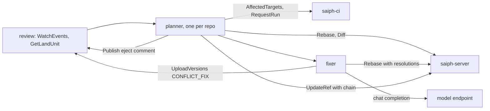

# Saiph: merge queue

Tracker: RIG-5665

> Freezes on merge; later changes supersede by citation, never rewrite
> (convention: the `docs/designs/agent/compass-agent-config-delivery/design.md`
> header). Unless a path says otherwise, every code path is in the
> `RigelBuild/saiph` repo, which does not exist yet. A Compass path says
> "in Compass".

Ledger-impact: D1–D9 are filed as DL-612..DL-620. The store addition this
record asked for (`Rebase` resolutions) is folded into
[store](store.md#server-side-commit-rebase-and-merge) (task S7).

**Named decisions this record introduces:** D1–D9 in [Decisions](#decisions).

Length: Matt lifted the length cap for this set (ruling 6 in the
[overview](README.md#rulings)). The prose sits mostly in Approach.

This record designs the merge queue that ruling 9 of the
[overview](README.md#rulings) asks for. It builds on the
[store](store.md#what-the-merge-queue-gets) calls, on review's land units
([review](review.md)) and on CI's affected targets and runs ([ci-cd](ci-cd.md)). It reuses
their entity and RPC names. The store call it added is listed in
[Store additions](#store-additions) and folded into store.

## Open Questions

OQ-1 and OQ-2 are load-bearing. OQ-6 has a sibling: ci-cd OQ-6 (flake
quarantine) changes how often OQ-6's hold fires, not its answer. The record
is written against each recommendation.

### OQ-1 — Pre-merge or post-merge gating? (load-bearing)

Scion: "We haven't been able to effectively replicate the industry standard
of a global repository lock on the merge queue, so instead, we've invested
in post-merge and pre-deploy automated testing. This does mean that
concurrent changes can conflict, but Claude can typically fix these
conflicts faster than humans can even identify them"
([Scion](https://www.anthropic.com/engineering/redesigning-source-control)).
Ruling 9 asks for batching and bisection, which is pre-merge gating. The
question is whether a repo may also take Scion's stance.

- (a) A per-repo `gate` mode in `.saiphqueue` (OQ-5). `pre`, the default:
  a batch lands only after a passing `RUN_KIND_MERGE_QUEUE` run on its
  projected state. `post`: the queue rebases, fixes and lands by CAS with
  no CI wait, and CI postsubmit, culprit finding and the pre-deploy gate
  ([ci-cd](ci-cd.md)) catch a breakage. In both modes, an entry that holds a
  conflict-fix version waits for a passing run.
- (b) `pre` only. Simple, but a repo with slow gate tests cannot trade
  green-trunk proof for throughput.
- (c) `post` only, as Scion. It drops the batching and bisection that
  ruling 9 asks for.

**Recommendation: (a), default `pre`.** Scion could not scale a global
lock. Per-target lanes remove the lock; they keep pre-merge testing. A
repo moves to `post` only when the queue's CI is its bottleneck. The
Compass repo starts on `pre`.

### OQ-2 — Does a conflict-fix version need a new approval? (load-bearing for review)

Matt asked that the author or the review policy decide.

- (a) The review policy decides by default: `carry_on_fix` in
  `.saiphreview`, true unless the repo sets it false. The author can
  require approval for one change with `fix_needs_approval`, which review
  owns (`RequestLandRequest` field 4) and returns as
  `LandEntry.fix_needs_approval` (field 6).
- (b) A fix always needs a new approval. Safe, but a one-line changelog
  merge then waits for a human, which defeats the fixer at agent scale.
- (c) A fix never needs one. The author loses control of their change.

**Recommendation: (a).** In every case the fix passes the same queue CI,
and review runs its semantic constraints again on the fix diff
([review](review.md)).

### OQ-3 — Which model does the fixer call, and through what?

Matt named "Luna or similar". Compass's model registry lists `gpt-6-luna`
for the implementer role (`docs/model-registry/README.md` in Compass:
"GPT-6 Luna implements").

- (a) An OpenAI-compatible `POST /v1/chat/completions` endpoint, set per
  install (`--fixer-url`, `--fixer-model`). Through Compass, this is the
  Compass LLM gateway, which serves that route
  ([gateway design](../compass/server/compass-server-llm-gateway/design.md)), with
  the stable name `gpt-6-luna`. A self-hosted Saiph points at any vendor.
  One call per conflict, with no tools.
- (b) A Compass agent session on a Runner, with tools. It can run builds,
  but Saiph then needs Compass to land a change, and a fix costs a whole
  session.

**Recommendation: (a).** The classifier limits the input to a few small
hunks, so tools buy nothing, and the queue's CI run is the build check.

### OQ-4 — What is trivial by default?

- (a) Conservative. Only `CONFLICT_KIND_CONTENT` in text files; at most 3
  paths, 5 hunks, 20 lines in any one term of a hunk and 60 conflicted
  lines in all; no path under a deny glob (default `**/.saiph*`).
- (b) A size limit only, for any kind. A `MODIFY_DELETE` or
  `FILE_DIRECTORY` conflict turns on intent, which a model cannot read
  from hunks.

**Recommendation: (a).** Mononoke's server-side merge resolution is also
bounded by a count: `collect_overlap_states` in
`eden/mononoke/features/pushrebase/src/lib.rs` returns
`MergeResolutionError::TooManyConflicts` past the
`scm/mononoke:pushrebase_max_merge_conflicts` knob. A model alone is not a
gate: MergeBERT reports "63-68% accuracy for merge resolution synthesis"
([MergeBERT](https://arxiv.org/abs/2109.00084)).

### OQ-5 — Where does queue policy live?

- (a) A repo-root `.saiphqueue` JSON file, read at the trunk head, as
  review reads `.saiphreview`. A policy change goes through review and the
  queue like any other change. A change cannot loosen the policy it lands
  under, because the queue reads trunk, not the candidate.
- (b) An admin RPC and a table. Faster to change, but not reviewed and not
  in history.

**Recommendation: (a).** Spend caps are not in the tree. They are operator
flags, and `.saiphqueue` can only lower them.

### OQ-6 — What does the queue do with an `INFRA` result?

CI keeps one result per (changeset, target) and never retries
([ci-cd](ci-cd.md), "Flakes and quarantine"). `INFRA` means the job never
reached a verdict: an eviction, a lost node, a failed image pull. It is
red, and CI's infra alert fires. CI stores `INFRA` on the run, not as the
changeset's result, "so a person may request a new run after the cause
is fixed. Nothing re-requests it automatically."

- (a) Request a new run at once, or rebuild the projection so its
  changesets are new and CI runs them again. Either is a retry, and the
  house rule forbids retrying until green.
- (b) Hold the batch. Its entries stay queued, with no bisection and no
  eject, until a holder of `REPO_ROLE_LAND` calls `Requeue` after the
  cause is fixed. That is the person CI's rule names. A trunk move does
  not release the hold: a new projection would run the same inputs
  again with no one asking, which is the automatic re-request CI forbids.
- (c) Eject the entries. That blames the author for CI's failure.

**Recommendation: (b).** A held batch blocks only its own lane; other
lanes go on. CI's infra alert already pages the CI lane, and its fix
ends with one `Requeue`.

### OQ-7 — Does the queue take a land-by-merge mode?

[git-bridge](git-bridge.md) OQ-1 (c) asks for one, so that
release-please, which accepts merges, keeps tagging.

- (a) Yes, per owner. `.saiphqueue` `merge_owners` lists change owners,
  for example `"external:github:release-please[bot]"`. Such an entry is
  batched alone. It lands as `Merge(trunk, head)`, with a `chain` of the
  one merge changeset; its members keep their ids. Review's "Landing
  detection" already marks side members of a merge as landed.
- (b) No. The bridge takes its fallback, OQ-1 (b): the queue lands
  imported PRs by rebase, and release-please stops tagging.

**Recommendation: (a).** It costs one branch in landing, no new store
RPC, and keeps both bots working.

## Problem / Intent

Agents land work at a rate no human queue was built for. Scion went from
"around 2,500 code changes merged per day" to "over 30,000 per day", and
could not keep "a global repository lock on the merge queue"
([Scion](https://www.anthropic.com/engineering/redesigning-source-control)).
Saiph needs a queue that lands review's ready stacks onto trunk with no
global lock: it batches, bisects failures, takes stacks as units, rebases
on the server, has a cheap model fix trivial conflicts, and ejects every
other conflict (ruling 9).

## Approach

### Ground truth

- **Saiph's repo** is `RigelBuild/saiph`. It does not exist yet, so every
  Saiph path here is a plan.
- **Store.** The queue uses only the calls listed in
  [What the merge queue gets](store.md#what-the-merge-queue-gets):
  `Rebase` with `drop_empty`, `Diff`, `MergeBase`, `IsAncestor`, `UpdateRef`
  with `chain`, `Pin`, `Unpin` and `WatchRefs`, plus the reads `GetRef`,
  `GetChangesets`, `ReadFile`, `Log` and `PutBlobs`. Trunk moves only for
  a subject with `REPO_ROLE_LAND`. Nothing conflicted is stored
  ([OQ-3](README.md#open-questions)).
- **Review** ([review](review.md), `saiph.v1.ReviewService`). The queue reads
  review; review never calls the queue. A land unit is a change with
  `land_requested` plus its open dependencies. `WatchEvents` with
  `EVENT_KIND_READINESS_CHANGED` carries `land_ready`, and
  `GetLandUnit` returns the unit's `LandEntry` rows in dependency order.
  Review records a landing from the trunk ref log; it has no callback.
- **CI** ([ci-cd](ci-cd.md), `saiph.v1.TargetService` and
  `saiph.v1.RunService`). `AffectedTargets(base, head)` is a snapshot diff
  of two root trees with no ancestry rule, so a speculative base works.
  It returns moon task ids `project:task`, `all` (the barrier) and
  `graph_changed`. A false `graph_changed` "always means it is
  unchanged". `RequestRun` with `RUN_KIND_MERGE_QUEUE` runs only `gate`
  tasks. `GetTargetStats` gives per-target flake counts. CI holds no pins.
- **Model gateway.** Through Compass, the fixer calls the Compass LLM
  gateway's `POST /v1/chat/completions`
  ([gateway design](../compass/server/compass-server-llm-gateway/design.md)).
  The gateway design has no spend cap, so the queue enforces its own
  (see [Model spend caps](#model-spend-caps)).

### Research and what Saiph takes from it

| Source | What it does | Saiph takes |
| -- | -- | -- |
| Scion | No global lock; "post-merge and pre-deploy automated testing"; "Claude can typically fix these conflicts faster than humans can even identify them" | No global lock; the `post` gate mode (OQ-1); a model fixer |
| Trunk, predictive testing | "each PR is tested as if all the PRs ahead of it have already been merged" ([docs](https://docs.trunk.io/merge-queue/optimizations/predictive-testing)) | Projected state |
| Trunk, parallel queues | "C tests predictively against both A and B"; "ALL impact is a serialization point" ([docs](https://docs.trunk.io/merge-queue/optimizations/parallel-queues)) | Lanes from affected targets; the `all` barrier |
| Trunk, pending failure depth | waits on "levels of successor test runs" before it fails or bisects ([docs](https://docs.trunk.io/merge-queue/optimizations/pending-failure-depth)) | Successor evidence |
| Trunk, batching | "It bisects into 2 sub-batches, retests, and recurses on whichever sub-batch failed"; "Only failures are reused" ([docs](https://docs.trunk.io/merge-queue/optimizations/batching)) | Bisection with its own concurrency, by prefixes, on new changesets |
| Trunk, anti-flake | "Retry limit should be 1-3 max" ([docs](https://docs.trunk.io/merge-queue/optimizations/anti-flake-protection)) | Nothing: no reruns (the house rule). Successor evidence and CI's flake quarantine replace them |
| Trunk, stacks | "tests and lands that Pull Request and every Pull Request beneath it atomically" ([docs](https://docs.trunk.io/merge-queue/using-the-queue/stacked-pull-requests)) | A stack is one entry |
| Graphite | "can't resolve any legitimate merge conflicts as a result of racing PRs on trunk that require human intervention" ([docs](https://graphite.com/docs/merge-pull-requests)) | Structural rebase is automatic; a real conflict needs a fixer or an eject |
| Uber SubmitQueue | "if the build graph remains unchanged, we just need to use the intersection of changed targets"; "only 7.9% of changes actually cause a change to the build graph" ([paper](https://www.masoud.io/docs/eurosys19.pdf)) | The land-time retest skip; a graph change is a barrier |
| Zuul | "Each time a change successfully merges, the window is increased by one. Each time a change fails, the window is halved" ([docs](https://zuul-ci.org/docs/zuul/latest/gating.html)) | An adaptive window of runs in flight |
| Google | Flake Aware Culprit Finding "is based on Bayesian inference and noisy binary search, utilizing prior information" ([paper](https://research.google/pubs/flake-aware-culprit-finding/)) | Flake rates as priors: they decide whether a failure waits for successor evidence or is bisected at once |
| Mononoke pushrebase | `MAX_REBASE_ATTEMPTS: usize = 100`; a server-side merge bounded by `scm/mononoke:pushrebase_max_merge_conflicts` (`eden/mononoke/features/pushrebase/src/lib.rs`) | The CAS retry bound; a size-bounded trivial class |

Chromium's commit queue names the same root problem: "The main problem is
test flakiness"
([design](https://www.chromium.org/developers/testing/commit-queue/design/)).
No primary source found describes a queue-side model conflict fixer.
GitHub's Copilot agent resolves a conflict, then "requests your review".
So the fixer here is Saiph's own design, held to the same CI as any
change.

### Shape

`saiph-queue` is its own binary in the saiph repo (OQ-2 of the
[overview](README.md#open-questions)). Its replicas keep no state of
their own; state is in the schema `saiph_queue`. Each repo has one
**planner**, held by a lease row that any replica can take, as the store's
derive workers do. The planner makes decisions in milliseconds and holds
nothing while CI runs. Batches in disjoint lanes test and land in
parallel, and they meet only at the trunk CAS.



The queue's words:

| Term | Meaning |
| -- | -- |
| entry | One land unit in the queue: a root change id and its members' `(change_id, version, changeset)`. A stack DAG is one entry. |
| seq | The entry's place in queue order, given at admission. |
| overlap | Two entries overlap when their targets meet, their changed paths meet, or either is a barrier. |
| barrier | An entry with `all=true` or `graph_changed=true`. It overlaps every entry. |
| ahead set | Every earlier active entry that an entry overlaps, closed over overlap. |
| lane | The entries that share an ahead set chain. A lane is not stored; it falls out of the ahead sets. |
| projection | Trunk head with the ahead set rebased on it in seq order: the state an entry is tested on. |
| batch | A run of entries tested by one CI run. It lands by one CAS, alone or with the batches before it in its lane. |
| fix | A conflict resolution the queue makes, recorded as a `VERSION_REASON_CONFLICT_FIX` version. |
| eject | Removal from the queue with a typed reason, a review comment, and the owner in attention. |
| required set | The targets a batch must pass: its run's targets, less quarantined targets and targets broken at the base. |
| probe | A CI run on a prefix of a failed batch, or on a successor's head for one target. Its changeset is new, so it is not a rerun. |
| hold | An entry or batch that waits with no verdict: for an ahead entry to land, or after `INFRA` (OQ-6). |

### Who calls whom

- **The queue's identity** is the subject `service:merge-queue`, with
  scopes `read write land` (see [Auth](#auth)). The queue serves a repo
  only while that subject holds `REPO_ROLE_LAND` on it (`GetRepo` returns
  `caller_role`) and the repo is enabled. `EnableRepo` does both in one
  call; `DisableRepo` undoes both ([API](#api-protosaiphv1queueproto)).
- **Review to queue.** The queue reads review. It needs review's land
  units and three writes: `UploadVersions` for a fix, `Publish` for an
  eject, and nothing else.
- **Queue to store.** `Rebase`, `Diff`, `UpdateRef`, `Pin`, `Unpin`,
  `WatchRefs` and the reads. It writes trunk and nothing else.
- **Queue to CI.** `AffectedTargets`, `RequestRun`, `WatchRun`,
  `CancelRun`, `GetTargetStats` and `ListBreakages`. CI forwards the
  queue's token to the store and reads `caller_role`;
  `RUN_KIND_MERGE_QUEUE` needs `REPO_ROLE_LAND`, which the queue holds.

### Admission

The planner tails `WatchEvents(repo, after_seq, kinds =
[EVENT_KIND_READINESS_CHANGED])` from its cursor
`saiph_queue.repos.review_seq`. For an event with `land_ready = true`
it calls `GetLandUnit(repo, change_id)`:

- `ready = false`: nothing happens. The blockers are review's.
- `ready = true`: the planner records one entry: the root change, the
  `LandEntry` rows in dependency order, and the next `seq`. A change is in
  at most one active entry. A new unit that holds every member of a
  queued entry replaces it and keeps its `seq`. When a member is in a
  batch already, the new unit waits until that batch lands or leaves, and
  then the planner reads `GetLandUnit` again; it returns only the members
  still open.
- `land_ready = false` withdraws the entry. A batch that holds it
  dissolves (see [Failure handling](#failure-handling)).

Then the planner places the entry against trunk head H:

1. `Rebase(changesets = members, onto = H, drop_empty = true)`. A
   conflict here is a trunk conflict
   ([Conflicts](#conflicts-auto-rebase-and-the-fixer)).
2. **Changed paths.** `Diff(from = empty, to = member, hunks = false)` for
   each member gives the member's own `FileDiff.path` and `copied_from`,
   with no trunk in it. The union is the entry's paths.
3. **Targets.** `AffectedTargets(base = H, head = the rebased head)`.
   `all = true` or `graph_changed = true` makes the entry a barrier. So
   does any change to `.saiphqueue` (OQ-5).

Targets measured from H hold on any projection while the build graph is
unchanged. That is Uber's rule: "if the build graph remains unchanged, we
just need to use the intersection of changed targets"
([SubmitQueue](https://www.masoud.io/docs/eurosys19.pdf)). On each trunk
move from `WatchRefs`, the planner calls `AffectedTargets(old head, new
head)`; when `all` or `graph_changed` is true, it measures every queued
entry's targets again.

### Lanes, ahead sets and the window

Two entries overlap when their targets meet, their paths meet, or either
is a barrier. Targets catch a change that breaks another through a
dependency. Paths catch two edits to one file that no target owns, such as
docs, which conflict as text. An entry's ahead set is every earlier active
entry it overlaps, closed over overlap, so a lane is a connected group of
entries in `seq` order. Lanes test and land in parallel and never wait for
each other. Trunk names the same idea: "C tests predictively against both
A and B" and "ALL impact is a serialization point"
([parallel queues](https://docs.trunk.io/merge-queue/optimizations/parallel-queues)).

Each lane has a window: the most entries it may have in testing at once.
It starts at `window` (default 20, Zuul's default), grows by one for each
entry that lands and halves for each batch that fails, with a floor of 2
and a ceiling of `window_max` (default 64). Zuul: "Each time a change
successfully merges, the window is increased by one. Each time a change
fails, the window is halved"
([Zuul](https://zuul-ci.org/docs/zuul/latest/gating.html)). Windows live
in the planner's memory, keyed by a lane's lowest `seq`. When lanes join
the smaller window wins; when one splits each part keeps it; a new planner
starts every lane at `window`.

### Projections and batches

A lane is a straight line of batches in `seq` order. The planner cuts
them as the window allows:

- A batch is up to `batch_max` (default 8) consecutive entries of one lane
  that are not yet in testing. A barrier is a batch on its own: its run
  covers every gate task, and a mixed batch would bisect against all of
  them.
- The batch's base is the head of the batch before it in the lane, or H
  when none is in testing.
- The planner builds the projection with one `Rebase(changesets = members,
  onto = previous head, drop_empty = true)` per entry, in order. The last
  result is the batch head. The first-parent path from the base to the
  head is the batch's `chain`, stored with the batch.
- An entry that rebased cleanly onto H but conflicts in the projection has
  a speculative conflict. It leaves the batch and holds until the batches
  ahead of it land or leave; then it is planned again. The queue never
  fixes a conflict against a state that has not landed.
- The planner pins the chain with `Pin(holder = "merge-queue:b<batch
  id>", ttl_seconds = 86400)`, renews it hourly while the batch lives and
  calls `Unpin(holder)` when it lands or dissolves. The holder follows the
  store's `"<owner record>:<key>"` form; the key is the batch id, not the
  store's example `merge-queue:<lane>`, because lanes are not stored.
  Members are pinned already: review pins every version of an open
  change ([review](review.md)).

A member that `drop_empty` drops is already on trunk. The rest of the
entry goes on, because the store rebases the dropped member's descendants
onto its parent. The dropped change never lands, so review cannot see it
close; the queue publishes a comment on it ("already on trunk at
`<changeset>`") and puts its owner in attention.

### CI runs

For each batch the planner calls `RequestRun(repo, changeset = batch head,
base = batch base, kind = RUN_KIND_MERGE_QUEUE, targets = [],
idempotency_key = "mq:b<batch id>", priority = 50)`. Empty `targets` is
`affected(base, head)`: exactly the batch's own delta. A batch further
down the lane tests only what it adds; what it does not touch passed in
the batches before it, by Uber's rule. Then it reads `WatchRun(run_id)`.

A batch's **required set** is its run's targets, less:

- results with `quarantined = true`, and targets with an open
  `BREAKAGE_KIND_FLAKE` breakage in `ListBreakages` at the time of the
  verdict (CI's flake quarantine, ci-cd OQ-6);
- results with `broken_at_base = true`. Trunk was red on that target
  before this batch, CI blocks only the targets a breakage broke, and the
  culprit is CI's to find ([ci-cd](ci-cd.md)). If the queue held such a batch,
  the fix for the breakage could not land either.

The batch passes when every required result is `PASSED`. `reused = true`
results count as they are. `INFRA` holds the batch (OQ-6). `CANCELLED`
comes only from the queue's own `CancelRun` and gives no verdict. Every
other required result is a failure.

Probes, land retests and successor probes run at priority 60, so a lane
that is deciding a failure moves before new batches start.

### Failure handling

A failed batch has a set F of required targets that did not pass. The
queue never runs a (changeset, target) twice; every probe below is on a
changeset CI has not tested for that target.

1. **Quarantine first.** The planner reads `ListBreakages` once. A
   target in F with an open `BREAKAGE_KIND_FLAKE` breakage leaves the
   required set, and the verdict is taken again. If F is now empty, the
   batch passes.
2. **Successor evidence.** Trunk's pending failure depth waits on
   "levels of successor test runs". Saiph asks for them. For each target
   T in F, the planner takes the nearest batch behind this one in the lane
   whose projection holds it, and calls `RequestRun(changeset = that
   head, base = that base, targets = [T], priority = 60)`, up to
   `pending_failure_depth` (default 2) batches deep. A successor pass on
   the same `input_key` is the disagreement CI turns into a flake
   breakage, and step 1 then drops T (ci-cd "Flakes and quarantine"). A
   successor fail on the same `input_key` confirms T. A result on a
   different `input_key` is not evidence.
3. **When there is no successor.** The prior is T's flake rate,
   `flaky / runs` from `GetTargetStats(window_days = 7)`, as Google's
   flake-aware search uses "prior information". At or above
   `flake_prior` (default 0.01), the batch waits up to `pfd_wait`
   (default 10 minutes) for a successor to be cut and probed. Below it,
   the failure is taken as real at once.
4. **Bisection.** A confirmed failure in a batch of one ejects that
   entry. In a batch of n, the projection already holds a head after each
   entry, so a prefix needs no new rebase. The planner probes up to
   `probe_parallel` (default 3) evenly spaced prefix heads per round, with
   `targets = F`, and keeps the shortest failing prefix. That takes
   ⌈log₄ n⌉ rounds; Trunk's "bisects into 2 sub-batches" is the same
   search with `probe_parallel = 1`. A prefix that fails and a longer one
   that passes on the same `input_key` is a flake, and step 1 applies.
5. **After the culprit.** The culprit entry is ejected
   ([Eject](#eject)). Entries before it form a new batch on the prefix
   head; `RequestRun` with empty targets reuses the probe results and
   runs only the rest. Entries after it go back to their lane and are
   projected again, so their changesets are new.

When ci-cd OQ-6 is ruled no, step 1 never fires, and a flaky target ejects
the entry that drew it until the target's owner fixes it. The window
halves for each failed batch.

### Landing

A batch lands when it passed (`gate = pre`) or when it is cut
(`gate = post`, OQ-1), and when every batch ahead of it in its lane has
landed. Landing runs these steps, in order:

1. **Review.** `GetLandUnit` for each entry. An entry that is not ready,
   or whose `(change_id, version)` set changed, leaves the batch, and the
   batch is cut again without it ([Land hand-off](review.md) in review).
2. **Trunk.** `GetRef(trunk)` gives T. When T is the batch base, go to
   step 4.
3. **Recompute.** `Rebase(changesets = the batch's members, onto = T,
   drop_empty = true)` gives a new head and chain. A conflict here is a
   trunk conflict ([Conflicts](#conflicts-auto-rebase-and-the-fixer)).
   Then `AffectedTargets(base = batch base, head = T)` measures the
   trunk delta. When `all` and `graph_changed` are false and its targets
   do not meet the batch's required set, the batch lands with no retest:
   Uber's rule. Otherwise the planner requests a land retest of the
   intersection on the new head, at priority 60, and lands on a pass.
4. **CAS.** `UpdateRef(name = trunk, expected = T, target = head, chain =
   chain, reason = "merge-queue b<batch id>")`. One CAS lands the whole
   batch. `updated = false` returns the current target; the planner goes
   back to step 3 with it.
5. **After.** `Unpin(holder)`, the entries are `LANDED` in
   `saiph_queue.entries`, and the window grows by one per entry. Review
   learns of the landing from the ref log, never from the queue.

Each pass through step 3 is new work on a new trunk, not a retry. It is
still bounded: after `max_land_attempts` (100, Mononoke's
`MAX_REBASE_ATTEMPTS`), the batch holds and the queue's lost-CAS alert
fires. A busy repo loses a CAS only to a batch in another lane, so the
retest skip makes most recomputes free.

### Conflicts, auto-rebase and the fixer

Auto-rebase is the store's `Rebase` with `drop_empty`, run as
`service:merge-queue`. A conflict returns as a typed `Conflict` with each
`PathConflict`'s kind, terms and hunks; nothing conflicted is stored. The
queue fixes only a **trunk conflict**: one against a trunk head that has
landed. A speculative conflict holds, as in
[Projections and batches](#projections-and-batches), because the state it
conflicts with may never land.

**Classifier.** Deterministic, and first. A conflict is trivial when
every rule in `.saiphqueue` `trivial` holds (defaults in OQ-4):

- every `PathConflict` is `CONFLICT_KIND_CONTENT` and no term is binary;
- at most `max_paths` paths, `max_hunks` hunks, `max_term_lines` lines in
  any one term and `max_lines` conflicted lines in all;
- no path matches a `deny` glob (default `**/.saiph*`, so no ACL, review
  or queue policy file);
- the fixer is on and the spend caps allow the call
  ([Model spend caps](#model-spend-caps)).

Anything else is ejected with the conflict attached.

**Fixer.** One `POST /v1/chat/completions` per trivial conflict, with
`model = --fixer-model`, `temperature = 0`, `response_format = {"type":
"json_object"}`, and `max_tokens` set from the per-fix cap. The system
prompt is fixed in the binary. The user message is JSON: for each hunk,
the path, the base, trunk and change terms as lines, and three lines of
context; plus the trunk changeset's message and the change's message. The
answer is `{"hunks": [{"path": "…", "index": 0, "lines": ["…"]}],
"resolvable": true}`. The prompt tells the model to answer
`"resolvable": false` when the two sides change meaning.

**Validation.** The fixer refuses the answer, and the entry is ejected,
when `resolvable` is false, when a hunk is missing or extra, when a
resolved line appears in neither the trunk term nor the change term of its
hunk, or when a line looks like a conflict marker. So the model may only
choose and order lines that the two sides wrote. This is the safe part of
git's `union` driver, which keeps both sides "in random order and the user
should verify the result"; here the order is the model's and the
verification is CI.

**Writing the fix.** The fixer builds each file from the merge with the
resolved hunks, stores it with `PutBlobs`, and calls `Rebase` again with
`resolutions` ([Store additions](#store-additions)). The store checks that
each resolution lands on a path that still conflicts, so a stale fix
fails loudly. Then `UploadVersions(heads = the rebased heads, reason =
VERSION_REASON_CONFLICT_FIX)` makes the fix a version. Members that
rebased cleanly come out `TRIVIAL_REBASE` and keep their approvals. The
fixed member's approvals follow review: they carry when `carry_on_fix`
holds and the change has no `fix_needs_approval`, and review checks its
`require` rules again on the fix diff (OQ-2). The planner then reads
`GetLandUnit` again. A ready unit is placed as a new entry with the same
`seq`; an unready one waits for its approvers, out of the queue. Every fix
passes a queue CI run before it lands, in both gate modes.

### Eject

An eject removes the entry and calls review once, on the change that
caused it: `Publish(change_id, version = current, comments = [one
NewComment{thread_id = 0, anchor{path = ""}, body, resolution =
RESOLUTION_UNRESOLVED}], attention_add = [owner])`. The owner comes from
`GetChange(...).change.owner`. The unresolved thread keeps the change
unready until the owner resolves it. Other members of the entry go back to
the queue only when review says they are ready again.

| Reason | When | The comment carries |
| -- | -- | -- |
| `CONFLICT` | A trunk conflict the classifier refuses | Each path, its kind and its hunks with base, trunk and change terms |
| `CONFLICT_UNFIXED` | The fixer answered unresolvable, or validation refused it | The same, plus the refusal |
| `FIX_BUDGET` | A trivial conflict, but a spend cap refused the call | The same, plus the cap that refused |
| `FAILED_TARGETS` | Bisection named this entry | Each failed target and its `details_url` |
| `POLICY_INVALID` | The entry changes `.saiphqueue` to something the queue cannot parse | The parse error |
| `MANUAL` | A `REPO_ROLE_LAND` holder called `Eject` | The caller and the reason text |

A body over review's 64 KiB comment limit is cut at a hunk boundary and
ends with a count of what was left out.

### Gate modes

`gate = pre` lands a batch after a passing `RUN_KIND_MERGE_QUEUE` run on
its projection. `gate = post` cuts and lands batches with no CI wait: the
queue still rebases, fixes and ejects conflicts, and CI postsubmit,
culprit finding and the pre-deploy gate catch a breakage ([ci-cd](ci-cd.md)).
That is Scion's stance, per repo. In `post`, an entry that holds a
`CONFLICT_FIX` version is batched alone and waits for a passing run, since
no human has read the fix. The repo's mode is read from `.saiphqueue` at
the trunk head when a batch is cut.

### Policy: `.saiphqueue`

A JSON file at the repo root, read at the trunk head. A missing file or
key means the default. An entry that changes the file is a barrier, and
the queue parses the new file at admission; a file it cannot parse ejects
the entry with `POLICY_INVALID`.

```json
{
  "gate": "pre",
  "window": 20, "window_max": 64, "batch_max": 8,
  "pending_failure_depth": 2, "flake_prior": 0.01, "pfd_wait_seconds": 600,
  "probe_parallel": 3,
  "fixer": true,
  "merge_owners": [],
  "trivial": { "max_paths": 3, "max_hunks": 5, "max_term_lines": 20, "max_lines": 60, "deny": ["**/.saiph*"] },
  "fix_max_tokens": 16000,
  "fix_repo_daily_micro_usd": 5000000
}
```

The last two can only lower the operator's flags of the same name.

### Model spend caps

Money is integer micro-USD, never a float, as Compass's
`ModelMetadata.InputCostMicroUSD` and `OutputCostMicroUSD` are
(`go/internal/store/model_registry.go` in Compass). The operator sets the
fixer's prices as `--fixer-input-micro-usd-per-mtok` and
`--fixer-output-micro-usd-per-mtok`.

- **Reserve, then call.** Before a call the fixer estimates input tokens
  as the request's bytes divided by 3, rounded up, and reserves the
  worst case: that estimate plus `max_tokens`, at the prices. The
  reservation is one `saiph_queue.fix_spend` update that succeeds only
  while the repo's and the tenant's day stay under their caps. A refused
  reservation makes no call and ejects with `FIX_BUDGET`.
- **Settle.** After the call, the fixer replaces the reservation with the
  response's `usage.prompt_tokens` and `usage.completion_tokens` at the
  prices. A call that fails keeps its reservation: the vendor may have
  billed it. A failed call is never repeated; the entry is ejected with
  `CONFLICT_UNFIXED`.

| Layer | Cap | Enforced by |
| -- | -- | -- |
| Fix call | `--fix-max-tokens` (default 16,000), input estimate plus output | the fixer refuses a larger input and sends the rest as `max_tokens` |
| Repo per day | `--fix-repo-daily-micro-usd` (default 5,000,000) | the `fix_spend` reservation; no call past it |
| Tenant per day | `--fix-tenant-daily-micro-usd` (default 20,000,000) | the same reservation, summed over the tenant's repos |
| Calls in flight | `--fix-max-in-flight` per repo (default 4) | the planner |
| Queue CI | CI's own caps | `saiph-ci` ([ci-cd](ci-cd.md), "Caps and spend") |
| Queue size | `--max-entries` per repo (default 5,000) | admission leaves new units with review until there is room |
| Vendor account | the vendor's usage limit, or the gateway's when it has one | outside Saiph; the deployment's spend-cap row names it, or names the gap |

`saiph_queue_fix_spend_micro_usd_total{tenant,repo}` measures spend. A
deployment that enables the fixer on a usage-billed vendor also adds a
budget alert that pages Matt through the billing paging route, and a
spend-cap row per layer with evidence that it enforces. Until then
`--fixer-url` stays empty in that deployment, the fixer is off, and every
conflict ejects.

### Auth

- **The queue's token.** As review does, `saiph-queue` signs its own
  five-minute tokens per tenant, `sub = service:merge-queue`, scopes
  `read write land`, with a key whose public half is an issuer in
  `saiph-server`'s `--issuers` file. That issuer may mint only
  `service:merge-queue` (`Issuer.Subjects`, review's store addition).
  The same token works at review and CI, which verify with the store's
  `Verifier`.
- **Repo access.** `EnableRepo` forwards the caller's bearer to
  `SetGrant(repo, "service:merge-queue", REPO_ROLE_LAND)`, so the store
  decides who may turn the queue on. `DisableRepo` removes the grant.
- **The fixer's credential.** A bearer read from `--fixer-token-file`.
  Through Compass it is a gateway token, which belongs to an agent
  account (`GatewayCaller.AgentAccountID`,
  `go/internal/store/gateway_tokens.go` in Compass), so the fixer's model
  spend shows in that account's token usage. Saiph imports nothing from
  Compass.

### State: the `saiph_queue` schema

```sql
-- internal/queue/migrations/0001_saiph_queue.sql; every table has ENABLE and
-- FORCE ROW LEVEL SECURITY and a tenant_isolation policy on saiph.tenant_id.
CREATE SCHEMA saiph_queue;
CREATE TABLE saiph_queue.repos (            -- one planner lease per repo
  tenant_id TEXT NOT NULL DEFAULT current_setting('saiph.tenant_id', TRUE),
  repo_id BIGINT NOT NULL,
  repo TEXT NOT NULL,                       -- "owner/name"
  enabled BOOLEAN NOT NULL,
  review_seq BIGINT NOT NULL DEFAULT 0,     -- WatchEvents cursor
  log_seq BIGINT NOT NULL DEFAULT 0,        -- WatchRefs cursor
  next_seq BIGINT NOT NULL DEFAULT 1,
  lease_token TEXT,
  lease_until_unix_ms BIGINT,
  PRIMARY KEY (tenant_id, repo_id)
);
CREATE TABLE saiph_queue.entries (
  tenant_id TEXT NOT NULL DEFAULT current_setting('saiph.tenant_id', TRUE),
  repo_id BIGINT NOT NULL,
  entry_id BIGINT GENERATED ALWAYS AS IDENTITY,
  seq BIGINT NOT NULL,
  root_change_id BYTEA NOT NULL CHECK (length(root_change_id) = 16),
  state SMALLINT NOT NULL,                  -- queued, testing, held, landed, ejected, withdrawn
  barrier BOOLEAN NOT NULL,
  targets TEXT[] NOT NULL,
  paths TEXT[] NOT NULL,
  batch_id BIGINT,
  eject_reason SMALLINT,
  created_unix_ms BIGINT NOT NULL,
  updated_unix_ms BIGINT NOT NULL,
  PRIMARY KEY (tenant_id, repo_id, entry_id)
);
CREATE TABLE saiph_queue.members (           -- LandEntry rows, dependency order
  tenant_id TEXT NOT NULL DEFAULT current_setting('saiph.tenant_id', TRUE),
  repo_id BIGINT NOT NULL,
  entry_id BIGINT NOT NULL,
  ord INT NOT NULL,
  change_id BYTEA NOT NULL CHECK (length(change_id) = 16),
  version INT NOT NULL,
  changeset BYTEA NOT NULL CHECK (length(changeset) = 32),
  PRIMARY KEY (tenant_id, repo_id, entry_id, ord)
);
CREATE TABLE saiph_queue.batches (
  tenant_id TEXT NOT NULL DEFAULT current_setting('saiph.tenant_id', TRUE),
  repo_id BIGINT NOT NULL,
  batch_id BIGINT GENERATED ALWAYS AS IDENTITY,
  base BYTEA NOT NULL,
  head BYTEA NOT NULL,
  chain BYTEA[] NOT NULL,
  prefix_heads BYTEA[] NOT NULL,            -- head after each entry
  run_id TEXT,
  state SMALLINT NOT NULL,                  -- testing, passed, failed, held, landed, dissolved
  land_attempts INT NOT NULL DEFAULT 0,
  landed_log_seq BIGINT,
  created_unix_ms BIGINT NOT NULL,
  PRIMARY KEY (tenant_id, repo_id, batch_id)
);
CREATE TABLE saiph_queue.probes (
  tenant_id TEXT NOT NULL DEFAULT current_setting('saiph.tenant_id', TRUE),
  repo_id BIGINT NOT NULL,
  batch_id BIGINT NOT NULL,
  changeset BYTEA NOT NULL,
  kind SMALLINT NOT NULL,                   -- successor, prefix, land retest
  targets TEXT[] NOT NULL,
  run_id TEXT NOT NULL,
  PRIMARY KEY (tenant_id, repo_id, batch_id, changeset, kind)
);
CREATE TABLE saiph_queue.fixes (
  tenant_id TEXT NOT NULL DEFAULT current_setting('saiph.tenant_id', TRUE),
  repo_id BIGINT NOT NULL,
  fix_id BIGINT GENERATED ALWAYS AS IDENTITY,
  entry_id BIGINT NOT NULL,
  change_id BYTEA NOT NULL,
  conflict_changeset BYTEA NOT NULL,
  onto BYTEA NOT NULL,
  outcome SMALLINT NOT NULL,                -- uploaded, unresolvable, refused, budget, call_failed
  input_tokens BIGINT, output_tokens BIGINT,
  cost_micro_usd BIGINT NOT NULL,
  created_unix_ms BIGINT NOT NULL,
  PRIMARY KEY (tenant_id, repo_id, fix_id)
);
CREATE TABLE saiph_queue.fix_spend (
  tenant_id TEXT NOT NULL DEFAULT current_setting('saiph.tenant_id', TRUE),
  repo_id BIGINT NOT NULL,
  day INT NOT NULL,                         -- days since the Unix epoch, UTC
  micro_usd BIGINT NOT NULL,                -- settled plus reserved
  PRIMARY KEY (tenant_id, repo_id, day)
);
CREATE TABLE saiph_queue.events (            -- WatchQueue, kept 30 days
  tenant_id TEXT NOT NULL DEFAULT current_setting('saiph.tenant_id', TRUE),
  repo_id BIGINT NOT NULL,
  seq BIGINT NOT NULL,
  entry_id BIGINT NOT NULL,
  kind SMALLINT NOT NULL,
  detail BYTEA NOT NULL,                    -- the QueueEvent, proto-encoded
  at_unix_ms BIGINT NOT NULL,
  PRIMARY KEY (tenant_id, repo_id, seq)
);
-- saiph_queue.schema_migrations, under its own advisory lock key, as saiph_ci's.
```

The planner writes its cursors and the rows they cause in one transaction,
so a crash replays nothing twice and skips nothing. The lease follows the
store's `Meta.Lease` pattern; any replica takes an expired one.

### API: `proto/saiph/v1/queue.proto`

The queue forwards the caller's bearer to `GetRepo` and reads
`caller_role`. Reads need `REPO_ROLE_READ`. `Eject`, `Requeue`,
`EnableRepo` and `DisableRepo` need `REPO_ROLE_LAND`. A change's owner
leaves the queue through review (`RequestLand` with `cancel = true`).

```proto
syntax = "proto3";
package saiph.v1;

service QueueService {
  rpc EnableRepo(EnableRepoRequest) returns (EnableRepoResponse);
  rpc DisableRepo(DisableRepoRequest) returns (DisableRepoResponse);
  rpc ListQueue(ListQueueRequest) returns (ListQueueResponse) { option idempotency_level = NO_SIDE_EFFECTS; }
  rpc GetEntry(GetEntryRequest) returns (GetEntryResponse) { option idempotency_level = NO_SIDE_EFFECTS; }
  rpc WatchQueue(WatchQueueRequest) returns (stream QueueEvent);
  rpc Eject(EjectRequest) returns (EjectResponse);
  rpc Requeue(RequeueRequest) returns (RequeueResponse);
}
enum EntryState { ENTRY_STATE_UNSPECIFIED = 0; ENTRY_STATE_QUEUED = 1; ENTRY_STATE_TESTING = 2; ENTRY_STATE_HELD = 3; ENTRY_STATE_LANDED = 4; ENTRY_STATE_EJECTED = 5; ENTRY_STATE_WITHDRAWN = 6; }
enum HoldReason { HOLD_REASON_UNSPECIFIED = 0; HOLD_REASON_AHEAD = 1; HOLD_REASON_INFRA = 2; HOLD_REASON_LAND_ATTEMPTS = 3; HOLD_REASON_PFD_WAIT = 4; }
enum EjectReason { EJECT_REASON_UNSPECIFIED = 0; EJECT_REASON_CONFLICT = 1; EJECT_REASON_CONFLICT_UNFIXED = 2; EJECT_REASON_FIX_BUDGET = 3; EJECT_REASON_FAILED_TARGETS = 4; EJECT_REASON_POLICY_INVALID = 5; EJECT_REASON_MANUAL = 6; }
message QueueMember { bytes change_id = 1; uint32 version = 2; bytes changeset = 3; }
message QueueEntry {
  uint64 entry_id = 1; uint64 seq = 2; bytes root_change_id = 3; repeated QueueMember members = 4;
  EntryState state = 5; HoldReason hold = 6; EjectReason eject = 7; bool barrier = 8;
  repeated string targets = 9; uint64 batch_id = 10; string run_id = 11; uint64 lane_root_seq = 12;
  int64 created_unix_ms = 13; int64 updated_unix_ms = 14;
}
message EnableRepoRequest { string repo = 1; }
message EnableRepoResponse {}
message DisableRepoRequest { string repo = 1; }
message DisableRepoResponse {}
message ListQueueRequest { string repo = 1; bool include_closed = 2; uint32 page_size = 3; string page_token = 4; }
message ListQueueResponse { repeated QueueEntry entries = 1; string next_page_token = 2; uint64 event_seq = 3; }
message GetEntryRequest { string repo = 1; bytes change_id = 2; }
message GetEntryResponse { QueueEntry entry = 1; }
message WatchQueueRequest { string repo = 1; uint64 after_seq = 2; }
message QueueEvent { uint64 seq = 1; QueueEntry entry = 2; int64 at_unix_ms = 3; }
message EjectRequest { string repo = 1; bytes change_id = 2; string reason = 3; }
message EjectResponse { QueueEntry entry = 1; }
// Releases a hold of kind INFRA or LAND_ATTEMPTS.
message RequeueRequest { string repo = 1; uint64 batch_id = 2; }
message RequeueResponse {}
```

`WatchQueue` answers `OUT_OF_RANGE` for an `after_seq` older than the kept
events; the consumer rescans with `ListQueue` and resumes at its
`event_seq`, as review's `WatchEvents` does.

### Hand-offs

- **In from review.** Readiness through `WatchEvents` and `GetLandUnit`;
  out to review only `UploadVersions` with `VERSION_REASON_CONFLICT_FIX`
  and the eject `Publish` ([Land hand-off](review.md) in review). Review
  marks a landing from the ref log. A land unit may hold a merge whose
  side member is not on the first-parent `chain`; review's "Landing
  detection" walks `Log` without `first_parent` and gives a side member
  the `trunk_seq` of the oldest `chain` entry that reaches it.
- **Out to CI.** `RUN_KIND_MERGE_QUEUE` runs on projections, probes and
  land retests; CI keeps the results, the flake breakages and the
  quarantine. A landed batch reaches CI as a `WatchRefs` entry with its
  `chain`, which feeds postsubmit milestones and culprit finding. In
  `gate = post`, that is the only test of a batch.
- **Out to CD.** None directly. A release is cut from a green trunk
  milestone ([ci-cd](ci-cd.md)); the queue never moves `release/*`.
- **Git bridge.** Its OQ-1 (c) asks for a land-by-merge mode; OQ-7 here.

### Store additions

Folded into [store](store.md#server-side-commit-rebase-and-merge):
`RebaseRequest.resolutions` and `PathResolution` (task S7). The pin
holder `merge-queue:b<batch id>` follows the store's
`"<owner record>:<key>"` form.

### Alternatives considered

- **A global repo lock.** Rejected: Scion could not keep one at 30,000
  merges a day.
- **Configured lanes**, as Trunk's parallel queues take impacted targets
  from the client. Rejected: CI already derives targets from the tree, and
  a client-sent list can be wrong.
- **Reruns to test for a flake.** Rejected by the house rule, as in
  ci-cd; successor probes and quarantine show a flake instead of hiding it.
- **Fixing speculative conflicts.** Rejected: the model would pay for
  states that may never land.
- **The fixer writes with `Commit`.** Rejected: `Commit` needs path write,
  and the queue holds only `land`. `Rebase` with `resolutions` keeps the
  fix inside the conflicted paths.
- **git's `union` driver as the fixer.** Rejected: it keeps both sides
  "in random order and the user should verify the result".
- **Storing conflicts so a human resolves them in the store.** The store
  never keeps them ([overview](README.md#open-questions) OQ-3).
- **A Compass agent session as the fixer.** OQ-3 (b).

### Decisions

- **D1 — DL-612.** `saiph-queue` is its own service with the schema `saiph_queue`
  and one planner per repo under a lease. It reads review and never is
  called by it.
- **D2 — DL-613.** Lanes are not configured: two entries share a lane when their
  affected targets or changed paths meet. `all`, `graph_changed` and a
  `.saiphqueue` change are barriers.
- **D3 — DL-614.** A batch is tested on a speculative projection of its lane, with
  a Zuul window per lane and at most `batch_max` entries.
- **D4 — DL-615.** The queue never reruns a target. A failure is judged by CI's
  flake quarantine, successor probes with flake rates as priors, and
  prefix bisection on changesets CI has not tested. `INFRA` holds a batch
  until `Requeue`.
- **D5 — DL-616.** A batch lands by one `UpdateRef` with `chain`. A lost CAS
  rebases the batch onto the new trunk and retests only targets the trunk
  delta touches, with no retest when the graph is unchanged and they do
  not meet; at most 100 attempts.
- **D6 — DL-617.** Auto-rebase is `Rebase` with `drop_empty`. The queue fixes only
  trunk conflicts: a deterministic classifier first, then one
  chat-completion call whose answer may only choose lines the two sides
  wrote, written by `Rebase` with `resolutions` and uploaded as a
  `CONFLICT_FIX` version that passes the same CI.
- **D7 — DL-618.** An eject is one unresolved change-level comment with a typed
  reason and the conflict or failed targets attached, and the owner in
  attention.
- **D8 — DL-619.** Fixer spend has a per-call token cap and per-repo and
  per-tenant daily micro-USD caps, reserved before each call, and a
  budget alert that pages Matt; the fixer stays off until they exist.
- **D9 — DL-620.** Queue policy is `.saiphqueue` at the trunk head, with a per-repo
  `gate` of `pre` (default) or `post`; operator caps can only be lowered.

## Plan

### Global Constraints

- **Inherit [store](store.md#global-constraints):** public repo, Go 1.26,
  `connectrpc.com/connect/v2`, Compass's lint rules (`errors.AsType[T]`,
  no `time.Sleep`, no `fmt.Print*`, no `context.Background`/`TODO`
  outside `main` and tests), red/green tests, `buf lint` STANDARD, SQL
  that YugabyteDB YSQL and Postgres 16 both run, no diff library.
- **Layout.** `internal/queue/` holds `plan`, `lane`, `run`, `land`,
  `fix`, `eject`, `policy`, `spend` and `api`. `cmd/saiph-queue` is the
  service. Migrations live in `internal/queue/migrations/`, numbered from
  `0001`.
- **No retries.** Nothing reruns a target or repeats a model call.
  Resuming a stream at its cursor is allowed. A landing's rebase after a
  lost CAS is new work, bounded at 100.
- **Money** is `int64` micro-USD.
- **The fixer** speaks the OpenAI-compatible chat-completions schema over
  `net/http`; no vendor SDK.
- **Tests.** Time-dependent logic (leases, windows, `pfd_wait`) uses
  `testing/synctest`; tests wait on the event, never a sleep. Store,
  review and CI are in-process Connect fakes; database tests run on
  Postgres 16 and YugabyteDB.

### Order

```text
Q1 proto ─┬─ Q2 schema ─ Q4 admission ─ Q5 lanes+batches ─ Q6 runs ─┬─ Q7 failures ─┐
Q3 store resolutions ─────────────────────────────── Q9 fixer ──────┼─ Q8 landing ──┼─ Q11 wiring+caps
                                                    Q10 eject+API ──┘               ┘
```

### Q1 — Proto and generated code

`proto/saiph/v1/queue.proto` as in [API](#api-protosaiphv1queueproto).
Tests: `buf lint` passes; `buf breaking` against the frozen file passes.

Interfaces:

```go
// gen/saiph/v1/saiphv1connect
type QueueServiceHandler interface{ /* EnableRepo, DisableRepo, ListQueue, GetEntry, WatchQueue, Eject, Requeue */ }
```

### Q2 — The `saiph_queue` schema and the lease

The tables in [State](#state-the-saiph_queue-schema) with RLS, the planner
lease and the cursors. Tests: another tenant's rows are invisible; a
second replica does not take a live lease and takes an expired one; a
cursor and the rows it causes commit together.

Interfaces:

```go
// internal/queue/plan
type Store struct{ /* pgxpool */ }
func (s *Store) Lease(ctx context.Context, tenant string, repo meta.RepoID, token string, ttl time.Duration) (Cursors, bool, error)
type Cursors struct{ ReviewSeq, LogSeq, NextSeq int64 }
```

### Q3 — Store addition: `Rebase` resolutions

Folded into store task S7
([store](store.md#s7--text-merge-rebase-merge-and-diff)), which carries
the tests and interfaces.

### Q4 — Admission and placement

`WatchEvents`, `GetLandUnit`, entries, the `Rebase` onto trunk, paths
from `Diff`, targets from `AffectedTargets`, barriers. Tests: a stack
DAG is one entry in parents-first order; a unit that holds a queued
entry replaces it with the same `seq`; `land_ready = false` withdraws; a
`.saiphqueue` change is a barrier; a replayed event is a no-op.

Interfaces:

```go
// internal/queue/plan
type Entry struct{ ID, Seq int64; Root [16]byte; Members []Member; Barrier bool; Targets, Paths []string }
type Member struct{ ChangeID [16]byte; Version uint32; Changeset object.ID }
func (p *Planner) Admit(ctx context.Context, tx pgx.Tx, e *saiphv1.ReviewEvent) error
func (p *Planner) Place(ctx context.Context, e *Entry, trunk object.ID) error
```

### Q5 — Lanes, windows, batches and pins

Overlap, ahead sets, the window, cutting batches, projections and pins.
Tests: entries with disjoint targets and paths land in parallel; a
barrier waits for every earlier entry; the window grows by one per land
and halves per failure within its floor and ceiling; a speculative
conflict holds; a batch's chain is pinned and unpinned once.

Interfaces:

```go
// internal/queue/lane
func Overlaps(a, b *plan.Entry) bool
func AheadSets(entries []*plan.Entry) map[int64][]int64
type Window struct{ Size, Floor, Max int }
func (w *Window) Landed(n int)
func (w *Window) Failed()
type Batch struct{ ID int64; Entries []int64; Base, Head object.ID; Chain, PrefixHeads []object.ID }
func (l *Lanes) Cut(ctx context.Context, trunk object.ID) ([]*Batch, error)
```

### Q6 — CI runs and verdicts

`RequestRun`, `WatchRun`, the required set, `INFRA` and `CANCELLED`.
Tests: a `quarantined` result is not required; `broken_at_base` is not
required; `INFRA` holds and requests nothing; a batch's second
`RequestRun` uses the same key and gets the same run.

Interfaces:

```go
// internal/queue/run
type Verdict struct{ Passed bool; Failed []string; Infra bool }
func Required(results []*saiphv1.TargetResult, flaky map[string]bool) []string
func Judge(results []*saiphv1.TargetResult, flaky map[string]bool) Verdict
```

### Q7 — Failure handling

Successor probes, flake priors, `pfd_wait`, prefix bisection and the
split after a culprit. Tests: a successor pass on the same `input_key`
lands the batch once CI quarantines the target; a different `input_key`
is not evidence; a batch of 8 with one culprit finds it in 2 rounds with
`probe_parallel = 3`; no (changeset, target) is requested twice across
a seeded simulation; entries before the culprit land.

Interfaces:

```go
// internal/queue/run
type Bisect struct{ PrefixHeads []object.ID; Parallel int; Failing map[int]bool }
func (b *Bisect) Next() []int
func (b *Bisect) Culprit() (int, bool)
func FlakePrior(s *saiphv1.TargetStats) float64
```

### Q8 — Landing

`GetLandUnit` before the CAS, recompute, the retest skip, `UpdateRef`
with `chain`, the attempt bound. Tests: a batch on an unchanged trunk
lands with one CAS; a lost CAS against a disjoint trunk delta lands with
no new run; an intersecting delta runs only the intersection; a changed
version leaves the batch; attempt 101 holds and fires the alert.

Interfaces:

```go
// internal/queue/land
type Outcome struct{ Landed bool; LogSeq int64; Retest []string; Hold saiphv1.HoldReason }
func (l *Lander) Land(ctx context.Context, b *lane.Batch) (Outcome, error)
func SkipRetest(delta *saiphv1.AffectedTargetsResponse, required []string) bool
```

### Q9 — Classifier, fixer and spend

The classifier, the chat-completion call, validation, `PutBlobs`,
`Rebase` with `resolutions`, `UploadVersions`, the spend ledger. Tests:
a `MODIFY_DELETE` is not trivial; a deny-glob path is not trivial; an
answer with an invented line is refused; a valid answer becomes a
`CONFLICT_FIX` version; a reservation past the repo or tenant cap makes
no call; a failed call keeps its reservation and is not repeated; usage
settles the ledger to the cent.

Interfaces:

```go
// internal/queue/fix
type Limits struct{ MaxPaths, MaxHunks, MaxTermLines, MaxLines int; Deny []string }
func Trivial(c *saiphv1.Conflict, l Limits) (bool, string)
type Fixer struct{ URL, Model string; Token []byte; HTTP *http.Client; Spend *spend.Ledger }
func (f *Fixer) Resolve(ctx context.Context, c *saiphv1.Conflict, msgs [2]string) ([]*saiphv1.PathResolution, error)
func Validate(c *saiphv1.Conflict, answer Answer) error
// internal/queue/spend
func (l *Ledger) Reserve(ctx context.Context, tenant string, repo meta.RepoID, microUSD int64) (Reservation, error)
func (r Reservation) Settle(ctx context.Context, microUSD int64) error
```

### Q10 — Eject and the queue API

The eject comment, the typed reasons, `EnableRepo`, `DisableRepo`,
`ListQueue`, `GetEntry`, `WatchQueue`, `Eject`, `Requeue`. Tests: an eject
publishes one unresolved change-level comment and adds the owner; a body
over 64 KiB is cut at a hunk; `Eject` by a `REPO_ROLE_WRITE` caller is
`PERMISSION_DENIED`; `Requeue` releases an `INFRA` hold; `WatchQueue`
resumes at its cursor.

Interfaces:

```go
// internal/queue/eject
func Body(reason saiphv1.EjectReason, c *saiphv1.Conflict, failed []*saiphv1.TargetResult, limit int) string
// internal/queue/api
func NewHandler(d *Deps) saiphv1connect.QueueServiceHandler
```

### Q11 — Binary, auth, deployment and caps

`cmd/saiph-queue` with `--dsn`, `--server`, `--review`, `--ci`,
`--signing-key`, `--fixer-url`, `--fixer-model`, `--fixer-token-file`,
the price and cap flags; the issuer entry with `Subjects`; metrics; the
lost-CAS alert; the fixer spend alert and spend-cap rows for each
deployment that turns the fixer on. Tests: the queue's token carries
`service:merge-queue` and `land`; an empty `--fixer-url` ejects every
conflict; the spend metric matches the ledger.

Interfaces:

```go
// cmd/saiph-queue
type flags struct{ DSN, Server, Review, CI, SigningKey, FixerURL, FixerModel, FixerTokenFile string; InputMicroUSDPerMTok, OutputMicroUSDPerMTok, RepoDailyMicroUSD, TenantDailyMicroUSD int64; FixMaxTokens, FixMaxInFlight, MaxEntries int }
```

## Tasks

- [ ] Q1 — `proto/saiph/v1/queue.proto` and generated code
- [ ] Q2 — `saiph_queue` schema, RLS, lease and cursors
- [ ] Q3 — store addition: `Rebase` resolutions (done in store S7)
- [ ] Q4 — admission and placement
- [ ] Q5 — lanes, windows, batches and pins
- [ ] Q6 — CI runs and verdicts
- [ ] Q7 — failure handling: successor probes, priors, bisection
- [ ] Q8 — landing: CAS, recompute, retest skip
- [ ] Q9 — classifier, fixer and spend ledger
- [ ] Q10 — eject and `QueueService`
- [ ] Q11 — `cmd/saiph-queue`, auth, deployment, caps and alerts
