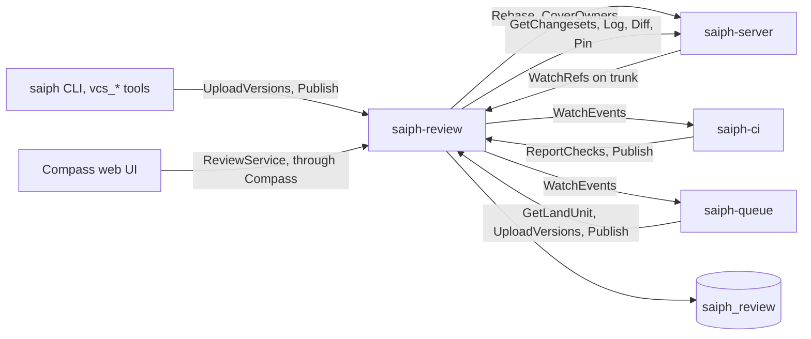

# Saiph: review

Tracker: RIG-5665

> Freezes on merge; later changes supersede by citation, never rewrite
> (convention: the `docs/designs/agent/compass-agent-config-delivery/design.md`
> header). Unless a path says otherwise, every code path is in the
> `RigelBuild/saiph` repo, which does not exist yet. A Compass path says
> "in Compass".

Ledger-impact: D1–D5 are filed as DL-597..DL-601. No existing decision
changes. The RIG-5558 decisions (DL-535..DL-538, DL-561) stay whole:
repos on the git backend keep GitHub review.

**Named decisions this record introduces:** D1–D5 in [Decisions](#decisions).

Length: Matt lifted the length cap for this set (ruling 6 in the
[overview](README.md#rulings)). The prose sits mostly in Approach, which
freezes the review entities, the `ReviewService` API and the land hand-off
that [ci-cd](ci-cd.md) and [merge-queue](merge-queue.md) build on.

This record designs review for Saiph: changes, versions, the stack graph,
threads, approvals, the attention set, what "ready to land" means, and the
Compass web UI hooks. It builds on the entities and RPCs of
[store](store.md) and adds the `saiph.v1.ReviewService`.

## Open Questions

Each question has a recommendation; the record is written against it. None
depends on another.

### OQ-1 — Who may upload a new version of another owner's change?

- (a) Any account with `REPO_ROLE_WRITE`. The version records its
  uploader; the owner does not change. Agents fix each other's changes,
  and a human can push a fix to an agent's change.
- (b) The owner only, as Critique works. Another author must make a new
  change.

**Recommendation: (a).** Fleets of agents hand work over often. The
uploader is visible on each version, and a version that changes code
drops every approval (see [Approvals](#approvals)), so (a) cannot smuggle
code past review.

### OQ-2 — How are change classes detected?

Scion's review tool "can express complex semantic constraints on
approvals, which lets us differentiate simple things like comment-only
changes from sensitive logical changes"
([Scion](https://www.anthropic.com/engineering/redesigning-source-control)).
The post does not publish how.

- (a) Lexical, from the store's `Diff` hunks: whitespace-only, comment-only
  (every changed line starts with a comment prefix for its file
  extension), else logic. No parser.
- (b) Syntactic, with a parser per language. It needs a parser library,
  which the global constraints forbid, and a grammar per language.

**Recommendation: (a).** A lexical class can be wrong in one direction: a
changed line inside a multi-line string that starts with `//` reads as a
comment. So a class only lowers the LGTM count (a `waive` rule). It never
waives owner approval, CI or a `require` rule. A parser can replace the
classifier later without changing the API.

### OQ-3 — May a reader whose read a `.saiphacl` narrows use review?

- (a) No. Review reads need read on the whole repo, as the store's id
  reads do ([store](store.md) OQ-3). A narrowed reader gets `NOT_FOUND`.
- (b) Yes, with every thread, diff and summary filtered per path.

**Recommendation: (a).** Comments quote code, titles name paths, and a
filter on every review read is a leak waiting for one missed call. (b)
can come later as a supersession.

### OQ-4 — How long do versions of closed changes stay readable?

Open changes pin every version. A landed or abandoned change no longer
needs its old versions.

- (a) Re-pin every version with a 90-day expiry when the change closes.
- (b) Keep them forever.
- (c) Unpin at once; gc keeps them for the repo's `retention_days`.

**Recommendation: (a).** Interdiffs of recently landed changes stay
readable for audits and culprit finding; the bytes still count against
`saiph.repos.quota_bytes`, and they stop growing after 90 days.

### OQ-5 — What does a repo without `.saiphreview` require?

- (a) One LGTM from a human, plus owner coverage and CI.
- (b) One LGTM from anyone, agents included.

**Recommendation: (a).** Critique: "every change requires an LGTM
regardless of approval status, ensuring that at least two pairs of eyes
viewed the change". With agents as authors, the second pair of eyes
defaults to a human. A repo lowers it with a `waive` rule.

### OQ-6 — How does a Compass agent learn it is its turn?

- (a) Compass posts a one-line message into the agent's home channel,
  through the existing message delivery path.
- (b) A new `AgentControl` variant with its own ack cursor, as forge
  notifications have.

**Recommendation: (a).** The delivery path already turns a message into a
turn, with cursors, acks and retries. (b) adds proto fields, a cursor
table and an ack arm for the same effect.

## Problem / Intent

Saiph repos land code without GitHub, so they need their own review.
Matt ruled that review follows Critique, Twigg and jj: changes stack
freely into DAGs, and CI uses the graph (ruling 3). This record defines
the review entities, the `ReviewService` API, the readiness contract the
merge queue consumes, and the Compass UI and agent hooks.

## Approach

### Ground truth

- **Saiph's repo** is `RigelBuild/saiph`. It does not exist yet, so every
  Saiph path here is a plan.
- **Store.** Review builds on the store's changeset and its 16-byte
  `change_id`, which a rewrite keeps ([Changeset](store.md#changeset)),
  and on `GetRepo`, `GetRef`, `GetChangesets`, `Log`, `Diff`, `Rebase`,
  `ReadFile`, `Pin`, `Unpin` and `WatchRefs`, plus the additions
  in [Store additions](#store-additions). The store keeps no versions;
  review groups changesets into versions by change id.
- **Workflow tier.** Review ships in the saiph repo as a Saiph service, as
  the merge queue and CI do ([overview](README.md#open-questions) OQ-2
  (a)). If Matt rules (b), the design holds and only the paths move.
- **Conflicts** are never stored ([overview](README.md#open-questions)
  OQ-3), so every version is a clean changeset.
- **Compass** keeps the web UI hooks and the agent tools. Saiph knows
  Compass only as a token issuer and a caller.

### Research and what Saiph takes from it

| Source | What it does | Saiph takes |
| -- | -- | -- |
| Critique ([SWE book ch. 19](https://abseil.io/resources/swe-book/html/ch19.html)) | The author "uploads a snapshot (showing a patch at a particular point in time)"; reviewers "look at diffs between any pairs of snapshots"; "Comments are by default marked as unresolved"; a reply lets "a reviewer to provide a complete thought on a change atomically"; LGTM and approval are separate bits | Versions, interdiff, unresolved by default, atomic publish, LGTM apart from owner approval |
| Gerrit ([patch sets](https://gerrit-review.googlesource.com/Documentation/concept-patch-sets.html), [labels](https://gerrit-review.googlesource.com/Documentation/config-labels.html), [attention set](https://gerrit-review.googlesource.com/Documentation/user-attention-set.html)) | "Multiple git commits can share the same Change-Id"; "You can diff between other patch sets"; `copyCondition` keeps votes by `changekind:`; the attention set | Version kinds that keep approvals; the attention rules |
| Twigg ([`aa_public.go`](https://github.com/twigg-vc/monorepo/blob/a5d7461c78948f474c1d54716ed33f5d575e7d54/twigg/commit/aa_public.go), [`submit.go`](https://github.com/twigg-vc/monorepo/blob/a5d7461c78948f474c1d54716ed33f5d575e7d54/twigg/server/submit.go)) | A version number "Increased by 1 on rebases, amends, msg changes and submits"; "OWNERS files, with ownership cascading down directories"; submit checks `latestVersionOfParent.IsSubmitted` | Dense version numbers; owners that cascade; a change lands with or after its parents |
| jj ([glossary](https://docs.jj-vcs.dev/latest/glossary/)) | Changes "don't exist as an object in the data model; only the change ID does"; the "change ID generally remains the same" | The change id as the one stable name |
| Scion ([post](https://www.anthropic.com/engineering/redesigning-source-control)) | Review "can express complex semantic constraints on approvals" | Change classes and `.saiphreview` rules |
| ReviewStack ([docs](https://sapling-scm.com/docs/addons/reviewstack/)) | A "dropdown for navigating the commits in the stack", "approving each change independently" | Each change in a stack is reviewed alone; the stack view navigates |

Twigg is AGPL-3.0; review takes its ideas, not its code.

### Shape

`saiph-review` (`cmd/saiph-review`) is one Go service. Its replicas share
no memory. Per-repo background work (the trunk watcher, the pin refresh
and the event sweep) runs under a lease row that any replica can take, as
the store's derive workers do. It keeps its rows in the schema
`saiph_review` and reads history only through `saiph.v1`.



### Callers and tokens

Review verifies bearer tokens with the store's `internal/auth` `Verifier`
and the same `--issuers` file, so a caller is one `auth.Principal`
([Tenancy](store.md#tenancy)).

- **On the caller's behalf.** Review forwards the caller's bearer to
  `saiph-server` for `GetRepo` and for every history read, so the store's
  ACLs decide what the caller sees. Every review call needs
  `caller_role` of at least `REPO_ROLE_READ` and `id_reads = true` (the
  `GetRepoResponse` field [client](client.md) adds; OQ-3); otherwise it answers
  `NOT_FOUND`. Writes need
  `REPO_ROLE_WRITE`.
- **On its own behalf.** Pins, version-kind rebases, interdiff rebases and the
  trunk watcher run as `service:saiph-review`. Review signs its own
  five-minute tokens per tenant, scopes `read write`, with a key whose
  public half is an issuer in `saiph-server`'s `--issuers` file. That
  issuer may mint only `service:saiph-review` (`Issuer.Subjects`, a store
  addition). The subject gets `REPO_ROLE_WRITE` on a repo through
  `SetGrant` when review is enabled for it. It never holds `land`.

| Subject | Caller | May |
| -- | -- | -- |
| `account:<id>` | A human | Everything below `land`; approves |
| `account:<id>`, `Principal.Agent` | A Compass agent session ([client](client.md)) | Author and review; its LGTM counts only where `.saiphreview` sets `lgtm_from_agents` (OQ-5); never `ReportChecks` |
| `service:merge-queue` | `saiph-queue` | `GetLandUnit`, `UploadVersions` with `VERSION_REASON_CONFLICT_FIX`, comments |
| `service:saiph-ci` | `saiph-ci` | `ReportChecks`, comments |
| `service:saiph-bridge` | The git bridge | `UploadVersions` with `VERSION_REASON_IMPORT`, `AbandonChange` of an external change |
| `service:compass` | Compass | Reads and `WatchEvents`, for attention routing (OQ-6) |

A service never approves and never enters the attention set. Gerrit says
the same of its "Service Users": they "will never be added to the
attention set"
([attention set](https://gerrit-review.googlesource.com/Documentation/user-attention-set.html)).

### Data model

| Entity | Key | What it is |
| -- | -- | -- |
| Change | `(repo, change_id)` | The unit of review. Its name is the store's 16-byte `change_id`, which every rewrite keeps. It has an owner, a status (`OPEN`, `LANDED`, `ABANDONED`), reviewers, an attention set and a `land_requested` bit. |
| Version | `(repo, change_id, number)` | An immutable snapshot: one changeset plus its base, the changeset's `parents[0]`. Numbers are dense from 1. A version records its uploader, a `VersionReason` and a `VersionKind`. |
| Stack edge | `(repo, change_id, version, depends_on)` | "This version of the change sits on that open change." One row per parent of the version's changeset whose change id is an open change. |
| Thread | `(repo, change_id, thread_id)` | Comments on one anchor: a version, a path, a side and a line range. `path = ""` is a change-level thread. A thread is `UNRESOLVED` or `RESOLVED`. |
| Comment | `(repo, change_id, comment_id)` | One message in a thread: a draft that only its author sees, or published. |
| Approval | `(repo, change_id, approver, kind)` | `LGTM` or `OWNER`, valid for one version (see [Approvals](#approvals)). |
| Check | `(repo, changeset, name)` | One check result, reported by a service for a version's changeset. |

Two graphs exist and they are different:

- **Version history** is per change: version 1, 2, 3 and so on. A
  version may rebase, amend or reword the one before it. It is a list,
  not a graph, and it belongs to review alone.
- **The stack graph** joins changes. Change B depends on change A when
  B's current version has a parent whose change id is A, and A is open.
  The edges are a DAG: a change may depend on two changes, and two
  changes may depend on one (ruling 3). Edges belong to a version, so a
  rebase of B onto trunk drops the edge in B's next version without
  touching A.

A landed or abandoned change is never a dependency. The stack of a
change is the connected part of the open-change graph that holds it.

### Uploading versions

`UploadVersions(repo, heads, reason, reviewers, request_land, owner)`
turns changesets into versions. The client has already pushed the
changesets through the store's intake ([Intake](store.md#intake)).

1. Review checks the caller (see [Callers and tokens](#callers-and-tokens))
   and reads the trunk head with `GetRef`.
2. It walks `Log(heads, stop = [trunk head])` with the caller's bearer.
   The result is every changeset between trunk and the heads, at most 100
   (`INVALID_ARGUMENT` above). A head already on trunk is
   `FAILED_PRECONDITION`.
3. For each changeset, parents first, it reads the `change_id`. Two
   changesets with one change id in one upload are a divergence:
   `INVALID_ARGUMENT` naming the id.
4. A changeset whose change id is new creates a change. Its owner is the
   caller's account, or the request's `owner` for an import (below).
5. A changeset that equals the change's current version is skipped, so
   a retry is a no-op. Any other changeset becomes the next version. An
   upload to an abandoned change restores it. An upload to a landed change
   is `FAILED_PRECONDITION`.
6. Review pins the new changesets (see [Pins](#pins)) and then, in one
   transaction, writes the versions, their stack edges, the version kind,
   the carried approvals, the attention changes and the events.
7. `reviewers` join every uploaded change's reviewer list and attention
   set. `request_land = true` sets `land_requested` on each head's change.

An upload by a non-owner is allowed (OQ-1 (a)); the version records the
uploader. The first account to upload a version of a change owned by
`external:*` becomes its owner.

**Imports.** Only a service caller may set `owner`, and a service caller
must send `reason = VERSION_REASON_IMPORT` with `owner =
"external:github:<login>"`. The external author stays in the changeset's
`author`. An external owner can neither approve nor request a land; a
human with `REPO_ROLE_WRITE` requests the land
([git-bridge](git-bridge.md) OQ-1). A service may abandon only a
change whose owner is `external:*`.

**Version kind.** Review compares the new version N with the one before
it, P, as Gerrit's `changekind:` does:

| Kind | When | Effect on approvals |
| -- | -- | -- |
| `FIRST` | N is version 1 | None yet |
| `MESSAGE_ONLY` | Same base and same root tree; only the message or author differs | Carried |
| `TRIVIAL_REBASE` | Base differs; `Rebase(P, onto = N.base)` is clean and its root tree equals N's, and the messages match | Carried |
| `CODE` | Anything else, or the rebase conflicts | Dropped, unless a conflict fix carries them |

The rebase runs as `service:saiph-review`. It writes an unpinned
changeset that gc removes after `retention_days`; review keeps the id in
`saiph_review.interdiffs` and reuses it for the interdiff below.

**Issue trailer.** A change names a tracker issue with an `Issue:` line
in the message trailer, one line per issue, the value verbatim (for
example `Issue: RIG-5821`). Review parses only that key and returns the
values in `ChangeSummary.issues`; Compass reads them with `refs.Parse`.
`vcs_submit` writes its `issues` there ([client](client.md)).

### Interdiff

`Interdiff(change_id, from_version, to_version)` diffs any two versions
of a change, as Critique lets reviewers "look at diffs between any pairs
of snapshots". `from_version = 0` means the base of `to_version`, which is
the plain diff of one version.

- **Same base.** Review calls the store's `Diff(from = A, to = B)` with
  the caller's bearer, so `.saiphacl` read rules apply as usual.
- **Different bases.** Review rebases A onto B's base (cached in
  `saiph_review.interdiffs`) and diffs the result against B. The answer
  sets `base_moved`, and the UI says so above the file list. If the
  rebase conflicts, review diffs A against B directly and sets
  `rebase_conflicted`; the diff then includes the base's changes, and the
  UI labels it.

Review does no text diffing itself. Every hunk comes from the store's
`Diff`, which uses `internal/textdiff`.

### Pins

Review keeps every version of an open change alive with
`Pin(holder = "review:<change id hex>", changesets, ttl_seconds =
2592000)`, the holder form the store's `PinRequest` comment gives. The
pin worker renews every open change's pins once a day, so a pin never
lapses while the change is open.

When a change lands or is abandoned, review pins its versions again with
a 90-day expiry (OQ-4) and stops renewing them. After that, gc decides.
Pinned bytes count against `saiph.repos.quota_bytes`, so the store's quota
caps them ([Caps and spend](store.md#caps-and-spend)).

### Approvals

Approval is four gates, kept apart as Critique keeps LGTM apart from
approval. Critique's LGTM means "I have reviewed this change, believe
that it meets our standards, and I think it is okay to commit it after
addressing unresolved comments"; its approval means "as a gatekeeper, I
allow this change to be committed to the codebase"
([SWE book ch. 19](https://abseil.io/resources/swe-book/html/ch19.html)).

| Gate | Satisfied when | Blocker |
| -- | -- | -- |
| LGTM | The policy's LGTM count is met by accounts other than the owner and the current version's uploader | `NEEDS_LGTM` |
| Owner | Every changed path is covered by an `OWNER` approval from an owner of its scope | `NEEDS_OWNER`, with the uncovered paths and suggested owners |
| Checks | The checks for the version's changeset are `complete`, and every required check is `SUCCESS` | `CHECKS_PENDING` or `CHECKS_FAILED` |
| Semantic rules | Every `require` rule in `.saiphreview` that matches the change holds | `NEEDS_LGTM` with the rule's paths |

Only an account with `REPO_ROLE_WRITE` approves, never a service. An
agent's LGTM counts only where the policy sets `lgtm_from_agents`
(OQ-5). An agent's `OWNER` approval counts only where an `owners` entry
names its account directly, never through a `role:` entry. The owner may
give the `OWNER` approval on its own change, as in Critique; it never
gives the LGTM.

**Owners.** Owners live in `.saiphacl`, so one file sets who reads,
who writes and who approves a directory. The file gains an optional
`owners` list ([Store additions](#store-additions)). A missing `owners`
key inherits it from the enclosing scope, the way `read` and `write` do;
at the top, the owners are the scope's `write` list. An owner entry
counts only if it also passes the scope's `write` check, so `owners` can
narrow `write` but never widen it. Coverage is checked under the
version's own ACL manifest and under the trunk head's, as the store
checks writes, so a change cannot make its author an owner of its own
paths. Review asks the store with `CoverOwners`; the store matches
`role:` entries against its grants.

**Policy file.** `.saiphreview` sits at the repo root and is read at the
trunk head, as the queue reads `.saiphqueue`. It is JSON:

```json
{
  "lgtm": 1,
  "lgtm_from_agents": false,
  "checks": true,
  "carry_on_fix": true,
  "rules": [
    { "waive": "lgtm", "class": "comment", "paths": ["docs/"] },
    { "require": "lgtm", "count": 2, "paths": ["internal/auth/"] },
    { "require": "lgtm_from", "subjects": ["account:acct_1"], "paths": [".saiphreview"] }
  ]
}
```

- Without the file, the defaults above apply (OQ-5 (a)).
- `checks: false` drops the check gate, for a repo with no CI.
- `carry_on_fix` is the merge queue's switch (see
  [Land hand-off](#land-hand-off)).
- A `waive` rule only lowers the LGTM count to zero, and only when the
  change's class is at or below `class` and every changed path is under
  `paths` (empty means every path). It never waives owner coverage,
  checks or a `require` rule (OQ-2).
- A `require` rule matches when any changed path is under `paths`.
  `lgtm` raises the count; `lgtm_from` needs one LGTM from a listed
  subject (`account:` or `role:`).
- A version whose tree holds a malformed `.saiphreview` gets the blocker
  `POLICY_INVALID`, so a malformed file never reaches trunk.

**Change classes.** Review classifies each version's diff against its
base from the store's `Diff` hunks, with no parser (OQ-2 (a)). The class
of a file is the highest of its changed lines; the class of a change is
the highest of its files.

| Class | A changed line is in it when |
| -- | -- |
| `WHITESPACE` | It differs from its pair only in whitespace |
| `COMMENT` | It is blank or starts, after indentation, with the comment prefix of its file type (`//` for `.go`, `.ts`, `.tsx`, `.js`, `.rs`, `.proto`; `#` for `.py`, `.sh`, `.yaml`, `.yml`, `.toml`, `.nix`; `--` for `.sql`), or its file is `.md` |
| `LOGIC` | Anything else, every binary file, every added, deleted or copied file, and every unknown file type |

**Stickiness.** An approval belongs to the version it was given on.
It carries to a new version of kind `MESSAGE_ONLY` or `TRIVIAL_REBASE`,
and to a `CONFLICT_FIX` version under the rules in
[Land hand-off](#land-hand-off). A `CODE` version drops every approval,
and the approvers enter the attention set.

### Threads and publishing

A thread anchors to one version, one path, one side and a line range.
`path = ""` makes it a change-level thread. Critique notes that
"Comments are by default marked as unresolved"; Saiph does the same, and
an unresolved thread blocks readiness (`UNRESOLVED_THREADS`). A thread
stays on its version; the UI lists threads from earlier versions with
their version number.

Drafts are private. `SaveDraft` stores one; `Publish` sends a whole
reply at once, so "a reviewer [can] provide a complete thought on a
change atomically". One `Publish` call, in one transaction:

1. turns the named drafts and the inline `comments` into comments;
2. sets each touched thread's resolution;
3. adds `approve` approvals for the version and removes `revoke` ones;
4. adds `reviewers_add` and applies the attention rules below;
5. writes the events.

`client_request_id` makes a retry return the first result, as Compass's
`AppendMessage` does with its own key. `version` must be the change's
current version for `approve`; comments may anchor to any version.

### Attention set

The attention set names who must act next. The rules follow Gerrit's:
"If reviewers are added to a change, then they are added to the
attention set"; "Replying (commenting, voting or just writing a change
message) removes the replying user from the attention set"; "If a
reviewer replies, then the change owner (and uploader) are added to the
attention set"
([attention set](https://gerrit-review.googlesource.com/Documentation/user-attention-set.html)).
Saiph adds:

- When the owner replies, the authors of the threads it replied to are
  added.
- A `CODE` version adds every approver whose approval it dropped.
- A complete check set with a failed required check adds the owner.
- `attention_add` and `attention_remove` on `Publish` set it by hand.
- A landed or abandoned change has an empty set.
- A service and an `external:*` owner never enter it.

### Readiness

A change is **ready** when it is open, its current version passes every
gate in [Approvals](#approvals), no thread is unresolved, and every parent
of its changeset is landable. A parent is landable when it is on trunk,
is the current version of an open change, or is a version of a landed
change. Any other parent (an old version of an open change, or a version
of an abandoned change) is the blocker `STALE_PARENT`.

A change is **land ready** when it has `land_requested`, it is ready, and
every open change it depends on, transitively, is ready. A dependency
does not need `land_requested`: landing a change lands what it sits on.
Review recomputes readiness for a change and every change that depends
on it in the transaction that changes any input, and writes a
`READINESS_CHANGED` event when `ready` or `land_ready` flips.

### Land hand-off

This is the whole contract with [merge-queue](merge-queue.md). The queue pulls; review
never calls the queue.

- **Request.** The owner, or any account with `REPO_ROLE_WRITE`, calls
  `RequestLand(change_id)`, or uploads with `request_land = true`.
  `cancel = true` clears it. `fix_needs_approval = true` makes any
  conflict fix of this change need new approvals (merge queue OQ-2 (a)).
- **Admission.** The queue tails `WatchEvents(kinds =
  [EVENT_KIND_READINESS_CHANGED])`. On `land_ready = true` it calls
  `GetLandUnit(change_id)`. The land unit is the change plus its open
  dependencies. The answer is `ready` and the unit's `LandEntry` rows in
  dependency order, parents first, or the blockers.
- **Before the trunk move.** The queue reads the unit again just before
  its trunk CAS and lands only if it is still ready with the same
  `(change_id, version)` set.
- **Conflict fix.** The queue's fixer uploads with `reason =
  VERSION_REASON_CONFLICT_FIX` as `service:merge-queue`. The fix takes
  the check results of the version it fixes; the queue's own CI run tests
  the fix before it lands. If `carry_on_fix` holds and the change has no
  `fix_needs_approval`, LGTM and `OWNER` approvals carry, and review runs
  the semantic rules again on the fix diff (the interdiff from the fixed
  version): a `require` rule that matches a `LOGIC` path in the fix diff
  needs a new approval on the fix. Otherwise no approval carries, the
  change is no longer ready, and the prior approvers enter the attention
  set.
- **Eject.** The queue `Publish`es a change-level comment (`path = ""`,
  `RESOLUTION_UNRESOLVED`) with `attention_add = ["<owner>"]`. The
  unresolved thread makes the change not ready until the owner resolves
  it. CI does the same for a culprit ([ci-cd](ci-cd.md)).
- **Landing.** Review learns of a landing from the trunk ref log, never
  from the queue (below).

### Landing detection

One trunk watcher per repo, under a lease row in `saiph_review.cursors`,
tails `WatchRefs(names = [trunk_ref])` from its stored `log_seq`. For
each entry it walks `Log(heads = [new_target], stop = [old_target])`
without `first_parent`, because a land unit may hold a merge: `chain` and
its `trunk_seqs` cover only the first-parent path, and a side member is
reachable from the merge but is not in `chain`. A changeset on the
first-parent path takes its own `trunk_seq`. A side changeset takes the
`trunk_seq` of the first `chain` entry, oldest first, whose history
reaches it. For each changeset whose change id names an open change:

- the changeset is the current version: the change becomes `LANDED`;
- otherwise (the queue rebased it): review adds a version with
  `VERSION_REASON_LANDED` for that changeset, then marks the change
  `LANDED`.

The change records `landed_changeset` and `landed_trunk_seq`, its pins
move to the 90-day expiry, and review writes `EVENT_KIND_LANDED`. The
cursor advances in the same transaction, so a crash replays the entry
and the replay is a no-op.

### Events

`WatchEvents(repo, after_seq, kinds)` streams `ReviewEvent`s in `seq`
order. `seq` is per repo, taken from `saiph_review.repo_state` in the
transaction that writes the event, so the order is the commit order. The
stream is a poller over the table every 250 ms, like the store's
`WatchRefs`. Events are kept 30 days; an `after_seq` older than the
oldest kept event answers `OUT_OF_RANGE`, and the consumer rescans with
`ListChanges`, whose `event_seq` is the cursor to resume from.

| Kind | When | Extra fields |
| -- | -- | -- |
| `VERSION_UPLOADED` | A version is written | `version`, `changeset`, `base`, `depends_on` |
| `ABANDONED`, `RESTORED` | Status changes | — |
| `LANDED` | The trunk watcher marks it | `landed_changeset`, `trunk_seq` |
| `READINESS_CHANGED` | `ready` or `land_ready` flips | `land_ready` |
| `ATTENTION_CHANGED` | Someone enters the attention set | `attention_added` |

### Tables

Review keeps its rows in its own schema, `saiph_review`, in the store's
database. It follows the store's tenancy exactly: a `tenant_id` column
defaulted from `saiph.tenant_id`, `ENABLE` and `FORCE ROW LEVEL
SECURITY`, and a `tenant_isolation` policy on every table. Request
handlers run in `InTenant`; the watcher, pin and sweep workers use a
BYPASSRLS role, as the store's gc and derive workers do. The SQL runs on
YugabyteDB YSQL and on Postgres 16.

Why a schema of its own and not tables in `saiph`: review is its own
binary with its own migrations (`internal/review/migrations/`), as CI is
with `saiph_ci`. A review migration never touches the store's schema.
Review keys rows by the store's `repo_id`, read from `saiph.repos` with a
`SELECT`-only grant; a sweep drops rows whose repo is gone. This rests on
the overview's OQ-2 (a): if the workflow services move out of the saiph
repo, they also move to their own database.

```sql
-- internal/review/migrations/0001_saiph_review.sql; every table has
-- tenant_id TEXT NOT NULL DEFAULT current_setting('saiph.tenant_id', TRUE),
-- ENABLE and FORCE ROW LEVEL SECURITY and a tenant_isolation policy.
CREATE SCHEMA saiph_review;
CREATE TABLE saiph_review.repo_state (tenant_id TEXT, repo_id BIGINT,
  event_seq BIGINT NOT NULL, PRIMARY KEY (tenant_id, repo_id));
CREATE TABLE saiph_review.changes (tenant_id TEXT, repo_id BIGINT,
  change_id BYTEA CHECK (length(change_id) = 16), owner TEXT NOT NULL,
  status SMALLINT NOT NULL, version INT NOT NULL, title TEXT NOT NULL,
  issues TEXT[], land_requested BOOLEAN NOT NULL, fix_needs_approval BOOLEAN NOT NULL,
  ready BOOLEAN NOT NULL, land_ready BOOLEAN NOT NULL, next_id BIGINT NOT NULL,
  landed_changeset BYTEA, landed_trunk_seq BIGINT,
  created_unix_ms BIGINT NOT NULL, updated_unix_ms BIGINT NOT NULL, closed_unix_ms BIGINT,
  PRIMARY KEY (tenant_id, repo_id, change_id));
CREATE INDEX changes_by_owner ON saiph_review.changes (tenant_id, owner, status);
CREATE TABLE saiph_review.versions (tenant_id TEXT, repo_id BIGINT, change_id BYTEA,
  version INT, changeset BYTEA NOT NULL CHECK (length(changeset) = 32), base BYTEA,
  uploader TEXT NOT NULL, reason SMALLINT NOT NULL, kind SMALLINT NOT NULL,
  class SMALLINT NOT NULL, created_unix_ms BIGINT NOT NULL,
  PRIMARY KEY (tenant_id, repo_id, change_id, version),
  UNIQUE (tenant_id, repo_id, changeset));
CREATE TABLE saiph_review.stack_edges (tenant_id TEXT, repo_id BIGINT, change_id BYTEA,
  version INT, depends_on BYTEA, parent BYTEA NOT NULL,
  PRIMARY KEY (tenant_id, repo_id, change_id, version, depends_on));
CREATE INDEX stack_edges_by_dep ON saiph_review.stack_edges (tenant_id, repo_id, depends_on);
CREATE TABLE saiph_review.reviewers (tenant_id TEXT, repo_id BIGINT, change_id BYTEA,
  subject TEXT, in_attention BOOLEAN NOT NULL, attention_since_unix_ms BIGINT,
  PRIMARY KEY (tenant_id, repo_id, change_id, subject));
CREATE INDEX attention_by_subject ON saiph_review.reviewers (tenant_id, subject) WHERE in_attention;
CREATE TABLE saiph_review.threads (tenant_id TEXT, repo_id BIGINT, change_id BYTEA,
  thread_id BIGINT, version INT NOT NULL, path TEXT NOT NULL, side SMALLINT NOT NULL,
  start_line INT NOT NULL, line_count INT NOT NULL, resolved BOOLEAN NOT NULL,
  author TEXT NOT NULL, PRIMARY KEY (tenant_id, repo_id, change_id, thread_id));
CREATE TABLE saiph_review.comments (tenant_id TEXT, repo_id BIGINT, change_id BYTEA,
  comment_id BIGINT, thread_id BIGINT NOT NULL, author TEXT NOT NULL, body TEXT NOT NULL,
  suggestion TEXT, published_unix_ms BIGINT NOT NULL,
  PRIMARY KEY (tenant_id, repo_id, change_id, comment_id));
CREATE TABLE saiph_review.drafts (tenant_id TEXT, repo_id BIGINT, change_id BYTEA,
  draft_id BIGINT, author TEXT NOT NULL, thread_id BIGINT NOT NULL, version INT NOT NULL,
  path TEXT NOT NULL, side SMALLINT NOT NULL, start_line INT NOT NULL, line_count INT NOT NULL,
  body TEXT NOT NULL, suggestion TEXT, resolution SMALLINT NOT NULL, updated_unix_ms BIGINT NOT NULL,
  PRIMARY KEY (tenant_id, repo_id, change_id, draft_id));
CREATE TABLE saiph_review.publishes (tenant_id TEXT, author TEXT, client_request_id TEXT,
  repo_id BIGINT NOT NULL, response BYTEA NOT NULL, PRIMARY KEY (tenant_id, author, client_request_id));
CREATE TABLE saiph_review.approvals (tenant_id TEXT, repo_id BIGINT, change_id BYTEA,
  approver TEXT, kind SMALLINT, version INT NOT NULL, given_on INT NOT NULL,
  PRIMARY KEY (tenant_id, repo_id, change_id, approver, kind));
CREATE TABLE saiph_review.checks (tenant_id TEXT, repo_id BIGINT, changeset BYTEA,
  name TEXT, reporter TEXT NOT NULL, state SMALLINT NOT NULL, required BOOLEAN NOT NULL,
  details_url TEXT, summary TEXT, updated_unix_ms BIGINT NOT NULL,
  PRIMARY KEY (tenant_id, repo_id, changeset, name));
CREATE TABLE saiph_review.check_sets (tenant_id TEXT, repo_id BIGINT, changeset BYTEA,
  reporter TEXT, complete BOOLEAN NOT NULL, PRIMARY KEY (tenant_id, repo_id, changeset, reporter));
CREATE TABLE saiph_review.events (tenant_id TEXT, repo_id BIGINT, seq BIGINT,
  change_id BYTEA NOT NULL, kind SMALLINT NOT NULL, event BYTEA NOT NULL, at_unix_ms BIGINT NOT NULL,
  PRIMARY KEY (tenant_id, repo_id, seq));
CREATE TABLE saiph_review.interdiffs (tenant_id TEXT, repo_id BIGINT, from_changeset BYTEA,
  onto BYTEA, result BYTEA, conflicted BOOLEAN NOT NULL,
  PRIMARY KEY (tenant_id, repo_id, from_changeset, onto));
CREATE TABLE saiph_review.cursors (tenant_id TEXT, repo_id BIGINT, stream TEXT,
  seq BIGINT NOT NULL, lease_token TEXT, lease_until_unix_ms BIGINT,
  PRIMARY KEY (tenant_id, repo_id, stream)); -- streams: "trunk", "pins", "sweep"
```

`events.event` is the encoded `ReviewEvent`. A check name has one
reporter: a second reporter for the same name and changeset is
`ALREADY_EXISTS`.

### API: `proto/saiph/v1/review.proto`

The package is `saiph.v1`, beside the store's `saiph.proto`, CI's
`ci.proto` and the queue's `queue.proto`. Reads carry `idempotency_level
= NO_SIDE_EFFECTS`. Review messages carry no prefix.

```proto
// proto/saiph/v1/review.proto
service ReviewService {
  rpc UploadVersions(UploadVersionsRequest) returns (UploadVersionsResponse);
  rpc AbandonChange(AbandonChangeRequest) returns (AbandonChangeResponse);
  rpc RestoreChange(RestoreChangeRequest) returns (RestoreChangeResponse);
  rpc GetChange(GetChangeRequest) returns (GetChangeResponse) { option idempotency_level = NO_SIDE_EFFECTS; }
  rpc GetChanges(GetChangesRequest) returns (GetChangesResponse) { option idempotency_level = NO_SIDE_EFFECTS; }
  rpc ListChanges(ListChangesRequest) returns (ListChangesResponse) { option idempotency_level = NO_SIDE_EFFECTS; }
  rpc GetStack(GetStackRequest) returns (GetStackResponse) { option idempotency_level = NO_SIDE_EFFECTS; }
  rpc Interdiff(InterdiffRequest) returns (InterdiffResponse) { option idempotency_level = NO_SIDE_EFFECTS; }
  rpc ListThreads(ListThreadsRequest) returns (ListThreadsResponse) { option idempotency_level = NO_SIDE_EFFECTS; }
  rpc SaveDraft(SaveDraftRequest) returns (SaveDraftResponse);
  rpc DeleteDraft(DeleteDraftRequest) returns (DeleteDraftResponse);
  rpc ListDrafts(ListDraftsRequest) returns (ListDraftsResponse) { option idempotency_level = NO_SIDE_EFFECTS; }
  rpc Publish(PublishRequest) returns (PublishResponse);
  rpc RequestLand(RequestLandRequest) returns (RequestLandResponse);
  rpc ReportChecks(ReportChecksRequest) returns (ReportChecksResponse);
  rpc GetLandUnit(GetLandUnitRequest) returns (GetLandUnitResponse) { option idempotency_level = NO_SIDE_EFFECTS; }
  rpc WatchEvents(WatchEventsRequest) returns (stream ReviewEvent);
}
enum ChangeStatus { CHANGE_STATUS_UNSPECIFIED = 0; CHANGE_STATUS_OPEN = 1; CHANGE_STATUS_LANDED = 2; CHANGE_STATUS_ABANDONED = 3; }
enum VersionReason { VERSION_REASON_UNSPECIFIED = 0; VERSION_REASON_UPLOAD = 1; VERSION_REASON_CONFLICT_FIX = 2; VERSION_REASON_LANDED = 3; VERSION_REASON_IMPORT = 4; }
enum VersionKind { VERSION_KIND_UNSPECIFIED = 0; VERSION_KIND_FIRST = 1; VERSION_KIND_MESSAGE_ONLY = 2; VERSION_KIND_TRIVIAL_REBASE = 3; VERSION_KIND_CODE = 4; }
enum ChangeClass { CHANGE_CLASS_UNSPECIFIED = 0; CHANGE_CLASS_WHITESPACE = 1; CHANGE_CLASS_COMMENT = 2; CHANGE_CLASS_LOGIC = 3; }
enum ApprovalKind { APPROVAL_KIND_UNSPECIFIED = 0; APPROVAL_KIND_LGTM = 1; APPROVAL_KIND_OWNER = 2; }
enum Side { SIDE_UNSPECIFIED = 0; SIDE_BASE = 1; SIDE_VERSION = 2; }
enum Resolution { RESOLUTION_UNSPECIFIED = 0; RESOLUTION_UNRESOLVED = 1; RESOLUTION_RESOLVED = 2; }
enum CheckState { CHECK_STATE_UNSPECIFIED = 0; CHECK_STATE_PENDING = 1; CHECK_STATE_RUNNING = 2; CHECK_STATE_SUCCESS = 3; CHECK_STATE_FAILURE = 4; CHECK_STATE_CANCELLED = 5; CHECK_STATE_SKIPPED = 6; }
enum BlockerKind { BLOCKER_KIND_UNSPECIFIED = 0; BLOCKER_KIND_NOT_OPEN = 1; BLOCKER_KIND_NEEDS_LGTM = 2; BLOCKER_KIND_NEEDS_OWNER = 3; BLOCKER_KIND_CHECKS_PENDING = 4; BLOCKER_KIND_CHECKS_FAILED = 5; BLOCKER_KIND_UNRESOLVED_THREADS = 6; BLOCKER_KIND_STALE_PARENT = 7; BLOCKER_KIND_DEPENDENCY_NOT_READY = 8; BLOCKER_KIND_POLICY_INVALID = 9; }
enum EventKind { EVENT_KIND_UNSPECIFIED = 0; EVENT_KIND_VERSION_UPLOADED = 1; EVENT_KIND_ABANDONED = 2; EVENT_KIND_RESTORED = 3; EVENT_KIND_LANDED = 4; EVENT_KIND_READINESS_CHANGED = 5; EVENT_KIND_ATTENTION_CHANGED = 6; }

// owner: "account:<id>" or "external:github:<login>".
message Change { bytes change_id = 1; string owner = 2; ChangeStatus status = 3; string title = 4; repeated string reviewers = 5; repeated string attention = 6; bool land_requested = 7; bool fix_needs_approval = 8; repeated string issues = 9; bytes landed_changeset = 10; uint64 landed_trunk_seq = 11; int64 created_unix_ms = 12; int64 updated_unix_ms = 13; }
message Version { uint32 number = 1; bytes changeset = 2; bytes base = 3; string uploader = 4; VersionReason reason = 5; VersionKind kind = 6; ChangeClass class = 7; repeated bytes depends_on = 8; int64 created_unix_ms = 9; }
message VersionRef { bytes change_id = 1; uint32 version = 2; bytes changeset = 3; }
message Approval { string approver = 1; ApprovalKind kind = 2; uint32 version = 3; uint32 given_on = 4; }
message CheckRun { string name = 1; CheckState state = 2; bool required = 3; string details_url = 4; string summary = 5; }
// paths: uncovered paths for NEEDS_OWNER; suggested: owners or subjects that would clear it.
message Blocker { BlockerKind kind = 1; bytes change_id = 2; string detail = 3; repeated string paths = 4; repeated string suggested = 5; }
message Readiness { bool ready = 1; bool land_ready = 2; repeated Approval approvals = 3; repeated CheckRun checks = 4; bool checks_complete = 5; repeated Blocker blockers = 6; uint32 unresolved_threads = 7; }
// Fields 1, 3, 10 and 11 are the git bridge's contract.
message ChangeSummary { bytes change_id = 1; string title = 2; ChangeStatus status = 3; string owner = 4; uint32 version = 5; bool land_requested = 6; bool ready = 7; bool land_ready = 8; repeated string attention = 9; bytes landed_changeset = 10; uint64 landed_trunk_seq = 11; repeated string issues = 12; int64 updated_unix_ms = 13; bytes changeset = 14; repeated bytes depends_on = 15; string repo = 16; }

// owner: service callers only, with VERSION_REASON_IMPORT.
message UploadVersionsRequest { string repo = 1; repeated bytes heads = 2; VersionReason reason = 3; repeated string reviewers = 4; bool request_land = 5; string owner = 6; }
message UploadVersionsResponse { repeated VersionRef versions = 1; }
message AbandonChangeRequest { string repo = 1; bytes change_id = 2; string reason = 3; }
message AbandonChangeResponse {}
message RestoreChangeRequest { string repo = 1; bytes change_id = 2; }
message RestoreChangeResponse {}
message GetChangeRequest { string repo = 1; bytes change_id = 2; }
message GetChangeResponse { Change change = 1; repeated Version versions = 2; Readiness readiness = 3; }
// At most 1,000 ids; an unknown or unreadable id is left out, never an error.
message GetChangesRequest { string repo = 1; repeated bytes change_ids = 2; }
message GetChangesResponse { repeated ChangeSummary changes = 1; }
// repo empty: every readable repo of the tenant; allowed only when attention or owner is the caller.
message ListChangesRequest { string repo = 1; ChangeStatus status = 2; bool land_requested = 3; string attention = 4; string owner = 5; uint32 page_size = 6; string page_token = 7; }
message ListChangesResponse { repeated ChangeSummary changes = 1; string next_page_token = 2; uint64 event_seq = 3; }
message GetStackRequest { string repo = 1; bytes change_id = 2; }
message StackEdge { bytes change_id = 1; bytes depends_on = 2; }
// At most 500 changes; truncated says more exist.
message GetStackResponse { repeated ChangeSummary changes = 1; repeated StackEdge edges = 2; bool truncated = 3; }
// from_version 0 = the base of to_version.
message InterdiffRequest { string repo = 1; bytes change_id = 2; uint32 from_version = 3; uint32 to_version = 4; repeated string paths = 5; uint32 context_lines = 6; uint32 page_size = 7; string page_token = 8; }
message InterdiffResponse { repeated FileDiff files = 1; string next_page_token = 2; bool base_moved = 3; bool rebase_conflicted = 4; bytes from_changeset = 5; bytes to_changeset = 6; }
// path "" = change-level.
message Anchor { string path = 1; Side side = 2; uint32 start_line = 3; uint32 line_count = 4; }
message Comment { uint64 comment_id = 1; string author = 2; string body = 3; string suggestion = 4; int64 published_unix_ms = 5; }
message Thread { uint64 thread_id = 1; uint32 version = 2; Anchor anchor = 3; bool resolved = 4; repeated Comment comments = 5; }
message ListThreadsRequest { string repo = 1; bytes change_id = 2; uint32 version = 3; bool unresolved_only = 4; uint32 page_size = 5; string page_token = 6; }
message ListThreadsResponse { repeated Thread threads = 1; string next_page_token = 2; }
// thread_id 0 = a new thread at anchor.
message NewComment { uint64 thread_id = 1; Anchor anchor = 2; string body = 3; Resolution resolution = 4; string suggestion = 5; }
message Draft { uint64 draft_id = 1; uint32 version = 2; NewComment comment = 3; int64 updated_unix_ms = 4; }
// draft_id 0 = a new draft.
message SaveDraftRequest { string repo = 1; bytes change_id = 2; Draft draft = 3; }
message SaveDraftResponse { Draft draft = 1; }
message DeleteDraftRequest { string repo = 1; bytes change_id = 2; uint64 draft_id = 3; }
message DeleteDraftResponse {}
message ListDraftsRequest { string repo = 1; bytes change_id = 2; }
message ListDraftsResponse { repeated Draft drafts = 1; }
message PublishRequest { string repo = 1; bytes change_id = 2; uint32 version = 3; repeated uint64 draft_ids = 4; repeated NewComment comments = 5; repeated ApprovalKind approve = 6; repeated ApprovalKind revoke = 7; repeated string attention_add = 8; repeated string attention_remove = 9; repeated string reviewers_add = 10; string client_request_id = 11; }
message PublishResponse { repeated Thread threads = 1; Readiness readiness = 2; }
message RequestLandRequest { string repo = 1; bytes change_id = 2; bool cancel = 3; bool fix_needs_approval = 4; }
message RequestLandResponse { bool ready = 1; repeated Blocker blockers = 2; }
// complete = the required set for this changeset is final.
message ReportChecksRequest { string repo = 1; bytes change_id = 2; uint32 version = 3; bytes changeset = 4; repeated CheckRun checks = 5; bool complete = 6; }
message ReportChecksResponse {}
message GetLandUnitRequest { string repo = 1; bytes change_id = 2; }
message LandEntry { bytes change_id = 1; uint32 version = 2; bytes changeset = 3; repeated bytes parents = 4; repeated bytes depends_on = 5; bool fix_needs_approval = 6; }
// entries in dependency order, parents first.
message GetLandUnitResponse { bool ready = 1; repeated LandEntry entries = 2; repeated Blocker blockers = 3; }
message WatchEventsRequest { string repo = 1; uint64 after_seq = 2; repeated EventKind kinds = 3; }
message ReviewEvent { uint64 seq = 1; bytes change_id = 2; uint32 version = 3; bytes changeset = 4; bytes base = 5; repeated bytes depends_on = 6; EventKind kind = 7; int64 at_unix_ms = 8; bytes landed_changeset = 9; uint64 trunk_seq = 10; bool land_ready = 11; repeated string attention_added = 12; }
```

Rules the types do not show:

- **Checks.** A required check passes only on `SUCCESS`; `SKIPPED` on a
  required check blocks. A target that affected detection drops is left
  out of the set, not reported `SKIPPED`. A report for a changeset that is
  no longer the current version is stored and changes nothing. Review
  keeps summaries only; logs stay with the reporter.
- **`ReportChecks`** needs a service caller with `REPO_ROLE_WRITE`.
- **`GetLandUnit`** needs `REPO_ROLE_LAND`.
- **Errors.** An unknown change, or one the caller cannot read, is
  `NOT_FOUND`. A write to a closed change is `FAILED_PRECONDITION`.
  `Publish` with `approve` on an old version is `FAILED_PRECONDITION`
  naming the current one.

### Store additions

Folded into [store](store.md#api-the-saiphv1-connect-package): the
`owners` list in `.saiphacl` and `CoverOwners` (store
[Per-directory ACLs](store.md#per-directory-acls), tasks S4 and S6), and
`Issuer.Subjects`, `Claims.Agent` and `Principal.Agent` (store S11).
Compass's `Minter` sets `agent: true` on agent-session tokens
([client](client.md) C9).

### Compass web UI hooks

The web UI lives in Compass and stays there. It follows the locked
aesthetic: Night Owl surfaces, one purple mark (the brand mark, never in
review), Departure Mono for display and Space Mono for UI, 1-bit
dot-matrix shapes, and only `--cx-*` and `--rigel-*` tokens from
`apps/ui/src/design/tokens.css` (in Compass), never a literal colour.

- **Transport.** The browser holds a Compass session, not a Saiph token.
  The Compass server mounts `saiph.v1.ReviewService` and the store's
  `HistoryService` read calls under its own origin and forwards each call
  with a 15-minute token it mints for the user (`sub =
  account:<user id>`, scopes `read write`). The UI's
  `createSaiphClients(conn)` sits beside `createLiveClients` in
  `apps/ui/src/live/client.ts` and reuses its gRPC-Web transport and
  bearer interceptor. Queries use `createConnectQuery`, refetching every
  15 s and on focus.
- **Routes.** `RouteMatch` in `apps/ui/src/view-route.ts` gains
  `{ view: "changes" }` at `/changes` and `{ view: "change", repo,
  changeId }` at `/change/<repo>/<change id>`. The compared versions ride
  in the query string (`?from=1&v=3`), so moving the slider never pushes
  a history entry.
- **Attention dashboard** (`/changes`). Three lists from `ListChanges`
  with `repo` empty: "Your turn" (`attention` is me), "Waiting" (`owner`
  is me, open, not my turn) and "Ready to land" (mine, `land_ready`).
  Gerrit calls its first section "Your turn"; Saiph keeps the name.
- **Change view.** A header with the title, the owner, the readiness
  badge and the blockers; the stack graph; the version slider; the file
  list; the diff with threads inline.
- **Readiness badge.** It follows `prLifecycle` in `board-render.ts`:
  `landed`, `abandoned`, `ready` (`land_ready`), `in_review` (any
  approval or thread) and `in_progress`. Check pips use a new
  `reviewCheckPip(state)` beside `checkPip`: `SUCCESS` is success,
  `FAILURE` and `CANCELLED` are failure, anything else is pending.
- **Stack graph.** An SVG on the dot grid with `shape-rendering:
  crispEdges`. Each change is a dot; each edge is a run of dots. Layers
  are depth from trunk (longest path); order inside a layer is the
  change id, so the layout is stable without a layout library. The
  current change is `--cx-accent`, a ready one `--cx-ok`, a blocked one
  `--cx-warn`, a failed check `--cx-error`. A click opens that change.
- **Version slider.** A dot track with one tick per version and two
  thumbs, `from` and `to`. A tick's glyph shows its kind: solid for
  `CODE`, hollow for `TRIVIAL_REBASE` and `MESSAGE_ONLY`, a cross for
  `CONFLICT_FIX`. Arrow keys move the focused thumb; the move uses
  `--cx-motion-fast`, which the tokens zero for reduced motion. The
  label reads "v2 → v5" in `--cx-text-sm`. When `base_moved` is set, a
  one-line notice sits above the files.
- **Diff.** The file list and hunks come from `Interdiff`. The rows reuse
  `SessionTrace`'s diff classes: `block-diff`, `diff-path`,
  `diff-line[data-kind]`, `diff-gutter` and `diff-body`; `data-kind`
  gains `ctx` for context lines. A click on a gutter opens a draft at
  that line; the reply bar publishes every draft at once.

### Agents as authors and reviewers

Agents act as their own accounts (`account:<id>`, `Principal.Agent`),
through the Runner relay [client](client.md) defines. The `vcs_*` tools keep
their names; on a Saiph repo they call review:

| Tool | Review call |
| -- | -- |
| `vcs_submit` | `UploadVersions(heads, VERSION_REASON_UPLOAD, request_land = ready)`; `issues` become `Issue:` trailers |
| `vcs_retire` | `AbandonChange` |
| `vcs_pr_status` | `GetChange` and `GetStack` |

New review tools sit in `createReviewTools(broker)` in
`packages/compass-agent/src/review.ts` (in Compass), beside
`createForgeTools`:

| Tool | Approval | Call |
| -- | -- | -- |
| `review_my_turn` | read | `ListChanges(attention = me)` |
| `review_get_change` | read | `GetChange`, `ListThreads` |
| `review_interdiff` | read | `Interdiff` |
| `review_publish` | write | `Publish` (comments, resolutions, `LGTM`, `OWNER`, attention) |
| `review_request_land` | write | `RequestLand` |

**Your turn** (OQ-6 (a)). A Compass worker tails `WatchEvents(kinds =
[EVENT_KIND_ATTENTION_CHANGED])` per Saiph repo as `service:compass`
under a lease, like `LeaseForgeMirror`. For each `attention_added` that
is an agent account, it calls `AppendMessage` into that agent's home
channel as the system account, with `clientRequestID =
"saiph-attention:<repo>:<change id hex>:<seq>"`, so a replay inserts
nothing. The message is one line: the change title, its short id and
"your turn".

An agent cannot LGTM its own change or one it uploaded the current
version of. Its LGTM counts only where `lgtm_from_agents` is set.

### Caps and spend

Review adds no new usage-billed meter. Its rows live in the store's
database, and the bytes it pins count against `saiph.repos.quota_bytes`.
The limits below cap row growth per call and per repo.

| Layer | Cap | Enforced by |
| -- | -- | -- |
| Upload | 100 changesets per `UploadVersions` | `INVALID_ARGUMENT` |
| Repo | 10,000 open changes | `RESOURCE_EXHAUSTED` on the change that would be one more |
| Change | 1,000 versions, 2,000 threads, 10,000 comments, 50 reviewers | `RESOURCE_EXHAUSTED` |
| Comment | 64 KiB body and suggestion | `INVALID_ARGUMENT` |
| Checks | 500 checks per changeset | `INVALID_ARGUMENT` |
| Events | 30 days kept | the sweep worker |
| Pins | 90 days after a change closes (OQ-4) | the store's gc |
| Reads | `page_size` at most 1,000 (default 100); 16 MiB bodies | the handlers, as in the store |

### Decisions

- **D1 — DL-597.** A change is named by the store's 16-byte `change_id`. A
  version is an immutable changeset plus its base, numbered densely from
  1. Review owns versions; the store keeps none.
- **D2 — DL-598.** The stack graph is a DAG of open-change dependencies, taken
  from changeset parents and kept apart from version history. Each change
  is reviewed and approved alone; it lands with or after what it sits on.
- **D3 — DL-599.** Approval is four gates: LGTM, owner coverage from the `owners`
  list in `.saiphacl`, complete required checks, and `.saiphreview`
  rules. Approvals carry only across message-only versions, trivial
  rebases and conflict fixes the policy allows.
- **D4 — DL-600.** Review is its own service, `saiph-review`, serving
  `saiph.v1.ReviewService` from schema `saiph_review`. It learns of
  landings from the trunk ref log and never calls the queue; the queue
  pulls land units.
- **D5 — DL-601.** Compass keeps the review UI and the agent tools. It proxies
  `ReviewService` for the browser with a token it mints for the user,
  and it tells an agent it is its turn with a home-channel message.

## Plan

### Global Constraints

- The repo is public. No task names the private monorepo or links a
  private tracker.
- Go 1.26 and `connectrpc.com/connect/v2` only. Dependencies are the
  store's list (`fxamacker/cbor/v2`, `x/crypto/blake2b`, `pgx/v5`,
  `minio-go/v7`, `klauspost/compress`). No diff library and no parser
  library: every hunk comes from the store's `Diff`.
- Lint bans `errors.As` (use `errors.AsType[T]`), `time.Sleep`,
  `fmt.Print*`, and `context.Background`/`context.TODO` outside `main`
  and tests.
- SQL runs on YugabyteDB YSQL and Postgres 16. Migrations live in
  `internal/review/migrations/`. Every table has `tenant_id`, `ENABLE`
  and `FORCE ROW LEVEL SECURITY` and a `tenant_isolation` policy.
- Review reads history only through `saiph.v1` with the caller's bearer,
  or as `service:saiph-review`; it never reads `saiph.*` tables except
  `saiph.repos`.
- Sapling and EdenFS code is GPL-2.0-only and Twigg is AGPL-3.0: take
  designs, copy no code.
- Compass tasks use Compass's own conventions and the UI tokens only;
  no hex colour, and purple only in the brand mark.
- No git vocabulary in names: change, version, land; never "PR",
  "branch" or "merge request".

### Order

R1 → R2 → (R3, R4) → R5 → R6 → R7 → R8; R9 and R10 after R1; R11 after
R5; R12 after R7.

### R1 — Proto and generated code

`proto/saiph/v1/review.proto` as in
[API](#api-protosaiphv1reviewproto), generated into the store's
`saiphv1` and `saiphv1connect` packages and its TS client. Tests: `buf
lint`, a drift check, a round-trip of each message.

Interfaces: the proto above; `saiphv1connect.ReviewServiceHandler` and
`saiphv1connect.ReviewServiceClient`.

### R2 — Schema and the meta layer

The `saiph_review` migration and typed queries. Tests: RLS hides another
tenant's rows; `NextEventSeq` is gap-free under concurrent writers; a
second `Lease` holder gets `ok = false` until the first expires.

Interfaces:

```go
// internal/review/rdb
type DB struct{ /* *pgxpool.Pool, system pool */ }
func Open(ctx context.Context, dsn, systemDSN string) (*DB, error)
func (d *DB) InTenant(ctx context.Context, tenant string, fn func(tx pgx.Tx) error) error
func (d *DB) AsSystem(ctx context.Context, fn func(tx pgx.Tx) error) error
func (d *DB) RepoID(ctx context.Context, tenant, repo string) (int64, error)
func NextEventSeq(ctx context.Context, tx pgx.Tx, repo int64) (uint64, error)
func AppendEvent(ctx context.Context, tx pgx.Tx, repo int64, e *saiphv1.ReviewEvent) error
func (d *DB) Lease(ctx context.Context, tenant string, repo int64, stream, token string, ttl time.Duration) (seq int64, ok bool, err error)
```

### R3 — Store additions in `saiph-server`

Folded into store tasks S4, S6 and S11
([store](store.md#s4--derived-framework-trees-commit-graph-and-acls)),
which carry the tests and interfaces.

### R4 — Version kinds and change classes

The kind of a new version against its previous one, and the lexical
class of a diff. Tests: a reworded version is `MESSAGE_ONLY`; a clean
rebase is `TRIVIAL_REBASE`; a rebase that conflicts is `CODE`; a `//`
line in a `.go` file is `COMMENT`; an added file is `LOGIC`; a
whitespace-only hunk is `WHITESPACE`.

Interfaces:

```go
// internal/review/classify
func Class(files []*saiphv1.FileDiff) saiphv1.ChangeClass
func LineClass(path string, oldLine, newLine []byte) saiphv1.ChangeClass

// internal/review/kind
type Store interface {
	GetChangesets(ctx context.Context, ids [][]byte) ([]*saiphv1.ChangesetObject, error)
	Rebase(ctx context.Context, changeset, onto []byte) (rewrite []byte, conflicted bool, err error)
}
func Of(ctx context.Context, s Store, prev, next *saiphv1.ChangesetObject) (saiphv1.VersionKind, error)
```

### R5 — Upload, abandon and the stack graph

`UploadVersions`, `AbandonChange`, `RestoreChange`, `GetChange`,
`GetChanges`, `ListChanges` and `GetStack`, with pins and the `Issue:`
trailer. Tests: a retry adds no version; a divergent upload is
`INVALID_ARGUMENT`; an edge appears for an open parent change and not
for a trunk parent; a rebase onto trunk drops the edge; a service upload
without `VERSION_REASON_IMPORT` is `PERMISSION_DENIED`; a service may
abandon only an `external:*` change; a narrowed reader gets `NOT_FOUND`.

Interfaces:

```go
// internal/review/core
type Deps struct {
	DB     *rdb.DB
	Store  StoreClients // saiphv1connect clients, per-call bearer
	Self   *SelfToken
	Policy *policy.Cache
	Now    func() time.Time
}
type StoreClients struct {
	Repo    saiphv1connect.RepoServiceClient
	Object  saiphv1connect.ObjectServiceClient
	History saiphv1connect.HistoryServiceClient
	Mutate  saiphv1connect.MutationServiceClient
	Ref     saiphv1connect.RefServiceClient
}
type Access struct{ Principal auth.Principal; RepoID int64; Role saiphv1.RepoRole; Bearer string }
func (d *Deps) Authorize(ctx context.Context, repo string, need saiphv1.RepoRole) (Access, error)
func (d *Deps) Upload(ctx context.Context, a Access, req *saiphv1.UploadVersionsRequest) ([]*saiphv1.VersionRef, error)
func (d *Deps) Stack(ctx context.Context, a Access, change [16]byte) (*saiphv1.GetStackResponse, error)
func ParseIssues(message string) []string
type SelfToken struct{ /* signer, issuer URL */ }
func (t *SelfToken) Bearer(tenant string) (string, error)
```

### R6 — Threads, drafts and publish

`SaveDraft`, `DeleteDraft`, `ListDrafts`, `ListThreads`, `Publish` and
the attention rules. Tests: a published thread starts unresolved; a
reply removes the replier and adds the owner; a reply by the owner adds
the thread authors; a retry with the same `client_request_id` returns
the stored response; a service is never added to attention; another
account's drafts are invisible.

Interfaces:

```go
// internal/review/core
func (d *Deps) Publish(ctx context.Context, a Access, req *saiphv1.PublishRequest) (*saiphv1.PublishResponse, error)
func Attention(change *saiphv1.Change, actor string, replyTo []string, added []string) (add, remove []string)
```

### R7 — Policy, approvals, checks and readiness

The `.saiphreview` parser, the four gates, stickiness, `ReportChecks`,
`RequestLand` and readiness propagation. Tests: no file means one human
LGTM; a `waive` rule never waives owners; `SKIPPED` on a required check
blocks; a `CODE` version drops approvals and adds the approvers to
attention; a `TRIVIAL_REBASE` keeps them; a dependency that loses an
approval flips `land_ready` on every change above it.

Interfaces:

```go
// internal/review/policy
type Rule struct{ Waive, Require, Class string; Count int; Subjects, Paths []string }
type Policy struct{ LGTM int; LGTMFromAgents, Checks, CarryOnFix bool; Rules []Rule }
func Parse(b []byte) (Policy, error)
func Default() Policy
type Cache struct{ /* keyed by (tenant, repo, trunk head) */ }
func (c *Cache) At(ctx context.Context, a core.Access, trunkHead []byte) (Policy, error)

// internal/review/ready
type Input struct {
	Change    *saiphv1.Change
	Version   *saiphv1.Version
	Approvals []*saiphv1.Approval
	Checks    []*saiphv1.CheckRun
	Complete  bool
	Uncovered []*saiphv1.UncoveredPath
	Threads   uint32
	Parents   []ParentState
	Policy    policy.Policy
	Changed   []string // paths changed against the base
}
type ParentState struct{ Changeset []byte; OnTrunk, CurrentOpen, Landed bool }
func Evaluate(in Input) *saiphv1.Readiness
func Carry(kind saiphv1.VersionKind, reason saiphv1.VersionReason, p policy.Policy, fixNeedsApproval bool) bool
```

### R8 — Land hand-off and landing detection

`GetLandUnit`, the conflict-fix path, and the trunk watcher. Tests: a
unit lists parents first; a unit with a not-ready dependency is not
ready; a fix with `carry_on_fix` keeps approvals and re-runs `require`
rules on the fix diff; a fix with `fix_needs_approval` drops them; a
landed rebased changeset adds a `VERSION_REASON_LANDED` version; the side
member of a landed merge becomes `LANDED` with the merge's `trunk_seq`; a
replayed ref-log entry is a no-op.

Interfaces:

```go
// internal/review/land
func LandUnit(ctx context.Context, d *core.Deps, a core.Access, change [16]byte) (*saiphv1.GetLandUnitResponse, error)
type Watcher struct{ /* *core.Deps, lease token */ }
func (w *Watcher) Run(ctx context.Context, tenant string, repo int64) error
func (w *Watcher) Apply(ctx context.Context, tx pgx.Tx, e *saiphv1.WatchRefsResponse) error
```

### R9 — Interdiff

`Interdiff` with the rebase cache. Tests: same base passes through to
`Diff`; a moved base sets `base_moved` and hides the base's changes; a
conflicted rebase sets `rebase_conflicted`; a path the caller cannot read
is left out.

Interfaces:

```go
// internal/review/interdiff
func Compute(ctx context.Context, d *core.Deps, a core.Access, req *saiphv1.InterdiffRequest) (*saiphv1.InterdiffResponse, error)
```

### R10 — Events, pins worker and sweep

`WatchEvents`, the 250 ms poller, the daily pin renewal, the 90-day
re-pin on close, the 30-day event sweep and the repo-gone sweep. Tests:
an old `after_seq` is `OUT_OF_RANGE`; `ListChanges.event_seq` resumes
with no gap; a closed change's pins carry a 90-day TTL.

Interfaces:

```go
// internal/review/events
func Watch(ctx context.Context, db *rdb.DB, a core.Access, req *saiphv1.WatchEventsRequest, send func(*saiphv1.ReviewEvent) error) error
// internal/review/workers
func RenewPins(ctx context.Context, d *core.Deps, tenant string, repo int64) error
func Sweep(ctx context.Context, d *core.Deps, now time.Time) error
```

### R11 — `cmd/saiph-review`, wiring and caps

The binary, its flags, the Connect handlers, the caps in
[Caps and spend](#caps-and-spend), and the deploy manifest. Tests: each
cap returns its code; a token from an unknown issuer is `UNAUTHENTICATED`.

Interfaces:

```go
// cmd/saiph-review
type flags struct{ Listen, Server, DSN, SystemDSN, Issuers, SigningKey, IssuerURL string }
// internal/review/api
func NewHandler(d *core.Deps, v *auth.Verifier) (string, http.Handler)
```

### R12 — Compass: proxy, UI and agent tools (in Compass)

The `ReviewService` proxy with a user token; `createSaiphClients`; the
`changes` and `change` routes; the attention dashboard, the stack graph,
the version slider and the diff; `createReviewTools`; the `vcs_*`
mapping; the attention worker. Tests: the proxy refuses a caller with no
session; the route round-trips through `parseRoute` and `routePath`; the
stack layout is stable for a fixed input; the slider moves by keyboard;
the attention worker's replay inserts no second message; `vcs_submit`
writes `Issue:` trailers.

Interfaces:

```ts
// apps/ui/src/live/client.ts (in Compass)
export function createSaiphClients(conn: ResolvedConnection): SaiphClients;
// apps/ui/src/view-route.ts (in Compass)
type RouteMatch = /* existing */ | { view: "changes" } | { view: "change"; repo: string; changeId: string };
// apps/ui/src/board-render.ts (in Compass)
export function reviewCheckPip(state: CheckState): "success" | "failure" | "pending";
export function changeLifecycle(s: ChangeSummary): "landed" | "abandoned" | "ready" | "in_review" | "in_progress";
// packages/compass-agent/src/review.ts (in Compass)
export function createReviewTools(broker: ReviewBroker): Tool[];
```

```go
// go/internal/saiphreview (in Compass)
func NewProxy(minter *saiphtoken.Minter, upstream string) http.Handler
func RunAttention(ctx context.Context, st *store.Store, c saiphv1connect.ReviewServiceClient, repo string) error
```

## Tasks

- [ ] R1 — `review.proto` and generated Go and TS
- [ ] R2 — `saiph_review` schema, RLS, event seq, leases
- [ ] R3 — store additions (done in store S4, S6 and S11)
- [ ] R4 — version kinds and change classes
- [ ] R5 — upload, abandon, restore, reads, stack graph, pins, `Issue:` trailer
- [ ] R6 — threads, drafts, publish, attention
- [ ] R7 — `.saiphreview`, approvals, checks, readiness, `RequestLand`
- [ ] R8 — `GetLandUnit`, conflict fixes, trunk watcher
- [ ] R9 — interdiff
- [ ] R10 — `WatchEvents`, pin renewal, sweep
- [ ] R11 — `cmd/saiph-review`, wiring, caps
- [ ] R12 — Compass: proxy, UI views, agent tools, attention messages
