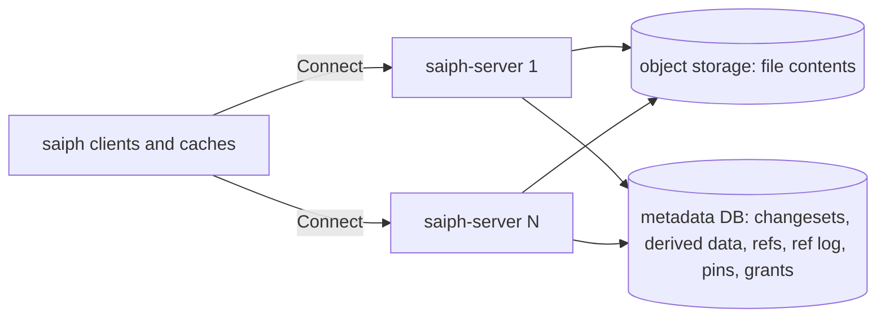

# Saiph: store and server

Tracker: RIG-5665

> Freezes on merge; later changes supersede by citation, never rewrite
> (convention: the `docs/designs/agent/compass-agent-config-delivery/design.md`
> header). Unless a path says otherwise, every code path is in the
> `RigelBuild/saiph` repo, which does not exist yet. A Compass path says
> "in Compass".

Ledger-impact: DL-578, DL-579 and DL-581 file D1–D3. They replace the
decisions of the deleted `internal-vcs.md` record, which made a git mirror
the store. DL-535, DL-090, DL-326 and DL-561 stay whole: they govern the git
backend, and this record designs Saiph only
([overview](README.md#rulings), ruling 5). The store additions that
[client](client.md), [review](review.md), [ci-cd](ci-cd.md),
[merge-queue](merge-queue.md) and [git-bridge](git-bridge.md) asked for
are folded into this record, and each of those records points here.

**Named decisions this record introduces:** D1–D3 in [Decisions](#decisions).

Length: Matt lifted the length cap for this set (ruling 6 in the
[overview](README.md#rulings)). The prose sits mostly in Approach, which
freezes the formats every sibling record builds on.

Saiph is the version control system Rigel sells. Customers self-host it or
use it through Compass, and the Compass repo is its first user. This record
owns the entities and RPCs the sibling records share: [client](client.md),
[review](review.md), [ci-cd](ci-cd.md), [git-bridge](git-bridge.md) and [merge-queue](merge-queue.md) in this
directory. The [overview](README.md) holds the glossary and the component
map.

## Open Questions

Matt ruled on 2026-10-18 that Saiph's core follows Scion to the letter.
Where the Scion post is silent, Mononoke, Sapling and EdenFS
(`facebook/sapling`) are the reference. Every departure is listed in
[Deviations from Scion](#deviations-from-scion) or
[Gaps filled from Mononoke and Sapling](#gaps-filled-from-mononoke-and-sapling).
The record is written against each recommendation below.

Settled by those rulings, so no longer open: the content hash is
BLAKE2b-256 keyed per object type, as Mononoke's (was OQ-1); the server is
its own `saiph-server` binary in the saiph repo (was OQ-5).

### OQ-1 — Which metadata database? (load-bearing)

Scion keeps changesets, refs and derived data in Spanner. A ref move "is a
compare-and-swap on a single Spanner row", and servers "compute derived
data on the fly and write the results back to Spanner". Spanner is a
Google Cloud service, so a self-hosted product cannot ship on it. Scion
also holds that "Everything must be horizontally scalable."

- (a) **YugabyteDB (YSQL).** The closest self-hosted equivalent of
  Spanner. "The transaction design is based on the Google Spanner
  architecture"
  ([yugabyte-db README](https://github.com/yugabyte/yugabyte-db)). YSQL
  "reuses the PostgreSQL query layer" and supports row-level security
  ([docs](https://docs.yugabyte.com/preview/secure/authorization/row-level-security/)).
  Writes scale out across nodes. The repo "contains two differently
  licensed components": the core database is Apache-2.0, and YugabyteDB
  Anywhere, the management platform, is under the Polyform Free Trial
  License 1.0.0. Saiph runs the core database only.
- (b) **Postgres ≥16 with one primary** (CloudNativePG on Kubernetes).
  Familiar, and Compass already runs it. One primary bounds write
  throughput, which fails Scion's scaling principle.
- (c) **CockroachDB.** Spanner-inspired and write-scalable, but its free
  tier under the CockroachDB Software License is
  ["throttled after 7 days without sending telemetry"](https://www.cockroachlabs.com/docs/stable/licensing-faqs),
  which a self-hosted product cannot accept.
- (d) **FoundationDB** (Apache-2.0). Scales, but has no SQL,
  ["Transaction size cannot exceed 10,000,000 bytes of affected data"](https://apple.github.io/foundationdb/known-limitations.html),
  and transactions end after five seconds.

**Recommendation: (a), with (b) allowed on one node.** The schema and
queries use only what YSQL and Postgres 16 both run, and CI runs the store
suite on both (S2). A deployment with many servers (ruling 1) runs
YugabyteDB. Dogfood and small self-hosted installs may run one Postgres.
Postgres does not win alone: its edge is familiarity, and it fails the
scaling principle. The design uses no LISTEN/NOTIFY, so behavior is the
same on both.

### OQ-2 — Which bytes are hashed? (load-bearing)

Scion does not say. Mononoke hashes the Thrift serialization of each
object. Saiph creates every changeset on the server, as Scion does
("Changesets are created server-side"), so only `saiph-server` encodes;
clients decode and may verify.

- (a) **Deterministic CBOR** ([RFC 8949 §4.2.1](https://www.rfc-editor.org/rfc/rfc8949#section-4.2.1),
  "Core Deterministic Encoding Requirements") with integer keys, via
  `fxamacker/cbor` (MIT). The determinism rule is in the RFC, so id
  stability does not rest on one library's behavior.
- (b) **Thrift**, as Mononoke. It follows the reference exactly, but it
  adds the Thrift compiler beside buf.
- (c) **Protobuf.** Not an option for hashing
  ([protobuf.dev](https://protobuf.dev/programming-guides/serialization-not-canonical/):
  "Protobuf serialization is not (and cannot be) canonical").

**Recommendation: (a).** It departs from the gap-fill reference, so the
gaps table lists it. Test vectors in the repo (S1) bind every decoder.

### OQ-3 — May a reader fetch an object by id alone? (security)

Scion's caches answer by id: "Every request is for a specific object that
never changes, so any cache can answer it". A blob id names content, not a
path, so a reader without access to a restricted directory could ask for a
guessed id and learn that the content exists.

- (a) Id reads (`GetBlobs`, `GetTrees`, `GetChangesets`) need read on the
  whole repo. Readers with partial access use path reads (`ReadTree`,
  `ReadFile`), which check the ACL for each path.
- (b) All reads go by path. Caches lose cheap id lookups.
- (c) Key blobs per ACL scope. Restricted content stops deduplicating, and
  moving a file across scopes copies it.

**Recommendation: (a).** Most repos have no read-narrowing ACL, so most
readers keep id reads. A partial reader never gets an id oracle.

### OQ-4 — Retention defaults

Trunk history is kept forever. The question is how long an unpinned
changeset lives (an abandoned commit, a dropped rebase candidate).

- (a) 7 days after creation.
- (b) 30 days.

**Recommendation: (a) 7 days**, set per deployment. Review versions and
workspaces hold pins, so a live change never depends on this window.

### OQ-5 — Does the store keep conflicted changesets? (shared with review and merge-queue)

- (a) No. The store refuses a conflicted tree. `Rebase` and `Merge` return
  a typed conflict and store nothing conflicted. The `saiph` client keeps
  conflict state in its working copy, as Sapling does: Sapling refuses to
  commit while conflicts are open (`checkunresolved` in
  `eden/scm/sapling/mergeutil.py`: "unresolved merge conflicts").
- (b) Yes, as jj does: a tree is a `Merge<TreeId>`, and conflicts can be
  committed and shared.

**Recommendation: (a).** It follows the reference. Trunk and the git
mirror can never hold a conflict, and every reader sees plain trees. (b)
can be added later as a new changeset field without changing old ids.

### OQ-6 — How does `saiph-server` know the caller? (load-bearing for client)

Saiph is its own product, so Compass's interceptors no longer sit in front
of it. The Scion post does not cover authentication.

- (a) `saiph-server` verifies signed bearer tokens (JWT) from configured
  issuers. Claims carry the tenant, the subject kind (account or service),
  the subject id and scopes. Compass is one issuer: it mints short-lived
  tokens for its agents and services. An install without Compass uses
  tokens Saiph issues itself, stored hashed in `saiph.tokens`.
- (b) Compass proxies every call. That adds a hop to every object read and
  breaks Scion's cache tiering.

**Recommendation: (a).** [client](client.md) designs the claims, key
discovery and Compass's issuance; the types are folded into S11 here. A
Kubernetes service-account issuer has a fixed tenant; Compass's issuer
sets the `tenant` claim.

## Problem / Intent

Saiph is the version control system Rigel sells; the Compass repo is its
first user. Matt ruled for a full Scion implementation with many servers
(ruling 1), with the core following Scion to the letter (ruling 10). This
record designs the store and server: the changeset format, the blob and
metadata stores, the ref compare-and-swap, derived data, server-side
commit, rebase and merge, and the Connect API that every client and
sibling record calls.

The model is Scion
([Redesigning source control](https://www.anthropic.com/engineering/redesigning-source-control)):
"Client-server asymmetry. In git, every client is capable of being a
full-fledged server. In Scion, the server answers questions about file
history and blame, creates commits, performs merges and rebases".

## Approach

### Ground truth

- **Saiph's repo** is `RigelBuild/saiph`. It does not exist yet, so every
  Saiph path in this record is a plan, not a citation.
- **Compass as a model.** Compass serves Connect v2
  (`connectrpc.com/connect/v2`). Its tenant tables carry `tenant_id` with
  `FORCE ROW LEVEL SECURITY` and a `tenant_isolation` policy on the GUC
  `compass.tenant_id`, set with `SET LOCAL` (`go/internal/store/tenant_tx.go`
  in Compass); `WithSystemRole` switches to a BYPASSRLS role. Its object
  store wraps minio-go (`NewS3ObjectStore` in
  `go/internal/store/objectstore.go` in Compass) and runs against Garage,
  R2, MinIO and AWS S3. Saiph reuses these patterns, not the packages.
- **Compass's deployment.** The Kubernetes record runs one Compass Server
  with `replicas: 1` and `Recreate`
  ([server-on-kubernetes](../compass/server-on-kubernetes.md#design)). Saiph runs
  its own Deployments and does not change that record.
- **License.** `facebook/sapling` is GPL-2.0-only (its file headers: "GNU
  General Public License version 2"). Compass is AGPL-3.0-only. This
  record borrows designs from Sapling, never code (Global Constraints).

### Shape: immutable content, transactional coordination

The store has two halves, as Scion has. File contents are content-addressed
and compressed in object storage: a changeset holds "content-addressed
pointers to the compressed file contents in blob storage". Changesets,
derived data and every mutable row (refs, pins, the ref log, ACL grants,
quotas) live in the metadata database, as Scion keeps them in Spanner.
Any tier can cache an immutable object forever: "Every request is for a
specific object that never changes, so any cache can answer it".

Creating a changeset never takes a lock and never touches a ref. Moving a
ref is a compare-and-swap on one row. Scion: "no packfiles to accept, no
locking or cross-server coordination, and no refs to move around… moving
one is a compare-and-swap on a single Spanner row that happens separately
from creating changesets." The object store is never the ref authority.



### Deviations from Scion

Each row is a place where Saiph does not do what the Scion post says. The
only accepted reasons are a fact Scion relies on that Saiph lacks, or a
detail the post leaves open.

| Scion | Saiph | Why |
| -- | -- | -- |
| Changesets, refs and derived data in Spanner ("a single Spanner row"; "write the results back to Spanner") | The same data in YugabyteDB YSQL; one Postgres ≥16 allowed on a single node (OQ-1) | Saiph lacks Spanner: it is a Google Cloud service, and customers self-host. YugabyteDB's transactions are "based on the Google Spanner architecture". |
| Cache servers in every region ("the tree and blob cache servers in its region") | One region by default; each added region adds a `saiph-cache` Deployment with the same RPCs ([client](client.md)) | Scion relies on a multi-region fleet. A self-hosted install usually has one cluster. The tiers and RPCs are unchanged. |

### Gaps filled from Mononoke and Sapling

The post leaves these open. Each row names the reference Saiph follows and
marks where Saiph departs from it. Every path is in `facebook/sapling`.

| Gap | Reference | Saiph |
| -- | -- | -- |
| Content hash | Mononoke ids are BLAKE2b-256, keyed per type (`context_key => "changeset"`, `"content"`, `"chunk"` in `eden/mononoke/mononoke_types/src/typed_hash.rs`) | Follows: BLAKE2b-256 keyed per type |
| Hashed bytes | Mononoke hashes its Thrift serialization | **Departs:** deterministic CBOR, because RFC 8949 states the determinism rule (OQ-2) |
| Changeset fields | Bonsai ([`bonsai.thrift`](https://github.com/facebook/sapling/blob/79071c2a3ea20c36ed71332608535e5801101bba/eden/mononoke/mononoke_types/serialization/bonsai.thrift)): ordered parents, changed paths, no tree | Follows, plus a change id |
| Change identity across rewrites | Sapling records mutations from predecessor to successor (`eden/scm/lib/mutationstore`: "a store for recording records of commit mutations") | **Departs** by Matt's ruling: a 16-byte change id, Saiph's own concept, inspired by jj |
| Write-ahead log mechanics | Neither says how the log is kept | An immutable row per changeset with an `intake_seq` from a database sequence, which orders intake without a lock |
| Large files | Mononoke `FileContents::Chunked` (`eden/mononoke/mononoke_types/src/file_contents.rs`) | Follows: 4 MiB chunks |
| Per-repo storage | Mononoke `PrefixBlobstore` (`eden/mononoke/blobstore/prefixblob`) | Follows: a `<tenant>/<repo>/` key prefix |
| Upload negotiation | Sapling's EdenAPI `lookup_batch` and `process_files_upload` (`eden/scm/lib/edenapi/trait/src/api.rs`) | Follows: `FindMissingBlobs`, then `PutBlobs` |
| Tree entries with sizes | Mononoke fsnodes: "summary information about the files in the manifest that is useful in the implementation of filesystems" (`eden/mononoke/mononoke_types/src/fsnode.rs`) | Follows: each entry carries a size |
| Content aliases | Mononoke `ContentMetadataV2` holds `sha256` and `git_sha1` (`eden/mononoke/mononoke_types/serialization/content.thrift`) | Follows: lazy content meta holds both |
| Ref log | Mononoke `bookmarks_update_log` (repo, name, from, to, reason, timestamp) | Follows: `saiph.ref_log` |
| Commit graph skip lists | Mononoke `commit_graph_edges` keeps `p1_linear_depth` and skew ancestors | Follows the idea: `p1_depth` and a Bitcoin skip pointer |
| Directory ACLs | Mononoke `.slacl` files and `AclManifests` | Follows: `.saiphacl` and an ACL manifest |
| Conflicts | Sapling refuses to commit unresolved conflicts (OQ-5) | Follows |
| Tenancy | None: Mononoke and Scion serve one organization | Adds a tenant id and RLS on every row, because Saiph is sold |
| Retention | Neither covers it | Adds gc of unpinned, non-trunk changesets after 7 days (OQ-4), because storage is usage-billed |

### Ids and encoding (OQ-2)

- An **id** is 32 bytes: BLAKE2b-256 of the object's bytes, keyed by the
  object's type, as Mononoke's typed hashes are. The keys are
  `saiph.changeset`, `saiph.tree`, `saiph.acl`, `saiph.content` and
  `saiph.chunk`. The key separates types, so a blob that holds a valid
  changeset encoding never shares a changeset's id. Go has keyed BLAKE2b
  in `golang.org/x/crypto/blake2b`.
- A **blob id** is the keyed hash of the raw file bytes. SHA-256 and the
  git SHA-1 are aliases in lazy content meta, as in Mononoke's
  `ContentMetadataV2`, so a build cache that keys by SHA-256 (REAPI
  `SHA256 = 1`) maps to Saiph through the alias.
- Changesets and tree nodes are encoded as deterministic CBOR (RFC 8949
  §4.2.1) with small integer map keys (OQ-2). Only `saiph-server`
  encodes. A decoder re-encodes and rejects input that is not
  byte-identical, so every client that verifies an id gets the same
  answer.
- Wire form: `bytes` of length 32. Text form: lowercase hex. Every id
  travels with its size where one exists (`size_bytes`), as REAPI digests
  do.

### Changeset

The changeset is the unit of history, as in Scion ("the unit of work is a
“changeset,” an entry in a write-ahead log") and Mononoke Bonsai
([bonsai.thrift](https://github.com/facebook/sapling/blob/79071c2a3ea20c36ed71332608535e5801101bba/eden/mononoke/mononoke_types/serialization/bonsai.thrift):
"Bonsai Changeset is the fundamental commit object of Mononoke's internal
representation"). Scion: "where a git commit stores a pointer to the tree,
a changeset stores a list of the files that changed relative to its first
parent". It never stores a tree. Changesets are created on the server only
(see [Intake](#intake)).

```text
Changeset (CBOR map, keys in this order; id = BLAKE2b-256 keyed "saiph.changeset")
  1  parents      [id]            ordered; parents[0] is the diff base; [] is a root
  2  change_id    bytes(16)       Saiph's change id; kept across rewrites
  3  author       Signature
  4  committer    Signature
  5  message      text            UTF-8
  6  changes      map<path, FileChange | null>   sorted by path bytes; null = delete
  7  extra        map<text, bytes>  optional; absent when empty
Signature  { 1 name: text, 2 email: text, 3 time_unix_ms: int, 4 tz_offset_min: int }
FileChange { 1 kind: 0 file | 1 executable | 2 symlink, 2 content: id, 3 size: uint,
             4 copy_from: { 1 path: text, 2 parent: uint } (optional) }
```

Rules, all checked at intake:

- **Tree rule.** `tree(cs) = apply(tree(parents[0]), changes)`. A root
  changeset applies to the empty tree. A merge lists every path whose
  merged result differs from `parents[0]`. So a tree is always derivable
  from one parent and the changes, with no merge logic.
- **Parent order is hashed.** Bonsai: "Parents are stored and hashed
  ordered. This matches Git". Two orders are two changesets.
- **Paths.** UTF-8, `/`-separated, no empty, `.` or `..` component, no NUL,
  at most 4,096 bytes. Bonsai's prefix rule holds: "There is no distinction
  between added and modified files", and "A deleted path may be a prefix of
  changed paths and means a file was replaced by a directory. Otherwise,
  path conflicts are not allowed".
- **Content exists.** Each `content` id names a blob already stored in the
  repo, with the stated `size`.
- **No conflicts** are stored (OQ-5). A changeset's tree is plain.
- **`extra`** carries keys the git bridge needs to round-trip an imported
  commit (for example a GPG signature). Keys are namespaced (`git.gpgsig`).
  The store does not interpret them.

A changeset has no tree id, no version and no review state. The root tree
id is derived (below) and kept on the changeset's row.

**The change id** is Saiph's own concept (ruling 11). Neither Scion nor
Bonsai has one; Sapling links rewrites through mutation records instead.
The idea comes from jj, where a change is "a commit as it evolves over
time". The server picks 16 random bytes on a change's first `Commit`, and
`Rebase` keeps them. So review groups versions by change id
([review](review.md)), and the merge queue follows a change across server-side
rebases with no walk over a rewrite log.

### Blobs

A blob is file content. Object keys are per repo, as Mononoke's
`PrefixBlobstore` prefixes keys: `<tenant>/<repo>/b/<hex>`. Per-repo keys
give up dedup across repos. They buy a simple repo delete (one prefix) and
no cross-repo existence oracle.

- A blob of at most 4 MiB is one object.
- A larger blob is stored as 4 MiB chunks, as Mononoke's
  `FileContents::Chunked`. Each chunk is a blob keyed `saiph.chunk`, and a
  chunk list sits at `<tenant>/<repo>/b/<hex>.chunks`. The client uploads
  missing chunks, then calls `PutChunkedBlob`. The server streams the
  chunks, hashes them in order, and stores the list only if the whole hash
  matches. An interrupted upload resumes by asking `FindMissingBlobs` for
  the chunks.
- Every object body is zstd-compressed (`klauspost/compress`), as Scion
  keeps "compressed file contents". The body starts with one format byte
  (`1` = zstd), so a later codec needs no migration. Ids are always of the
  raw bytes.
- Uploads negotiate as Sapling's EdenAPI does (`lookup_batch`, then
  `process_files_upload`): `FindMissingBlobs` answers from `saiph.blobs`
  rows, not object HEADs, then `PutBlobs` sends only the missing content.
  A row is written only after the object PUT succeeds.
- `max_file_bytes` is a per-repo setting, default 100 MiB. A repo with a
  git mirror cannot raise it, because "GitHub blocks files larger than
  100 MiB"
  ([GitHub docs](https://docs.github.com/en/repositories/working-with-files/managing-large-files/about-large-files-on-github)).

### Trees

A tree node is derived, never uploaded. It is a sorted list of entries:

```text
TreeNode (CBOR array of entries, sorted by name bytes; id = BLAKE2b-256 keyed "saiph.tree")
Entry { 1 name: text, 2 kind: 0 file | 1 executable | 2 symlink | 3 tree,
        3 id: id, 4 size: uint }   size of a tree = sum of its file sizes
```

Nodes are rows in `saiph.nodes`, as Scion writes derived data back to its
database. A changeset writes only the nodes on the paths it changes, so a
commit costs O(changed paths × depth), never the repo size. Each entry
carries a size, as Mononoke's fsnodes do, so a virtual checkout lists a
directory without fetching blobs. Clients fetch trees by id from the root
down, as Scion's do: "Starting from a root tree, the client checks its
local store for missing trees and requests them recursively".

### Metadata database (OQ-1)

The metadata database holds changesets, derived data and all mutable
state, in its own schema `saiph`, with its own migrations and its own
tenant GUC. File contents never enter it. SQL is limited to what
YugabyteDB YSQL and Postgres 16 both run. Each tenant table carries
`tenant_id` with `ENABLE` and `FORCE ROW LEVEL SECURITY` and a
`tenant_isolation` policy on the GUC `saiph.tenant_id`, the pattern
Compass uses.

```sql
-- internal/meta/migrations/0001_saiph.sql (sketch; every tenant table gets RLS)
CREATE SCHEMA saiph;
CREATE SEQUENCE saiph.intake_seq;
CREATE TABLE saiph.tenants (id TEXT PRIMARY KEY, quota_bytes BIGINT NOT NULL DEFAULT 0);
CREATE TABLE saiph.repos (
  tenant_id TEXT NOT NULL DEFAULT current_setting('saiph.tenant_id', TRUE)
    REFERENCES saiph.tenants (id) ON DELETE RESTRICT,
  id BIGINT GENERATED ALWAYS AS IDENTITY,
  name TEXT NOT NULL,                       -- "owner/name"
  trunk_ref TEXT NOT NULL DEFAULT 'trunk',
  max_file_bytes BIGINT NOT NULL DEFAULT 104857600,
  quota_bytes BIGINT NOT NULL,
  retention_days INT NOT NULL DEFAULT 7,
  git_mirrored BOOLEAN NOT NULL DEFAULT false, -- KindGitCommit runs only here
  stored_bytes BIGINT NOT NULL DEFAULT 0,
  log_seq BIGINT NOT NULL DEFAULT 0,        -- last ref-log entry
  trunk_seq BIGINT NOT NULL DEFAULT 0,      -- last trunk position
  deleted_unix_ms BIGINT,
  created_unix_ms BIGINT NOT NULL,
  PRIMARY KEY (tenant_id, id), UNIQUE (tenant_id, name));
CREATE TABLE saiph.changesets (
  tenant_id TEXT NOT NULL DEFAULT current_setting('saiph.tenant_id', TRUE),
  repo_id BIGINT NOT NULL,
  id BYTEA NOT NULL CHECK (length(id) = 32),
  encoded BYTEA NOT NULL,                   -- the hashed CBOR bytes
  intake_seq BIGINT NOT NULL DEFAULT nextval('saiph.intake_seq'),
  change_id BYTEA NOT NULL CHECK (length(change_id) = 16),
  p1 BYTEA,                                 -- parents[0]; NULL for a root
  parent_count SMALLINT NOT NULL,
  generation BIGINT NOT NULL,               -- 1 + max over all parents
  p1_depth BIGINT NOT NULL,                 -- length of the first-parent chain
  skip BYTEA,                               -- first-parent ancestor at GetSkipHeight(p1_depth)
  root_tree BYTEA NOT NULL,
  acl_root BYTEA,                           -- ACL manifest; NULL = no ACL files
  trunk_seq BIGINT,                         -- position on trunk; NULL off trunk
  created_unix_ms BIGINT NOT NULL,
  PRIMARY KEY (tenant_id, repo_id, id));
CREATE INDEX changesets_by_change ON saiph.changesets (tenant_id, repo_id, change_id);
CREATE TABLE saiph.changeset_parents (tenant_id TEXT, repo_id BIGINT, child BYTEA,
  ord SMALLINT, parent BYTEA, PRIMARY KEY (tenant_id, repo_id, child, ord));
CREATE INDEX changeset_children ON saiph.changeset_parents (tenant_id, repo_id, parent);
CREATE TABLE saiph.blobs (tenant_id TEXT, repo_id BIGINT, id BYTEA, size_bytes BIGINT,
  chunks INT NOT NULL DEFAULT 0, stored_bytes BIGINT, last_seen_unix_ms BIGINT,
  PRIMARY KEY (tenant_id, repo_id, id));
CREATE TABLE saiph.nodes (tenant_id TEXT, repo_id BIGINT, id BYTEA, kind SMALLINT,
  encoded BYTEA, created_unix_ms BIGINT, PRIMARY KEY (tenant_id, repo_id, id));  -- tree and ACL nodes
CREATE TABLE saiph.refs (tenant_id TEXT, repo_id BIGINT, name TEXT, target BYTEA NOT NULL,
  version BIGINT NOT NULL, updated_unix_ms BIGINT, PRIMARY KEY (tenant_id, repo_id, name));
CREATE TABLE saiph.ref_log (tenant_id TEXT, repo_id BIGINT, log_seq BIGINT, name TEXT,
  old_target BYTEA, new_target BYTEA, chain BYTEA[], subject TEXT, reason TEXT,
  at_unix_ms BIGINT, PRIMARY KEY (tenant_id, repo_id, log_seq));
CREATE TABLE saiph.pins (tenant_id TEXT, repo_id BIGINT, holder TEXT, changeset BYTEA,
  expires_unix_ms BIGINT, PRIMARY KEY (tenant_id, repo_id, holder, changeset));
CREATE TABLE saiph.grants (tenant_id TEXT, repo_id BIGINT, subject TEXT, role SMALLINT,
  ref_prefix TEXT NOT NULL DEFAULT '',      -- '' = repo-wide; else UpdateRef and DeleteRef under it only
  PRIMARY KEY (tenant_id, repo_id, subject, ref_prefix));
-- object = the changeset, or the blob for per-blob kinds; path = '' unless per path
CREATE TABLE saiph.derived (tenant_id TEXT, repo_id BIGINT, kind SMALLINT, object BYTEA,
  path TEXT NOT NULL DEFAULT '', value BYTEA, PRIMARY KEY (tenant_id, repo_id, kind, object, path));
CREATE TABLE saiph.derive_cursors (tenant_id TEXT, repo_id BIGINT, kind SMALLINT,
  log_seq BIGINT, lease_token TEXT, lease_until_unix_ms BIGINT,
  PRIMARY KEY (tenant_id, repo_id, kind));
CREATE TABLE saiph.path_touches (tenant_id TEXT, repo_id BIGINT, path TEXT, trunk_seq BIGINT,
  PRIMARY KEY (tenant_id, repo_id, path, trunk_seq));
CREATE TABLE saiph.git_commits (tenant_id TEXT, repo_id BIGINT, changeset BYTEA,
  git_commit BYTEA CHECK (length(git_commit) = 20),
  PRIMARY KEY (tenant_id, repo_id, changeset), UNIQUE (tenant_id, repo_id, git_commit));
-- OQ-6 (a): Saiph-issued tokens; read before the tenant is known, so no RLS
CREATE TABLE saiph.tokens (hash BYTEA PRIMARY KEY, tenant_id TEXT NOT NULL,
  kind SMALLINT NOT NULL, subject TEXT NOT NULL, scopes TEXT[], expires_unix_ms BIGINT);
```

The sketch elides `NOT NULL`, the `tenant_id` default and the foreign keys
on the later tables; the migration has them all. Repos have a numeric id,
so a rename moves no object. Object keys use the numeric id.

### Refs and the ref log

A ref is a name and a target changeset. Scion "discourages refs (pointers
to commits, such as branches and tags), except for the main ref or release
branches, because *global* state that every server has to agree on is a
looming scaling problem". So does Saiph. A repo has its trunk ref and
optional `release/*` refs. Review heads, workspaces and merge-queue
candidates are not refs; they hold **pins** instead, so gc keeps their
changesets.

- **Names** match `^[a-z0-9][a-z0-9._/-]{0,199}$`.
- **Protected refs** are the trunk ref and `release/*`. They move only
  forward along the first-parent chain, and only for a subject with the
  `land` role (the merge queue, admins). A grant may carry a
  `ref_prefix`: it then gives its role only for `UpdateRef` and
  `DeleteRef` on refs whose names start with it, so a deploy controller
  can hold `land` on `release/` and not on trunk
  ([ci-cd](ci-cd.md) OQ-3). Every other check, and
  `GetRepoResponse.caller_role`, uses the repo-wide grant.
- **The CAS.** `UpdateRef` names the expected target. One statement
  decides it:

```sql
UPDATE saiph.refs SET target = $new, version = version + 1, updated_unix_ms = $now
 WHERE tenant_id = $t AND repo_id = $r AND name = $name AND target = $expected
 RETURNING version;
```

  Exactly one of two racing writers wins. On Postgres under READ
  COMMITTED, the second writer blocks on the row, then "The search
  condition of the command (the WHERE clause) is re-evaluated to see if
  the updated version of the row still matches"
  ([Postgres docs](https://www.postgresql.org/docs/current/transaction-iso.html)).
  If either database reports a serialization failure instead, the server
  retries once from a fresh read. The loser gets zero rows and a typed
  `current` result, not an error.
- **Batch advance.** `UpdateRef` may carry a `chain`: an ordered list of
  changesets where `chain[0].parents[0]` is the expected target, each next
  entry's `parents[0]` is the one before it, and the last is the new
  target. The server checks the chain from immutable rows before the
  transaction, then moves the ref once. The merge queue lands a whole batch
  with one CAS. Without a chain, the server walks the first-parent chain
  from the new target back to the expected one (at most 10,000 steps, else
  `INVALID_ARGUMENT` asking for a chain).
- **In the same transaction** the server bumps `saiph.repos.log_seq`,
  writes one `saiph.ref_log` row, and, for the trunk ref, gives each chain
  entry the next `trunk_seq`. The repo row lock orders ref-log entries, so
  the log is gapless. The log follows Mononoke's `bookmarks_update_log`.
- **`trunk_seq`** is a dense position on trunk: 1 for the first trunk
  changeset, then +1 for each. CI milestones, bisection and the git bridge
  use it as "the n-th trunk changeset".
- **`WatchRefs`** streams ref-log entries after a given `log_seq`. Each
  replica runs one poller per watched repo; it reads `saiph.ref_log` rows
  after its last seq every 250 ms and fans them out to that replica's
  streams. A reconnecting consumer resumes from its last seq and misses
  nothing.

### Derived data

Derived data follows Scion: "Each type of derived data is defined
recursively, so its value for a changeset is computed from its values for
that changeset’s parents." Scion's servers "compute derived data on the fly
and write the results back" to the database, and so do Saiph's: values
live in `saiph.nodes` and `saiph.derived`. Mononoke has the same model
([`derivable_type.rs`](https://github.com/facebook/sapling/blob/main/eden/mononoke/mononoke_types/src/derivable_type.rs),
"Enum which consolidates all available derived data types"). A derived
value is a pure function of immutable inputs, so two servers that derive
the same value write the same bytes. No lease guards a derivation; an
in-process singleflight stops duplicate work in one replica, and
`INSERT … ON CONFLICT DO NOTHING` absorbs a cross-replica race.

Each kind has a mode, as Scion chooses per type "whether to compute it
eagerly or defer the work":

- **Eager** kinds are derived at intake, in the changeset's transaction. A
  changeset without them is never visible.
- **On-trunk** kinds are derived when trunk advances. A worker per
  (repo, kind) reads the ref log from `saiph.derive_cursors.log_seq`, under
  a lease row with a token and a TTL (the pattern of `LeaseForgeMirror` in
  `go/internal/store/forge_mirrors.go` in Compass). Any replica can hold
  the lease.
- **Lazy** kinds are derived on first read and memoized.

| Kind | Mode | Value | Used by |
| -- | -- | -- | -- |
| Root tree | Eager | `saiph.nodes` rows; root id in `saiph.changesets.root_tree` | every read, `Diff`, client checkout |
| Commit graph | Eager | `generation`, `p1_depth`, `skip` columns | `MergeBase`, `Log`, ancestry checks |
| ACL manifest | Eager | `saiph.nodes` rows; root id in `acl_root` | every ACL check |
| Path index | On-trunk | `saiph.path_touches` rows | `PathHistory` on trunk |
| Git commit | On-trunk, repos with `git_mirrored` only | `saiph.git_commits` rows | [git-bridge](git-bridge.md) export, `GetGitCommits` |
| Git tree | Lazy, per tree node | the 20-byte git tree id in `saiph.derived` | [git-bridge](git-bridge.md) export |
| Content meta | Lazy, per blob | `{is_binary, is_utf8, lines, sha256, git_sha1}` in `saiph.derived` | `Diff`, `Blame`, `GetContentMeta`, git bridge, build-cache aliases |
| Blame | Lazy, per (changeset, path) | range list in `saiph.derived` | `Blame` |

- **Trees.** `tree(cs)` applies `cs.changes` to `tree(parents[0])` and
  writes only the nodes on changed paths.
- **Commit graph.** Scion builds "skip lists for the commit graph".
  `generation` prunes ancestry walks. `skip` is the Bitcoin skip pointer on
  the first-parent chain
  ([`chain.cpp`](https://raw.githubusercontent.com/bitcoin/bitcoin/master/src/chain.cpp)
  `GetSkipHeight`: `return (height & 1) ? InvertLowestOne(InvertLowestOne(height - 1)) + 1 : InvertLowestOne(height);`),
  so "ancestor at depth d" takes O(log n) steps. Mononoke's
  `commit_graph_edges` keeps the same idea as `p1_linear_depth` with skew
  ancestors.
- **ACL manifest.** Mononoke's `AclManifests` is the model
  ([`acl_manifest/derive.rs`](https://raw.githubusercontent.com/facebook/sapling/main/eden/mononoke/derived_data/acl_manifest/derive.rs):
  "Only `.slacl` file changes (explicit + implicit deletes) are fed to
  `derive_manifest`; unchanged subtrees are reused automatically"). A
  changeset that touches no ACL file copies its parent's `acl_root`.
- **Path index.** For each trunk changeset, one row per changed path and
  per ancestor directory of it. `PathHistory` on a trunk changeset is one
  index range scan. Off trunk, it walks the first-parent chain until it
  reaches a trunk changeset, then uses the index.
- **Git commit and git tree.** The store owns the slots and the table;
  the git-commit worker runs only for repos with `git_mirrored`.
  [git-bridge](git-bridge.md) owns both derivations (git trees and
  commits from changesets, with `extra` keys for round-trip fields).
  `GetGitCommits` maps changesets and git commits both ways.
- **Blame.** Lazy, as Mononoke's blame: `blame(cs, path)` is
  `blame(parents[0], path)` moved through the line diff, with new lines
  assigned to `cs`. The value is a `saiph.derived` row keyed by
  (changeset, path).
- **Adding a kind** later is one `Deriver`, as Scion has "added new types
  of derived data many times as the system has grown". A backfill runs it
  over trunk from the oldest unrecorded `trunk_seq`.

### Intake

Scion: "Changesets are created server-side and are available everywhere,
instantly." Saiph has no RPC that takes a client-encoded changeset.
`Commit`, `Rebase`, `Merge` and history import all build changesets
through one intake path. Import ([git-bridge](git-bridge.md)) runs inside
`saiph-server`, as Scion's "git-to-Scion ingestion pipeline" is
server-side. For each changeset, in order:

1. Check path, size and parent-order rules on the structured input.
2. Check that every parent is stored or earlier in the batch. Otherwise
   `FAILED_PRECONDITION`, with the missing ids in a `MissingObjects`
   detail.
3. Check that every blob is stored, with `SELECT … FOR SHARE` on its row,
   and touch `last_seen_unix_ms`. Otherwise `FAILED_PRECONDITION` with the
   missing digests.
4. Check write ACLs for every changed path (below).
5. Encode, hash, and derive the eager kinds.
6. In one transaction, insert the changeset row (with its encoded bytes),
   its parent rows and its new nodes, all `ON CONFLICT DO NOTHING`.

Intake is idempotent: the same input gives the same id and no new row.
It takes no lock beyond its own inserts and the blob share locks, so
commits stay "cheap, incremental, and lock-free". Nothing reaches object
storage during intake, so a crash leaves no orphan.

### Server-side commit, rebase and merge

Scion's server "creates commits, performs merges and rebases". So does
Saiph's. These calls let a thin client (the `saiph` CLI, an agent, the web
app, the merge queue) change history with no local repo.

- **`Commit`** takes parents, file changes whose content is already
  stored, a message and an optional change id. The committer is the
  caller at server time. An admin, or a token with the `import` scope
  (history import), may also set the committer and `extra`; the scope
  gives nothing else. The server builds the changeset through intake.
- **`CommitBatch`** runs intake once over up to 1,000 `CommitRequest`s,
  so a parent may be an earlier entry. Import uses it
  ([git-bridge](git-bridge.md)).
- **`Rebase`** takes a set of changesets (any shape, up to 1,000) and an
  `onto`. Every parent outside the set is replaced by `onto`. Each
  changeset is rewritten in topological order: the new changes are a
  three-way merge of each path, with the old `parents[0]` tree as the base,
  the new `parents[0]` tree as the destination, and the old changeset's
  tree as the source. Change id, author and message are kept. The
  committer is the caller, at server time. With `drop_empty`, a rewritten
  changeset with no changes is dropped and its children take its parent.
  This drops a change that trunk already holds.
- **Resolutions.** `Rebase` may carry `resolutions`: content for a path
  whose three-way merge, while a named changeset is rewritten, is a
  `CONFLICT_KIND_CONTENT` conflict. A non-empty list needs
  `REPO_ROLE_LAND`. A resolution for any other path, or for a
  `.saiphacl`, is `INVALID_ARGUMENT` naming the path, so a fix made
  against an old trunk fails instead of overwriting. Content not stored
  is `FAILED_PRECONDITION`. A conflict the resolutions do not cover still
  returns `Conflict`. The merge queue's fixer uses it
  ([merge-queue](merge-queue.md)).
- **`Merge`** takes two or more parents and merges each path against the
  merge base. With more than one best merge base, every path that differs
  between the bases is a `MULTIPLE_BASES` conflict. The store does not
  merge criss-cross histories implicitly.
- **Conflicts are results, not errors.** A conflict is
  `Conflict{changeset, paths[]}`. Each `PathConflict` has a kind, the
  file versions as jj orders them, and hunks. jj's `Merge<T>`
  ([`lib/src/merge.rs`](https://github.com/jj-vcs/jj/blob/9ff73e7f/lib/src/merge.rs))
  "Alternates between positive and negative terms, starting with
  positive". So `adds` has n entries and `removes` has n−1. For a rebase,
  `adds = [destination, source]` and `removes = [base]`. Each hunk carries
  the destination line range and the text of each term. A binary file has
  no hunks.
- **Nothing conflicted is stored** (OQ-5). On a conflict, `Rebase`
  returns the rewrites that came before it. Those are stored, unpinned
  changesets; the caller pins the ones it keeps. `Merge` writes nothing.
- **The text merge** is in-house (`internal/textdiff`): a histogram line
  diff and a three-way line merge, written fresh (Sapling's diff code is
  GPL-2.0-only; see Global Constraints). The conflict shape above is
  Saiph's own. A file is binary when its first 8 KiB holds a NUL byte, as
  git decides.

### Per-directory ACLs

ACLs live in the tree, as Mononoke's `.slacl` files do. A file named
`.saiphacl` in a directory sets the ACL for that directory and everything
under it, down to the next `.saiphacl`. It is JSON:

```json
{ "read": ["role:read"], "write": ["account:acct_1", "role:admin"] }
```

- A missing `read`, `write` or `owners` key inherits that list from the
  enclosing scope. The repo grants (`saiph.grants`) are the outermost
  scope.
- An entry is `account:<id>`, `service:<name>`, or `role:<role>`, which
  matches any subject holding that repo role or a higher one. `admin`
  always passes. A malformed list fails intake with `INVALID_ARGUMENT`.
- **Owners.** The optional `owners` list names who must approve a change
  to paths in the scope ([review](review.md)). `CoverOwners` returns each
  path whose scope has no owner among the given approvers, checked under
  the changeset's ACL manifest and the trunk head's, so a version that
  adds itself to `owners` is not covered by the new entry. An owner
  without write in the scope does not cover it.
- **Write.** Every changed path needs write in its scope under
  `parents[0]`'s ACL manifest and under the trunk head's. Changing,
  adding or deleting `<dir>/.saiphacl` needs write in the scope that encloses
  `<dir>`, never the file's own scope. A `land` subject passes write checks
  for `Rebase` and `Merge`, because those reapply changes already checked
  at intake.
- **Read.** A path read (`ReadTree`, `ReadFile`, `Diff`, `Blame`,
  `PathHistory`) needs read in the path's scope under the changeset's ACL
  manifest and under the trunk head's. A denied read answers `NOT_FOUND`,
  never `PERMISSION_DENIED`, so it does not confirm the path exists.
  `Diff` and `ReadTree` leave out denied entries.
- **Id reads** need read on the whole repo: no `.saiphacl` narrows read for
  the caller (OQ-3). A malformed `.saiphacl` fails intake with
  `INVALID_ARGUMENT` naming the path.
- Protected paths, such as a mirrored repo's `.github/workflows/`, use
  this same mechanism: a `.saiphacl` there grants write to named humans only.

### Tenancy

Saiph is sold to customers who self-host it, and Compass tenants use it
through Compass, so tenancy is core, not an add-on. In Compass's terms it
passes the
[boundary record](../compass/meta/oss-core-managed-boundary/design.md#boundary-test)
test (the public single-tenant product compiles and runs it), and
Compass's product rule is
[self-host and managed](https://github.com/RigelBuild/compass/blob/main/docs/concepts/self-host-and-managed.md).
This record restates neither.

- Every `saiph` row carries `tenant_id`, under RLS on `saiph.tenant_id`.
  `meta.(*Meta).InTenant` sets it with `SET LOCAL`. GC, derive workers and
  token lookup use a BYPASSRLS role.
- Every object key starts with the tenant id: `<tenant>/<repo id>/…`.
- The tenant comes from the verified token (OQ-6), never from a request
  field. Handlers read one `auth.Principal{Kind, ID, Tenant, Scopes,
  Agent}` from the context; `Agent` marks an agent's account.
- A self-hosted install has one tenant row, created at boot. Compass
  creates a Saiph tenant per Compass tenant with `EnsureTenant`, called
  with a token Compass mints for that tenant.

### Horizontal scaling

Ruling 1 asks for many servers, and Scion says "Everything must be
horizontally scalable". `saiph-server` keeps no state of its own. Every
write goes to the metadata database or object storage, so any replica
answers any call.

- **Deployment.** `saiph-server` runs as a Deployment with `replicas: N`
  and `RollingUpdate`. Its manifests live in the saiph repo (`deploy/`). A
  single replica is for dogfooding only (ruling 1).
- **Object cache.** Scion's servers "are essentially large caches". Each
  replica keeps an in-process LRU of immutable objects keyed by
  `(tenant, repo, id)`, bounded by `--cache-bytes` (default 1 GiB). An
  entry is never invalidated, because its key names its content.
- **HTTP caching.** Every read by id is marked
  `option idempotency_level = NO_SIDE_EFFECTS;`, so Connect serves it over
  GET ([Connect docs](https://connectrpc.com/docs/go/get-requests-and-caching/):
  "Handlers will automatically support GET requests using this option").
  Those responses carry
  `Cache-Control: private, max-age=31536000, immutable`.
- **Tiers.** Scion: "The scion-daemon, scion-cache, and scion-server all
  respond to identical RPCs for this protocol". `saiphd` (the node daemon)
  and `saiph-cache` (the regional cache) serve the same `ObjectService`
  reads as `saiph-server`, and tiering is strict: a daemon talks only to
  its cache tier, a cache only to servers. Both are designed in
  [client](client.md); they authenticate each caller for the repo before they
  answer from cache.
- **Workers.** Derive and gc workers hold lease rows with a TTL and a
  token. Any replica can take any lease.
- **Write ceiling.** Trunk advances serialize on one ref row per repo.
  Landing a batch with one `UpdateRef` keeps that row cold
  ([merge-queue](merge-queue.md)). Changeset intake scales with the database.

### GC and retention

- **Roots** are every ref target, every unexpired pin, and every changeset
  younger than the repo's `retention_days` (OQ-4). Trunk history is always
  reachable from the trunk ref, so it is kept forever.
- **Changesets.** A daily gc worker per repo marks every changeset reachable
  from a root through parent rows. It deletes the unmarked changeset rows
  and their derived rows in one transaction.
- **Blobs.** A blob row is deleted when no live changeset names it and its
  `last_seen_unix_ms` is older than the retention window. The `DELETE`
  re-checks `last_seen_unix_ms` in its `WHERE`. An intake that touched the
  row (step 3) holds a share lock, so the delete waits and then skips the
  row. The object is deleted after the row's transaction commits.
- **Nodes** (tree and ACL) are swept weekly: keep every node reachable
  from a live changeset's `root_tree` or `acl_root`, or newer than the
  retention window, and delete the rest.
- **Repo delete** sets `deleted_unix_ms`. After 30 days a worker deletes
  the repo's rows and its object prefix. `CreateRepo` refuses the name
  until then.
- **Ref log** rows are kept forever. They are small, and they are the
  audit trail of every trunk move.

### Caps and spend

Object storage and the database are usage-billed when an operator runs them
on a cloud vendor. Saiph enforces its own caps, and the deployment that
enables it adds the vendor layer.

| Layer | Cap | Enforced by |
| -- | -- | -- |
| Repo | `saiph.repos.quota_bytes` (required at `CreateRepo`) | intake and `PutBlobs` refuse with `RESOURCE_EXHAUSTED` before any write |
| Tenant | `saiph.tenants.quota_bytes` (0 = no tenant cap) | the same check, summed over the tenant's repos |
| File | `saiph.repos.max_file_bytes` | `PutBlobs` and `PutChunkedBlob` |
| Request | 16 MiB per call (`connect.WithReadMaxBytes`) | Connect handler options |
| Bucket | Garage `garage bucket set-quotas --max-size <size> --max-objects <n> <bucket>`, or the vendor's bucket quota | object store refuses uploads past the quota |
| Database | the operator's volume size (CloudNativePG `storage.size`, or the YugabyteDB volume claims) | the database stops writing at a full volume; ref and changeset writes fail closed |

`stored_bytes` counts blob bytes as stored (after compression), changeset
encodings, nodes and derived rows. A deployment that enables Saiph on a
usage-billed vendor also adds a budget alert that pages Matt through the
billing paging route, and a spend-cap row per layer with evidence that it
enforces. Until then Saiph stays off in that deployment.

### API: the `saiph.v1` Connect package

The API is its own proto package, `saiph.v1`, in
`proto/saiph/v1/saiph.proto` in the saiph repo. Go code generates to
`github.com/RigelBuild/saiph/gen/saiph/v1` (`saiphv1`, `saiphv1connect`);
TS generates to a client package that the Compass web app consumes. It is
a public API: the `saiph` CLI, `saiphd`, agents, the web app, the merge
queue, CI and customer tooling call it. Scion: "all of the source control
queries the client uses are also exposed via API".

Every request names a repo as `"owner/name"`. Ids are 32-byte `bytes`.
An empty `bytes` field means "not set". Errors use Connect codes:
`NOT_FOUND` (also for a read the ACL denies), `PERMISSION_DENIED` (writes
only), `FAILED_PRECONDITION` with a `MissingObjects` detail,
`RESOURCE_EXHAUSTED` (quota), `INVALID_ARGUMENT` (encoding, paths, limits).
A lost CAS and a conflict are not errors; they are typed results.

```proto
// proto/saiph/v1/saiph.proto
syntax = "proto3";
package saiph.v1;

message Digest { bytes id = 1; uint64 size_bytes = 2; }
message Signature { string name = 1; string email = 2; int64 time_unix_ms = 3; int32 tz_offset_min = 4; }
enum EntryKind { ENTRY_KIND_UNSPECIFIED = 0; ENTRY_KIND_FILE = 1; ENTRY_KIND_EXECUTABLE = 2; ENTRY_KIND_SYMLINK = 3; ENTRY_KIND_TREE = 4; }
message Entry { string name = 1; EntryKind kind = 2; bytes id = 3; uint64 size_bytes = 4; }
message CopyFrom { string path = 1; uint32 parent = 2; }
message FileChange { EntryKind kind = 1; Digest content = 2; CopyFrom copy_from = 3; }
message PathChange { string path = 1; oneof change { FileChange file = 2; bool delete = 3; } }
message Changeset {
  repeated bytes parents = 1;
  bytes change_id = 2;
  Signature author = 3;
  Signature committer = 4;
  string message = 5;
  repeated PathChange changes = 6;  // sorted by path, as encoded
  map<string, bytes> extra = 7;
}
// FAILED_PRECONDITION detail: what the server lacks.
message MissingObjects { repeated Digest blobs = 1; repeated bytes changesets = 2; }

service RepoService {
  rpc EnsureTenant(EnsureTenantRequest) returns (EnsureTenantResponse);
  rpc CreateRepo(CreateRepoRequest) returns (CreateRepoResponse);
  rpc GetRepo(GetRepoRequest) returns (GetRepoResponse);
  rpc ListRepos(ListReposRequest) returns (ListReposResponse);
  rpc DeleteRepo(DeleteRepoRequest) returns (DeleteRepoResponse);
  rpc SetGrant(SetGrantRequest) returns (SetGrantResponse);
  rpc SetGitMirrored(SetGitMirroredRequest) returns (SetGitMirroredResponse);
}
enum RepoRole { REPO_ROLE_UNSPECIFIED = 0; REPO_ROLE_READ = 1; REPO_ROLE_WRITE = 2; REPO_ROLE_LAND = 3; REPO_ROLE_ADMIN = 4; }
message Repo { string name = 1; string trunk_ref = 2; uint64 quota_bytes = 3; uint64 stored_bytes = 4; uint64 max_file_bytes = 5; uint32 retention_days = 6; bool git_mirrored = 7; }
message CreateRepoRequest { string repo = 1; uint64 quota_bytes = 2; uint64 max_file_bytes = 3; uint32 retention_days = 4; }
message CreateRepoResponse { Repo repo = 1; }
message GetRepoRequest { string repo = 1; }
// id_reads: no .saiphacl narrows read for the caller (OQ-3). tenant: the caller's, from its token.
message GetRepoResponse { Repo repo = 1; RepoRole caller_role = 2; bool id_reads = 3; string tenant = 4; }
message ListReposRequest { string prefix = 1; uint32 page_size = 2; string page_token = 3; }
message ListReposResponse { repeated Repo repos = 1; string next_page_token = 2; }
message DeleteRepoRequest { string repo = 1; }
message DeleteRepoResponse {}
// subject is "account:<id>" or "service:<name>"; UNSPECIFIED removes the grant.
// ref_prefix set: the role applies only to UpdateRef and DeleteRef under it.
message SetGrantRequest { string repo = 1; string subject = 2; RepoRole role = 3; string ref_prefix = 4; }
message SetGrantResponse {}
// The tenant comes from the caller's token, which needs the provision scope.
message EnsureTenantRequest { uint64 quota_bytes = 1; }
message EnsureTenantResponse { bool created = 1; }
// Admin only. Enabling fails while max_file_bytes > 100 MiB.
message SetGitMirroredRequest { string repo = 1; bool git_mirrored = 2; }
message SetGitMirroredResponse { Repo repo = 1; }

service ObjectService {
  rpc FindMissingBlobs(FindMissingBlobsRequest) returns (FindMissingBlobsResponse);
  rpc PutBlobs(PutBlobsRequest) returns (PutBlobsResponse);
  rpc PutChunkedBlob(PutChunkedBlobRequest) returns (PutChunkedBlobResponse);
  rpc GetBlobs(GetBlobsRequest) returns (GetBlobsResponse) { option idempotency_level = NO_SIDE_EFFECTS; }
  rpc GetChangesets(GetChangesetsRequest) returns (GetChangesetsResponse) { option idempotency_level = NO_SIDE_EFFECTS; }
  rpc GetTrees(GetTreesRequest) returns (GetTreesResponse) { option idempotency_level = NO_SIDE_EFFECTS; }
  rpc GetContentMeta(GetContentMetaRequest) returns (GetContentMetaResponse) { option idempotency_level = NO_SIDE_EFFECTS; }
  rpc ReadTree(ReadTreeRequest) returns (ReadTreeResponse);
  rpc ReadFile(ReadFileRequest) returns (stream ReadFileResponse);
}
message FindMissingBlobsRequest { string repo = 1; repeated Digest digests = 2; }
message FindMissingBlobsResponse { repeated Digest missing = 1; }
// Each content at most 4 MiB; the server computes the ids.
message PutBlobsRequest { string repo = 1; repeated bytes contents = 2; }
message PutBlobsResponse { repeated Digest digests = 1; }
message PutChunkedBlobRequest { string repo = 1; Digest digest = 2; repeated Digest chunks = 3; }
message PutChunkedBlobResponse {}
// chunks set: content empty. stored set (stored_form): content and chunks
// empty; the body as the store keeps it (format byte, then zstd).
message Blob { bytes id = 1; bytes content = 2; repeated Digest chunks = 3; bytes stored = 4; }
message GetBlobsRequest { string repo = 1; repeated bytes ids = 2; bool stored_form = 3; }
message GetBlobsResponse { repeated Blob blobs = 1; }
message ChangesetObject { bytes id = 1; bytes encoded = 2; Changeset changeset = 3; bytes root_tree = 4; uint64 generation = 5; }
message GetChangesetsRequest { string repo = 1; repeated bytes ids = 2; bool omit_decoded = 3; }
message GetChangesetsResponse { repeated ChangesetObject changesets = 1; }
message TreeObject { bytes id = 1; bytes encoded = 2; repeated Entry entries = 3; }
// omit_decoded: entries empty; encoded only.
message GetTreesRequest { string repo = 1; repeated bytes ids = 2; bool omit_decoded = 3; }
message GetTreesResponse { repeated TreeObject trees = 1; }
// Id read on blob ids, at most 1,000; derived lazily; unknown ids are left out.
message GetContentMetaRequest { string repo = 1; repeated bytes ids = 2; }
message ContentMeta { bytes id = 1; bool is_binary = 2; bool is_utf8 = 3; uint64 lines = 4; bytes sha256 = 5; bytes git_sha1 = 6; }
message GetContentMetaResponse { repeated ContentMeta metas = 1; }
// Path read, ACL-checked per entry; depth 0 = one level.
message ReadTreeRequest { string repo = 1; bytes changeset = 2; string path = 3; uint32 depth = 4; }
message ReadTreeResponse { repeated PathEntry entries = 1; }
message PathEntry { string path = 1; Entry entry = 2; }
message ReadFileRequest { string repo = 1; bytes changeset = 2; string path = 3; }
message ReadFileResponse { oneof frame { Entry header = 1; bytes chunk = 2; } }

service HistoryService {
  rpc Log(LogRequest) returns (LogResponse);
  rpc MergeBase(MergeBaseRequest) returns (MergeBaseResponse) { option idempotency_level = NO_SIDE_EFFECTS; }
  rpc IsAncestor(IsAncestorRequest) returns (IsAncestorResponse) { option idempotency_level = NO_SIDE_EFFECTS; }
  rpc Diff(DiffRequest) returns (DiffResponse) { option idempotency_level = NO_SIDE_EFFECTS; }
  rpc PathHistory(PathHistoryRequest) returns (PathHistoryResponse);
  rpc Blame(BlameRequest) returns (BlameResponse) { option idempotency_level = NO_SIDE_EFFECTS; }
  rpc CoverOwners(CoverOwnersRequest) returns (CoverOwnersResponse) { option idempotency_level = NO_SIDE_EFFECTS; }
  rpc GetGitCommits(GetGitCommitsRequest) returns (GetGitCommitsResponse) { option idempotency_level = NO_SIDE_EFFECTS; }
}
// approvers: subjects with an OWNER approval. Checked under the changeset's
// ACL manifest and the trunk head's. At most 1,000 paths. Needs id reads.
message CoverOwnersRequest { string repo = 1; bytes changeset = 2; repeated string paths = 3; repeated string approvers = 4; }
message UncoveredPath { string path = 1; string scope = 2; repeated string owners = 3; }
message CoverOwnersResponse { repeated UncoveredPath uncovered = 1; }
// Either list may be empty; unknown ids are left out.
message GetGitCommitsRequest { string repo = 1; repeated bytes changesets = 2; repeated bytes git_commits = 3; }
message GitCommitMapping { bytes changeset = 1; bytes git_commit = 2; }
message GetGitCommitsResponse { repeated GitCommitMapping mappings = 1; }
// Ancestors of heads, newest generation first, excluding ancestors of stop.
message LogRequest { string repo = 1; repeated bytes heads = 2; repeated bytes stop = 3; repeated string paths = 4; bool first_parent = 5; uint32 page_size = 6; string page_token = 7; }
message LogEntry { bytes id = 1; Changeset changeset = 2; uint64 trunk_seq = 3; }
message LogResponse { repeated LogEntry entries = 1; string next_page_token = 2; }
// All best common ancestors; empty when the heads share no history.
message MergeBaseRequest { string repo = 1; repeated bytes heads = 2; }
message MergeBaseResponse { repeated bytes bases = 1; }
message IsAncestorRequest { string repo = 1; bytes ancestor = 2; bytes descendant = 3; }
message IsAncestorResponse { bool ancestor = 1; }
// from empty = to's parents[0]; paths are prefixes; empty = all.
message DiffRequest { string repo = 1; bytes from = 2; bytes to = 3; repeated string paths = 4; bool hunks = 5; uint32 context_lines = 6; uint32 page_size = 7; string page_token = 8; }
enum ChangeKind { CHANGE_KIND_UNSPECIFIED = 0; CHANGE_KIND_ADDED = 1; CHANGE_KIND_MODIFIED = 2; CHANGE_KIND_DELETED = 3; CHANGE_KIND_COPIED = 4; }
message DiffHunk { uint32 old_start = 1; uint32 old_lines = 2; uint32 new_start = 3; uint32 new_lines = 4; bytes text = 5; }
message FileDiff { string path = 1; ChangeKind kind = 2; Entry old = 3; Entry new = 4; string copied_from = 5; bool binary = 6; repeated DiffHunk hunks = 7; }
message DiffResponse { repeated FileDiff files = 1; string next_page_token = 2; }
message PathHistoryRequest { string repo = 1; bytes from = 2; string path = 3; uint32 page_size = 4; string page_token = 5; }
message PathHistoryResponse { repeated bytes changesets = 1; string next_page_token = 2; }
message BlameRequest { string repo = 1; bytes changeset = 2; string path = 3; }
message BlameRange { uint32 start_line = 1; uint32 line_count = 2; bytes changeset = 3; string original_path = 4; uint32 original_start_line = 5; }
message BlameResponse { repeated BlameRange ranges = 1; }

service MutationService {
  rpc Commit(CommitRequest) returns (CommitResponse);
  rpc Rebase(RebaseRequest) returns (RebaseResponse);
  rpc Merge(MergeRequest) returns (MergeResponse);
  rpc CommitBatch(CommitBatchRequest) returns (CommitBatchResponse);
}
// committer = caller at server time unless an admin or the import scope sets it;
// change_id empty = new random id; extra is honored for admins and the import scope only.
message CommitRequest { string repo = 1; repeated bytes parents = 2; repeated PathChange changes = 3; string message = 4; Signature author = 5; bytes change_id = 6; Signature committer = 7; map<string, bytes> extra = 8; }
message CommitResponse { bytes changeset = 1; bytes root_tree = 2; }
// A parent may be an earlier entry. At most 1,000 commits and 16 MiB.
message CommitBatchRequest { string repo = 1; repeated CommitRequest commits = 2; }
message CommitBatchResponse { repeated bytes changesets = 1; }
// Content for a path that conflicts while rewriting changeset (an old id); kind FILE or EXECUTABLE.
message PathResolution { bytes changeset = 1; string path = 2; Digest content = 3; EntryKind kind = 4; }
message RebaseRequest { string repo = 1; repeated bytes changesets = 2; bytes onto = 3; bool drop_empty = 4; repeated PathResolution resolutions = 5; }
message Rewrite { bytes old = 1; bytes new = 2; bool dropped = 3; }
// conflict set: rewrites hold only the changesets rewritten before it.
message RebaseResponse { repeated Rewrite rewrites = 1; Conflict conflict = 2; }
message MergeRequest { string repo = 1; repeated bytes parents = 2; string message = 3; bytes change_id = 4; }
message MergeResponse { oneof outcome { bytes changeset = 1; Conflict conflict = 2; } }
enum ConflictKind {
  CONFLICT_KIND_UNSPECIFIED = 0; CONFLICT_KIND_CONTENT = 1; CONFLICT_KIND_MODIFY_DELETE = 2;
  CONFLICT_KIND_ADD_ADD = 3; CONFLICT_KIND_FILE_DIRECTORY = 4; CONFLICT_KIND_MODE = 5;
  CONFLICT_KIND_BINARY = 6; CONFLICT_KIND_MULTIPLE_BASES = 7;
}
// One side of a conflict; entry unset = the path is absent on that side.
message ConflictTerm { bytes changeset = 1; Entry entry = 2; }
// jj Merge<T> order: adds has n terms, removes n-1.
message ConflictHunk { uint32 dest_start_line = 1; uint32 dest_line_count = 2; repeated bytes adds = 3; repeated bytes removes = 4; }
message PathConflict { string path = 1; ConflictKind kind = 2; repeated ConflictTerm adds = 3; repeated ConflictTerm removes = 4; repeated ConflictHunk hunks = 5; }
message Conflict { bytes changeset = 1; repeated PathConflict paths = 2; }

service RefService {
  rpc GetRef(GetRefRequest) returns (GetRefResponse);
  rpc ListRefs(ListRefsRequest) returns (ListRefsResponse);
  rpc UpdateRef(UpdateRefRequest) returns (UpdateRefResponse);
  rpc DeleteRef(DeleteRefRequest) returns (DeleteRefResponse);
  rpc WatchRefs(WatchRefsRequest) returns (stream WatchRefsResponse);
  rpc Pin(PinRequest) returns (PinResponse);
  rpc Unpin(UnpinRequest) returns (UnpinResponse);
}
message Ref { string name = 1; bytes target = 2; uint64 version = 3; int64 updated_unix_ms = 4; }
message GetRefRequest { string repo = 1; string name = 2; }
message GetRefResponse { Ref ref = 1; }
message ListRefsRequest { string repo = 1; string prefix = 2; }
message ListRefsResponse { repeated Ref refs = 1; }
// expected empty = create; chain[0].parents[0] == expected, last == target.
message UpdateRefRequest { string repo = 1; string name = 2; bytes expected = 3; bytes target = 4; repeated bytes chain = 5; string reason = 6; }
message UpdateRefResponse { bool updated = 1; Ref current = 2; uint64 log_seq = 3; repeated uint64 trunk_seqs = 4; }
message DeleteRefRequest { string repo = 1; string name = 2; bytes expected = 3; }
message DeleteRefResponse { bool deleted = 1; Ref current = 2; }
message WatchRefsRequest { string repo = 1; uint64 after_log_seq = 2; repeated string names = 3; }
message WatchRefsResponse { uint64 log_seq = 1; string name = 2; bytes old_target = 3; bytes new_target = 4; repeated bytes chain = 5; repeated uint64 trunk_seqs = 6; string subject = 7; string reason = 8; int64 at_unix_ms = 9; }
// holder is "<owner record>:<key>", for example "review:<change id hex>" or "merge-queue:b<batch id>".
message PinRequest { string repo = 1; string holder = 2; repeated bytes changesets = 3; uint32 ttl_seconds = 4; }
message PinResponse {}
// changesets empty = every pin of the holder.
message UnpinRequest { string repo = 1; string holder = 2; repeated bytes changesets = 3; }
message UnpinResponse {}
```

Limits on every call: at most 1,000 ids or changesets per request, 16 MiB
per request and response body, and `page_size` at most 1,000 (default
100). `UpdateRef` on a protected ref needs `REPO_ROLE_LAND`. `Pin` and
`Unpin` need `REPO_ROLE_WRITE`.

### What the merge queue gets

[merge-queue](merge-queue.md) builds on these calls and on nothing else in
the store:

- **Auto-rebase** is `Rebase` with `drop_empty`. A conflict comes back as
  `Conflict{changeset, paths[]}`, with hunks, so the conflict fixer gets
  the exact terms and the queue can eject without parsing text.
- **Affected paths** come from `Diff` with `paths` and no `hunks`, and
  from `MergeBase` and `IsAncestor` to place a stack against trunk.
  Per-target lanes map those paths to targets ([ci-cd](ci-cd.md)).
- **Landing a batch** is one `UpdateRef` with `chain`. A lost CAS returns
  the current target; the lane rebases onto it and retries. No global lock
  is held while CI runs.
- **Candidates** survive gc through `Pin` with the holder
  `merge-queue:b<batch id>`, and are dropped with `Unpin`.
- **Conflict fixes** are written by `Rebase` with `resolutions`.
- **Trunk events** stream from `WatchRefs`, which resumes from a
  `log_seq` after a restart.

### Alternatives considered

- **A git repo per repo as the store** (the deleted `internal-vcs.md`).
  Rejected by ruling 1: git packs, refs and locks are what Scion removed.
  Git stays a derived export ([git-bridge](git-bridge.md)).
- **Client-uploaded changesets**, as Sapling's EdenAPI
  `upload_changesets`. Rejected: Scion creates changesets on the server,
  and one encoder keeps ids stable.
- **File contents in the database.** Rejected: Scion keeps contents in
  blob storage, and contents dominate the bytes.
- **Object-store conditional writes as the ref authority.** Rejected: a
  ref move must also order the ref log and assign `trunk_seq` in the same
  transaction.
- **Store trees in each changeset, as git does.** Rejected: Scion's
  changeset holds changed files, and the server builds trees once.
- **Store conflicts (jj `Merge<TreeId>`).** Deferred (OQ-5).

### Decisions

- **D1 — DL-578.** Saiph's store follows Scion: changesets hold ordered
  parents, a 16-byte change id and the files changed against the first
  parent, are created only by the server, and are encoded as deterministic
  CBOR with BLAKE2b-256 ids keyed per type; file contents live
  zstd-compressed in object storage; changesets, derived data, refs, the
  ref log and pins live in a metadata database (YugabyteDB YSQL for many
  servers, Postgres ≥16 on one node, one shared schema `saiph`); a ref
  moves only by a single-row compare-and-swap.
- **D2 — DL-579.** The server creates commits, rebases and merges;
  conflicts are typed results (paths, jj-ordered terms, hunks) and are
  never stored; `UpdateRef` advances a ref by an ordered chain of
  changesets in one CAS; derived data (trees, commit graph, ACL manifest
  eager; path index and git commits on trunk; blame lazy) is a pure
  function of a changeset and its parents, written back to the database.
- **D3 — DL-581.** Saiph is its own repo and product, with its own Connect
  package `saiph.v1`, its own schema and tenant GUC, and per-tenant object
  keys; it reads the caller from an `auth.Principal` built from a verified
  issuer token (Compass is one issuer); per-directory ACLs are in-tree
  `.saiphacl` files, and a denied read answers `NOT_FOUND`.

## Plan

### Global Constraints

- **Public repo.** No operator names, hosts or private product detail.
  Cite code by symbol and path.
- **Repo and language.** Code lives in `RigelBuild/saiph` (Go module
  `github.com/RigelBuild/saiph`, Go 1.26, the toolchain Compass uses).
  `connectrpc.com/connect/v2` only. Lint starts from Compass's
  `go/.golangci.yml` rules: no `errors.As` (use `errors.AsType[T]`), no
  `time.Sleep`, no `fmt.Print*`, no `context.Background`/`TODO` outside
  `main` and tests.
- **Sapling and EdenFS: designs and ideas only, never code.**
  `facebook/sapling` is GPL-2.0-only, and GPL-2.0-only code cannot be
  copied into AGPL-3.0 code. No file, function, test or data table from
  that repo is copied, translated or pasted, whatever license Saiph takes
  ([overview](README.md#open-questions) OQ-1). Running an unmodified
  EdenFS as a separate program is not in scope.
- **Scion first.** Every store choice follows the Scion post or appears in
  [Deviations from Scion](#deviations-from-scion) or
  [Gaps filled from Mononoke and Sapling](#gaps-filled-from-mononoke-and-sapling).
  A task that departs further supersedes this record first.
- **Dependencies:** `github.com/fxamacker/cbor/v2` (MIT),
  `golang.org/x/crypto/blake2b`, `github.com/jackc/pgx/v5`,
  `github.com/minio/minio-go/v7` and `github.com/klauspost/compress`, the
  last three as Compass uses them. No diff library.
- **Layout.** `internal/` holds `object`, `meta`, `blob`, `derive`, `acl`,
  `textdiff`, `intake`, `gc`, `auth` and `api`; `cmd/saiph-server` is the
  server binary. `cmd/saiph` and `cmd/saiphd` belong to [client](client.md).
- **Auth dependency:** `github.com/go-jose/go-jose/v4` (Apache-2.0), as
  [client](client.md) uses it.
- **Database.** SQL uses only what YugabyteDB YSQL and Postgres 16 both
  run. The `saiph` schema has its own migrations in
  `internal/meta/migrations/`, numbered from `0001`.
- **Tests.** Every task is red/green. Database tests run on both Postgres
  16 and YugabyteDB; object-store tests use a Garage fixture or an
  in-memory `Objects`.
- **Proto.** `buf lint` STANDARD with no `ignore_only` entry.

### Order

```text
S1 ids+encoding ─┬─ S2 meta ──┬─ S4 derive+acl ─ S6 intake+Commit ─┬─ S7 rebase/merge/diff ─┐
                 └─ S3 blobs ─┘                                    ├─ S8 refs+pins+watch ───┼─ S10 gc ─ S11 wiring+caps
S5 proto (after S1) ──────────────────────────────────────────────┘ S9 trunk derive ───────┘
```

### S1 — Ids and canonical encoding

Encode and strictly decode changesets and tree nodes; keyed BLAKE2b-256
ids; path rules; test vectors shared with every client. Tests: round-trip;
a reordered map, a non-shortest integer, an unsorted path and a bad path
each fail decode; the same bytes under two type keys give two ids; the
vectors file matches.

Interfaces:

```go
// internal/object
type ID [32]byte
type Digest struct{ ID ID; Size uint64 }
type Kind uint8 // KindFile, KindExecutable, KindSymlink, KindTree
type Signature struct{ Name, Email string; TimeUnixMs int64; TZOffsetMin int32 }
type CopyFrom struct{ Path string; Parent uint32 }
type FileChange struct{ Kind Kind; Content ID; Size uint64; CopyFrom *CopyFrom }
type Changeset struct {
	Parents   []ID
	ChangeID  [16]byte
	Author    Signature
	Committer Signature
	Message   string
	Changes   map[string]*FileChange // nil value = delete
	Extra     map[string][]byte
}
type TreeEntry struct{ Name string; Kind Kind; ID ID; Size uint64 }
type HashKey string // KeyChangeset "saiph.changeset", KeyTree "saiph.tree", KeyACL "saiph.acl", KeyContent "saiph.content", KeyChunk "saiph.chunk"
func Hash(key HashKey, b []byte) ID // keyed BLAKE2b-256
func ParseID(s string) (ID, error)
func (id ID) String() string
func BlobID(content []byte) ID // Hash(KeyContent, content)
func EncodeChangeset(cs *Changeset) ([]byte, ID, error)
func DecodeChangeset(b []byte) (*Changeset, ID, error)
func EncodeTree(entries []TreeEntry) ([]byte, ID, error)
func DecodeTree(b []byte) ([]TreeEntry, ID, error)
func CheckPath(p string) error
// testdata: internal/object/testdata/vectors.json
```

### S2 — Metadata schema and the ref CAS

The `saiph` schema with RLS on every table, sqlc queries in
`internal/meta/queries/`, tenant transactions, ref-prefix grants, and
`UpdateRef` with its chain check and ref-log write. Tests, each on
Postgres 16 and on YugabyteDB: cross-tenant reads return no rows; two
racing `UpdateRef` calls give one winner and one `Current`; the ref log
is gapless under concurrency; `trunk_seq` is dense; a `release/` grant
moves `release/x` and not trunk; `caller_role` ignores prefix grants.

Interfaces:

```go
// internal/meta
type RepoID int64
type Meta struct{ /* pgxpool on Postgres or YugabyteDB YSQL */ }
func Open(ctx context.Context, dsn string) (*Meta, error)
func (m *Meta) Migrate(ctx context.Context) error
func (m *Meta) EnsureTenant(ctx context.Context, tenant string) error
func (m *Meta) InTenant(ctx context.Context, tenant string, fn func(q *db.Queries) error) error
func (m *Meta) AsSystem(ctx context.Context, fn func(q *db.Queries) error) error
type RefUpdate struct {
	Repo     RepoID
	Name     string
	Expected object.ID // zero = create
	Target   object.ID
	Chain    []object.ID // checked by the caller from immutable rows
	Subject  string
	Reason   string
	Trunk    bool
}
type RefResult struct {
	Updated   bool
	Version   int64
	Current   object.ID
	LogSeq    int64
	TrunkSeqs []int64
}
func (m *Meta) UpdateRef(ctx context.Context, tenant string, u RefUpdate) (RefResult, error)
func (m *Meta) Lease(ctx context.Context, tenant string, repo RepoID, kind int16, token string, ttl time.Duration) (cursor int64, ok bool, err error)
type Role int16 // RoleRead, RoleWrite, RoleLand, RoleAdmin
func (m *Meta) RefRole(ctx context.Context, tenant string, repo RepoID, subject, ref string) (Role, error)
type GitCommitRow struct{ Changeset object.ID; GitCommit [20]byte }
func (m *Meta) GitCommits(ctx context.Context, tenant string, repo RepoID, changesets []object.ID, gits [][20]byte) ([]GitCommitRow, error)
```

### S3 — Blob store

Put, chunked put, get, find-missing, zstd framing, per-repo keys and quota
accounting, over an object store that wraps minio-go. Tests: same bytes
give the same id and one row; a chunk list with a wrong total hash is
refused; a quota overrun refuses before any PUT; `FindMissing` answers
from rows.

Interfaces:

```go
// internal/blob
type Objects interface {
	Put(ctx context.Context, key string, body []byte) error
	Get(ctx context.Context, key string) ([]byte, error)
	Delete(ctx context.Context, key string) error
	ListPrefix(ctx context.Context, prefix string, fn func(key string) error) error
}
type S3Config struct{ Endpoint, Bucket, AccessKey, SecretKey string; Secure bool }
func NewS3Objects(cfg S3Config) (Objects, error)
type Store struct{ /* Objects, *meta.Meta */ }
func New(objects Objects, m *meta.Meta) *Store
func Key(tenant string, repo meta.RepoID, id object.ID) string // <tenant>/<repo>/b/<hex>
func (s *Store) FindMissing(ctx context.Context, tenant string, repo meta.RepoID, digests []object.Digest) ([]object.Digest, error)
func (s *Store) Put(ctx context.Context, tenant string, repo meta.RepoID, contents [][]byte) ([]object.Digest, error)
func (s *Store) PutChunked(ctx context.Context, tenant string, repo meta.RepoID, whole object.Digest, chunks []object.Digest) error
func (s *Store) Get(ctx context.Context, tenant string, repo meta.RepoID, id object.ID) (content []byte, chunks []object.Digest, err error)
```

### S4 — Derived framework, trees, commit graph and ACLs

Eager derivation (root tree, commit graph columns, ACL manifest), the
skip pointer, `.saiphacl` parsing and the ACL checker. Tests: a tree from
changes equals a tree built from scratch; `SkipHeight` matches Bitcoin's
values for 0..1,024; an ancestor at depth d takes at most 2·log2(n) steps;
an ACL file change needs write in the enclosing scope; a denied read is
`NotFound`.

Owner tests: an inherited `owners` list covers a child path; an owner
without write in the scope does not cover; a version that adds itself to
`owners` is not covered by the new entry.

Interfaces:

```go
// internal/derive
type Kind int16 // KindPathIndex, KindGitCommit, KindGitTree, KindContentMeta, KindBlame
type Node struct{ ID object.ID; Kind int16; Encoded []byte } // a tree or ACL node
type EagerResult struct {
	RootTree   object.ID
	ACLRoot    *object.ID
	Generation int64
	P1Depth    int64
	Skip       *object.ID
	Nodes      []Node // inserted in the changeset's transaction
}
func SkipHeight(height int64) int64
func Eager(ctx context.Context, env *Env, cs *object.Changeset, id object.ID) (EagerResult, error)
func Ancestor(ctx context.Context, env *Env, from object.ID, depth int64) (object.ID, error)
type Deriver interface {
	Kind() Kind
	Derive(ctx context.Context, env *Env, id object.ID) ([]byte, error)
}

// internal/acl
type Rule struct{ Read, Write, Owners []string }
func ParseRule(b []byte) (Rule, error)
type Checker struct{ /* *derive.Env, grants */ }
func (c *Checker) CanRead(ctx context.Context, p auth.Principal, cs object.ID, path string) (bool, error)
func (c *Checker) CanWrite(ctx context.Context, p auth.Principal, cs object.ID, path string) (bool, error)
func (c *Checker) NarrowsRead(ctx context.Context, p auth.Principal, cs object.ID) (bool, error)
type UncoveredPath struct{ Path, Scope string; Owners []string }
func (c *Checker) CoverOwners(ctx context.Context, cs object.ID, paths, approvers []string) ([]UncoveredPath, error)
```

### S5 — Proto and generated code

`proto/saiph/v1/saiph.proto` as in [API](#api-the-saiphv1-connect-package),
with the saiph repo's own `buf.yaml` and `buf.gen.yaml` (Go and TS).
Tests: `buf lint`, a drift check, and a round-trip of each message.

Interfaces: the proto above; generated packages
`github.com/RigelBuild/saiph/gen/saiph/v1` (`saiphv1`) and
`github.com/RigelBuild/saiph/gen/saiph/v1/saiphv1connect`; a TS client
package for the Compass web app.

### S6 — Intake, Commit and the read services

Intake (`internal/intake`, steps 1–6), `Commit`, `CommitBatch`,
`RepoService` (with `SetGitMirrored`), `ObjectService` (with
`stored_form` and `omit_decoded`), `Log`, `MergeBase`, `IsAncestor` and
`CoverOwners`. Tests: intake is idempotent; a missing blob returns
`MissingObjects`; a write outside the caller's ACL scope is
`PERMISSION_DENIED`; a GET to `GetChangesets` works; a batch whose second
commit names the first as parent is stored; a caller without admin or
`import` cannot set `extra`; enabling `git_mirrored` with
`max_file_bytes` above 100 MiB is `FAILED_PRECONDITION`; `stored` bytes
decompress to bytes that hash to the id; `id_reads` is false for a caller
a `.saiphacl` narrows; `GetRepoResponse.tenant` is the token's tenant.

Interfaces (every unary handler has this shape):

```go
// internal/auth
type PrincipalKind uint8 // PrincipalAccount, PrincipalService
type Principal struct{ Kind PrincipalKind; ID, Tenant string; Scopes []string; Agent bool }
func WithPrincipal(ctx context.Context, p Principal) context.Context
func PrincipalFrom(ctx context.Context) (Principal, bool)

// internal/intake
type Input struct {
	Parents   []object.ID
	ChangeID  [16]byte // zero = new random id
	Author    object.Signature
	Committer object.Signature
	Message   string
	Changes   map[string]*object.FileChange
	Extra     map[string][]byte
}
type Intake struct{ /* *meta.Meta, *blob.Store, *derive.Env, *acl.Checker */ }
func (in *Intake) Create(ctx context.Context, p auth.Principal, repo meta.RepoID, inputs []Input) ([]object.ID, error)

// internal/api
type Deps struct{ Meta *meta.Meta; Blobs *blob.Store; Env *derive.Env; ACL *acl.Checker; Intake *intake.Intake }
func Mount(mux *http.ServeMux, deps Deps, opts ...connect.HandlerOption)

func (s *mutationService) Commit(ctx context.Context, req *saiphv1.CommitRequest) (*saiphv1.CommitResponse, error)
func (s *objectService) GetChangesets(ctx context.Context, req *saiphv1.GetChangesetsRequest) (*saiphv1.GetChangesetsResponse, error)
func (s *objectService) ReadFile(ctx context.Context, req *saiphv1.ReadFileRequest, stream saiphv1connect.ObjectServiceReadFileServerStream) error
func (s *historyService) MergeBase(ctx context.Context, req *saiphv1.MergeBaseRequest) (*saiphv1.MergeBaseResponse, error)
func (s *mutationService) CommitBatch(ctx context.Context, req *saiphv1.CommitBatchRequest) (*saiphv1.CommitBatchResponse, error)
func (s *repoService) SetGitMirrored(ctx context.Context, req *saiphv1.SetGitMirroredRequest) (*saiphv1.SetGitMirroredResponse, error)
func (s *historyService) CoverOwners(ctx context.Context, req *saiphv1.CoverOwnersRequest) (*saiphv1.CoverOwnersResponse, error)
```

### S7 — Text merge, Rebase, Merge and Diff

The histogram diff and three-way merge, `Rebase`, `Merge` and `Diff`.
Tests: a clean rebase keeps change ids; an overlapping edit returns a
`CONTENT` conflict with `adds = [dest, src]`, `removes = [base]` and the
right line range; `drop_empty` drops a change trunk holds; criss-cross
merge bases give `MULTIPLE_BASES`; `Diff` with `paths` returns only those
prefixes.

Resolution tests: a resolution on a conflicted content path lands its
content; one on a clean path or a `.saiphacl` is `INVALID_ARGUMENT`; a
`REPO_ROLE_WRITE` caller is `PERMISSION_DENIED`; missing content is
`FAILED_PRECONDITION`; an uncovered conflict still returns `Conflict`.

Interfaces:

```go
// internal/textdiff
type LineRange struct{ Start, Count int } // Start is 1-based
type Edit struct{ Old, New LineRange }
type ConflictHunk struct{ Dest LineRange; Adds, Removes [][]byte }
func IsBinary(b []byte) bool
func Diff(old, new []byte) []Edit
func Merge3(base, dest, src []byte) (merged []byte, conflicts []ConflictHunk)

// internal/intake
type Resolution struct{ Changeset object.ID; Path string; Content object.ID; Kind object.Kind }

func (s *mutationService) Rebase(ctx context.Context, req *saiphv1.RebaseRequest) (*saiphv1.RebaseResponse, error)
func (s *mutationService) Merge(ctx context.Context, req *saiphv1.MergeRequest) (*saiphv1.MergeResponse, error)
func (s *historyService) Diff(ctx context.Context, req *saiphv1.DiffRequest) (*saiphv1.DiffResponse, error)
```

### S8 — Ref service, pins and the ref stream

`GetRef`, `ListRefs`, `UpdateRef` (chain check, protected refs),
`DeleteRef`, `WatchRefs` (a ref-log poller, rows as truth), `Pin`, `Unpin`.
Tests: a chain whose links do not connect is `INVALID_ARGUMENT`; a
non-`land` caller cannot move trunk; a lost CAS returns `updated=false`
and the current ref; a stream resumed at `after_log_seq` misses nothing.

Interfaces:

```go
func (s *refService) UpdateRef(ctx context.Context, req *saiphv1.UpdateRefRequest) (*saiphv1.UpdateRefResponse, error)
func (s *refService) WatchRefs(ctx context.Context, req *saiphv1.WatchRefsRequest, stream saiphv1connect.RefServiceWatchRefsServerStream) error
func (s *refService) Pin(ctx context.Context, req *saiphv1.PinRequest) (*saiphv1.PinResponse, error)
type RefLogEntry struct{ LogSeq int64; Name string; Old, New object.ID; Chain []object.ID; TrunkSeqs []int64; Subject, Reason string; AtUnixMs int64 }
func (m *Meta) RefLogAfter(ctx context.Context, tenant string, repo RepoID, after int64, limit int) ([]RefLogEntry, error)
// internal/api: one poller per watched repo per replica, every 250 ms
func newRefPoller(m *meta.Meta, every time.Duration) *refPoller
```

### S9 — On-trunk and lazy derivation

Derive workers for the path index and the git-commit slot (the git-bridge
`Deriver` plugs in, for repos with `git_mirrored`), the lazy git-tree
slot, lazy content meta and blame, `PathHistory`, `Blame`,
`GetContentMeta` and `GetGitCommits`. Tests: a worker resumes from its
cursor after a lease loss; `PathHistory` on trunk is one range scan;
blame of a moved line names the original changeset; `GetContentMeta`
returns the SHA-256 of the blob's bytes and leaves out an unknown id;
`GetGitCommits` answers both directions.

Interfaces:

```go
// internal/derive
func RunTrunkWorker(ctx context.Context, env *Env, d Deriver) error
func Register(d Deriver) // git-bridge registers KindGitCommit and KindGitTree
func (s *historyService) PathHistory(ctx context.Context, req *saiphv1.PathHistoryRequest) (*saiphv1.PathHistoryResponse, error)
func (s *historyService) Blame(ctx context.Context, req *saiphv1.BlameRequest) (*saiphv1.BlameResponse, error)
func (s *objectService) GetContentMeta(ctx context.Context, req *saiphv1.GetContentMetaRequest) (*saiphv1.GetContentMetaResponse, error)
func (s *historyService) GetGitCommits(ctx context.Context, req *saiphv1.GetGitCommitsRequest) (*saiphv1.GetGitCommitsResponse, error)
```

### S10 — GC and retention

Changeset mark-sweep, the blob delete race guard, the weekly node sweep and
repo delete. Tests: a pinned changeset survives; an expired pin does not; a
blob touched by an intake in flight survives the sweep; repo delete frees
the name after 30 days.

Interfaces:

```go
// internal/gc
type Config struct{ Every, NodeSweepEvery, RepoDeleteAfter time.Duration }
func Run(ctx context.Context, m *meta.Meta, b *blob.Store, cfg Config) error
func CollectRepo(ctx context.Context, m *meta.Meta, b *blob.Store, tenant string, repo meta.RepoID, now time.Time) (Stats, error)
type Stats struct{ Changesets, Blobs, Nodes int64; Bytes int64 }
```

### S11 — Server binary, auth, deployment and caps

`cmd/saiph-server` with `--dsn`, `--bucket`, `--cache-bytes` and
`--issuers` (a file of trusted issuers). `internal/auth` verifies issuer
JWTs, with keys from the file or discovered from the issuer URL, and
Saiph's own hashed tokens, into an `auth.Principal` (OQ-6). Deploy
manifests in `deploy/` (a Deployment with `replicas: N`, a Service, a
migration Job) and the caps rows. Tests: a token from an unknown issuer
is `UNAUTHENTICATED`; the token's tenant, not a request field, scopes
every row; a token without `exp` or `iat`, with a lifetime over one hour,
or with a wrong `aud` is refused; an unknown `kid` refetches keys at most
once per five minutes; a Kubernetes token maps to `service:k8s/<ns>/<sa>`
in the issuer's tenant with scope `read`; a `tenant` claim that differs
from `Issuer.Tenant` is refused; an issuer with `Subjects` rejects any
other `sub`; `agent: true` sets `Principal.Agent`; two replicas serve one
repo with one consistent trunk; a quota refusal end to end against
Garage with a bucket quota set.

Interfaces:

```go
// internal/auth
type Issuer struct {
	Name, URL  string
	Keys       []crypto.PublicKey // empty = discover from URL
	Provision  bool
	Audience   string   // default "saiph"
	Tenant     string   // required when Kubernetes; else must match the tenant claim if set
	CAFile     string   // trust roots for discovery; empty = system roots
	Kubernetes bool     // sub system:serviceaccount:<ns>:<sa> -> service:k8s/<ns>/<sa>, scope read
	Subjects   []string // non-empty: the only sub values this issuer may mint
}
type Claims struct {
	jwt.Claims        // iss, sub, aud, exp, iat (go-jose/v4/jwt); exp and iat required
	Tenant     string `json:"tenant,omitempty"`
	Scope      string `json:"scope,omitempty"` // space-separated
	Agent      bool   `json:"agent,omitempty"` // the subject is an agent's account
}
const MaxTokenLifetime = time.Hour
var Scopes = []string{"read", "write", "land", "provision", "import"}
type Verifier struct{ /* issuers, *meta.Meta for saiph.tokens */ }
func NewVerifier(issuers []Issuer, m *meta.Meta) *Verifier
func (v *Verifier) Verify(ctx context.Context, bearer string) (Principal, error)
func Interceptor(v *Verifier) connect.ServerInterceptor
func discoverKeys(ctx context.Context, hc *http.Client, issuerURL string) (jose.JSONWebKeySet, error)
func (i Issuer) principal(c Claims) (Principal, error)
// cmd/saiph-server
type serverFlags struct{ DSN, Bucket, Issuers string; CacheBytes int64 }
func registerFlags(fs *flag.FlagSet) *serverFlags
```

## Tasks

- [ ] S1 — ids and canonical encoding (`internal/object`, test vectors)
- [ ] S2 — `saiph` schema, RLS, `Meta`, ref CAS, ref log and ref-prefix grants
- [ ] S3 — blob store, chunking, zstd framing, quotas, minio-go objects
- [ ] S4 — eager derivation: trees, commit graph and skip list, ACL manifest, owners and checker
- [ ] S5 — `proto/saiph/v1/saiph.proto` and generated code
- [ ] S6 — intake, `Commit`, `CommitBatch`, repo, object and read history services, `CoverOwners`
- [ ] S7 — text merge, `Rebase` with resolutions, `Merge`, `Diff`
- [ ] S8 — ref service, chain CAS, pins, `WatchRefs`
- [ ] S9 — on-trunk and lazy derivation, `PathHistory`, `Blame`, `GetContentMeta`, `GetGitCommits`
- [ ] S10 — gc and retention
- [ ] S11 — `saiph-server` binary, issuer auth and discovery, deploy manifests, caps rows and budget alert
